# ACC-001 คู่มือ Accounting > Configuration > Settings

- บริษัท: Linkweld (Thailand) Co., Ltd.
- ระบบ: Odoo 18 Enterprise Staging
- วันที่ตรวจ: 16 กรกฎาคม 2026
- วิธีตรวจ: Evidence-first Read-only
สถานะหลักฐาน: ค่าบนหน้าจอเป็น `Confirmed`; ผลทางธุรกิจที่ยังไม่ได้ตามไปยังรายการเดิมเป็น `Inferred` หรือ `Partially Confirmed`

## ขอบเขตและข้อจำกัด

- ภาพทุกภาพมาจากหน้าจอจริงของ Linkweld staging
- ไฟล์ `original` เป็นภาพต้นฉบับที่ไม่ถูกแก้ไข
- ไฟล์ `annotated` เป็นสำเนาที่เพิ่มกรอบสี่เหลี่ยมสีแดงและหมายเลขเท่านั้น
- ไม่มีการกด Save, Confirm, Post, Reset, Cancel, Install, Activate หรือคำสั่งที่เขียนข้อมูล
- ไม่มีการสร้างหรือแก้ไข Configuration, Master Data หรือ Transaction
- “ผลหลังตั้งค่า” ในบทนี้หมายถึงผลที่คาดตาม Odoo 18 และค่าปัจจุบันที่เห็นจริง ส่วนภาพผลลัพธ์จากรายการเดิมจะเพิ่มในขั้น Transaction Trace

## วิธีอ่านสถานะหลักฐาน

| สถานะ | ความหมาย |
|---|---|
| Confirmed | เห็นค่าหรือสถานะโดยตรงใน Linkweld staging |
| Partially Confirmed | เห็นค่าแล้ว แต่ยังไม่มีรายการเดิมที่พิสูจน์ผลครบวงจร |
| Inferred | อธิบายผลจาก Odoo 18 มาตรฐาน แต่ยังไม่ยืนยันด้วยรายการเดิมของ Linkweld |
| Risk | ต้องให้เจ้าของนโยบายอนุมัติก่อนเปลี่ยน |
| Not Available | ไม่มีข้อมูลเดิมหรือสิทธิ์เพียงพอสำหรับยืนยัน |

---

## ภาพ 1: จุดเข้าเมนูและ Fiscal Localization

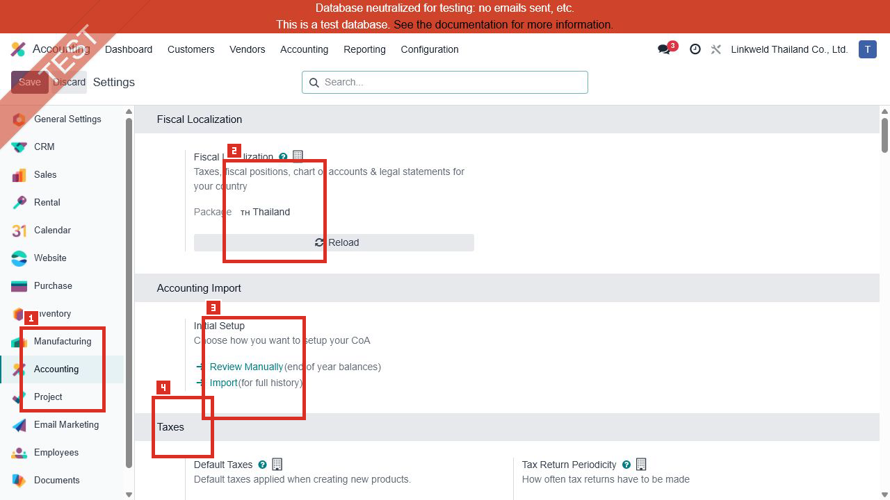

| หมายเลข | ค่าปัจจุบัน | ความหมายและผลเมื่อใช้ค่านี้ | หากเปลี่ยน | หลักฐาน |
|---|---|---|---|---|
| 1 | Accounting ถูกเลือกในแถบซ้าย | ยืนยันว่าภาพนี้เป็น Settings ภายใต้ Accounting ไม่ใช่ General Settings ของแอปอื่น | ไม่มีผลทางบัญชี เป็นเพียงบริบทการนำทาง | Confirmed |
| 2 | Package = Thailand | โหลดโครงสร้างบัญชี ภาษี รายงาน และพฤติกรรมตาม Fiscal Localization ประเทศไทยที่ติดตั้งอยู่ | Odoo ระบุว่าเปลี่ยนแพ็กเกจได้เฉพาะก่อนมีรายการบัญชีที่ Post แล้ว การเปลี่ยนในฐานข้อมูลที่ใช้งานจึงเป็น High Risk | Confirmed / Risk |
| 3 | Initial Setup แสดง Review Manually และ Import | เป็นทางเลือกสำหรับตั้งยอดยกมา/ประวัติการบัญชี ไม่ใช่ค่าที่ต้องกดในงานประจำ | การกดอาจเปิดขั้นตอนนำเข้าข้อมูลและเขียนรายการ จึงห้ามใช้ในรอบ Read-only | Confirmed / Risk |
| 4 | Taxes section | จุดเริ่มของนโยบายภาษีระดับบริษัท | การเปลี่ยนค่าด้านล่างอาจกระทบเอกสารใหม่ รายงานภาษี และวิธีปัดเศษ | Confirmed |

ผลที่ต้องตรวจต่อ:

- ตรวจ Chart of Accounts, Taxes, Tax Grids และรายงานไทยจากเมนู Configuration โดยเปิดเฉพาะข้อมูลเดิม
- ยืนยันกับฝ่ายบัญชีว่าแพ็กเกจ Thailand และผังบัญชีปัจจุบันเป็นชุดที่อนุมัติใช้จริง

อ้างอิง: [Odoo 18 Fiscal localizations](https://www.odoo.com/documentation/18.0/applications/finance/fiscal_localizations.html)

---

## ภาพ 2: Taxes

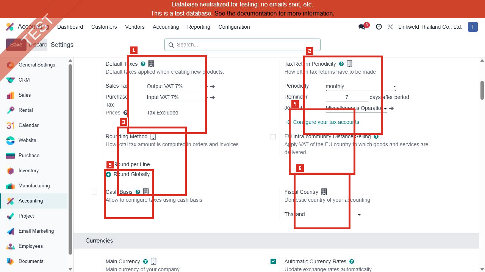

| หมายเลข | ค่าปัจจุบัน | ความหมายและผลเมื่อใช้ค่านี้ | หากเปลี่ยน | หลักฐาน |
|---|---|---|---|---|
| 1 | Sales Tax = Output VAT 7%; Purchase Tax = Input VAT 7%; Prices = Tax Excluded | ภาษีขายและภาษีซื้อ 7% ถูกเสนอเป็นค่าเริ่มต้นเมื่อสร้างสินค้าใหม่ ราคาเริ่มต้นถูกตีความว่าไม่รวมภาษี | กระทบค่าเริ่มต้นของสินค้า/บรรทัดใหม่ ไม่ควรใช้แทนการกำหนดภาษีเฉพาะสินค้า และต้องทดสอบ Fiscal Position/WHT แยก | Confirmed / Partially Confirmed |
| 2 | Periodicity = monthly; Reminder = 7 days; Journal = Miscellaneous Operations | รอบรายงานภาษีเป็นรายเดือน เตือนก่อน/หลังตามกลไกของ Odoo และใช้ Journal นี้กับการปิดรอบภาษี | เปลี่ยนรอบหรือ Journal อาจกระทบขั้นตอนยื่นภาษีและ Closing Entry ต้องให้ Accounting Owner อนุมัติ | Confirmed / Risk |
| 3 | Rounding Method = Round Globally | Odoo รวมฐาน/ยอดภาษีทั้งเอกสารก่อนปัดเศษ แทนการปัดทีละบรรทัด | ยอดภาษีรวมอาจต่างจาก Round per Line เล็กน้อย จึงต้องเทียบใบกำกับภาษีและรายงานไทยก่อนเปลี่ยน | Confirmed / Risk |
| 4 | EU Intra-community Distance Selling = Off | ไม่เปิดกฎ VAT สำหรับการขายระยะไกลภายในสหภาพยุโรป ซึ่งสอดคล้องกับบริษัทไทยหากไม่มีขอบเขตธุรกิจดังกล่าว | เปิดเฉพาะเมื่อมีข้อกำหนด EU ที่ผ่านการวิเคราะห์ภาษีแล้ว | Confirmed |
| 5 | Cash Basis = Off | ภาษีไม่ได้ใช้กลไกรับรู้เมื่อรับ/จ่ายเงินจาก setting นี้ | หากเปิด Odoo จะสร้างรายการภาษีเพิ่มเติมเมื่อ Reconcile การชำระเงิน ต้องยืนยันข้อกฎหมายและบัญชีพักภาษี | Confirmed / Risk |
| 6 | Fiscal Country = Thailand | กำหนดประเทศทางบัญชีของบริษัทเป็นประเทศไทย | มีผลต่อพฤติกรรม localization และไม่ควรเปลี่ยนโดยไม่มีแผน migration | Confirmed / Risk |

ผลหลังตั้งค่าที่คาด:

- เมื่อสร้างสินค้าใหม่ ระบบจะเสนอ Output VAT 7% และ Input VAT 7%
- เอกสารที่ใช้ภาษีจะสร้าง Tax Journal Items และ Tax Grids ตามตัวภาษีที่เลือก
- การยืนยันผลจริงของ Linkweld ต้องเปิดสินค้าและ Invoice/Bill เดิมโดยไม่แก้ไขในขั้น Transaction Trace

อ้างอิง: [Odoo 18 Taxes](https://www.odoo.com/documentation/18.0/applications/finance/accounting/taxes.html), [Odoo 18 Tax return](https://www.odoo.com/documentation/18.0/applications/finance/accounting/reporting/tax_returns.html)

---

## ภาพ 3: Currencies และจุดเริ่ม Customer Invoices

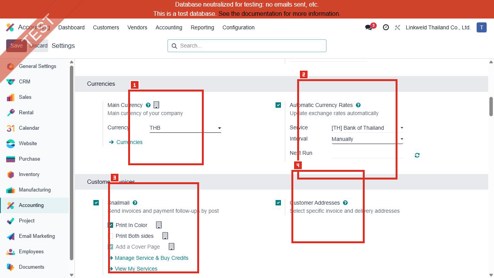

| หมายเลข | ค่าปัจจุบัน | ความหมายและผลเมื่อใช้ค่านี้ | หากเปลี่ยน | หลักฐาน |
|---|---|---|---|---|
| 1 | Main Currency = THB | รายการบัญชีหลักและรายงานบริษัทคำนวณเป็นบาท รายการสกุลอื่นจะเก็บทั้งสกุลเอกสารและมูลค่าเทียบ THB | การเปลี่ยนสกุลหลักในระบบที่มีรายการแล้วเป็น High Risk และต้องทำผ่านแผน migration เท่านั้น | Confirmed / Risk |
| 2 | Automatic Currency Rates = On; Service = [TH] Bank of Thailand; Interval = Manually; Next Run ว่าง | มีบริการอัตราแลกเปลี่ยนจาก Bank of Thailand แต่ตั้งรอบเป็น Manual จึงยังต้องสั่งอัปเดตเอง ไม่ได้ดึงอัตโนมัติตามวัน | หากเปลี่ยนเป็น Daily/Weekly/Monthly ระบบจะดึงอัตราตามรอบ ควรกำหนดเจ้าของข้อมูลและตรวจวัน cut-off | Confirmed / Risk |
| 3 | Snailmail = On; Print In Color = On; Print Both sides = Off; Add a Cover Page = On แต่ขึ้นกับบริการ | เปิดความสามารถส่งเอกสารทางไปรษณีย์และตัวเลือกพิมพ์ตามที่เห็น บริการอาจใช้เครดิต | เปลี่ยนมีผลต่อวิธีส่ง/ต้นทุนบริการ ไม่เปลี่ยน Posting ของบัญชีโดยตรง | Confirmed / Partially Confirmed |
| 4 | Customer Addresses = On | เอกสารลูกค้าสามารถเลือก Invoice Address และ Delivery Address แยกกัน | ปิดแล้วการเลือกที่อยู่เฉพาะบนเอกสารอาจหายไป ต้องทดสอบกับ flow Sales/Delivery | Confirmed / Inferred |

ข้อสังเกตสำคัญ:

- ชื่อ “Automatic Currency Rates” ไม่ได้หมายความว่าระบบอัปเดตตามเวลาเสมอ เพราะ Interval ปัจจุบันเป็น `Manually`
- ต้องตรวจวันที่อัตราล่าสุดใน Configuration > Currencies และรายการสกุลต่างประเทศเดิมก่อน Go-live

อ้างอิง: [Odoo 18 Multi-currency system](https://www.odoo.com/documentation/18.0/applications/finance/accounting/get_started/multi_currency.html)

---

## ภาพ 4: Customer Invoice Options

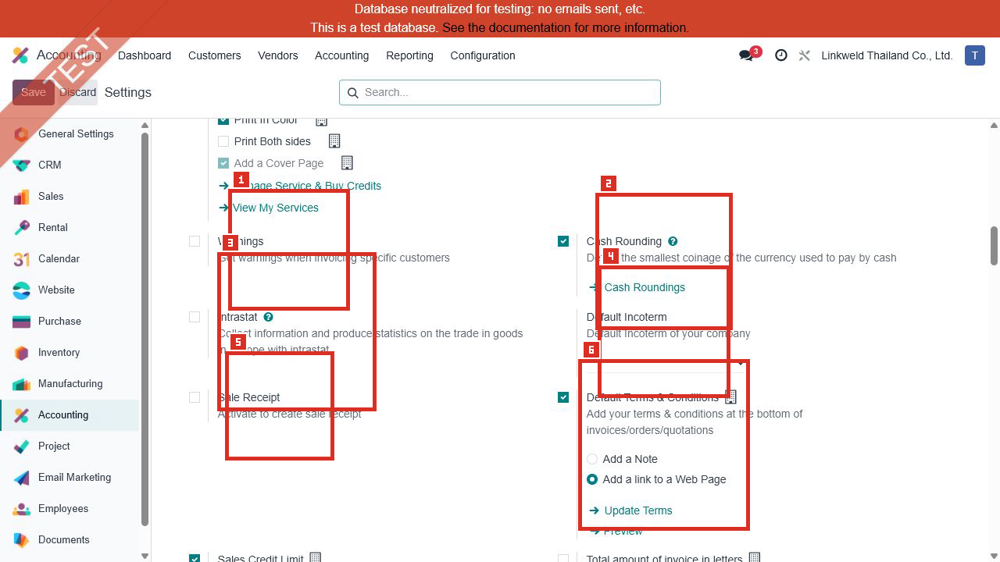

| หมายเลข | ค่าปัจจุบัน | ความหมายและผลเมื่อใช้ค่านี้ | หากเปลี่ยน | หลักฐาน |
|---|---|---|---|---|
| 1 | Warnings = Off | ไม่มีช่อง Warning เฉพาะลูกค้าสำหรับเตือนผู้ใช้ตอนออกเอกสารจาก setting นี้ | เปิดแล้วสามารถตั้งคำเตือน/ข้อความบล็อกตามลูกค้าได้ แต่ต้องกำหนดเจ้าของข้อความและ UAT | Confirmed / Inferred |
| 2 | Cash Rounding = On | เปิดเมนูและช่อง Cash Rounding Method บน Invoice เพื่อปัดยอดตามเหรียญ/หน่วยเงินสดที่กำหนด | การเปิดอย่างเดียวไม่ปัดทุก Invoice ต้องมี Cash Rounding Method และเลือกใช้บนเอกสาร | Confirmed / Partially Confirmed |
| 3 | Intrastat = Off | ไม่เก็บข้อมูลสถิติการค้าระหว่างประเทศของ EU จาก setting นี้ | เปิดเฉพาะเมื่อบริษัทมีข้อกำหนด Intrastat | Confirmed |
| 4 | Default Incoterm = ว่าง | ไม่มี Incoterm ระดับบริษัทถูกเสนอเป็นค่าเริ่มต้น | หากกำหนด เอกสารใหม่จะได้รับค่าเริ่มต้น แต่ยังต้องตรวจ Incoterm ตามสัญญาการขาย/ซื้อ | Confirmed / Partially Confirmed |
| 5 | Sale Receipt = Off | ไม่เปิด flow ใบเสร็จขายแบบง่ายจาก setting นี้ | เปิดแล้วมีเอกสาร/เมนูที่เกี่ยวข้องเพิ่ม ต้องแยกจาก Tax Invoice/Receipt ของไทยให้ชัด | Confirmed / Risk |
| 6 | Default Terms & Conditions = On; ใช้ Add a link to a Web Page | Quotation/Order/Invoice สามารถแสดงลิงก์ไปหน้า Terms & Conditions แทนข้อความยาวบนเอกสาร | ต้องตรวจ URL และเนื้อหาหน้าเว็บจริง รวมถึง version control ของเงื่อนไขก่อน Go-live | Confirmed / Partially Confirmed |

อ้างอิง: [Odoo 18 Cash rounding](https://www.odoo.com/documentation/18.0/applications/finance/accounting/customer_invoices/cash_rounding.html)

---

## ภาพ 5: Credit Control, Invoice Display และ Units of Measure

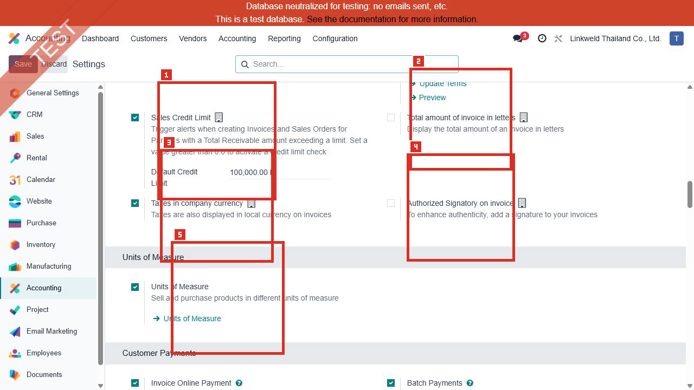

| หมายเลข | ค่าปัจจุบัน | ความหมายและผลเมื่อใช้ค่านี้ | หากเปลี่ยน | หลักฐาน |
|---|---|---|---|---|
| 1 | Sales Credit Limit = On; Default Credit Limit = 100,000.00 THB | ระบบคำนวณยอดลูกหนี้รวมเทียบวงเงินและแสดงคำเตือนใน Sales/Invoice ตาม flow มาตรฐาน | วงเงินระดับบริษัทเป็นค่าเริ่มต้น ต้องตรวจวงเงินเฉพาะลูกค้าและนิยามยอดค้างที่ฝ่ายเครดิตใช้จริง | Confirmed / Partially Confirmed |
| 2 | Total amount of invoice in letters = Off | Invoice ไม่แสดงยอดรวมเป็นตัวอักษรจาก setting นี้ | เปิดแล้วรูปแบบรายงานจะเพิ่มยอดเป็นคำ ต้องตรวจภาษาและแบบฟอร์มไทย | Confirmed / Inferred |
| 3 | Taxes in company currency = On | Invoice สกุลต่างประเทศสามารถแสดงยอดภาษีเทียบสกุลบริษัท THB | ควรคงไว้หากฝ่ายภาษีต้องอ้างยอด THB แต่ต้องตรวจอัตราและวันที่ที่รายงานใช้ | Confirmed / Partially Confirmed |
| 4 | Authorized Signatory on invoice = Off | แบบฟอร์ม Invoice ไม่มีลายเซ็นผู้มีอำนาจจากฟังก์ชันนี้ | เปิดแล้วต้องกำหนดผู้ลงนาม ภาพลายเซ็น และการควบคุมสิทธิ์/แบบฟอร์ม | Confirmed / Risk |
| 5 | Units of Measure = On | ซื้อและขายสินค้าได้ต่างหน่วย โดย Odoo แปลงภายใน UoM Category เดียวกัน | เปลี่ยน/ปิดอาจกระทบการมองเห็นเมนูและ flow แต่ข้อมูลเดิมยังต้องตรวจ conversion อย่างระมัดระวัง | Confirmed / Risk |

จุด UAT:

- ตรวจว่าคำเตือน Credit Limit เป็น Warning หรือ Blocking ตาม flow จริงของ Linkweld
- ตรวจ Conversion ของ UoM ใน Purchase, Inventory, Manufacturing และ Accounting Valuation จากรายการเดิม

---

## ภาพ 6: Customer Payments และ Vendor Bills

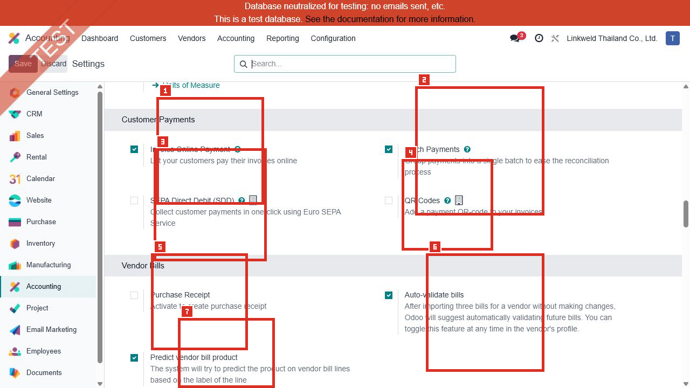

| หมายเลข | ค่าปัจจุบัน | ความหมายและผลเมื่อใช้ค่านี้ | หากเปลี่ยน | หลักฐาน |
|---|---|---|---|---|
| 1 | Invoice Online Payment = On | Portal/Invoice สามารถเสนอการชำระออนไลน์เมื่อมี Payment Provider ที่เปิดและกำหนดครบ | setting นี้ไม่ยืนยันว่าผู้ให้บริการใดพร้อมใช้งาน ต้องตรวจ provider และ journal เพิ่ม | Confirmed / Partially Confirmed |
| 2 | Batch Payments = On | รวม Payments หลายรายการเป็น Batch เพื่อฝากเงิน สร้างไฟล์ หรือช่วย Reconciliation | การ Validate Batch เป็นธุรกรรมเขียนข้อมูล จึงทดสอบได้เฉพาะจาก Batch เดิมในรอบ Read-only | Confirmed / Partially Confirmed |
| 3 | SEPA Direct Debit (SDD) = Off | ไม่มี flow เก็บเงินลูกค้าด้วย SEPA Direct Debit | เหมาะกับไทยหากไม่ได้ใช้ SEPA; ไม่ควรเปิดโดยไม่มี mandate/bank requirement | Confirmed |
| 4 | QR Codes = Off | Invoice ไม่เพิ่ม Payment QR Code จาก setting มาตรฐานนี้ | ต้องแยกจากโมดูล PromptPay/Thai QR ที่อาจติดตั้งอยู่ การปิดจุดนี้ไม่ได้ยืนยันว่า QR ไทยใช้งานไม่ได้ | Confirmed / Risk |
| 5 | Purchase Receipt = Off | ไม่เปิดเอกสาร Purchase Receipt จาก setting นี้ | หากเปิด ต้องแยกหน้าที่และเลขที่เอกสารจาก Vendor Bill/Receipt ทางภาษี | Confirmed / Risk |
| 6 | Auto-validate bills = On | หลังนำเข้าบิลเดิมจาก Vendor ซ้ำหลายครั้งโดยไม่แก้ Odoo อาจเสนอให้เปิดการยืนยันอัตโนมัติระดับ Vendor | ไม่ได้หมายความว่าทุกบิลจะ Post ทันที ต้องตรวจค่า Auto-post bills ของ Vendor เดิม | Confirmed / Partially Confirmed |
| 7 | Predict vendor bill product = On | Odoo พยายามเดา Product ของบรรทัด Bill จากข้อความ Label และประวัติเดิม | ผู้ใช้ยังต้องตรวจ Product, Account, Tax, Quantity และราคา ไม่ควรถือว่าการเดาถูกต้องเสมอ | Confirmed / Partially Confirmed |

อ้างอิง: [Odoo 18 Batch payments](https://www.odoo.com/documentation/18.0/applications/finance/accounting/payments/batch.html), [Odoo 18 Vendor bills](https://www.odoo.com/documentation/18.0/applications/finance/accounting/vendor_bills.html)

---

## ภาพ 7: Vendor Payments และ Digitization

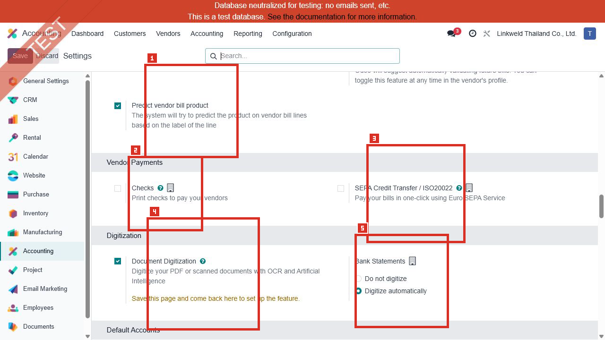

| หมายเลข | ค่าปัจจุบัน | ความหมายและผลเมื่อใช้ค่านี้ | หากเปลี่ยน | หลักฐาน |
|---|---|---|---|---|
| 1 | Predict vendor bill product = On | ภาพต่อเนื่องจากภาพ 6 เพื่อยืนยันสถานะของการคาดเดา Product | ผลจริงต้องตรวจ Bill เดิมที่มาจาก Upload/OCR | Confirmed / Partially Confirmed |
| 2 | Checks = Off | ไม่เปิด flow พิมพ์เช็คมาตรฐานสำหรับจ่าย Vendor | Linkweld อาจใช้โมดูลเช็คเฉพาะที่ติดตั้งอยู่ ต้องตรวจเมนูและ Payment Method แยก | Confirmed / Risk |
| 3 | SEPA Credit Transfer / ISO20022 = Off | ไม่เปิดการจ่าย Vendor ด้วยไฟล์ SEPA มาตรฐาน | ไม่ควรเปิดหากธนาคารไทยไม่ได้ใช้ format นี้; Solution ไทยต้องตรวจไฟล์ธนาคารที่ต้องการจริง | Confirmed |
| 4 | Document Digitization = On | เปิด OCR/AI สำหรับอ่าน PDF หรือภาพและเติม Vendor Bill/Refund | เป็นบริการ IAP ที่ใช้เครดิต ผู้ใช้ต้อง Review ก่อน Confirm และไม่ควรพึ่ง OCR โดยไม่มี control | Confirmed / Partially Confirmed |
| 5 | Bank Statements = Digitize automatically | เอกสาร Bank Statement ที่เข้ากระบวนการ Digitization ถูกตั้งให้ประมวลผลอัตโนมัติ | ต้องตรวจการใช้เครดิต ความแม่นยำ และสิทธิ์ผู้ตรวจ Bank ก่อนนำเข้า/กระทบ Reconciliation | Confirmed / Risk |

อ้างอิง: [Odoo 18 Document digitization](https://www.odoo.com/documentation/18.0/applications/finance/accounting/vendor_bills/invoice_digitization.html)

---

## ภาพ 8: Default Accounts

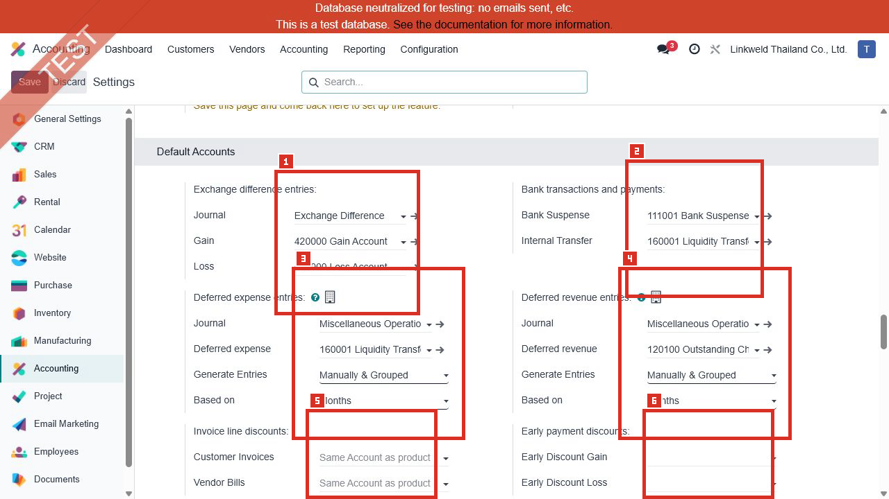

| หมายเลข | ค่าปัจจุบัน | ความหมายและผลเมื่อใช้ค่านี้ | หากเปลี่ยน | หลักฐาน |
|---|---|---|---|---|
| 1 | Exchange Difference Journal = Exchange Difference; Gain = 420000 Gain Account; Loss = 571000 Loss Account | เมื่อ Reconcile รายการสกุลต่างประเทศต่างอัตรา Odoo ใช้ Journal และบัญชีกำไร/ขาดทุนนี้ | ต้องตรวจ Account Type, สกุลเงิน และตัวอย่าง Journal Entry เดิมก่อนอนุมัติ | Confirmed / Partially Confirmed |
| 2 | Bank Suspense = 111001 Bank Suspense Account; Internal Transfer = 160001 Liquidity Transfer | Bank Suspense รองรับรายการธนาคารที่ยังไม่ Reconcile; Internal Transfer ใช้เป็นบัญชีคั่นกลางระหว่างบัญชีสภาพคล่อง | ต้อง Reconcile ให้บัญชีพักกลับเป็นศูนย์ตามรอบ และยืนยัน account type/reconcile flag | Confirmed / Partially Confirmed |
| 3 | Deferred Expense Journal = Miscellaneous Operations; Account = 160001 Liquidity Transfer; Generate Entries = Manually & Grouped; Based on = Months | ค่าใช้จ่ายรอตัดบัญชีจะถูกรวมและให้ผู้ใช้ Generate จากรายงานตามเดือน แทนการสร้างทุกรายการตอนยืนยัน Bill | บัญชี Deferred Expense ตาม Odoo ควรเป็น Current Asset/Prepayment; ชื่อ Liquidity Transfer จึงเป็นจุดเสี่ยงที่ต้องตรวจ Account Type และนโยบาย | Confirmed / Risk |
| 4 | Deferred Revenue Journal = Miscellaneous Operations; Account = 120100 Outstanding Cheques; Generate Entries = Manually & Grouped; Based on = Months | รายได้รอรับรู้จะถูกรวมและ Generate จากรายงานตามเดือน | บัญชี Deferred Revenue ตาม Odoo ควรเป็น Current Liability; ชื่อ Outstanding Cheques จึงเป็นจุดเสี่ยงที่ต้องตรวจ Account Type และนโยบาย | Confirmed / Risk |
| 5 | Invoice line discounts: Customer Invoices และ Vendor Bills ว่าง โดยแสดง Same Account as product | ส่วนลดระดับบรรทัดใช้บัญชีเดียวกับสินค้าในสภาพปัจจุบัน | หากกำหนดบัญชีเฉพาะ ส่วนลดจะถูกแยกลงบัญชี ต้องทดสอบรายงาน Gross/Net และภาษี | Confirmed / Risk |
| 6 | Early Discount Gain/Loss ว่าง | ไม่มีบัญชีกำไร/ขาดทุน Early Payment Discount ระดับบริษัทกำหนดในสองช่องนี้ | หากใช้ Cash Discount/Tax Reduction ต้องกำหนดบัญชีและทดสอบการ Reconcile ให้ครบ | Confirmed / Risk |

### จุดเสี่ยงที่ต้องยืนยันก่อน Go-live

1. `160001 Liquidity Transfer` ใช้เป็นทั้ง Internal Transfer และ Deferred Expense
2. `120100 Outstanding Cheques` ใช้เป็น Deferred Revenue
3. ต้องตรวจ Account Type และ Journal Entries เดิมก่อนตัดสินว่า Mapping ถูกหรือผิด
4. ห้ามแก้บัญชี Default หลัง Go-live โดยไม่มี Regression Test ด้าน Invoice, Bill, Payment, Deferred Report และ Financial Statements

อ้างอิง: [Odoo 18 Multi-currency system](https://www.odoo.com/documentation/18.0/applications/finance/accounting/get_started/multi_currency.html), [Odoo 18 Deferred expenses](https://www.odoo.com/documentation/18.0/applications/finance/accounting/vendor_bills/deferred_expenses.html), [Odoo 18 Deferred revenues](https://www.odoo.com/documentation/18.0/applications/finance/accounting/customer_invoices/deferred_revenues.html)

---

## ภาพ 9: Stock Valuation

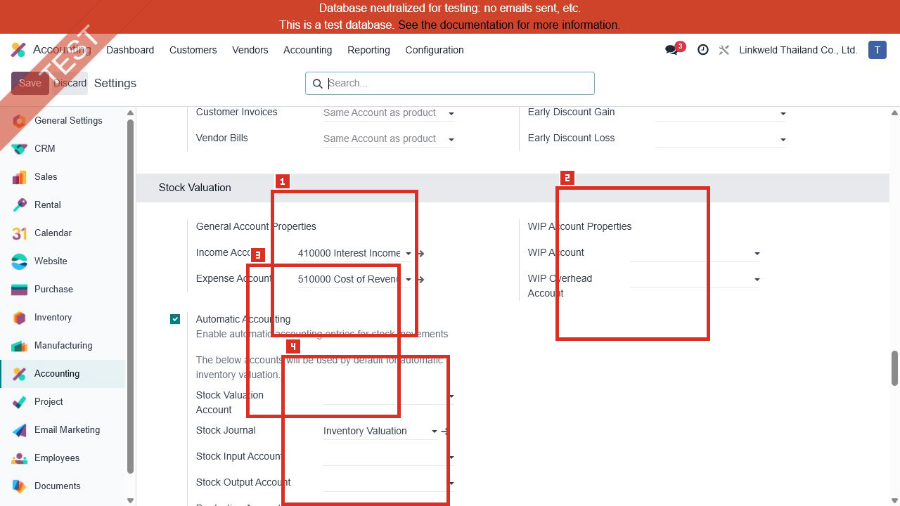

| หมายเลข | ค่าปัจจุบัน | ความหมายและผลเมื่อใช้ค่านี้ | หากเปลี่ยน | หลักฐาน |
|---|---|---|---|---|
| 1 | Income Account = 410000 Interest Income / ดอกเบี้ยรับ; Expense Account = 510000 Cost of Revenue / ต้นทุนขาย | เป็นค่า Default ด้านบัญชีสินค้าเมื่อระดับ Product/Product Category ไม่ได้ Override | Income Account ชื่อ Interest Income ดูไม่สอดคล้องกับรายได้จากการขายสินค้า จึงต้องตรวจ Category/Product และ Journal Entry เดิมก่อนสรุป | Confirmed / Risk |
| 2 | WIP Account และ WIP Overhead Account = ว่าง | ไม่มีค่า WIP ระดับบริษัทในหน้าจอนี้ | หาก Manufacturing ใช้ WIP/Overhead Posting ต้องตรวจว่ากำหนดจาก Product Category, Work Center หรือโมดูลเฉพาะที่อื่นหรือไม่ | Confirmed / Risk |
| 3 | Automatic Accounting = On | เปิดความสามารถสร้าง Journal Entry จาก Stock Valuation ของ Product Category ที่ตั้งเป็น Automated | การเปิดไม่ได้ทำให้ทุก Category เป็น Automated ต้องตรวจ Costing Method และ Inventory Valuation ของ Category ทีละชุด | Confirmed / Partially Confirmed |
| 4 | Stock Valuation Account = ว่าง; Stock Journal = Inventory Valuation; Stock Input = ว่าง; Stock Output = ว่าง; Production = ว่าง | หน้าบริษัทมี Journal แต่ Default Accounts หลายช่องว่าง ระบบอาจพึ่งค่าที่ Product Category | ห้ามเติมบัญชีทันที ต้องตรวจ Category ปัจจุบันและรายการ Stock Valuation เดิมเพื่อหลีกเลี่ยงรายการซ้ำหรือ Mapping ผิด | Confirmed / Risk |

ผลหลังตั้งค่าที่คาด:

- Category ที่ใช้ Automated Valuation จะสร้าง Stock Valuation Layer และ Journal Entry เมื่อมี Stock Move
- Stock Input/Output เป็นบัญชีพักรับเข้า/จ่ายออก ส่วน Stock Valuation เก็บมูลค่าสินค้าคงเหลือ
- Linkweld ต้อง Reconcile Stock Valuation Report กับ General Ledger และตรวจ FIFO/AVCO/Standard Price ตาม Category

อ้างอิง: [Odoo 18 Automatic inventory valuation](https://www.odoo.com/documentation/18.0/applications/inventory_and_mrp/inventory/product_management/inventory_valuation/inventory_valuation_config.html)

---

## ภาพ 10: Stock Accounts ต่อเนื่อง, Bank & Cash และ Fiscal Year

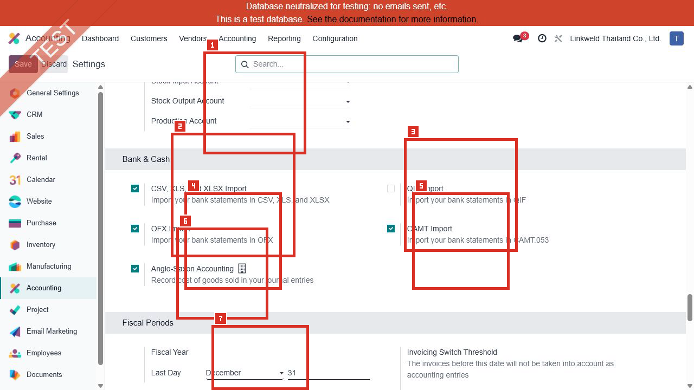

| หมายเลข | ค่าปัจจุบัน | ความหมายและผลเมื่อใช้ค่านี้ | หากเปลี่ยน | หลักฐาน |
|---|---|---|---|---|
| 1 | Stock Input, Stock Output และ Production Account ว่าง | ยืนยันภาพต่อเนื่องว่าค่าระดับบริษัทไม่ได้กรอก | ต้องตรวจ Product Categories และ Manufacturing Accounting ก่อนกำหนด Default | Confirmed / Risk |
| 2 | CSV, XLS, XLSX Import = On | สามารถนำเข้า Bank Statement จากไฟล์ตารางที่รองรับ | การ Import เป็นการสร้าง Bank Transactions จึงห้ามทดลองในรอบ Read-only; ต้องใช้ไฟล์ทดสอบที่อนุมัติใน UAT ภายหลัง | Confirmed / Risk |
| 3 | QIF Import = Off | ไม่มีตัวเลือก Import QIF | เปิดเฉพาะเมื่อธนาคารส่ง QIF และมี mapping ผ่านการทดสอบ | Confirmed |
| 4 | OFX Import = On | เปิดตัวเลือก Import OFX | ต้องตรวจ format/date/duplicate detection กับไฟล์ธนาคารจริงใน UAT | Confirmed / Partially Confirmed |
| 5 | CAMT Import = On | เปิดตัวเลือก Import CAMT.053 | ต้องตรวจ version ของ CAMT ที่ธนาคารไทยส่งและ reconciliation key | Confirmed / Partially Confirmed |
| 6 | Anglo-Saxon Accounting = On | ต้นทุนขายใช้ flow Anglo-Saxon โดยเชื่อม Stock Interim กับ Invoice/Bill และการรับรู้ COGS ตามกลไกนี้ | เป็น Accounting Policy สำคัญ ต้องยืนยันกับ CFO/Auditor และทดสอบ Receipt, Delivery, Invoice, Bill, Return และ Landed Cost | Confirmed / Risk |
| 7 | Fiscal Year Last Day = December 31 | ปีบัญชีสิ้นสุด 31 ธันวาคม | เปลี่ยนมีผลต่อ Reporting/Closing Period ต้องได้รับอนุมัติและตรวจข้อกฎหมาย | Confirmed / Risk |

อ้างอิง: [Odoo 18 Automatic inventory valuation](https://www.odoo.com/documentation/18.0/applications/inventory_and_mrp/inventory/product_management/inventory_valuation/inventory_valuation_config.html), [Odoo 18 Year-end closing](https://www.odoo.com/documentation/18.0/applications/finance/accounting/reporting/year_end.html)

---

## ภาพ 11: Fiscal Periods, Analytics และ Reporting

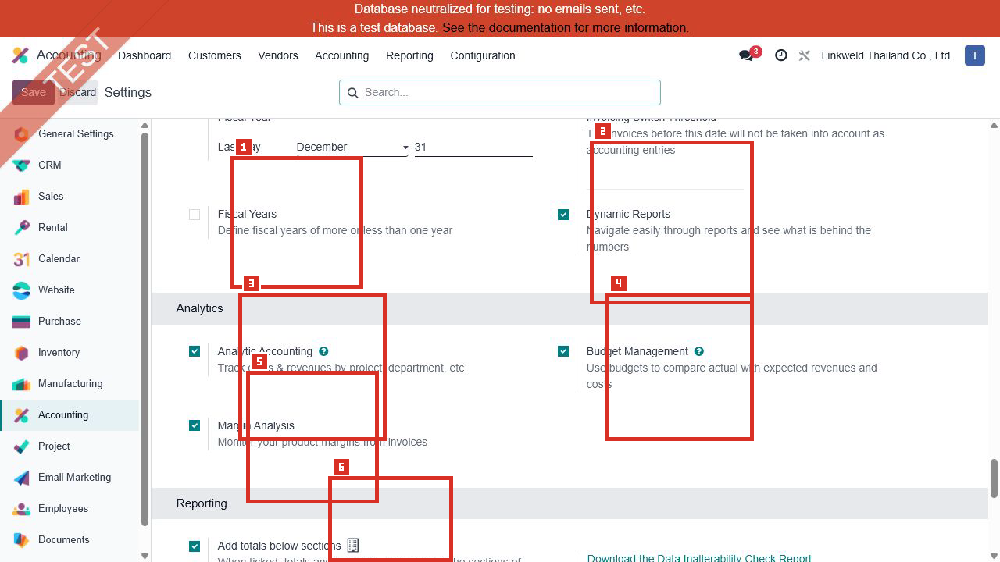

| หมายเลข | ค่าปัจจุบัน | ความหมายและผลเมื่อใช้ค่านี้ | หากเปลี่ยน | หลักฐาน |
|---|---|---|---|---|
| 1 | Fiscal Years = Off | ใช้ปีบัญชีมาตรฐาน 12 เดือนตามวันสิ้นปี 31 ธันวาคม ไม่เปิดปีบัญชีสั้น/ยาวพิเศษ | เปิดเมื่อมีงวดเปลี่ยนผ่านมากหรือน้อยกว่า 12 เดือน และต้องสร้าง Fiscal Year ที่มี Start/End Date | Confirmed / Risk |
| 2 | Dynamic Reports = On | รายงานรองรับ Drill-down จากยอดรวมไปยังรายการที่เกี่ยวข้อง | ปิดแล้วความสามารถเจาะดูรายละเอียดอาจลดลง ไม่เปลี่ยนยอดบัญชี | Confirmed / Inferred |
| 3 | Analytic Accounting = On | สามารถกระจายรายได้/ต้นทุนไป Analytic Accounts และ Plans | ต้องตรวจ Applicability ว่า Optional หรือ Mandatory และตรวจ Distribution Model | Confirmed / Partially Confirmed |
| 4 | Budget Management = On | เปิดการสร้าง/ติดตาม Budget เทียบ Actual | ต้องตรวจ Budget เดิม, Analytic Dimensions, วันที่ และผู้อนุมัติ | Confirmed / Partially Confirmed |
| 5 | Margin Analysis = On | เปิดการวิเคราะห์ Margin จาก Invoice/Product | Margin ที่ได้ขึ้นกับ Cost, Invoice และ Product Mapping จึงต้อง Reconcile กับ Manufacturing/Stock Cost | Confirmed / Partially Confirmed |
| 6 | Reporting: Add totals below sections = On | รายงานแสดง Total/Subtotal ด้านล่าง Section | เป็นรูปแบบรายงาน ไม่เปลี่ยน Posting | Confirmed |

อ้างอิง: [Odoo 18 Analytic accounting](https://www.odoo.com/documentation/18.0/applications/finance/accounting/reporting/analytic_accounting.html), [Odoo 18 Reporting](https://www.odoo.com/documentation/18.0/applications/finance/accounting/reporting.html)

---

## ภาพ 12: Reporting, Storno และ Accounting Firms Mode

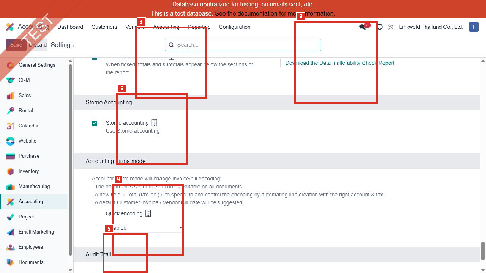

| หมายเลข | ค่าปัจจุบัน | ความหมายและผลเมื่อใช้ค่านี้ | หากเปลี่ยน | หลักฐาน |
|---|---|---|---|---|
| 1 | Add totals below sections = On | ภาพต่อเนื่องของรูปแบบ Total/Subtotal ในรายงาน | ไม่มีผลกับ Journal Entry | Confirmed |
| 2 | Download the Data Inalterability Check Report | เป็นคำสั่งดาวน์โหลดรายงานตรวจความต่อเนื่อง/ความไม่เปลี่ยนแปลงของรายการที่ถูก Secure ด้วย Hash | การดาวน์โหลดเป็น Read-only แต่การ Secure Entries เป็นการล็อกข้อมูลและอยู่นอกขอบเขตรอบนี้ | Confirmed / Risk |
| 3 | Storno accounting = On | เปิดนโยบาย Storno ของระบบตามโมดูลที่ติดตั้ง | ยังไม่ยืนยันผล Journal Entry ของ Linkweld ต้องเปิด Reversal เดิมและตรวจ Debit/Credit ก่อนอธิบายเป็นผลยืนยัน | Confirmed / Partially Confirmed |
| 4 | Accounting Firms mode: Quick encoding = Disabled | ไม่เปิด Quick Encoding สำหรับ Customer Invoice หรือ Vendor Bill | หากเปิด Odoo เพิ่มความสามารถกรอก Total (tax incl.), วันที่เสนออัตโนมัติ และความยืดหยุ่นในการ Encode เอกสาร ต้องจำกัดสิทธิ์และ UAT Sequence/Tax | Confirmed / Risk |
| 5 | Audit Trail section | จุดเริ่ม setting ที่มีผลถาวรเมื่อเปิด | ดูรายละเอียดภาพ 13 | Confirmed |

อ้างอิง: [Odoo 18 Data inalterability check report](https://www.odoo.com/documentation/18.0/applications/finance/accounting/reporting/data_inalterability.html), [Odoo 18 Accounting and Invoicing](https://www.odoo.com/documentation/18.0/applications/finance/accounting.html)

---

## ภาพ 13: Audit Trail

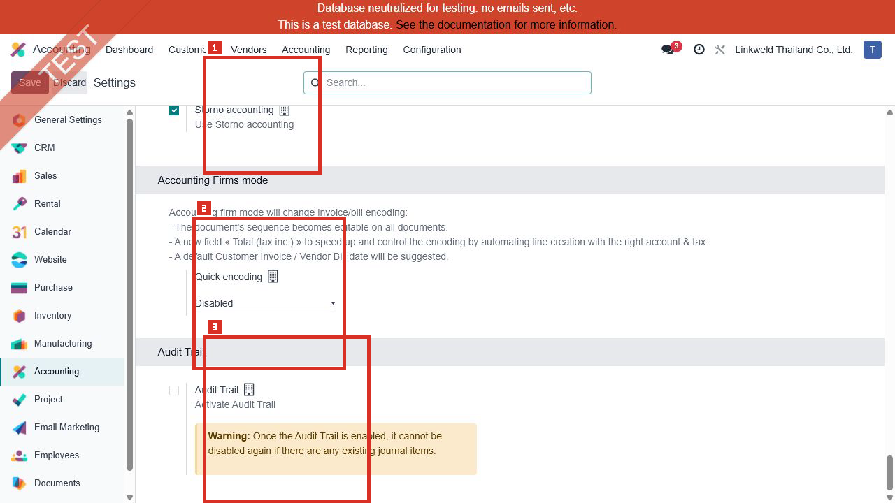

| หมายเลข | ค่าปัจจุบัน | ความหมายและผลเมื่อใช้ค่านี้ | หากเปลี่ยน | หลักฐาน |
|---|---|---|---|---|
| 1 | Storno accounting = On | ภาพต่อเนื่องเพื่อยืนยันสถานะ Storno | ต้องตามรายการ Reversal เดิมก่อนสรุปผล | Confirmed / Partially Confirmed |
| 2 | Quick encoding = Disabled | ไม่มี Accounting Firms Quick Encoding | หากเปิดจะเปลี่ยน UX และ control ของการ Encode Invoice/Bill | Confirmed / Risk |
| 3 | Audit Trail = Off | ขณะตรวจยังไม่เปิดรายงาน Audit Trail แบบ Immutable ของ Odoo | Odoo ระบุว่าเมื่อเปิดและมี Journal Items แล้วจะปิดกลับไม่ได้; ต้องอนุมัติโดย CFO/Auditor, สำรองข้อมูล และผ่าน UAT ก่อนเปิด | Confirmed / High Risk |

ผลหลังเปิด Audit Trail ตาม Odoo 18:

- เก็บรายงานการเปลี่ยนแปลงฟิลด์ที่มีผลต่อบัญชี พร้อมเวลา ผู้ใช้ ค่าเดิม และค่าใหม่
- Posted Journal Entries รวม Invoice/Bill จะไม่สามารถลบได้และใช้แนวทาง Cancel ตามที่ระบบรองรับ
- การตัดสินใจเปิดต้องเป็นนโยบายถาวร ไม่ใช่การทดลองใน Staging ที่จะเลียนแบบ Production โดยไม่มีแผน

อ้างอิง: [Odoo 18 Reporting and Audit Trail](https://www.odoo.com/documentation/18.0/applications/finance/accounting/reporting.html)

---

## Standard Odoo vs Pain Point

| หัวข้อ | Standard Odoo 18 | สภาพที่พบใน Linkweld | ข้อเสนอ |
|---|---|---|---|
| Fiscal Localization | ใช้ Package ประเทศตามนิติบุคคล | Thailand ถูกเลือก | คงไว้และตรวจ Thai Taxes/Reports ทีละเมนู |
| Tax Defaults | กำหนดภาษีเริ่มต้นระดับบริษัทและสินค้า | VAT 7%, Tax Excluded, Round Globally | ตรวจ Tax Grid, WHT และ Invoice/Bill เดิม |
| Currency Rates | รองรับ Manual หรือ Scheduled Update | BOT service แต่ Interval = Manually | กำหนดเจ้าของการอัปเดตและ SLA ก่อน Go-live |
| Deferred Accounts | Deferred Expense ควรเป็น Current Asset; Deferred Revenue ควรเป็น Current Liability | ใช้ Liquidity Transfer และ Outstanding Cheques | ตรวจ Account Type และ Journal Entry เดิมโดยด่วน |
| Inventory Valuation | Company defaults สามารถถูก Override ที่ Product Category | Automatic Accounting On แต่บัญชี Default หลายช่องว่าง | ตรวจทุก Category ที่มี Stock/MRP และ Reconcile GL |
| Manufacturing WIP | รองรับบัญชี WIP/Overhead ตาม configuration ที่เกี่ยวข้อง | WIP fields ว่าง | ตรวจ MO เดิม, Product Category และโมดูล Manufacturing Accounting |
| Auditability | Audit Trail และ Data Inalterability รองรับการตรวจสอบ | Audit Trail Off; Storno On | ให้ CFO/Auditor ตัดสินใจหลัง UAT |

## รายการ UAT ขั้นต่ำจากบทนี้

| UAT ID | กรณีทดสอบโดยใช้ข้อมูลเดิม | ผลที่ต้องตรวจ | สถานะ |
|---|---|---|---|
| UAT-ACC-001-01 | เปิด Product เดิมที่ใช้ VAT 7% | Sales/Purchase Taxes และ Fiscal Position | Pending |
| UAT-ACC-001-02 | เปิด Invoice/Bill เดิมที่มีหลายบรรทัด | Round Globally, Tax Grids และยอดรายงานภาษี | Pending |
| UAT-ACC-001-03 | เปิดเอกสารสกุลต่างประเทศและ Payment/Reconciliation เดิม | Rate, THB equivalent, Exchange Gain/Loss Journal | Pending |
| UAT-ACC-001-04 | เปิด Deferred Expense/Revenue Report เดิม | Journal, Account Type, Manual & Grouped entries | Pending |
| UAT-ACC-001-05 | เปิด Stock Receipt/Delivery และ Valuation เดิม | Stock Valuation Layer, Input/Output/Valuation Accounts | Pending |
| UAT-ACC-001-06 | เปิด Manufacturing Order เดิม | Production/WIP/Overhead และ Costing impact | Pending |
| UAT-ACC-001-07 | เปิด Batch Payment/Bank Reconciliation เดิม | Outstanding/Suspense/Internal Transfer clearing | Pending |
| UAT-ACC-001-08 | เปิด Reversal เดิม | ผลของ Storno accounting ต่อ Debit/Credit | Pending |
| UAT-ACC-001-09 | ตรวจ Audit Trail decision | CFO/Auditor approval และ rollback limitation | Pending |

## สรุปสถานะ

- Accounting Settings ทั้งหน้าถูกเก็บภาพครบ 13 ภาพ
- ค่าปัจจุบัน 19 sections และ 60 setting boxes ถูกอ่านจากหน้าเดิมแบบ Read-only
- ยังไม่ถือว่าผลทาง Transaction ได้รับการยืนยันจนกว่าจะ Trace รายการเดิม
- ไม่มีการแก้ไขข้อมูล Odoo ระหว่างการจัดทำบทนี้
