# ACC-002 คู่มือ Accounting > Configuration > Payment Terms

- บริษัท: Linkweld (Thailand) Co., Ltd.
- ระบบ: Odoo 18 Enterprise Staging
- วันที่ตรวจ: 16 กรกฎาคม 2026
- วิธีตรวจ: Evidence-first Read-only
- สถานะบท: `Confirmed` สำหรับค่าที่อ่านจากหน้าจอและโมเดลแบบ Read-only; ผลต่อธุรกรรมเดิมยังเป็น `Partially Confirmed`

## ขอบเขตและข้อจำกัด

- เปิดเฉพาะเมนูและ Payment Terms ที่มีอยู่แล้ว ไม่สร้าง แก้ไข บันทึก Archive หรือลบข้อมูล
- ภาพในโฟลเดอร์ `original` เป็นภาพหน้าจอจริงที่ไม่ถูกแก้ไข ภาพใน `annotated` เป็นสำเนาที่เพิ่มวงกลมสีแดงและหมายเลขเท่านั้น
- ตรวจครบ 104 Payment Terms และ 107 Due Term lines ด้วยการอ่านข้อมูลเท่านั้น
- เปิดฟอร์มตัวอย่างเดิม 5 รูปแบบ: Immediate, ชื่อไม่ตรงกฎ, หลายงวด, Early Discount และ Company-specific
- ไม่ใช้ Developer Mode > Technical และไม่สร้าง Transaction เพื่อทดสอบ
- การตรวจชื่อกับกฎ 70 รายการเป็นการคัดกรองความเสี่ยง ไม่ใช่คำสั่งให้แก้ข้อมูล ต้องให้ Accounting และ Commercial Owner ยืนยันเป็นรายรายการ

## สรุปค่าที่พบ

| หัวข้อ | ค่าที่พบ | สถานะ/ความหมาย |
|---|---:|---|
| Active Payment Terms | 104 | Confirmed |
| Due Term lines | 107 | Confirmed |
| กฎ 1 บรรทัด: 100% ครบกำหนด 0 วันหลัง Invoice Date | 80 | Confirmed ทางเทคนิค |
| ชื่อมีแนวโน้มไม่ตรงกฎ 100% Immediate | 70 | Risk screening ต้องยืนยันกับเจ้าของนโยบาย |
| Payment Terms หลายงวด | 2 | Confirmed |
| Early Discount เปิด | 1 | Confirmed |
| Show installment dates เปิด | 2 | Confirmed |
| จำกัดเฉพาะ Linkweld Thailand | 2 | Confirmed |
| กลุ่มชื่อซ้ำแบบ Normalized | 2 กลุ่ม | Confirmed |

หลักฐานโครงสร้าง:

- [รายการ Payment Terms ทั้ง 104 รายการ](../evidence/accounting/ACC-002/ACC-002_payment_terms_dom_extract.json)
- [กฎ Due Terms ทั้ง 107 บรรทัด](../evidence/accounting/ACC-002/ACC-002_payment_terms_rules_extract.json)
- [ผลวิเคราะห์ชื่อเทียบกฎและรายการที่ต้องทบทวน](../evidence/accounting/ACC-002/ACC-002_payment_terms_analysis.json)

---

## ภาพ 1: หน้า Payment Terms และจำนวนรายการ

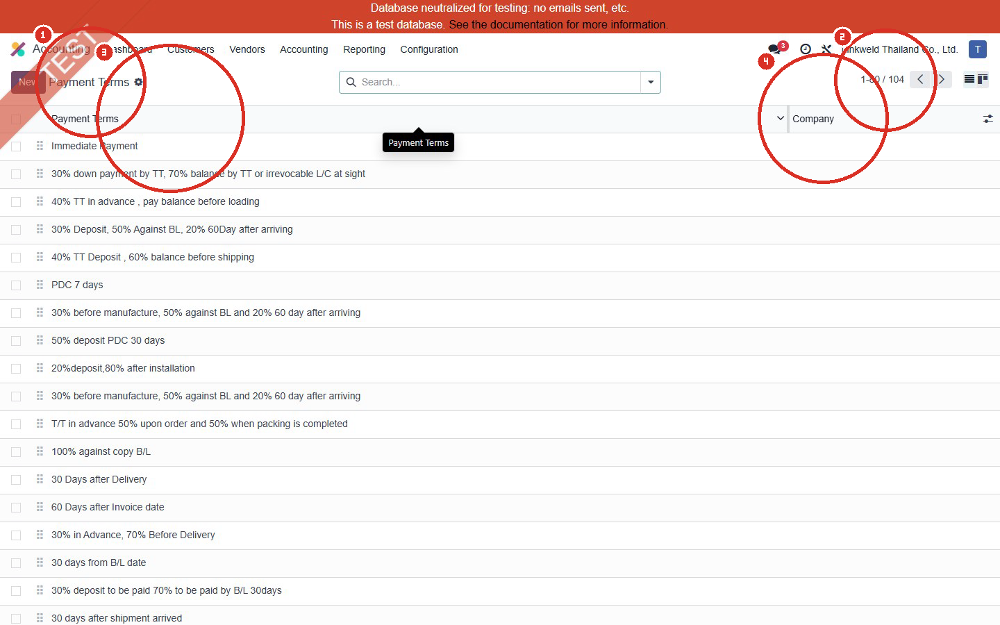

| หมายเลข | จุดบนหน้าจอ | ค่าปัจจุบันและผล |
|---|---|---|
| 1 | Accounting > Payment Terms | ยืนยันว่าอยู่ในเมนู Configuration ของ Accounting การกด New จะสร้าง Master Data จึงไม่ใช้ในรอบนี้ |
| 2 | Pager | แสดง `1-80 / 104` หน้าแรก และมีหน้าถัดไปอีก 24 รายการ |
| 3 | Payment Terms | ชื่อที่ผู้ใช้เห็นบน Contact, Sales Order, Invoice และ Vendor Bill ตามจุดที่ Odoo รองรับ ชื่อไม่ใช่ตัวคำนวณวันครบกำหนด กฎใน Due Terms เป็นตัวคำนวณจริง |
| 4 | Company | ว่างหมายถึงใช้ร่วมได้ตามบริบทหลายบริษัท; ถ้าระบุบริษัทจะจำกัดการใช้งานของเงื่อนไขนั้น ต้องตรวจสิทธิ์และ company context ก่อนเปลี่ยน |

ผลทางบัญชี:

- Payment Terms กำหนดวันครบกำหนดของลูกหนี้/เจ้าหนี้และจำนวนงวดที่ Odooสร้างบนรายการ Accounting
- มีผลต่อ Aged Receivable, Aged Payable, Cash Planning, Follow-up และจำนวนเงินงวดที่เสนอเมื่อชำระ
- ชื่อเพียงอย่างเดียวไม่รับประกันว่าระบบคำนวณตามข้อความในชื่อ

---

## ภาพ 2-4: รายการหน้าแรก 1-80 จาก 104

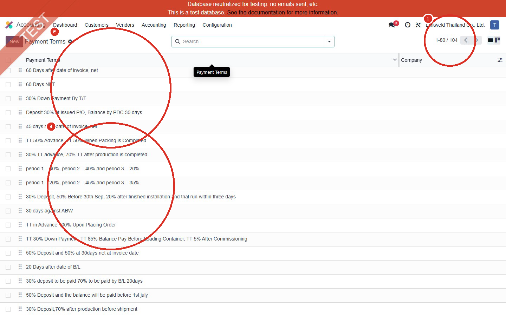

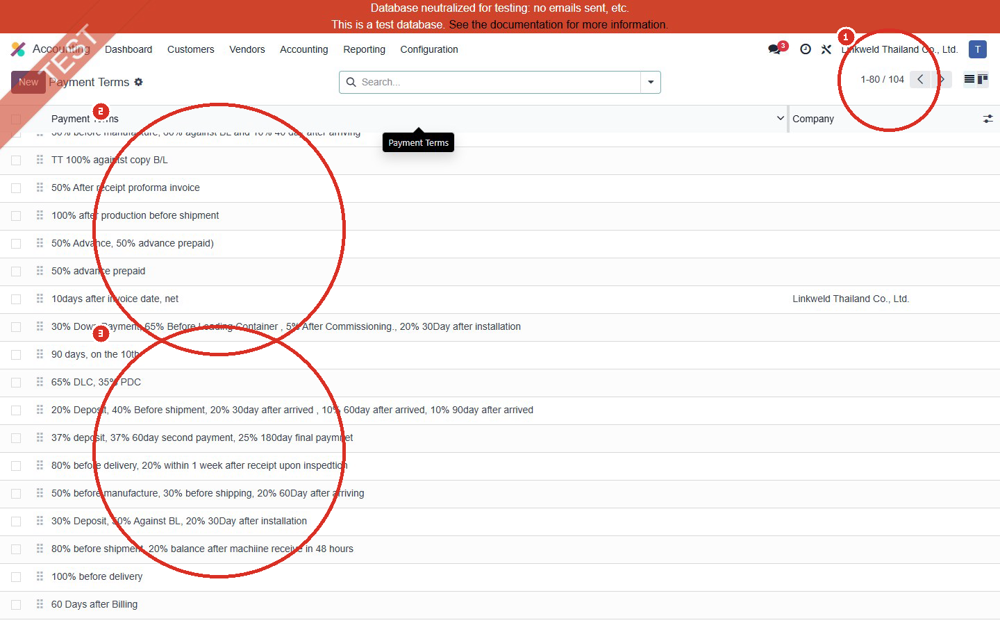

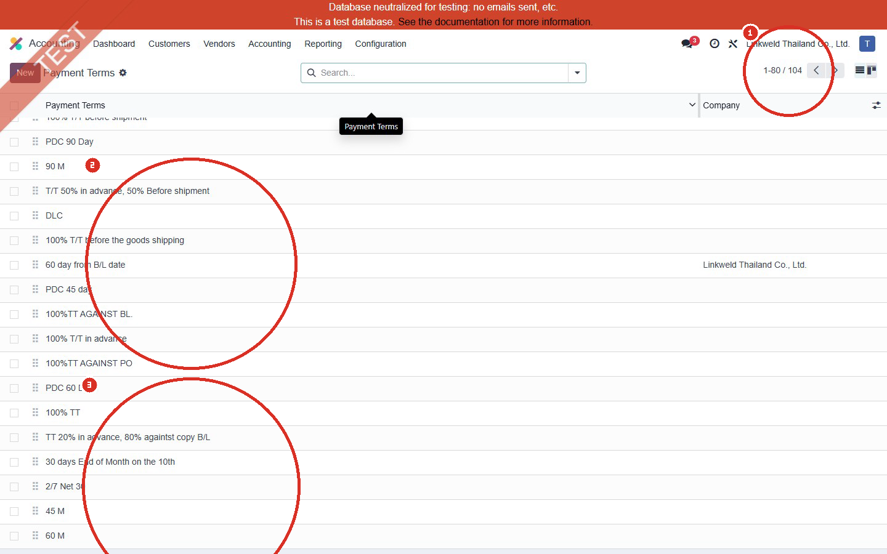

| หมายเลข | ความหมาย |
|---|---|
| 1 | Pager ยืนยันว่าภาพทั้งสามยังเป็นชุด `1-80 / 104` |
| 2 | ตัวอย่างชื่อที่อ้างถึงจำนวนวัน, Deposit, Balance, B/L, Shipment หรือ Installation ซึ่งต้องตรวจ Due Terms ภายใน ไม่ควรสรุปจากชื่อ |
| 3 | ตัวอย่างชื่อที่เป็นเงื่อนไขทางการค้าหลายเหตุการณ์ แต่บางรายการมีกฎจริงเพียง 100% วันที่ออก Invoice |

ข้อสังเกต:

- พบชื่อที่อ้างถึง PO, B/L, การผลิต, การส่งมอบ และการติดตั้งจำนวนมาก
- Odoo Payment Terms มาตรฐานคำนวณจาก Invoice Date และตัวเลือกปลายเดือน ไม่ได้ตรวจวันที่ B/L, Shipping, Installation หรือ Commissioning โดยอัตโนมัติ
- หากธุรกิจต้องออกหลาย Invoice ตาม milestone ควรออกแบบ Invoicing Policy/Down Payment/Milestone Invoice แยกจาก Payment Terms

---

## ภาพ 5-6: รายการหน้า 81-104 จาก 104

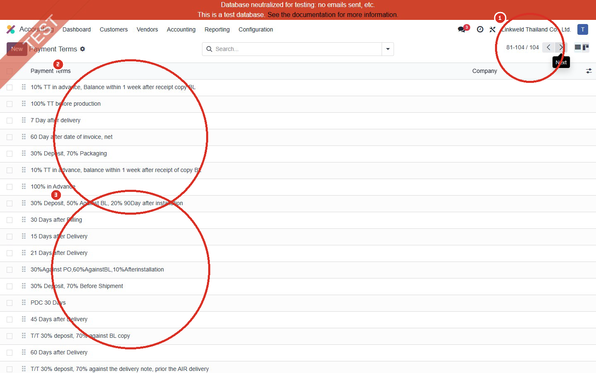

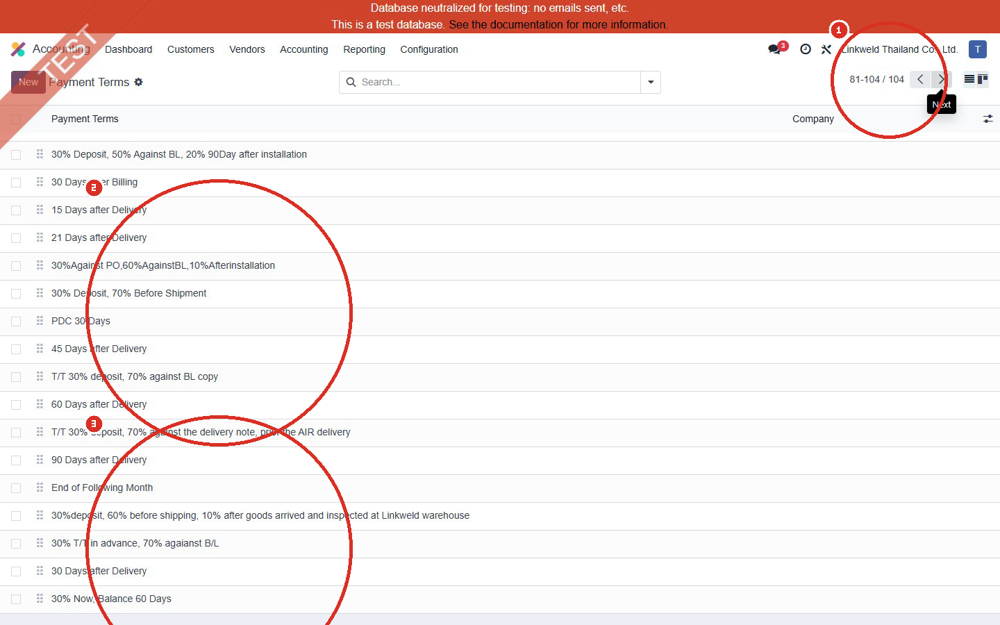

| หมายเลข | ความหมาย |
|---|---|
| 1 | Pager ยืนยันชุด `81-104 / 104` ทำให้ภาพรายการครอบคลุมครบทุกแถวที่ Active |
| 2 | ตัวอย่าง Payment Terms ที่ระบุจำนวนวันหรือหลายเปอร์เซ็นต์ ต้องตรวจว่ากฎจริงสร้างงวดและวันครบกำหนดตามชื่อหรือไม่ |
| 3 | รายการส่วนท้ายของฐานข้อมูล ยืนยันว่าไม่ได้สรุปจากเฉพาะ 80 รายการหน้าแรก |

จุดควบคุมที่แนะนำ:

- กำหนด Naming Standard เช่น `NET 30 FROM INVOICE`, `30% INV DATE + 70% INV DATE+60` และห้ามใช้ชื่อที่บอก milestone ซึ่งระบบไม่ได้คำนวณ
- กำหนด Accounting Owner ผู้เดียวที่อนุมัติการสร้าง/แก้/Archive Payment Terms
- ก่อน Archive ต้องตรวจ Contact defaults, Sales/Purchase documents, Draft invoices/bills และเอกสารที่ยังเปิดอยู่

---

## ภาพ 7: Immediate Payment ที่ตั้งค่าตรงกับชื่อ

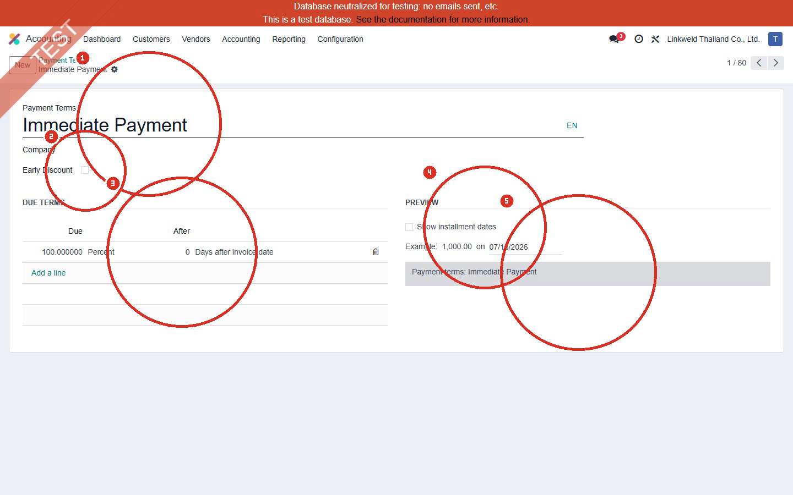

| หมายเลข | ค่าปัจจุบัน | ความหมายและผลเมื่อใช้ค่านี้ | หากเปลี่ยน |
|---|---|---|---|
| 1 | Name = Immediate Payment | ชื่อสื่อว่าครบกำหนดวันที่ออก Invoice และสอดคล้องกับกฎด้านล่าง | เปลี่ยนชื่อไม่เปลี่ยนการคำนวณ หากกฎไม่เปลี่ยน แต่ผู้ใช้อาจเลือกผิดจากชื่อใหม่ |
| 2 | Company = ว่าง; Early Discount = Off | ใช้ได้โดยไม่จำกัดเฉพาะ Linkweld Thailand ใน field นี้ และไม่มีส่วนลดชำระก่อน | ระบุ Company แล้วจำกัดบริบท; เปิด Early Discount แล้วต้องกำหนดเปอร์เซ็นต์ วัน และนโยบายลดภาษี |
| 3 | Due = 100% / After = 0 Days after invoice date | สร้างยอดครบกำหนดเต็มจำนวนในวันที่ Invoice Date | เปลี่ยนจำนวนวันหรือเพิ่มบรรทัดจะเปลี่ยน Maturity Date/Installments ของเอกสารใหม่และ Draft ที่คำนวณใหม่ |
| 4 | Show installment dates = Off | ไม่แสดงตารางงวดละเอียดบนรายงาน Invoice จากตัวเลือกนี้ | เปิดแล้วรายงาน Invoice แสดงยอดและวันครบกำหนดแต่ละงวด |
| 5 | Preview = Payment terms: Immediate Payment | ข้อความตัวอย่างช่วยตรวจว่าผู้รับเอกสารจะเห็นคำอธิบายอย่างไร | ข้อความ Preview ควรตรงกับ Due Terms และผ่านการอนุมัติข้อความเอกสาร |

ผลหลังใช้กับเอกสาร:

- Invoice/Bill ที่ใช้เงื่อนไขนี้ควรมี Receivable/Payable ครบกำหนดเต็มจำนวนใน Invoice Date
- รอบ Read-only ยังไม่ได้เปิด Journal Items ของเอกสารเดิม จึงต้องยืนยันใน UAT จาก Transaction เดิมที่เหมาะสม

---

## ภาพ 8: ตัวอย่างชื่อ 30%/70% แต่กฎจริงเป็น 100% Immediate

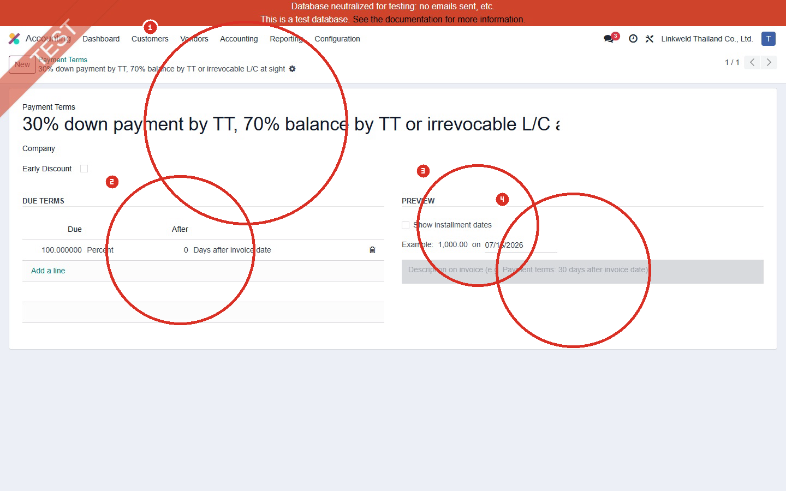

| หมายเลข | ค่าปัจจุบัน | ผลที่เกิดขึ้น | ความเสี่ยง |
|---|---|---|---|
| 1 | Name = `30% down payment by TT, 70% balance by TT or irrevocable L/C at sight` | ผู้ใช้อาจเข้าใจว่าระบบแบ่ง 2 งวด 30% และ 70% | ชื่อทำให้เข้าใจผิด เพราะกฎจริงไม่มีสองงวด |
| 2 | Due = 100% / 0 Days after invoice date | Odoo คำนวณเต็มจำนวนครบกำหนดวันที่ Invoice | Aged Receivable/Payable และ Cash Forecast อาจเร็วเกินนโยบายการค้า |
| 3 | Show installment dates = Off | รายงานไม่แสดงการแบ่งงวดจาก field นี้ | ลูกค้า/ผู้ขายไม่เห็นตาราง 30%/70% ที่ชื่อสื่อ |
| 4 | Preview ไม่มีข้อความ 30%/70% | ผล Preview สอดคล้องกับการไม่มีกฎแบ่งงวด แต่ไม่สอดคล้องกับชื่อ | เอกสารและการติดตามหนี้อาจไม่ตรงสัญญา |

สถานะ: `Confirmed High Risk` สำหรับความไม่สอดคล้องของรายการตัวอย่างนี้ แต่ยังห้ามแก้จนกว่าจะตรวจเอกสารที่ใช้งานอยู่และได้ Accounting/Commercial sign-off

---

## ภาพ 9: ตัวอย่างหลายงวดที่กฎตรงกับชื่อ

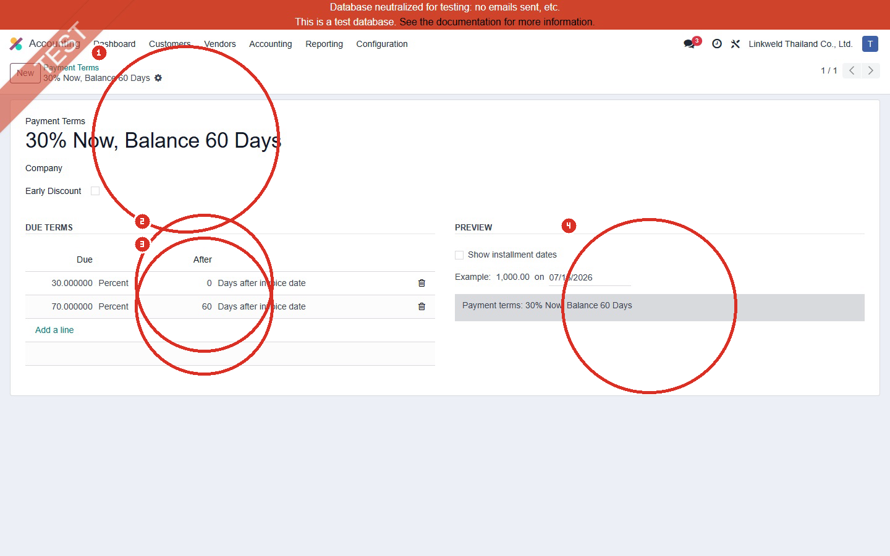

| หมายเลข | ค่าปัจจุบัน | ผลที่เกิดขึ้น |
|---|---|---|
| 1 | Name = 30% Now, Balance 60 Days | ชื่อระบุสองงวดจาก Invoice Date |
| 2 | 30% / 0 Days after invoice date | สร้างงวดแรก 30% ครบกำหนดวันที่ Invoice |
| 3 | 70% / 60 Days after invoice date | สร้างงวดที่สอง 70% ครบกำหนด 60 วันหลัง Invoice |
| 4 | Preview = Payment terms: 30% Now, Balance 60 Days | คำอธิบาย Preview ตรงกับโครงสร้างสองงวด แต่ Show installment dates ยัง Off |

กฎควบคุม:

- ผลรวมบรรทัด Percent ควรครบ 100%
- ต้องตรวจลำดับวันครบกำหนด เพราะ Odoo คำนวณ Terms ตามลำดับ Due Date
- หากต้องการให้ Invoice PDF แสดงยอดและวันที่แต่ละงวด ให้พิจารณา Show installment dates หลังผ่าน UAT

---

## ภาพ 10: Early Discount 2/7 Net 30

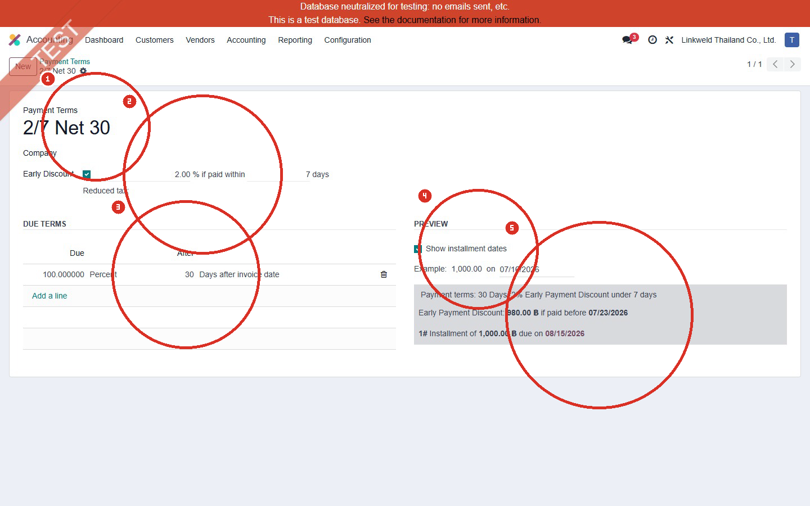

| หมายเลข | ค่าปัจจุบัน | ความหมายและผลเมื่อใช้ค่านี้ | จุดควบคุม |
|---|---|---|---|
| 1 | Name = 2/7 Net 30 | ลด 2% หากชำระภายใน 7 วัน มิฉะนั้นครบกำหนดเต็มจำนวน 30 วัน | ต้องให้ Accounting/Tax Owner อนุมัติ |
| 2 | Early Discount = On; 2%; 7 days; Reduced tax แสดงเป็น On early payment | เมื่อ Reconcile ภายในช่วง ระบบพิจารณาส่วนลดและวิธีลดฐานภาษีตามตัวเลือก | ต้องตรวจ Cash Discount Gain/Loss accounts และกฎหมายภาษีไทยก่อนใช้จริง |
| 3 | Due = 100% / 30 Days after invoice date | ยอดปกติครบกำหนด 30 วันหลัง Invoice | เปลี่ยนวันมีผลต่อ Maturity/Aging |
| 4 | Show installment dates = On | รายงาน Invoice สามารถแสดงรายละเอียดวันครบกำหนดและส่วนลดชำระก่อน | ต้องตรวจ Layout ภาษาไทย/อังกฤษและยอดภาษี |
| 5 | Preview แสดงส่วนลด 980 บาทก่อนวันที่ตัวอย่าง และ 1,000 บาทครบกำหนดภายหลัง | เป็นผลลัพธ์จากวันที่ Example บนหน้าจอ ไม่ใช่ Transaction ที่สร้างใหม่ | ต้อง UAT Payment ก่อน/หลังวันส่วนลดและ Reconciliation |

ผลทางภาษี:

- ตัวเลือก Reduced tax เปลี่ยนวิธีคำนวณฐานภาษีเมื่อมีส่วนลดชำระก่อน
- Odoo 18 รองรับ `Always`, `On early payment` และ `Never`; Linkweld ต้องเลือกตามนโยบายภาษีไทยที่ได้รับอนุมัติ
- ห้ามใช้เพียงเพราะ Preview คำนวณได้ ต้อง Reconcile Invoice, Payment, Tax Report และ Gain/Loss accounts

---

## ภาพ 11: Payment Term จำกัดเฉพาะบริษัท

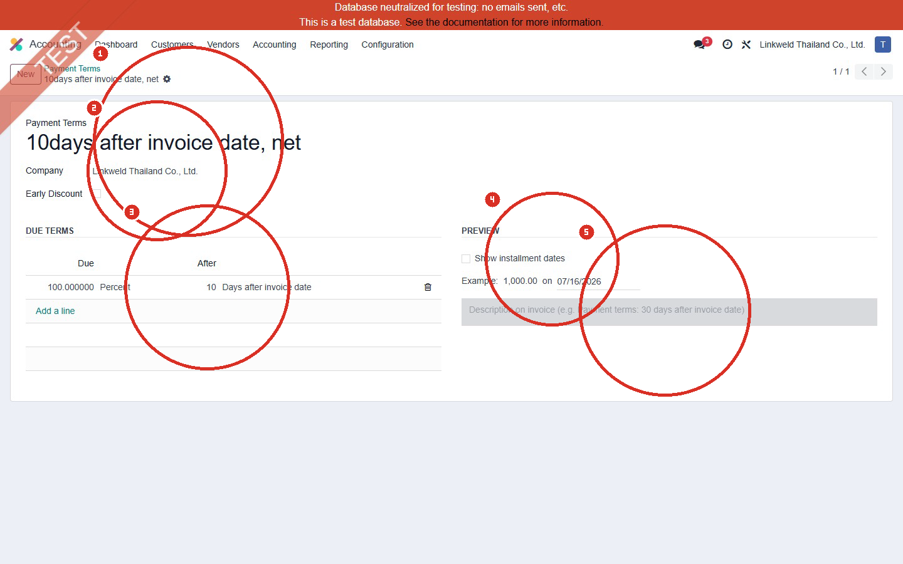

| หมายเลข | ค่าปัจจุบัน | ความหมายและผลเมื่อใช้ค่านี้ |
|---|---|---|
| 1 | Name = 10days after invoice date, net | ชื่อระบุครบกำหนด 10 วันหลัง Invoice |
| 2 | Company = Linkweld Thailand Co., Ltd. | จำกัดการใช้งานตาม Company context ลดความเสี่ยงใช้ข้ามบริษัท |
| 3 | Due = 100% / 10 Days after invoice date | กฎตรงกับชื่อและสร้างวันครบกำหนด 10 วันหลัง Invoice |
| 4 | Show installment dates = Off | ไม่แสดงตารางงวดบน Invoice report จากตัวเลือกนี้ |
| 5 | Preview description ว่าง | เอกสารอาจไม่มีคำอธิบาย Payment Terms ที่ชัดเจนจากช่อง Preview ต้องตรวจ Report จริงจากเอกสารเดิม |

ข้อเสนอ: ใช้ Company-specific เมื่อเป็นนโยบายเฉพาะนิติบุคคล และทบทวน Payment Terms ที่ Company ว่างว่าตั้งใจให้ใช้ร่วมทุกบริษัทจริงหรือไม่

---

## อธิบายทุก Field ที่ Config ได้บนฟอร์ม

| Field | หน้าที่ | ผลเมื่อ Config | ความเสี่ยง/สิ่งที่ต้องตรวจ |
|---|---|---|---|
| Payment Terms / Name | ชื่อภายในและชื่อที่แสดงบนเอกสารบางจุด | ช่วยผู้ใช้เลือกเงื่อนไข | ชื่ออาจไม่ตรงกฎ ต้องตรวจ Due Terms เสมอ |
| Company | จำกัด Payment Term ตามบริษัท | ลดการใช้ข้ามนิติบุคคล | ว่างอาจทำให้ใช้ร่วมได้ ต้องทดสอบ multi-company access |
| Early Discount | เปิด Cash Discount | เพิ่มเปอร์เซ็นต์ส่วนลด วันสิ้นสุด และ Tax Reduction | กระทบ Reconciliation, Gain/Loss และ Tax Report |
| Discount Percentage | อัตราลดเมื่อชำระก่อน | Odoo คำนวณยอดลดจาก Invoice | ต้องมี policy และ approval |
| Discount Days | จำนวนวันที่ได้ส่วนลด | ใช้ Payment Date เทียบสิทธิ์ส่วนลด | ต้องกำหนดการนับวันและ cut-off |
| Reduced tax | วิธีลดฐานภาษี | Always / On early payment / Never ให้ผลภาษีต่างกัน | High Risk สำหรับไทย ต้องให้ Tax Owner อนุมัติ |
| Due - Value | จำนวนต่อบรรทัด | Percent หรือค่าคงที่ตามตัวเลือกที่ระบบแสดง | ผลรวม/ยอดคงเหลือต้องครบ Invoice total |
| Due - After | วิธีคำนวณวันครบกำหนด | วันหลัง Invoice, ปลายเดือน, วันของเดือนถัดไปตามตัวเลือก | ชื่อควรตรงกับสูตรและต้องทดสอบปลายเดือน/ปี |
| Add a line | เพิ่มงวด | สร้าง Receivable/Payable maturity หลายบรรทัด | เป็นการเขียน Master Data จึงไม่ใช้ในรอบ Read-only |
| Preview description | ข้อความบนเอกสาร | อธิบายเงื่อนไขให้คู่ค้า | ข้อความว่างหรือไม่ตรงกฎทำให้เกิดข้อโต้แย้ง |
| Show installment dates | แสดงยอด/วันแต่ละงวดบน Invoice report | เพิ่มความชัดเจนของ Invoice PDF | ต้องตรวจ Layout, ภาษา, Currency และ rounding |
| Example date | จำลองผลจากวันที่ที่กรอกบนหน้าจอ | ช่วย Preview วันครบกำหนด | ใช้เพื่อคำนวณตัวอย่าง ไม่ใช่ Transaction จริง |

## กลุ่มชื่อซ้ำที่พบ

1. `30 Days  after Delivery` จำนวน 2 รายการ
2. `30% before manufacture, 50% against BL and 20% 60 day after arriving` จำนวน 2 รายการ

ห้ามรวม/Archive จากชื่ออย่างเดียว ต้องตรวจ External ID, Contact defaults, Sales/Purchase documents, Draft invoices/bills, เอกสารเปิด และประวัติการใช้งานก่อน

## Standard Odoo vs Pain Point

| หัวข้อ | Standard Odoo 18 | สภาพที่พบใน Linkweld | ข้อเสนอ |
|---|---|---|---|
| Due Date | คำนวณจาก Invoice Date และสูตรวัน/ปลายเดือน | 80 รายการเป็น 100% วันที่ Invoice | ยืนยันว่าตั้งใจ Immediate จริงกี่รายการ |
| Installments | เพิ่ม Due Terms หลายบรรทัดเพื่อแบ่งยอด | มีหลายงวดจริงเพียง 2 รายการ | สร้างชุดมาตรฐานเฉพาะนโยบายที่อนุมัติ |
| Commercial milestones | Payment Terms ไม่ได้ตรวจ PO, B/L, Shipment, Installation โดยอัตโนมัติ | หลายชื่ออ้างถึง milestone เหล่านี้ | ใช้ Down Payment/Milestone Invoicing หรือออกแบบ flow ที่เหมาะสม |
| Name vs Rule | ชื่อควรอธิบายกฎจริง | พบตัวอย่างยืนยันชื่อ 30%/70% แต่กฎ 100% Immediate | Freeze การสร้างใหม่และทำ cleansing หลัง impact review |
| Early Discount | รองรับ %/วันและ Tax Reduction | ใช้ 1 รายการ | ตรวจ Gain/Loss, VAT/WHT และ Reconciliation |
| Multi-company | จำกัดด้วย Company ได้ | จำกัดเฉพาะบริษัท 2 รายการ | ทบทวนรายการ Company ว่างทั้งหมด |
| Invoice communication | Preview และ Show installment dates ช่วยสื่อสาร | เปิด Show installment dates เพียง 2 รายการ | กำหนดมาตรฐานข้อความและ PDF หลัง UAT |

## Solution ที่แนะนำ

1. Freeze การสร้าง Payment Terms ใหม่ชั่วคราว และกำหนด Accounting Owner/Commercial Approver
2. แบ่ง 104 รายการเป็นสามประเภท: Invoice-date terms, Installment terms และ Contract milestone terms
3. สำหรับ Invoice-date terms ให้กฎ ชื่อ และ Preview ตรงกัน พร้อมกำหนด Company
4. สำหรับ Installment terms ให้ผลรวมครบ 100% และเปิด Show installment dates เมื่อเอกสารต้องแสดงตารางงวด
5. สำหรับ PO/B/L/Shipment/Installation ให้ตัดสินใจว่าเป็น Down Payment, Milestone Invoice หรือ Payment Term; ห้ามเก็บเป็นชื่ออย่างเดียว
6. ตรวจการใช้งานของรายการซ้ำและรายการเสี่ยงก่อน Archive/แก้ไข โดยใช้ Clone UAT และ change log ที่อนุมัติ
7. ส่ง decision matrix และ UAT evidence ให้ Accounting Owner, Commercial Owner และทีม Odoo Vietnam ก่อนเปลี่ยน staging/go-live

## รายการ UAT ขั้นต่ำ

| UAT ID | กรณีทดสอบโดยใช้ข้อมูลเดิม/Clone UAT | ผลที่ต้องตรวจ | สถานะ |
|---|---|---|---|
| UAT-ACC-002-01 | เปิด Invoice/Bill เดิมที่ใช้ Immediate Payment | Due Date, Journal Items, Aging | Pending |
| UAT-ACC-002-02 | เปิดเอกสารเดิมที่ใช้ Payment Term หลายงวด | จำนวนงวด, ยอดรวม, วันครบกำหนด, rounding | Pending |
| UAT-ACC-002-03 | ตรวจรายการชื่อ 30%/70% ที่กฎ 100% Immediate | ผลกระทบต่อ Draft/Open documents และ partner defaults | Pending |
| UAT-ACC-002-04 | ทดสอบ 2/7 Net 30 ใน Clone UAT | Payment ก่อน/หลัง 7 วัน, Gain/Loss, Tax Reduction, Reconciliation | Pending |
| UAT-ACC-002-05 | ตรวจ Invoice PDF ที่ Show installment dates On/Off | ข้อความ ยอด Currency และวันครบกำหนด | Pending |
| UAT-ACC-002-06 | ทดสอบ Company-specific และ Company ว่าง | Visibility และการเลือกข้ามบริษัท | Pending |
| UAT-ACC-002-07 | ตรวจ Payment Terms ชื่อซ้ำ | Defaults, documents, open items และ archive impact | Pending |
| UAT-ACC-002-08 | ทดสอบ Invoice Date สิ้นเดือน/สิ้นปี | สูตร End of Month/Next Month และ leap year | Pending |
| UAT-ACC-002-09 | Trace รายการที่อ้าง B/L/Shipment/Installation | ตัดสินใจ Payment Term vs Down Payment/Milestone flow | Pending |

## สรุปสถานะ

- เก็บภาพรายการครบ 104 Payment Terms และฟอร์มตัวอย่างที่ครอบคลุมทุกกลุ่ม field สำคัญ
- มีภาพต้นฉบับ 11 ภาพและภาพวงหมายเลข 11 ภาพ
- Confirmed ว่ามี 80 รายการที่กฎจริงเป็น 100% ครบกำหนด 0 วันหลัง Invoice Date
- คัดกรอง 70 รายการที่ชื่อมีแนวโน้มไม่ตรงกฎเพื่อรอ Business Owner ยืนยัน ไม่ถือว่า 70 รายการผิดทั้งหมดโดยอัตโนมัติ
- ไม่ได้สร้าง แก้ไข หรือบันทึก Configuration, Master Data หรือ Transaction ใน Odoo

อ้างอิง:

- [Odoo 18 Payment terms and installment plans](https://www.odoo.com/documentation/18.0/applications/finance/accounting/customer_invoices/payment_terms.html)
- [Odoo 18 Cash discounts and tax reduction](https://www.odoo.com/documentation/18.0/applications/finance/accounting/customer_invoices/cash_discounts.html)
- [Odoo 18 Down payments](https://www.odoo.com/documentation/18.0/applications/sales/sales/invoicing/down_payment.html)
