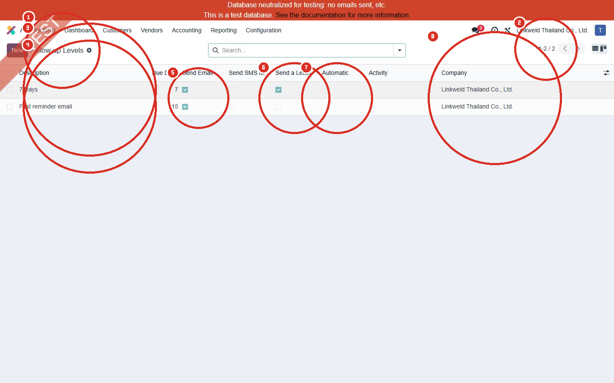
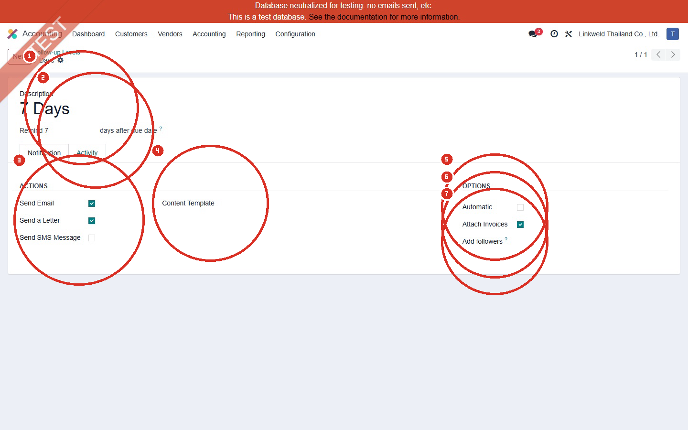
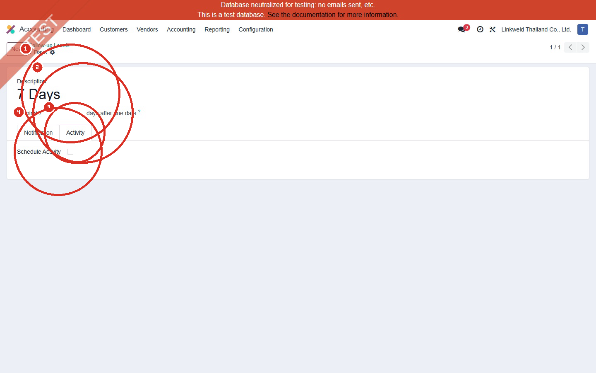
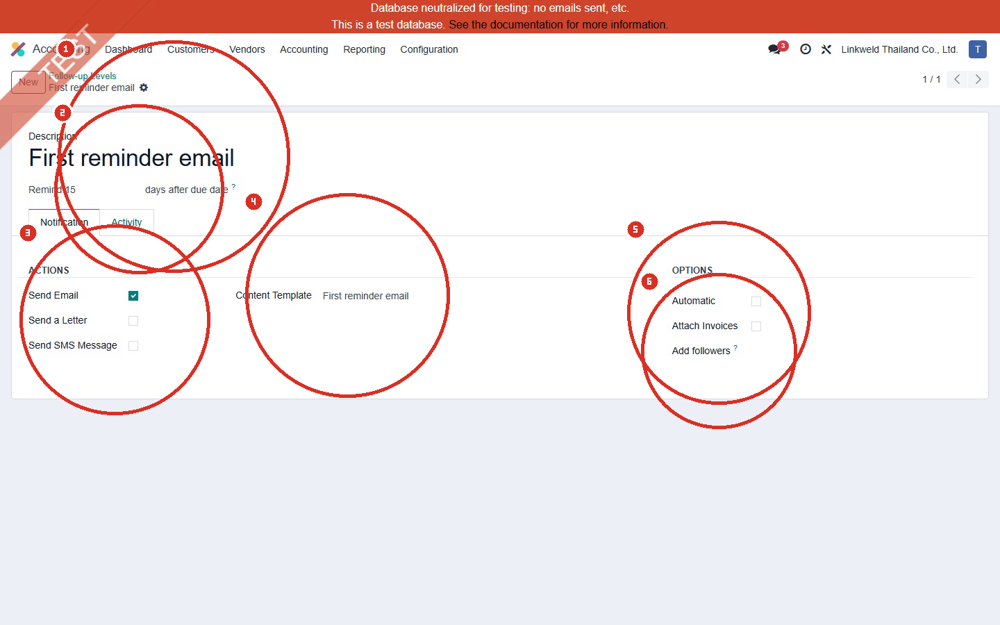
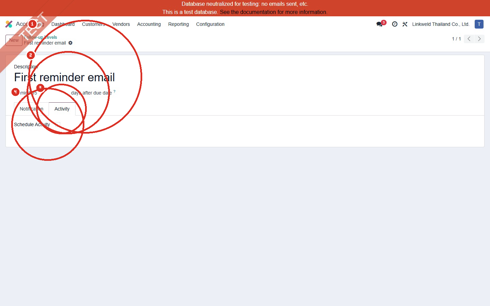

# ACC-003 คู่มือ Accounting > Configuration > Follow-up Levels

- บริษัท: Linkweld (Thailand) Co., Ltd.
- ระบบ: Odoo 18 Enterprise Staging
- วันที่ตรวจ: 16 กรกฎาคม 2026
- วิธีตรวจ: Evidence-first Read-only
- สถานะบท: `Confirmed` สำหรับค่าที่อ่านจากรายการและฟอร์มเดิม; ผลการส่ง Email, Letter, SMS และ Activity เป็น `Not Available` เพราะไม่ได้ดำเนินการส่งหรือสร้างข้อมูล

## ขอบเขตและข้อจำกัด

- เปิดเฉพาะ Follow-up Levels ที่มีอยู่แล้ว 2 รายการ ไม่กด New, Edit, Save หรือคำสั่งส่งข้อความ
- ไม่ Process Follow-ups และไม่เปิด Send and Print ของลูกค้า
- ไม่เปลี่ยน Automatic, Attach Invoices, Template, Followers หรือ Activity
- ภาพต้นฉบับและภาพ Annotated ต้องมาจากหน้าจอ Odoo จริงเท่านั้น ห้ามสร้างภาพจำลอง
- การตรวจนี้ยืนยัน Configuration ปัจจุบัน แต่ยังไม่ยืนยันผลส่งจริง ที่อยู่ผู้รับ ภาษา Template ค่า IAP หรือ Chatter log

## สรุปค่าที่พบ

| Level | Due Days | Email | Letter | SMS | Automatic | Attach Invoices | Content Template | Activity |
|---|---:|---|---|---|---|---|---|---|
| 7 Days | 7 วันหลัง Due Date | On | On | Off | Off | On | ว่าง | Off |
| First reminder email | 15 วันหลัง Due Date | On | Off | Off | Off | Off | First reminder email | Off |

หลักฐานโครงสร้าง:

- [ACC-003 Follow-up Levels DOM extract](../evidence/accounting/ACC-003/ACC-003_follow_up_levels_dom_extract.json)

## ภาพ 1: รายการ Follow-up Levels

| หมายเลข | จุดบนหน้าจอ | ค่าปัจจุบันและผล |
|---|---|---|
| 1 | Accounting context | ยืนยันว่าเป็นเมนู Accounting > Configuration > Follow-up Levels และปุ่ม New ไม่ถูกใช้ในรอบ Read-only |
| 2 | Pager | แสดง `1-2 / 2` จึงมี Follow-up Levels ทั้งหมด 2 รายการใน Company ปัจจุบัน |
| 3 | 7 Days | Level แรกเริ่มเมื่อเลย Due Date 7 วัน |
| 4 | First reminder email | Level ที่สองเริ่มเมื่อเลย Due Date 15 วัน |
| 5 | Due Days | ค่าที่เห็นคือ 7 และ 15 วัน; ระบบเทียบกับ Due Date ไม่ใช่ Invoice Date โดยตรง |
| 6 | Email และ SMS | ทั้งสอง Level เปิด Email และปิด SMS |
| 7 | Letter, Automatic และ Activity | 7 Days เปิด Letter; ทั้งสอง Level ปิด Automatic และไม่มี Activity |
| 8 | Company | ทั้งสองรายการจำกัดที่ Linkweld Thailand Co., Ltd. |

## ภาพ 2: Level 7 Days - Notification

| หมายเลข | Field | ค่าปัจจุบัน | ความหมายและความเสี่ยง |
|---|---|---|---|
| 1 | Description | 7 Days | ชื่อ Level ที่ผู้ใช้เห็น |
| 2 | Remind | 7 วันหลัง Due Date | ลูกค้าที่มีรายการเลยกำหนด 7 วันเข้าเงื่อนไข Level นี้ตามสถานะ Follow-up |
| 3 | Actions | Email On, Letter On, SMS Off | ผู้ใช้สามารถเลือก Email และ Letter; Odoo ระบุว่า Letter ต้องใช้ IAP credit/tokens และต้องตรวจที่อยู่/ค่าใช้จ่าย |
| 4 | Content Template | ว่าง | ไม่มี Template ที่ยืนยันจาก Field นี้ก่อนส่ง ต้องตรวจข้อความ Preview/Send Wizard ทุกครั้ง |
| 5 | Automatic | Off | ไม่ควรส่งอัตโนมัติจาก Level นี้ตามค่าที่เห็น แต่ยังต้องตรวจ Cron/Customization แยกหากมี |
| 6 | Attach Invoices | On | เมื่อส่ง Reminder อาจแนบ Invoice ที่ค้างชำระ ต้องควบคุมผู้รับ ภาษา เอกสาร และข้อมูลการเงิน |
| 7 | Add followers | ว่าง | ไม่เพิ่มผู้ติดตามจาก Field นี้ จึงไม่มีผู้รับ Reply เพิ่มจากค่านี้ |

## ภาพ 3: Level 7 Days - Activity

| หมายเลข | Field | ค่าปัจจุบัน | ผล |
|---|---|---|---|
| 1 | Description | 7 Days | ยืนยัน Record เดียวกับหน้า Notification |
| 2 | Remind | 7 วันหลัง Due Date | Activity ใช้จังหวะ Level เดียวกับ Notification |
| 3 | Activity tab | เปิดดูแบบ Read-only | ใช้กำหนดกิจกรรมภายใน ไม่ใช่ช่องทางส่งข้อความให้ลูกค้า |
| 4 | Schedule Activity | Off | Level นี้ไม่สร้าง Activity ให้ผู้รับผิดชอบโดยอัตโนมัติ อาจทำให้การติดตามขึ้นกับการ Process แบบ Manual |

## ภาพ 4: First reminder email - Notification

| หมายเลข | Field | ค่าปัจจุบัน | ความหมายและความเสี่ยง |
|---|---|---|---|
| 1 | Description | First reminder email | ชื่อ Level ที่ผู้ใช้เห็น |
| 2 | Remind | 15 วันหลัง Due Date | ใช้ Reminder หลัง Level 7 วันอีก 8 วันตามลำดับเวลาที่ Config |
| 3 | Actions | Email On, Letter Off, SMS Off | เปิดเฉพาะช่องทาง Email จาก Level นี้ |
| 4 | Content Template | First reminder email | มี Template ระบุ แต่ยังไม่ตรวจเนื้อหา ภาษา Dynamic Fields ผู้ส่ง หรือผู้รับ |
| 5 | Automatic | Off | การส่งยังต้องผ่านผู้ใช้หรือ Process ที่อนุมัติ ไม่ได้เปิด Auto จาก Level นี้ |
| 6 | Attach Invoices / Add followers | Off / ว่าง | ไม่แนบ Invoice และไม่มีผู้ติดตามเพิ่มเติมจากค่า Default ของ Level นี้ |

## ภาพ 5: First reminder email - Activity

| หมายเลข | Field | ค่าปัจจุบัน | ผล |
|---|---|---|---|
| 1 | Description | First reminder email | ยืนยัน Record เดียวกับหน้า Notification |
| 2 | Remind | 15 วันหลัง Due Date | Activity ใช้จังหวะ Level เดียวกับ Notification |
| 3 | Activity tab | เปิดดูแบบ Read-only | ใช้กำหนดกิจกรรมภายใน |
| 4 | Schedule Activity | Off | ไม่มี Activity อัตโนมัติให้ Collection Owner หลัง Level 15 วัน |

## อธิบาย Field ที่ Config ได้

| Field | หน้าที่ | ผลเมื่อเปิด/กำหนด | จุดควบคุม |
|---|---|---|---|
| Description | ชื่อ Level ที่ผู้ใช้เห็น | ใช้อธิบายขั้นติดตาม | ชื่อควรตรงกับ Due Days และ Action |
| Remind / Due Days | จำนวนวันก่อนหรือหลัง Due Date | ค่าบวกคือหลัง Due Date; Odoo รองรับค่าลบสำหรับเตือนก่อน Due Date | ต้องทดสอบ Due Date จาก Payment Terms และ Timezone |
| Send Email | เปิด Email action | ส่ง Reminder ผ่าน Email เมื่อ Process | ตรวจผู้รับ ผู้ส่ง ภาษา Template และ Chatter |
| Send a Letter | เปิดบริการจดหมาย | ส่งเอกสารทางไปรษณีย์ | ตรวจที่อยู่ IAP credit ค่าใช้จ่าย และข้อมูลที่พิมพ์ |
| Send SMS Message | เปิด SMS | ส่งข้อความไปเบอร์ Contact | ต้องมี IAP/SMS template และ consent ที่เหมาะสม |
| Content Template | Template ของ Email/Letter | เติม Subject/Body และ Dynamic Fields | ต้อง Preview ทุกภาษาและห้ามมีข้อมูลผิดลูกค้า |
| Automatic | Process Level อัตโนมัติ | ลดงาน Manual แต่เพิ่มความเสี่ยงส่งผิดทันที | ต้องผ่าน UAT และอนุมัติจาก Credit Control/CFO ก่อนเปิด |
| Attach Invoices | แนบ Invoice ที่ Overdue | ช่วยลูกค้าตรวจเอกสาร | เสี่ยงส่งเอกสารผิดผู้รับหรือเปิดเผยข้อมูลการเงิน |
| Add followers | เพิ่มผู้ติดตาม Partner | ผู้ติดตามอาจได้รับการแจ้ง Reply | ต้องกำหนดบทบาทและข้อมูลส่วนบุคคล |
| Schedule Activity | สร้าง Activity | มอบหมายงานติดตามภายใน | ต้องกำหนด Responsible, Activity Type และ SLA |

## Standard Odoo vs Pain Point

| หัวข้อ | Standard Odoo 18 | สภาพที่พบใน Linkweld | ข้อเสนอ |
|---|---|---|---|
| Trigger | ใช้จำนวนวันเทียบ Invoice Due Date | มี Level 7 และ 15 วัน | ยืนยัน Credit Collection Policy และลำดับ Escalation |
| Channels | Email, Letter, SMS | 7 วันใช้ Email+Letter; 15 วันใช้ Email | ทบทวนว่าควรส่ง Letter ก่อน Reminder 15 วันหรือไม่ |
| Automation | เปิด Automatic ได้ | ปิด Automatic ทั้งสองรายการ | คง Manual จนกว่า Reconciliation, Template และ Recipient UAT ผ่าน |
| Template | ใช้ Content Template เพื่อเติมข้อความ | 7 วันว่าง; 15 วันมี Template | จัดทำ Approved Template แยกภาษาและ Legal wording |
| Attachments | แนบ Overdue Invoices ได้ | เปิดเฉพาะ 7 วัน | ตรวจ Privacy, Recipient และ Invoice PDF ก่อนส่ง |
| Internal activity | สร้าง Activity ให้ผู้รับผิดชอบได้ | ปิดทั้งสองรายการ | พิจารณา Activity/SLA หาก Manual process ไม่มี Owner ชัดเจน |
| Payment status | ควร Reconcile รายการธนาคารก่อน Follow-up | ยังไม่ได้ Trace ใน batch นี้ | ห้าม Process Follow-up ก่อน Reconciliation และ Exception review |

## Solution ที่แนะนำ

1. ให้ Credit Control และ Accounting Owner อนุมัติลำดับ 7/15 วัน ช่องทาง และข้อความก่อนเปลี่ยนค่า
2. คง Automatic = Off ระหว่าง UAT และให้ผู้ใช้ Preview รายชื่อ/ยอด/เอกสารก่อนส่ง
3. สร้างหรือเลือก Content Template ที่อนุมัติสำหรับ Level 7 วัน พร้อมภาษาไทย/อังกฤษและ Dynamic Fields ที่ตรวจแล้ว
4. ทบทวน Send a Letter ที่ Level 7 วัน รวม IAP cost, ที่อยู่, ผู้อนุมัติ และเงื่อนไขว่าควรส่งจริงเมื่อใด
5. Reconcile Bank และตัด Paid/Disputed/On-hold invoices ออกจากรายการก่อน Process Follow-ups
6. กำหนด Collection Owner และ Activity/SLA สำหรับลูกค้าที่ไม่ตอบหลัง Level 15 วัน
7. เก็บ Chatter/Audit evidence และรายงานจำนวน Reminder ที่ส่ง ผิดพลาด และค้างดำเนินการ

## รายการ UAT ขั้นต่ำ

| UAT ID | กรณีทดสอบใน Clone UAT | ผลที่ต้องตรวจ | สถานะ |
|---|---|---|---|
| UAT-ACC-003-01 | Invoice ครบกำหนด 6, 7 และ 8 วัน | Level boundary และยอด Overdue ถูกต้อง | Pending |
| UAT-ACC-003-02 | Invoice ครบกำหนด 14, 15 และ 16 วัน | Level 15 วันและลำดับ Escalation ถูกต้อง | Pending |
| UAT-ACC-003-03 | Preview Email ทั้งสอง Level โดยไม่ส่ง | Subject, Body, ภาษา, Dynamic Fields, ผู้ส่งและผู้รับ | Pending |
| UAT-ACC-003-04 | Preview Letter Level 7 วัน | ที่อยู่, PDF, IAP cost และ Approval | Pending |
| UAT-ACC-003-05 | ทดสอบ Attach Invoices On/Off | แนบเฉพาะ Invoice ของลูกค้าที่ถูกต้อง ไม่มีข้อมูลข้ามบริษัท | Pending |
| UAT-ACC-003-06 | Reconcile Payment ก่อน/หลัง Follow-up | Paid invoice ไม่ถูกติดตามและยอดค้างตรง Partner Ledger | Pending |
| UAT-ACC-003-07 | Customer มีหลาย Contact/ภาษา/บริษัท | Recipient, Language, Company และ Access ถูกต้อง | Pending |
| UAT-ACC-003-08 | เปิด Automatic ใน Clone UAT เท่านั้น | Job timing, duplicate prevention, error handling และ Chatter log | Pending |
| UAT-ACC-003-09 | เปิด Schedule Activity ใน Clone UAT | Responsible, Activity Type, SLA และการปิดงาน | Pending |

## สรุปสถานะ

- Confirmed ว่ามี Follow-up Levels 2 รายการ: 7 วันและ 15 วันหลัง Due Date
- Confirmed ว่าทั้งสองรายการเปิด Email แต่ปิด Automatic และ Schedule Activity
- Level 7 วันเปิด Letter และ Attach Invoices แต่ Content Template ว่าง
- Level 15 วันใช้ Content Template `First reminder email` และไม่แนบ Invoice
- ยังไม่ได้ส่ง Reminder, Letter, SMS หรือสร้าง Activity จึงไม่อ้างว่าผลลัพธ์ปลายทางผ่านแล้ว
- ไม่มีการสร้าง แก้ไข หรือบันทึก Configuration, Master Data หรือ Transaction ใน Odoo

อ้างอิง:

- [Odoo 18 Follow-up on invoices](https://www.odoo.com/documentation/18.0/applications/finance/accounting/payments/follow_up.html)
