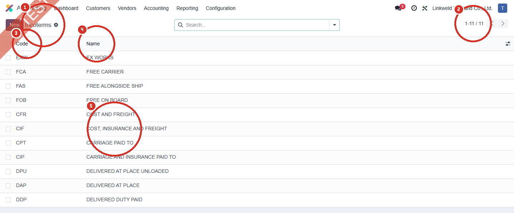
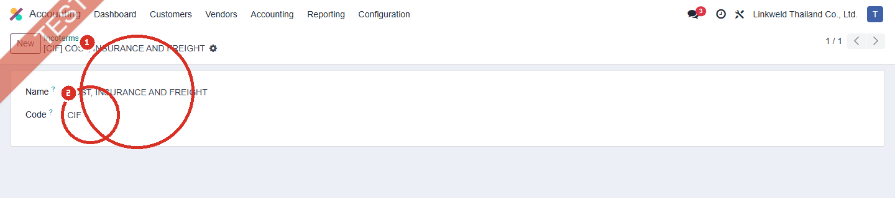

# ACC-004 คู่มือ Accounting > Configuration > Incoterms

- บริษัท: Linkweld (Thailand) Co., Ltd.
- ระบบ: Odoo 18 Enterprise Staging
- วันที่ตรวจ: 16 กรกฎาคม 2026
- วิธีตรวจ: Evidence-first Read-only
- สถานะบท: `Confirmed` สำหรับรายการและค่าบนฟอร์ม Incoterm; ผลบนเอกสารจริงเป็น `Not Available` จนกว่าจะพบเอกสารเดิมที่เหมาะสม

## ขอบเขตและข้อจำกัด

- ตรวจเมนู Accounting > Configuration > Incoterms และเปิดฟอร์ม CIF ที่มีอยู่แล้วเท่านั้น
- ไม่สร้าง แก้ไข บันทึก Archive หรือ Delete Incoterm
- ระหว่างตรวจมีการเข้า inline edit โดยไม่ตั้งใจหนึ่งครั้ง แต่ไม่ได้เปลี่ยนค่าและกด Discard ทันที
- ไม่สร้าง Invoice, Bill, Sales Order, Purchase Order หรือ Transaction เพื่อทดสอบ
- ยังไม่ได้ยืนยัน Incoterm บนเอกสารเดิม, Incoterm Location, PDF หรือการส่งค่าจาก Sales/Purchase เพราะ batch นี้ตรวจเฉพาะ Master Configuration

หลักฐานโครงสร้าง:

- [ACC-004 Incoterms extract](../evidence/accounting/ACC-004/ACC-004_incoterms_extract.json)

## ภาพ 1: รายการ Incoterms

| หมายเลข | จุดบนหน้าจอ | ค่าปัจจุบันและผล |
|---|---|---|
| 1 | เมนู Incoterms | ยืนยันว่าเป็น Accounting > Configuration > Incoterms และไม่ได้ใช้ปุ่ม New |
| 2 | Pager | แสดง `1-11 / 11` จึงมี Incoterm ที่มองเห็นได้ 11 รายการ |
| 3 | Code | รหัสมาตรฐาน 3 ตัวอักษรใช้ระบุเงื่อนไขการค้าบนเอกสาร |
| 4 | Name | ชื่อเต็มอธิบายรหัส Incoterm; ทั้ง 11 รายการตรงกับชุดมาตรฐาน Odoo 18 |
| 5 | CIF | ตัวอย่างรายการที่เปิดอ่านรายละเอียดบนฟอร์มโดยไม่บันทึกการเปลี่ยนแปลง |

## รายการที่พบทั้งหมด

| Code | Name | Active | ความหมายเชิงธุรกิจโดยย่อ |
|---|---|---|---|
| EXW | EX WORKS | Yes | ผู้ซื้อรับภาระหลักตั้งแต่รับสินค้าที่สถานที่ผู้ขาย |
| FCA | FREE CARRIER | Yes | ผู้ขายส่งมอบสินค้าให้ผู้ขนส่ง ณ จุดที่ตกลง |
| FAS | FREE ALONGSIDE SHIP | Yes | ผู้ขายส่งมอบข้างเรือ ณ ท่าเรือที่กำหนด |
| FOB | FREE ON BOARD | Yes | ผู้ขายส่งมอบเมื่อสินค้าขึ้นเรือ ณ ท่าเรือต้นทาง |
| CFR | COST AND FREIGHT | Yes | ผู้ขายรับค่าขนส่งถึงปลายทาง แต่ความเสี่ยงโอนตามเงื่อนไข CFR |
| CIF | COST, INSURANCE AND FREIGHT | Yes | ผู้ขายรับค่าขนส่งและประกันภัยตามเงื่อนไข CIF |
| CPT | CARRIAGE PAID TO | Yes | ผู้ขายชำระค่าขนส่งถึงสถานที่ที่ระบุ |
| CIP | CARRIAGE AND INSURANCE PAID TO | Yes | ผู้ขายชำระค่าขนส่งและประกันภัยถึงสถานที่ที่ระบุ |
| DPU | DELIVERED AT PLACE UNLOADED | Yes | ผู้ขายส่งมอบและขนถ่าย ณ สถานที่ปลายทาง |
| DAP | DELIVERED AT PLACE | Yes | ผู้ขายส่งมอบ ณ สถานที่ปลายทาง พร้อมให้ขนถ่าย |
| DDP | DELIVERED DUTY PAID | Yes | ผู้ขายรับภาระถึงปลายทางรวมอากรตามข้อตกลง |

หมายเหตุ: คำอธิบายข้างต้นเป็นสรุปเพื่อควบคุมการตั้งค่า ไม่แทนข้อความสัญญา คำแนะนำด้านกฎหมาย ภาษี ศุลกากร หรือ Incoterms rules ฉบับทางการ

## ภาพ 2: ฟอร์ม CIF

| หมายเลข | Field | ค่าปัจจุบัน | ผลเมื่อ Config |
|---|---|---|---|
| 1 | Name | COST, INSURANCE AND FREIGHT | แสดงชื่อเต็มในรายการและช่องเลือกบนเอกสาร; เปลี่ยนชื่ออาจทำให้ผู้ใช้ตีความเงื่อนไขผิด |
| 2 | Code | CIF | รหัสมาตรฐานที่ใช้สื่อสารกับคู่ค้าและรายงาน; Odoo แสดง Record เป็น `[CIF] COST, INSURANCE AND FREIGHT` |

## อธิบาย Field ที่ Config ได้

| Field | หน้าที่ | หากเปลี่ยนค่า | จุดควบคุม |
|---|---|---|---|
| Name | ชื่อเต็มของ Incoterm | ผู้ใช้เห็นชื่อใหม่ในรายการและเอกสารที่อ้างอิง Record นี้ | ต้องตรงกับ Code และข้อกำหนดทางการค้า |
| Code | รหัสมาตรฐาน Incoterm | ชื่อแสดงผลและข้อมูลที่ส่งต่ออาจเปลี่ยนตาม Code | จำกัด 3 ตัวอักษรตาม Odoo standard source; ห้ามสร้างรหัสภายในที่ชนรหัสสากล |
| Active | ซ่อนหรือแสดง Record สำหรับการเลือกใหม่ | ปิด Active จะซ่อนจากการใช้งานใหม่ แต่ Record เดิมยังต้อง Trace | ตรวจเอกสารเปิดอยู่ Default และ Integration ก่อน Archive |

## ผลต่อ Module และเอกสาร

| จุดใช้งาน | Standard Odoo 18 | สถานะ Linkweld |
|---|---|---|
| Invoice / Bill | เลือก Incoterm ที่แท็บ Other Info | ยังไม่ Trace จากเอกสารเดิม |
| Incoterm Location | ระบุสถานที่ที่เกี่ยวข้อง เช่นท่าเรือปลายทางสำหรับ CIF | ยังไม่พบหลักฐานใน batch นี้ |
| Default Incoterm | ตั้งใน Accounting Settings เพื่อเติมค่าใน Invoice/Bill ใหม่ | ACC-001 ยืนยันว่าค่าว่าง จึงไม่มี Default ระดับบริษัท; ไม่สร้างเอกสารใหม่เพื่อทดสอบ |
| Sales / Purchase | อาจส่งต่อจากเอกสารต้นทางตาม flow และ module ที่ติดตั้ง | ต้อง Trace เอกสารเดิมเท่านั้น |
| Invoice PDF / Integration | อาจนำ Code, Name และ Location ไปแสดงหรือส่งออก | ต้องตรวจ Report และ Interface ที่ใช้งานจริง |
| Journal Entry / Tax | Incoterm เป็นข้อมูลทางการค้าบน `account.move`; จาก standard source ไม่ใช่ field คำนวณยอด ภาษี หรือบัญชีโดยตรง | จัดเป็น `Inferred`; Custom addon อาจเพิ่มพฤติกรรม จึงต้อง Regression |
| Stock / Landed Cost | Incoterm ระบุความรับผิดชอบด้านค่าใช้จ่ายและความเสี่ยง แต่ไม่ได้สร้าง Landed Cost หรือ Stock Valuation ให้อัตโนมัติ | ต้องมี Policy แยกสำหรับ Freight, Insurance, Duty และ Landed Cost |

## Standard Odoo vs Pain Point

| หัวข้อ | Standard Odoo 18 | สภาพที่พบใน Linkweld | ข้อเสนอ |
|---|---|---|---|
| Master list | มี Incoterms มาตรฐาน 11 รายการ | พบครบ 11 รายการและ Active ทั้งหมด | ไม่ต้องสร้าง Incoterm เพิ่มหากไม่มี requirement ที่อนุมัติ |
| Code/Name | ใช้ Code 3 ตัวอักษรและชื่อมาตรฐาน | ตรงกับ Odoo standard | Freeze การแก้ Code/Name และกำหนด Owner |
| Location | ระบุสถานที่ประกอบ Incoterm บน Invoice/Bill | ยังไม่ Trace | บังคับ Business Owner ระบุ Port/Place เมื่อเงื่อนไขต้องใช้ |
| Default | ตั้งค่า Default เพื่อเติมเอกสารใหม่ | ผลจริงยังไม่ยืนยัน | ตรวจเฉพาะเอกสารเดิม ห้ามสร้างเอกสารทดสอบใน staging |
| Accounting | ไม่คำนวณ Journal/Tax จาก Incoterm โดยตรง | Custom behavior ยังไม่ตัดออก | ทำ regression กับ Invoice, Bill, Freight, Duty และ Landed Cost |
| Governance | Incoterm เป็นเงื่อนไขทางการค้าและความเสี่ยง | ยังไม่ยืนยัน Owner และ Contract wording | ให้ Sales, Purchase, Logistics, Finance และ Legal อนุมัติ policy ร่วมกัน |

## Solution ที่แนะนำ

1. คงชุดมาตรฐาน 11 รายการและห้ามแก้ Code/Name โดยไม่มี Change Request ที่อนุมัติ
2. กำหนด Incoterm Owner ระหว่าง Sales, Purchase และ Logistics พร้อม Finance/Legal review
3. ระบุ Incoterm Location ให้ชัดบนเอกสารที่ต้องใช้ Port, Terminal หรือ Place
4. แยก Accounting Policy สำหรับ Freight, Insurance, Import Duty, VAT และ Landed Cost เพราะ Incoterm ไม่ทำรายการบัญชีให้เอง
5. Trace เอกสารเดิมจาก SO/PO ไป Invoice/Bill/Delivery และ PDF โดยไม่สร้าง Transaction ใหม่
6. ตรวจ Integration, Report และ Custom addons ว่าใช้ Code หรือ Record ID ก่อน Archive หรือเปลี่ยนค่า
7. ตรวจ Multi-company และ Access ให้ผู้ใช้งานเลือกเฉพาะชุดที่อนุมัติ

## รายการ UAT ขั้นต่ำแบบใช้ข้อมูลเดิมเท่านั้น

| UAT ID | กรณีตรวจจาก Record ที่มีอยู่ | ผลที่ต้องตรวจ | สถานะ |
|---|---|---|---|
| UAT-ACC-004-01 | เปิด Invoice เดิมที่มี Incoterm | Code, Name, Location และ Company ตรงเอกสารต้นทาง | Pending |
| UAT-ACC-004-02 | เปิด Vendor Bill เดิมที่มี Incoterm | ข้อมูลตรง PO/เอกสารนำเข้าและไม่มีการเปลี่ยน Tax อัตโนมัติที่ไม่อนุมัติ | Pending |
| UAT-ACC-004-03 | Trace SO เดิมไป Invoice/Delivery | Incoterm และ Location ส่งต่อถูกต้อง | Pending |
| UAT-ACC-004-04 | Trace PO เดิมไป Bill/Receipt | Incoterm และ Location ส่งต่อถูกต้อง | Pending |
| UAT-ACC-004-05 | เปิด PDF/Report เดิมที่ระบบมีอยู่แล้ว | Code, Name, Location และภาษาแสดงถูกต้อง | Pending |
| UAT-ACC-004-06 | ตรวจเอกสารเดิมที่มี Freight, Insurance, Duty หรือ Landed Cost | การบันทึกบัญชี ภาษี และ Stock Valuation ตรง Policy ไม่ได้อาศัย Incoterm เพียงอย่างเดียว | Pending |
| UAT-ACC-004-07 | ตรวจสิทธิ์ผู้ใช้และ Multi-company แบบ Read-only | เห็นและเลือก Incoterm ได้ตามบทบาทและบริษัท | Pending |

## สรุปสถานะ

- Confirmed ว่ามี Incoterms มาตรฐาน 11 รายการและ Active ทั้งหมด
- Confirmed ฟอร์ม CIF มี Name `COST, INSURANCE AND FREIGHT` และ Code `CIF`
- ชุดปัจจุบันตรงกับ Odoo 18 standard จึงยังไม่มี Pain Point ที่ต้องสร้าง Master เพิ่ม
- ผลบน Invoice, Bill, SO, PO, PDF, Landed Cost และ Integration ยังไม่ยืนยันจนกว่าจะ Trace Record เดิม
- ไม่มีการสร้าง แก้ไข บันทึก Archive หรือ Delete Configuration, Master Data หรือ Transaction

อ้างอิง:

- [Odoo 18 Incoterms](https://www.odoo.com/documentation/18.0/applications/finance/accounting/customer_invoices/incoterms.html)
- [Odoo 18 standard account.incoterms source](https://github.com/odoo/odoo/blob/18.0/addons/account/models/account_incoterms.py)
- [Odoo 18 standard account.move source](https://github.com/odoo/odoo/blob/18.0/addons/account/models/account_move.py)
