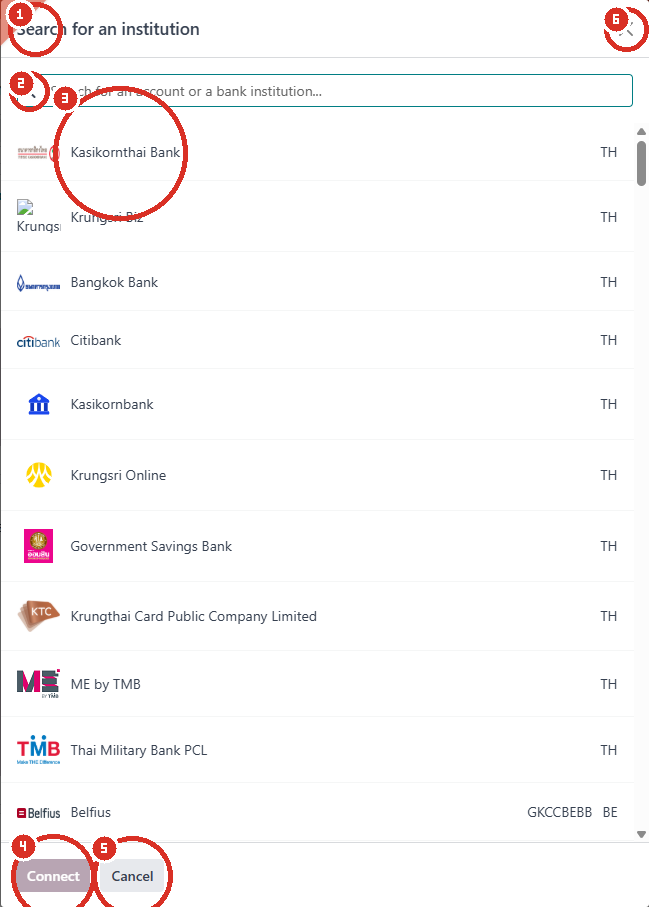

# ACC-005 คู่มือ Accounting > Configuration > Add a Bank Account

- บริษัท: Linkweld (Thailand) Co., Ltd.
- ระบบ: Odoo 18 Enterprise Staging
- วันที่ตรวจ: 16 กรกฎาคม 2026
- วิธีตรวจ: Evidence-first Read-only
- สถานะบท: `Confirmed` สำหรับเมนูและหน้าจอเริ่มต้นเลือกสถาบัน; การเลือกธนาคาร การสร้าง Journal และผลการ Sync เป็น `Not Available`

## ขอบเขตและข้อจำกัด

- ตรวจว่าเมนู Accounting > Configuration > Add a Bank Account แสดงต่อผู้ใช้ปัจจุบัน
- หน้าต่าง `Search for an institution` เปิดได้ จากนั้นปิด Browser session โดยไม่กดปุ่มในหน้าต่างและไม่ส่งข้อมูล
- ระหว่างเปิดเมนูพบเฉพาะ request `/web/action/load` และ `/web/action/run`; ไม่พบ Create/Write request
- ไม่ค้นหา ไม่เลือกสถาบันการเงิน ไม่กรอกเลขบัญชี Bank หรือ SWIFT
- ไม่กด Connect, Create, Continue, Record transactions manually หรือ Add new bank
- ไม่สร้าง Bank Journal, Bank Account, Online Synchronization หรือ Bank Transaction
- ผลการเปิด Wizard และการเชื่อมธนาคารต้องทดสอบใหม่บน Clone UAT หลังอนุมัติข้อมูลและช่วงวันที่นำเข้าธุรกรรม

หลักฐานโครงสร้าง:

- [ACC-005 Add a Bank Account extract](../evidence/accounting/ACC-005/ACC-005_add_bank_account_extract.json)

## ภาพ 1: Search for an institution

| หมายเลข | จุดบนหน้าจอ | ผลการตรวจ |
|---|---|---|
| 1 | ชื่อหน้าต่าง | ยืนยันว่าอยู่ที่ `Search for an institution` |
| 2 | ช่องค้นหา | ว่างและไม่ได้พิมพ์หรือส่งคำค้น |
| 3 | รายการสถาบัน | แสดง 11 แถวในหน้าจอเริ่มต้น แต่ยังไม่ได้เลือกสถาบันใด |
| 4 | Connect | ปิดใช้งานเพราะยังไม่ได้เลือกสถาบัน จึงไม่มีการเริ่มเชื่อมต่อ |
| 5 | Cancel | พร้อมใช้เพื่อปิดหน้าต่าง แต่หลักฐานชุดนี้ไม่ได้กด |
| 6 | Close | ทางออกจากหน้าต่างอีกจุดหนึ่ง แต่หลักฐานชุดนี้ไม่ได้กด |

## หน้าที่ของเมนูตาม Standard Odoo 18

| ขั้นตอน | Standard Odoo 18 | ผลกระทบ |
|---|---|---|
| Search for an institution | ค้นหาสถาบันการเงินที่ผู้ให้บริการเชื่อมต่อรองรับ | เป็นการเริ่มกระบวนการ Bank Synchronization |
| Type of account / Provider | บางธนาคารให้เลือกประเภทบัญชีหรือผู้ให้บริการเชื่อมต่อ | ตัวเลือกอาจเปลี่ยนเส้นทาง Consent และข้อมูลที่ธนาคารร้องขอ |
| Connect | เริ่มเชื่อมต่อกับธนาคารผ่านผู้ให้บริการภายนอก | อาจสร้าง Online Synchronization, Bank Journal และนำเข้าธุรกรรม |
| Add new bank / Record transactions manually | สร้างบัญชีธนาคารแบบไม่ Sync เมื่อไม่ต้องการหรือไม่สามารถเชื่อม Online | สร้าง Bank Journal และบัญชีที่เกี่ยวข้อง จึงเป็น Write operation |
| Initial synchronization | นำเข้าธุรกรรมหลังวันที่ของรายการล่าสุด; หาก Journal ว่างอาจดึงประวัติทั้งหมดที่ผู้ให้บริการส่งมา | เสี่ยงเกิดรายการย้อนหลังจำนวนมากและกระทบ Reconciliation |

## ผลการตรวจ Linkweld

| จุดตรวจ | ผล | Evidence Status |
|---|---|---|
| สิทธิ์เห็นเมนู | เห็น Add a Bank Account ภายใต้ Accounting > Configuration | Confirmed |
| Initial institution window | เปิดได้และแสดงรายการ 11 แถว ช่องค้นหาว่าง Connect ปิด และ Cancel ใช้งานได้ | Confirmed |
| Popup / Error notification | ไม่พบ Popup blocked, Access Error หรือ Odoo notification; พบเพียงโลโก้ภายนอกหนึ่งไฟล์โหลดไม่ได้จาก DNS ซึ่งไม่ขัดขวางหน้าต่าง | Confirmed เฉพาะสิ่งที่มองเห็น |
| Institution compatibility | ไม่ค้นหาหรือเลือกธนาคารตามกฎ Read-only | Not Available |
| Manual bank fields | ไม่เปิดขั้นตอน Add new bank | Not Available |
| Journal / Account creation | ไม่ส่ง Wizard และไม่สร้าง Record | Not Tested by design |
| Initial transaction import | ไม่เชื่อมธนาคาร | Not Tested by design |

## Accounting Policy ที่ต้องอนุมัติก่อน Config

| Policy | คำถามที่ต้องตัดสินใจ | Owner |
|---|---|---|
| Bank master ownership | ใครอนุมัติเลขบัญชี ชื่อธนาคาร สกุลเงิน บริษัท และการเปิด/ปิด Journal | CFO / Accounting Manager |
| Connection method | ใช้ Online Synchronization หรือ Import statement/manual transaction | CFO / Treasury / IT |
| Data consent | อนุญาตผู้ให้บริการภายนอกรายใดและข้อมูลบัญชีใดที่เข้าถึงได้ | Management / Legal / IT Security |
| Initial history cutoff | จะเริ่มนำเข้าตั้งแต่วันใด และต้องตั้ง Lock Everything ก่อน Sync หรือไม่ | Accounting Manager |
| Opening balance | ยอดยกมาและรายการก่อน Cutoff จะบันทึกและกระทบยอดอย่างไร | Accounting Manager |
| Currency | Journal currency, company currency และ exchange difference account ต้องตรง Policy ใด | Accounting Manager |
| Suspense / Outstanding | Bank Suspense, Outstanding Receipts และ Outstanding Payments ใช้บัญชีใด | Accounting Manager |
| Reconciliation | ใคร Fetch, Import, Match, Validate และแก้ Unmatched transaction | Treasury / Accounting |
| Multi-company access | ผู้ใช้ใดเห็นหรือจัดการบัญชีธนาคารของแต่ละบริษัท | System Admin / Accounting Manager |

## Standard Odoo vs Pain Point

| หัวข้อ | Standard Odoo 18 | สภาพที่พบใน Linkweld | ข้อเสนอ |
|---|---|---|---|
| Bank setup | Standard สร้าง Journal และ Account ให้เมื่อเพิ่มบัญชีธนาคาร | เมนูและ initial window เปิดได้โดยไม่มี Access Error | คง Standard และห้าม Connect จนกว่า Policy/Clone UAT พร้อม |
| Online sync | รองรับสถาบันจำนวนมากผ่านผู้ให้บริการภายนอก | ยังไม่ยืนยันธนาคารไทยหรือบัญชี Linkweld ใด | ทำ compatibility check โดยไม่ส่งข้อมูลจริงก่อน แล้วทดสอบใน Clone UAT |
| Manual account | สร้าง Bank Journal แบบไม่ Sync ได้ | ยังไม่เปิดขั้นตอนเพราะมี Write risk | ใช้เมื่อ Online sync ไม่รองรับและมี Policy import statement ชัดเจน |
| Initial import | ดึงรายการหลัง Transaction ล่าสุด และอาจดึงประวัติทั้งหมดถ้า Journal ว่าง | ยังไม่ได้กำหนด Cutoff | ตั้ง Lock Everything และ Opening Balance policy ก่อน Connect |
| Reconciliation | Standard รองรับ Bank transaction และ Matching | Custom payment/cheque/WHT addons มีโอกาสทับซ้อน | Regression การรับ-จ่าย เช็ค WHT FX และ Bank reconciliation ก่อน Go-live |

## Solution ที่แนะนำ

1. ใช้ Standard Odoo Bank Journal และ Reconciliation ก่อนพิจารณา Custom bank integration
2. ตรวจ Enterprise subscription, การเข้าถึง `production.odoofin.com`, Browser popup/ad-blocker และ Provider endpoint ก่อน UAT โดยไม่สร้าง Record
3. สร้าง Clone UAT จาก Staging และกำหนด Bank owner, Journal code, Currency, Account mapping และ Cutoff date ก่อน Connect
4. ตั้ง Lock Everything ตามวันที่ที่ Accounting อนุมัติก่อน Initial sync เพื่อป้องกันการนำเข้าประวัติย้อนหลังเกินขอบเขต
5. เริ่มด้วยบัญชีธนาคารทดสอบหนึ่งบัญชีและจำกัดผู้ใช้ หลังผ่าน Reconciliation จึงขยายไปบัญชีอื่น
6. ตรวจ Duplicate ระหว่าง Bank Account, Journal และ Online Synchronization ก่อนสร้างรายการใหม่
7. ทำ Regression ร่วมกับ Payment, Cheque, WHT, Foreign Currency, Outstanding Account และ Reconciliation addons ที่ติดตั้งอยู่
8. บันทึก Consent, Provider, ผู้อนุมัติ และหลักฐานการกระทบยอดไว้ใน Change Request ก่อน Promote

## รายการ UAT ขั้นต่ำบน Clone UAT เท่านั้น

| UAT ID | กรณีทดสอบ | ผลที่ต้องตรวจ | สถานะ |
|---|---|---|---|
| UAT-ACC-005-01 | ผู้ใช้ Accounting Manager เปิด Add a Bank Account | เปิด initial institution window ได้โดยไม่มี Access Error | Pending |
| UAT-ACC-005-02 | ค้นหาธนาคารที่อนุมัติ | พบสถาบัน ประเทศ Provider และ Account type ถูกต้อง โดยยังไม่ Connect | Pending |
| UAT-ACC-005-03 | ตรวจ Consent และข้อมูลที่ Provider ร้องขอ | Legal/IT Security อนุมัติและไม่มีการเก็บ Credential ใน Odoo หรือเอกสารโครงการ | Pending |
| UAT-ACC-005-04 | เชื่อมบัญชีทดสอบหนึ่งบัญชี | สร้าง Journal/Account/Online Synchronization หนึ่งชุด ไม่ซ้ำ Record เดิม | Pending |
| UAT-ACC-005-05 | ทดสอบ Manual bank path | Account Number, Bank, SWIFT, Currency, Company และ Journal mapping ถูกต้อง | Pending |
| UAT-ACC-005-06 | ทดสอบ Initial sync หลังตั้ง Lock Everything | นำเข้าเฉพาะช่วงวันที่อนุมัติ ไม่มีรายการย้อนหลังเกิน Cutoff | Pending |
| UAT-ACC-005-07 | กระทบยอด Statement/Transaction | Opening balance, ending balance, suspense และ unmatched ตรง Bank statement | Pending |
| UAT-ACC-005-08 | ทดสอบ Payment, Cheque และ WHT | ไม่มีรายการซ้ำและ Outstanding/Exchange difference ถูกบัญชี | Pending |
| UAT-ACC-005-09 | ทดสอบบัญชีสกุลเงินต่างประเทศ | Journal currency, rate, realized/unrealized difference และรายงานถูกต้อง | Pending |
| UAT-ACC-005-10 | ทดสอบ Multi-company และ Access | ผู้ใช้เห็น เชื่อม Fetch และ Reconcile ได้เฉพาะบริษัท/บทบาทที่อนุมัติ | Pending |

## สรุปสถานะ

- Confirmed ว่าผู้ใช้ปัจจุบันเห็นเมนู Add a Bank Account
- Initial institution window เปิดได้และไม่พบ Access Error แต่ยังไม่ได้ยืนยันการเลือกธนาคารหรือ Connect
- ยังไม่ยืนยันธนาคาร Provider Account type Journal mapping หรือ Initial sync ของ Linkweld
- ไม่พบเหตุผลให้ทำ Custom ก่อนตรวจ Standard connectivity และ Policy บน Clone UAT
- ไม่มีการสร้าง แก้ไข บันทึก เชื่อม หรือ Import ข้อมูลใน Odoo

อ้างอิง:

- [Odoo 18 Bank synchronization](https://www.odoo.com/documentation/18.0/applications/finance/accounting/bank/bank_synchronization.html)
- [Odoo 18 Bank and cash accounts](https://www.odoo.com/documentation/18.0/applications/finance/accounting/bank.html)
