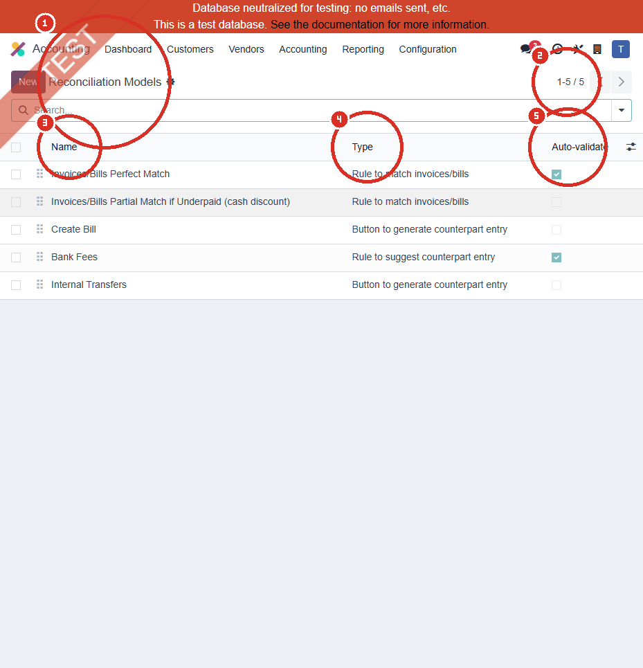
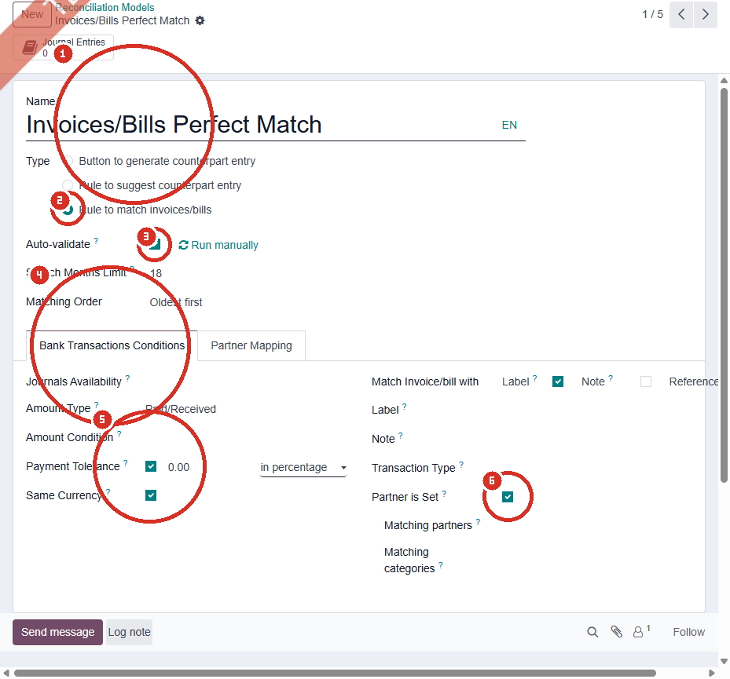
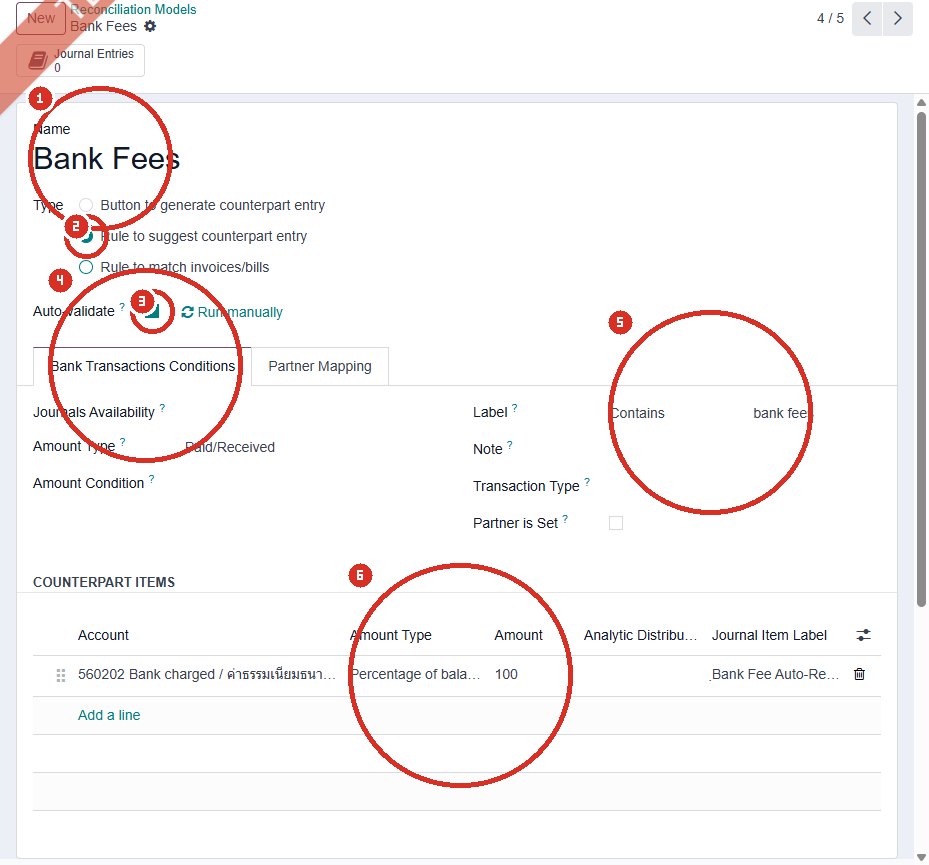
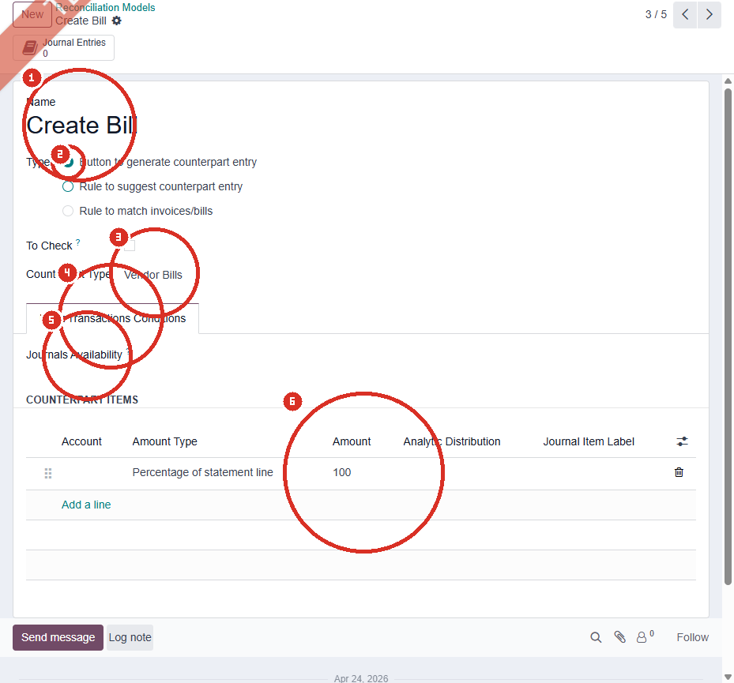

# ACC-006 คู่มือ Accounting > Configuration > Reconciliation Models

- บริษัท: Linkweld (Thailand) Co., Ltd.
- ระบบ: Odoo 18 Enterprise Staging
- วันที่ตรวจ: 16 กรกฎาคม 2026
- วิธีตรวจ: Evidence-first Read-only
- สถานะบท: `Confirmed` สำหรับรายการ 5 Models และรายละเอียด 3 ฟอร์มที่เปิดอ่าน; ผลการ Reconcile จริงเป็น `Not Available`

## ขอบเขตและข้อจำกัด

- ตรวจรายการ Reconciliation Models ทั้ง 5 รายการ และเปิดฟอร์มเดิม 3 รายการใน View mode
- ไม่กด New, Run manually, Auto-validate, Add a line, Save, Archive, Delete หรือคำสั่ง Reconcile
- ไม่แก้ลำดับ Model, Conditions, Account, Amount, Partner Mapping หรือ Journal Item Label
- ไม่สร้าง Bank Transaction, Vendor Bill, Journal Entry หรือข้อมูลทดสอบ
- รายละเอียดของ Partial Match, Internal Transfers และ Partner Mapping ยังไม่ยืนยัน เพราะไม่ได้เปิดหรือเปลี่ยน Tab ในหลักฐานชุดนี้

หลักฐานโครงสร้าง:

- [ACC-006 Reconciliation Models extract](../evidence/accounting/ACC-006/ACC-006_reconciliation_models_extract.json)

## ภาพ 1: รายการ Reconciliation Models

| หมายเลข | จุดบนหน้าจอ | ผลการตรวจ |
|---|---|---|
| 1 | ชื่อรายการ | ยืนยันว่าอยู่ที่ Accounting > Configuration > Reconciliation Models |
| 2 | Pager | แสดง `1-5 / 5` จึงพบ 5 รายการในบริษัทปัจจุบัน |
| 3 | Name และลำดับ | ลำดับมีผลเมื่อหลาย Models ตรงเงื่อนไข โดย Odoo ใช้รายการแรกที่ตรง |
| 4 | Type | พบครบ 3 ประเภท: Match invoices/bills, Suggest counterpart และ Button counterpart |
| 5 | Auto-validate | เปิด 2 รายการ คือ Perfect Match และ Bank Fees |

## รายการที่พบทั้งหมด

| ลำดับ | Name | Type | Auto-validate | Detail Evidence |
|---|---|---|---|---|
| 1 | Invoices/Bills Perfect Match | Rule to match invoices/bills | On | Confirmed |
| 2 | Invoices/Bills Partial Match if Underpaid (cash discount) | Rule to match invoices/bills | Off | Not Available |
| 3 | Create Bill | Button to generate counterpart entry | Off | Confirmed |
| 4 | Bank Fees | Rule to suggest counterpart entry | On | Confirmed |
| 5 | Internal Transfers | Button to generate counterpart entry | Off | Not Available |

## ภาพ 2: Invoices/Bills Perfect Match

| หมายเลข | Field | ค่าปัจจุบัน | ผลและความเสี่ยง |
|---|---|---|---|
| 1 | Name / Type | Invoices/Bills Perfect Match / Rule to match invoices/bills | ใช้ค้นหา Invoice, Bill หรือ Payment ที่มีอยู่แล้ว |
| 2 | Auto-validate | On | เมื่อเงื่อนไขตรงสมบูรณ์ Odoo สามารถ Reconcile อัตโนมัติ จึงต้องทดสอบ false positive |
| 3 | Search Months Limit / Matching Order | 18 / Oldest first | เอกสารเกิน 18 เดือนอาจไม่ถูกค้นหา และรายการเก่ากว่าจะถูกพิจารณาก่อน |
| 4 | Amount Type / Payment Tolerance | Paid/Received / On, 0.00% | ค่า 0% ทำให้ไม่มีส่วนต่างที่ยอมรับได้จาก Model นี้ แม้ Toggle เปิดอยู่ |
| 5 | Same Currency | On | จำกัด Matching ให้สกุลเงินตรงกัน ลดความเสี่ยงจับคู่ข้าม Currency |
| 6 | Match conditions | Label On, Partner is Set On; Note/Reference Off | ความถูกต้องขึ้นกับคุณภาพ Label และ Partner ของ Bank Transaction |

## ภาพ 3: Bank Fees

| หมายเลข | Field | ค่าปัจจุบัน | ผลและความเสี่ยง |
|---|---|---|---|
| 1 | Name / Type | Bank Fees / Rule to suggest counterpart entry | ใช้สร้าง Counterpart สำหรับค่าธรรมเนียมธนาคารที่เกิดซ้ำ |
| 2 | Auto-validate | On | เมื่อ Conditions ตรง ระบบอาจลงบัญชีและ Reconcile โดยไม่รอผู้ใช้ตรวจ |
| 3 | Amount Type | Paid/Received | ใช้ทิศทางเงินรับหรือจ่ายเป็นส่วนหนึ่งของเงื่อนไข |
| 4 | Label / Partner | Contains `bank fees`; Partner is Set Off | Keyword ค่อนข้างกว้างและไม่บังคับ Partner จึงต้องทดสอบข้อความที่คล้ายกัน |
| 5 | Account | `560202 Bank charged / ค่าธรรมเนียมธนาคาร` | รายการที่ตรงจะเสนอหรือใช้บัญชีค่าใช้จ่ายนี้ ต้องยืนยัน Account type และ Tax policy |
| 6 | Amount / Label | 100% of balance / `Bank Fee Auto-Recon` | ลงยอดคงเหลือทั้งหมดเป็นค่าธรรมเนียมเมื่อ Model ทำงาน |

## ภาพ 4: Create Bill

| หมายเลข | Field | ค่าปัจจุบัน | ผลและความเสี่ยง |
|---|---|---|---|
| 1 | Name / Type | Create Bill / Button to generate counterpart entry | เป็นปุ่มให้ผู้ใช้เรียก ไม่ใช่ Rule ที่ Auto-run |
| 2 | To Check | Off | ผลลัพธ์อาจไม่ถูก Flag ให้ตรวจตาม Field นี้ ต้องยืนยัน Workflow อนุมัติ |
| 3 | Counterpart Type | Vendor Bills | ใช้สร้างฝั่ง Vendor Bill จาก Bank Transaction เมื่อผู้ใช้กดปุ่ม |
| 4 | Bank Transactions Conditions | ไม่พบเงื่อนไขเฉพาะในภาพ | ปุ่มอาจพร้อมใช้งานกว้าง ต้องจำกัดด้วยสิทธิ์และคู่มือ |
| 5 | Account | ว่าง | ต้องยืนยันว่าผู้ใช้เลือก Account, Vendor และ Tax อย่างถูกต้องก่อน Post |
| 6 | Amount | 100% of statement line | ใช้ยอด Bank Transaction เต็มจำนวนเป็นฐานของ Counterpart |

## อธิบาย Type และ Field สำคัญ

| Field / Type | Standard Odoo 18 | จุดควบคุม |
|---|---|---|
| Button to generate counterpart entry | สร้างปุ่มใน Bank Reconciliation ให้ผู้ใช้สร้าง Counterpart ตาม Rule | จำกัดสิทธิ์และบังคับตรวจ Account, Partner, Tax, Analytic และ Amount |
| Rule to suggest counterpart entry | เสนอรายการใหม่จาก Conditions ของ Bank Transaction | ทดสอบ Keyword, Regex, ทิศทางเงิน และ false positive |
| Rule to match invoices/bills | จับคู่กับ Invoice, Bill หรือ Payment ที่มีอยู่ | ตรวจ Label, Partner, Reference, Currency, Amount และช่วงเดือนค้นหา |
| Auto-validate | Reconcile อัตโนมัติเมื่อเงื่อนไขครบ | ถือเป็น High risk; ต้องมี Negative test และ Monitoring |
| Sequence | หากหลาย Models ตรง จะใช้รายการแรกตามลำดับ | Freeze ลำดับหลัง UAT และใช้ Change Request เมื่อเปลี่ยน |
| Payment Tolerance | รองรับกรณีรับเงินต่ำกว่ายอด เช่น Cash discount | Odoo ระบุว่าไม่ใช้กับ Overpayment; ต้องยืนยัน Tax reduction policy |
| Partner Mapping | Map ข้อความจาก Bank Transaction ไป Partner | ต้องตรวจ Duplicate keyword และ Multi-company |
| Counterpart Items | กำหนด Account, Amount, Label และ Analytic Distribution | ตรวจ Debit/Credit, Tax, Currency และ Reporting ก่อน Auto-validate |

## Standard Odoo vs Pain Point

| หัวข้อ | Standard Odoo 18 | สภาพที่พบใน Linkweld | ข้อเสนอ |
|---|---|---|---|
| Default models | Localization อาจมี Models เริ่มต้นและแก้ไขได้ | พบ 5 Models ครบสามประเภท | ใช้ Standard ก่อน Custom และระบุ Owner ของแต่ละ Model |
| Perfect match | ค้นหาเอกสารและ Auto-reconcile เมื่อ Conditions ตรง | Auto-validate On, Search 18 เดือน, Label + Partner, Same Currency | ทดสอบ duplicate reference, similar partner และเอกสารเกิน 18 เดือน |
| Partial match | รองรับ Underpayment/Cash discount พร้อม Tolerance | มีรายการแต่ไม่ได้เปิดรายละเอียด | ตรวจ Tolerance, Difference account และ Thai VAT/WHT ก่อนใช้ |
| Bank fees | ใช้ Label หรือ Regex เพื่อเสนอ Counterpart | Auto-validate On, Contains `bank fees`, ไม่บังคับ Partner, ลง 100% ที่ 560202 | จำกัด Keyword/Journal และทำ false-positive test |
| Create Bill | ปุ่มสร้าง Counterpart หรือ Vendor Bill จาก Bank Transaction | Account ว่าง, To Check Off, Amount 100% | บังคับ Vendor/Tax/Account review และห้าม Auto-post โดยไม่อนุมัติ |
| Internal transfer | ใช้ปุ่มลง Internal Transfer account และ Reconcile ทั้งสองฝั่ง | มี Model แต่รายละเอียดไม่ยืนยัน | ตรวจ Transfer account และจับคู่ขาออก/ขาเข้าบน Clone UAT |
| Partner mapping | ช่วย Map ธุรกรรมไป Partner | เห็น Tab แต่ไม่ได้ตรวจ Rows | Review Mapping ทั้งหมดก่อน Go-live |

## Solution ที่แนะนำ

1. Freeze ลำดับและค่าของ 5 Models จนกว่า Accounting จะอนุมัติ UAT
2. จัด Auto-validate ทั้ง Perfect Match และ Bank Fees เป็น High-risk control และกำหนดผู้ตรวจรายงานรายการที่ Auto-reconciled
3. จำกัด Bank Fees ด้วย Journal, Amount direction และข้อความที่เฉพาะกว่าเดิม หาก Negative test พบ false positive
4. ตรวจ Account `560202`, VAT, WHT, Currency และ Analytic policy ก่อนยอมให้ Bank Fees Auto-validate
5. เปิดรายละเอียด Partial Match บนรอบ Read-only ถัดไปก่อนใช้งาน Cash discount และยืนยัน Difference account กับ Tax reduction
6. กำหนด Create Bill workflow ให้ต้องมี Vendor, Expense account, Tax invoice, VAT/WHT และ Approver ก่อน Post
7. ตรวจ Internal Transfer account และ Reconcile ทั้งขาออก/ขาเข้า ไม่ใช้ Model นี้กับ Supplier/Customer payment
8. จำกัดสิทธิ์แก้ Model, Sequence และ Auto-validate ให้ Accounting Manager/System Admin ที่อนุมัติเท่านั้น

## รายการ UAT ขั้นต่ำบน Clone UAT เท่านั้น

| UAT ID | กรณีทดสอบ | ผลที่ต้องตรวจ | สถานะ |
|---|---|---|---|
| UAT-ACC-006-01 | Perfect Match ด้วย Label, Partner, Amount และ Currency ตรง | จับคู่เอกสารถูกใบและ Auto-validate เพียงหนึ่งครั้ง | Pending |
| UAT-ACC-006-02 | Label คล้ายกันหรือ Partner มีหลายเอกสารยอดเท่ากัน | ไม่ Auto-reconcile ผิดเอกสาร | Pending |
| UAT-ACC-006-03 | Invoice/Bill เก่ากว่า 18 เดือน | แสดงผลตาม Search Months Limit และมีวิธี Manual ที่ควบคุมได้ | Pending |
| UAT-ACC-006-04 | Partial underpayment ภายในและเกิน Tolerance | ส่วนต่าง Account, Cash discount และ Tax reduction ถูก Policy | Pending |
| UAT-ACC-006-05 | Overpayment | ไม่ใช้ Payment Tolerance ผิดกรณีและบันทึก Outstanding ถูกต้อง | Pending |
| UAT-ACC-006-06 | Bank fee Label ตรงและไม่ตรง Keyword | ลง 560202 เฉพาะรายการที่อนุมัติ ไม่มี false positive | Pending |
| UAT-ACC-006-07 | Bank fee ต่าง Currency/Journal/ทิศทางเงิน | Account, Exchange difference และ Amount sign ถูกต้อง | Pending |
| UAT-ACC-006-08 | Create Bill จาก Bank Transaction | Vendor, Account, Tax, WHT, Amount และ Approval ครบก่อน Post | Pending |
| UAT-ACC-006-09 | Internal transfer ระหว่างสอง Bank Journals | ใช้ Internal Transfer account และ Reconcile ครบทั้งขาออก/ขาเข้า | Pending |
| UAT-ACC-006-10 | Partner Mapping คำซ้ำหรือหลายบริษัท | Map ถูก Partner และ Company โดยไม่ข้ามสิทธิ์ | Pending |
| UAT-ACC-006-11 | หลาย Models ตรงพร้อมกัน | ใช้ Model แรกตาม Sequence ที่อนุมัติ | Pending |
| UAT-ACC-006-12 | สิทธิ์ผู้ใช้และ Audit | ผู้ใช้ทั่วไปแก้ Model/Auto-validate ไม่ได้ และตรวจย้อนหลังได้ | Pending |

## สรุปสถานะ

- Confirmed ว่ามี Reconciliation Models 5 รายการ และพบ Auto-validate On 2 รายการ
- Perfect Match ใช้ช่วงค้นหา 18 เดือน, Oldest first, Label + Partner, Same Currency และ Tolerance 0.00%
- Bank Fees ใช้ Label Contains `bank fees`, ไม่บังคับ Partner และลง 100% ไปบัญชี `560202`
- Create Bill เป็นปุ่ม, To Check Off, Counterpart Type Vendor Bills, Account ว่าง และ Amount 100%
- ผลการ Reconcile, Partial Match detail, Internal Transfer mapping และ Partner Mapping ยังไม่ยืนยัน
- ไม่มีการสร้าง แก้ไข บันทึก หรือ Execute Model/Transaction ใดใน Odoo

อ้างอิง:

- [Odoo 18 Reconciliation models](https://www.odoo.com/documentation/18.0/applications/finance/accounting/bank/reconciliation_models.html)
- [Odoo 18 Bank reconciliation](https://www.odoo.com/documentation/18.0/applications/finance/accounting/bank/reconciliation.html)
- [Odoo 18 Internal transfers](https://www.odoo.com/documentation/18.0/applications/finance/accounting/bank/internal_transfers.html)
