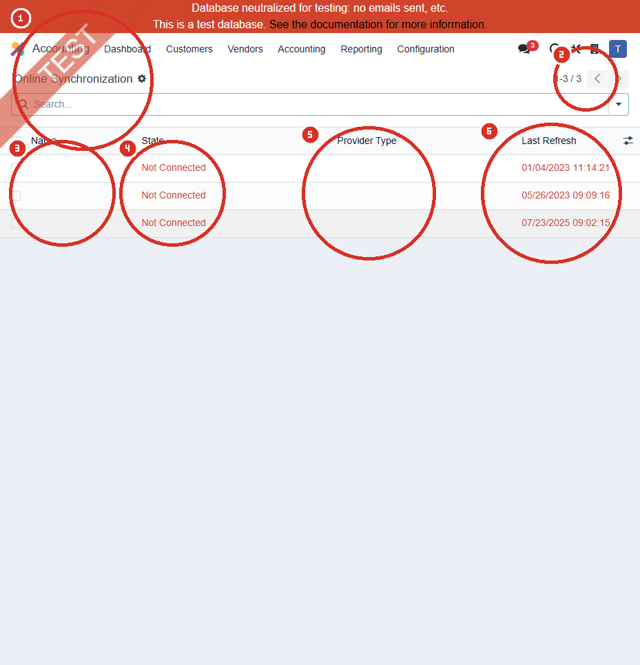
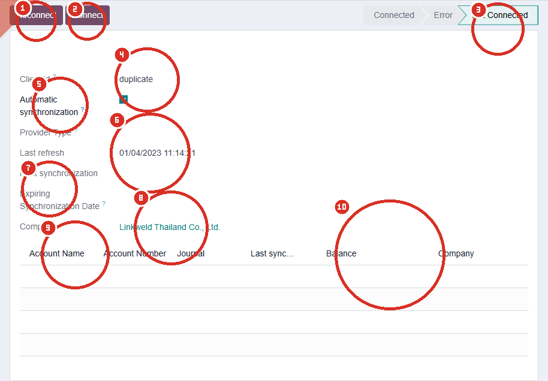

# ACC-007 คู่มือ Accounting > Configuration > Online Synchronization

- บริษัท: Linkweld (Thailand) Co., Ltd.
- ระบบ: Odoo 18 Enterprise Staging
- วันที่ตรวจ: 16 กรกฎาคม 2026
- วิธีตรวจ: Evidence-first Read-only
- สถานะบท: `Confirmed` สำหรับรายการและฟอร์ม Not Connected; ผลการ Connect, Reconnect, Fetch และ Sync เป็น `Not Available`

## ขอบเขตและข้อจำกัด

- ตรวจรายการ Online Synchronization ทั้ง 3 Records และเปิดฟอร์มเดิม 1 รายการใน View mode
- ไม่กด Fetch Transactions, Update Credentials, Connect, Reconnect, Synchronize, New, Edit, Save, Archive หรือ Delete
- ไม่เปิดหน้า Provider, OAuth, Credential, Token, Technical field หรือ External link
- ไม่สร้าง Bank Connection, Account Mapping, Journal หรือ Transaction
- ค่า Last Refresh เก็บตามรูปแบบที่หน้าจอแสดงเพื่อหลีกเลี่ยงการตีความวัน/เดือนผิด

หลักฐานโครงสร้าง:

- [ACC-007 Online Synchronization extract](../evidence/accounting/ACC-007/ACC-007_online_synchronization_extract.json)

## ภาพ 1: รายการ Online Synchronization

| หมายเลข | จุดบนหน้าจอ | ผลการตรวจ |
|---|---|---|
| 1 | ชื่อรายการ | ยืนยันว่าอยู่ที่ Accounting > Configuration > Online Synchronization |
| 2 | Pager | แสดง `1-3 / 3` จึงพบ 3 Records |
| 3 | Name | ว่างทั้ง 3 Records |
| 4 | State | `Not Connected` ทั้ง 3 Records |
| 5 | Provider Type | ว่างทั้ง 3 Records |
| 6 | Last Refresh | แสดง `01/04/2023 11:14:21`, `05/26/2023 09:09:16`, `07/23/2025 09:02:15` |

## ภาพ 2: ฟอร์ม Not Connected

| หมายเลข | Field / Control | ค่าปัจจุบัน | ผลและความเสี่ยง |
|---|---|---|---|
| 1 | Reconnect | แสดงบนหน้าจอ แต่ไม่ได้กด | อาจเริ่มกระบวนการเชื่อม Provider ใหม่ จึงห้ามใช้บน Primary staging |
| 2 | Connect | แสดงบนหน้าจอ แต่ไม่ได้กด | อาจสร้าง/เปลี่ยน Connection และ Account Mapping |
| 3 | Status | Not Connected; Connected และ Error ไม่ Active | ยืนยันว่า Record ตัวอย่างไม่ได้เชื่อมอยู่ในขณะตรวจ |
| 4 | Client id | `duplicate` | เป็นค่าที่เห็นบนหน้าจอ ไม่ใช่ Credential ที่เปิดตรวจ และยังไม่สรุปสาเหตุ |
| 5 | Automatic synchronization | On | เป็นค่าบน Record แต่ไม่มีหลักฐานว่า Schedule ทำงาน เพราะยัง Not Connected และ Next synchronization ว่าง |
| 6 | Provider Type | ว่าง | ไม่สามารถยืนยัน Provider หรือความเข้ากันได้ของธนาคาร |
| 7 | Last refresh | `01/04/2023 11:14:21` | เป็นประวัติบน Record ไม่ยืนยันว่ามี Sync สำเร็จหรือ Transaction ถูกนำเข้า |
| 8 | Next / Expiring Date | ว่างทั้งคู่ | ไม่มีหลักฐานรอบ Sync ถัดไปหรือวันหมดอายุ Connection |
| 9 | Company | Linkweld Thailand Co., Ltd. | Record อยู่ในบริษัทปัจจุบัน ต้องควบคุม Multi-company access |
| 10 | Account Mapping | ตารางว่าง 0 แถว | ไม่มี Bank Account, Journal, Balance หรือ Last synchronization mapping ในฟอร์มนี้ |

## ผลการตรวจ Records ปัจจุบัน

| จุดตรวจ | ผล | Evidence Status |
|---|---|---|
| จำนวน Records | 3 | Confirmed |
| Name | ว่างทั้ง 3 | Confirmed |
| State | Not Connected ทั้ง 3 | Confirmed |
| Provider Type | ว่างทั้ง 3 | Confirmed |
| Account Mapping | ฟอร์มตัวอย่างไม่มี Row | Confirmed สำหรับ Record ตัวอย่าง |
| Automatic synchronization | On ใน Record ตัวอย่าง | Confirmed แต่ Runtime Not Available |
| Connected bank/provider | ไม่พบ | Not Available |
| Fetch/Imported transactions | ไม่ได้เรียก | Not Tested by design |
| Credential/OAuth | ไม่ได้เปิด | Not Inspected by design |

## อธิบาย Field และผลเมื่อ Config

| Field / Control | หน้าที่ | จุดควบคุม |
|---|---|---|
| State | แสดง Connected, Error หรือ Not Connected | ใช้ติดตาม Connection health แต่ต้องดู Error log และ Provider ด้วย |
| Provider Type | ระบุผู้ให้บริการเชื่อม Bank | ต้องผ่าน Legal, Security และ Bank compatibility review |
| Automatic synchronization | ให้ระบบ Fetch ตามรอบเมื่อ Provider รองรับและ Connection Active | เปิดหลัง Cutoff, Mapping และ Reconciliation UAT เท่านั้น |
| Last refresh | เวลาที่ Record ถูก Refresh ล่าสุด | ไม่เท่ากับการยืนยันว่า Transactions ครบหรือ Reconciled |
| Next synchronization | เวลารอบอัตโนมัติถัดไป | ต้องไม่ว่างเมื่อ Connection Active และ Policy ต้องการ Auto Sync |
| Expiring Synchronization Date | วันหมดอายุหรือรอบต่ออายุ Connection | กำหนด Owner และ Alert ก่อนหมดอายุ |
| Account Mapping | ผูกบัญชีจาก Provider กับ Bank Journal ใน Odoo | ห้าม Mapping ข้าม Company, Currency หรือบัญชีธนาคาร |
| Connect / Reconnect | เริ่มหรือสร้าง Connection ใหม่ | ใช้เฉพาะ Clone UAT และต้องมีผู้อนุมัติ |
| Fetch Transactions | นำ Bank Transactions เข้า Odoo | มีผลต่อ Reconciliation และอาจนำเข้าประวัติย้อนหลัง |
| Update Credentials | ต่ออายุหรือเปลี่ยนสิทธิ์ Provider | ห้ามบันทึก Credential ในคู่มือ, Screenshot หรือ Ticket |

## Standard Odoo vs Pain Point

| หัวข้อ | Standard Odoo 18 | สภาพที่พบใน Linkweld | ข้อเสนอ |
|---|---|---|---|
| Connection | เชื่อมผ่าน Third-party Provider และเลือกบัญชีที่ต้อง Sync | 3 Records เป็น Not Connected ชื่อ/Provider ว่าง | จัดเป็น stale/unowned candidate และ Trace ที่มา ก่อน Archive/Delete |
| Automatic sync | หลังเชื่อมแล้ว Odoo โดยทั่วไป Sync ตามรอบ และบางธนาคารต้อง Manual | Record ตัวอย่างเปิด Automatic แต่ไม่มี Next synchronization | ไม่ถือว่า Active; ยืนยัน Runtime บน Clone UAT เท่านั้น |
| Account mapping | ผูกบัญชีธนาคารกับ Journal | ตารางตัวอย่างว่าง | ห้าม Connect จนกว่า Journal, Currency, Company และ Cutoff อนุมัติ |
| Credential expiry | Update Credentials ตาม Provider process | Expiring Date ว่างและไม่ได้เปิด Credential | กำหนด Connection owner และ Renewal procedure |
| Initial history | อาจนำเข้าประวัติทั้งหมดหาก Journal ไม่มี Transaction | ยังไม่มี Mapping หรือ Cutoff | ตั้ง Lock Everything และ Reconcile opening balance ก่อน First Sync |
| Governance | Online links ควรมี Name, Provider, Company และ Mapping ที่ Trace ได้ | ชื่อ/Provider ว่างทั้ง 3 และ Last Refresh กระจายหลายปี | ทำ inventory/owner review; ไม่ลบจากข้อมูลหน้าจอเพียงอย่างเดียว |

## Solution ที่แนะนำ

1. Freeze ปุ่ม Connect/Reconnect/Fetch/Update Credentials บน Primary staging จนกว่า Accounting และ IT อนุมัติ
2. Trace Record ทั้ง 3 กับ Odoo Vietnam, Odoo.sh history และ Bank Journal ownership เพื่อระบุว่าเป็น Historical, Duplicate หรือ Abandoned record
3. ห้าม Archive/Delete จนกว่าจะตรวจ Journal, Transaction, Message log, External identifier และ Audit requirement
4. หากต้องใช้ Online Sync ให้สร้าง Clone UAT และเริ่มจากบัญชีเดียว พร้อม Provider, Company, Currency, Journal และ Cutoff ที่อนุมัติ
5. ตั้ง Lock Everything ก่อน First Sync ตาม Accounting policy และกระทบยอดยอดยกมากับ Bank statement
6. จำกัดสิทธิ์ Connect, Credential update และ Fetch ให้ Treasury/Accounting Manager ที่ได้รับอนุมัติ
7. กำหนด Monitoring สำหรับ Last refresh, Next synchronization, Expiry, Error และ Duplicate transaction
8. หากธนาคารไม่รองรับหรือ Control ไม่ผ่าน ให้ใช้ Statement import/manual reconciliation แทนการทำ Custom ทันที

## รายการ UAT ขั้นต่ำบน Clone UAT เท่านั้น

| UAT ID | กรณีทดสอบ | ผลที่ต้องตรวจ | สถานะ |
|---|---|---|---|
| UAT-ACC-007-01 | Inventory 3 Existing links | ระบุ Owner, Provider, Journal reference และเหตุผลคง/Archive ได้ | Pending |
| UAT-ACC-007-02 | Connect บัญชีทดสอบหนึ่งบัญชี | State, Provider, Company และ Mapping ถูกต้อง ไม่มี Duplicate link | Pending |
| UAT-ACC-007-03 | Initial Sync หลังตั้ง Cutoff | นำเข้าเฉพาะช่วงอนุมัติและยอดตรง Bank statement | Pending |
| UAT-ACC-007-04 | Automatic synchronization | Last/Next synchronization อัปเดตตามรอบและไม่ Fetch ซ้ำ | Pending |
| UAT-ACC-007-05 | Manual Fetch | ผู้มีสิทธิ์เรียกได้ครั้งเดียวและ Transaction ไม่ซ้ำ | Pending |
| UAT-ACC-007-06 | Reconnect / Credential expiry | Connection ต่ออายุได้โดยไม่เปิดเผย Credential และ Mapping ไม่เปลี่ยนผิด | Pending |
| UAT-ACC-007-07 | Provider error / outage | State เป็น Error, มี Alert/Owner และใช้ Manual fallback ได้ | Pending |
| UAT-ACC-007-08 | Multi-company / Multi-currency | Mapping ไม่ข้าม Company และ Journal currency ถูกต้อง | Pending |
| UAT-ACC-007-09 | Bank Reconciliation regression | Payment, Cheque, WHT, FX และ Reconciliation Models ไม่สร้างรายการซ้ำ | Pending |
| UAT-ACC-007-10 | Archive stale link | ทำได้เฉพาะหลังยืนยันว่าไม่มี Journal/Transaction/Audit dependency | Pending |

## สรุปสถานะ

- Confirmed ว่ามี Online Synchronization 3 Records และทั้งหมดเป็น Not Connected
- Name และ Provider Type ว่างทั้งหมด; Record ตัวอย่างไม่มี Account Mapping
- Automatic synchronization On ใน Record ตัวอย่าง แต่ไม่มี Next synchronization และไม่มีหลักฐานว่า Runtime ทำงาน
- Last Refresh เป็นเพียงค่าประวัติบน Record ไม่ยืนยัน Sync success หรือ Transaction completeness
- Records ทั้ง 3 ต้อง Owner review และ Trace dependency ก่อน Archive/Delete
- ไม่มีการ Connect, Reconnect, Fetch, Update Credentials, Sync, Create หรือ Write ใดใน Odoo

อ้างอิง:

- [Odoo 18 Bank synchronization](https://www.odoo.com/documentation/18.0/applications/finance/accounting/bank/bank_synchronization.html)
- [Odoo 18 Bank transactions](https://www.odoo.com/documentation/18.0/applications/finance/accounting/bank/transactions.html)
- [Odoo 18 Bank reconciliation](https://www.odoo.com/documentation/18.0/applications/finance/accounting/bank/reconciliation.html)
