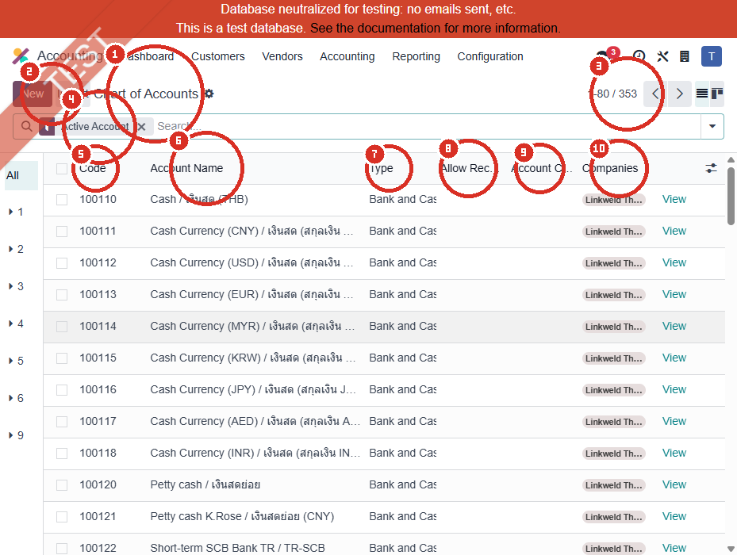
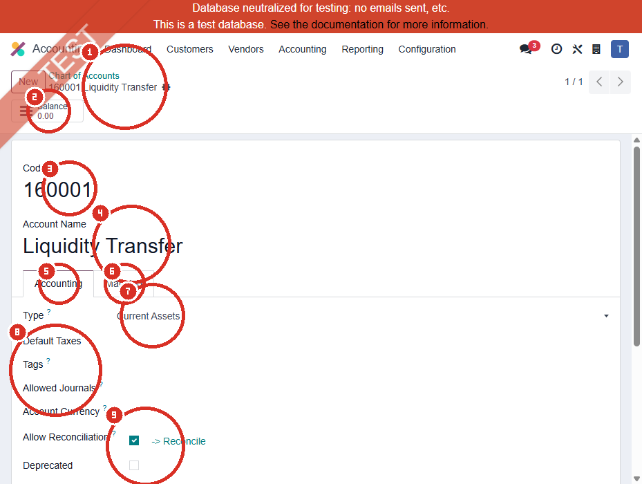
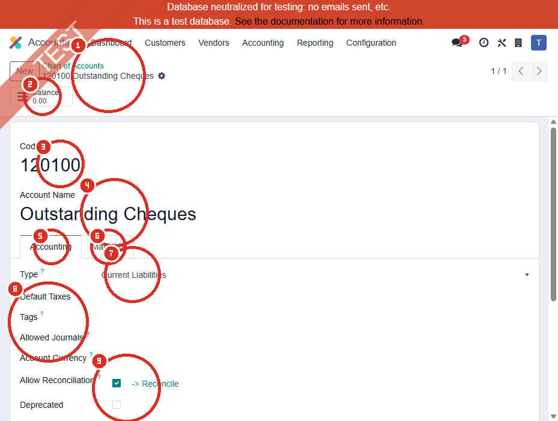
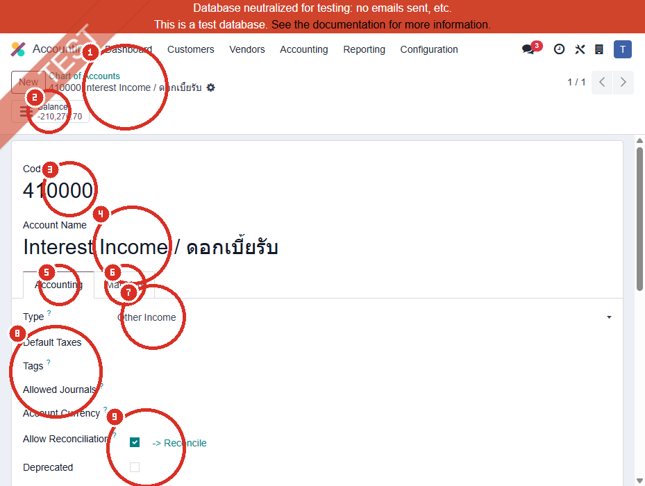

# ACC-008 คู่มือ Accounting > Configuration > Chart of Accounts

- บริษัท: Linkweld (Thailand) Co., Ltd.
- ระบบ: Odoo 18 Enterprise Staging
- วันที่ตรวจ: 16 กรกฎาคม 2026
- วิธีตรวจ: Evidence-first Read-only
- สถานะบท: `Confirmed` สำหรับยอดรวม 353 Active Accounts, Account Type counts และสามบัญชีอ้างอิงจาก ACC-001; การใช้งานย้อนหลังเป็น `Not Available`

## ขอบเขตและข้อจำกัด

- ตรวจ Chart of Accounts ภายใต้ Filter `Active Account` และเปิดบัญชีเดิม 3 รายการแบบ View mode
- ยอดรวมและ Account Type counts จำกัดที่บริษัท Linkweld Thailand Co., Ltd. และรวมตรงกับ UI 353 รายการ
- ผล Read Group ครั้งแรกที่ไม่มี Company context ถูกตัดทิ้ง ไม่ใช้เป็นหลักฐาน
- จำกัดภาพ List ให้เห็นเฉพาะแถวแรกเพื่อไม่เปิดเผยเลขบัญชีธนาคารที่อาจอยู่ในชื่อบัญชีแถวล่าง
- ไม่กด New, Import, Export, Reconcile, Balance, Journal Items, Mapping, Save, Archive หรือ Delete
- ไม่สร้าง แก้ Code/Name/Type, Allow Reconciliation, Currency, Tax, Tag, Group, Company หรือ Allowed Journals

หลักฐานโครงสร้าง:

- [ACC-008 Chart of Accounts extract](../evidence/accounting/ACC-008/ACC-008_chart_of_accounts_extract.json)

## ภาพ 1: Chart of Accounts

| หมายเลข | จุดบนหน้าจอ | ผลการตรวจ |
|---|---|---|
| 1 | ชื่อรายการ | Accounting > Configuration > Chart of Accounts |
| 2 | Active Account filter | List จำกัดเฉพาะบัญชี Active |
| 3 | Pager | `1-80 / 353`; Page size 80 และ Active total 353 |
| 4 | Search panel | ใช้ค้นหา Code เฉพาะบัญชีเดิมโดยไม่แก้ข้อมูล |
| 5 | Code | รหัสบัญชีที่ใช้ระบุ Account ใน Journal และ Report |
| 6 | Account Name | ชื่อควรสะท้อนวัตถุประสงค์ทางบัญชีและ Policy |
| 7 | Type | มีผลต่อ Financial Report, Year-end closing และ Opening entries |
| 8 | Allow Reconciliation | กำหนดว่า Journal items ของ Account แสดงเป็นตัวเลือก Match หรือไม่ |
| 9 | Account Currency / Companies | จำกัด Currency และ Company scope ของ Account |
| 10 | View | เปิดฟอร์ม Existing account โดยไม่เข้าสู่ Edit mode |

## จำนวน Active Accounts ตาม Type

| Account Type | Technical Type | จำนวน |
|---|---|---:|
| Bank and Cash | asset_cash | 40 |
| Current Assets | asset_current | 40 |
| Fixed Assets | asset_fixed | 22 |
| Non-current Assets | asset_non_current | 2 |
| Receivable | asset_receivable | 10 |
| Equity | equity | 12 |
| Current Year Earnings | equity_unaffected | 1 |
| Expenses | expense | 126 |
| Depreciation | expense_depreciation | 12 |
| Cost of Revenue | expense_direct_cost | 7 |
| Income | income | 11 |
| Other Income | income_other | 6 |
| Current Liabilities | liability_current | 38 |
| Non-current Liabilities | liability_non_current | 16 |
| Payable | liability_payable | 10 |
| **รวม** |  | **353** |

หมายเหตุ: จำนวนนี้ยืนยันโครงสร้างระดับ Type ไม่ใช่การอนุมัติความถูกต้องของ Code, Name, Balance หรือ Mapping ทุกบัญชี

## ภาพ 2: 160001 Liquidity Transfer

| หมายเลข | Field | ค่าปัจจุบัน | ผลและความเสี่ยง |
|---|---|---|---|
| 1 | Code / Name | 160001 / Liquidity Transfer | ชื่อสื่อถึงบัญชีพักหรือโอนสภาพคล่อง ไม่ใช่ Prepayment โดยตรง |
| 2 | Balance smart button | 0.00; ไม่ได้เปิด | ยอดศูนย์ ณ หน้าจอไม่พิสูจน์ว่าไม่มีประวัติหรือ Dependency |
| 3 | Type | Current Assets | อยู่ในหมวดสินทรัพย์หมุนเวียน ซึ่งเป็นหมวด Balance Sheet ที่เหมาะกับสินทรัพย์ระยะสั้น แต่ Purpose ต้องตรวจเพิ่ม |
| 4 | Default Taxes | ว่าง | ไม่มี Tax เติมอัตโนมัติจาก Account นี้ |
| 5 | Tags | ว่าง | ไม่มี Report tag ที่เห็นในฟอร์ม |
| 6 | Allowed Journals | ว่าง | ไม่จำกัด Journal จาก Field นี้ |
| 7 | Account Currency | ว่าง | ไม่บังคับ Currency เฉพาะ |
| 8 | Allow Reconciliation | On | Journal items สามารถถูกเลือกเพื่อ Reconcile ได้ |
| 9 | Deprecated / Company / Group | Off / Linkweld Thailand Co., Ltd. / ว่าง | Account Active และ Company-specific; Group ไม่ได้กำหนดตรงฟอร์ม |

ความเชื่อมโยง ACC-001: ถูกตั้งเป็น Deferred Expense Account. Account Type อยู่ในฝั่ง Current Asset แต่ชื่อและวัตถุประสงค์ Liquidity Transfer ไม่ได้ยืนยันว่าเป็น Prepayment/Deferred Expense control account จึงต้อง Trace Existing entries และ Deferral policy ก่อนเปลี่ยน

## ภาพ 3: 120100 Outstanding Cheques

| หมายเลข | Field | ค่าปัจจุบัน | ผลและความเสี่ยง |
|---|---|---|---|
| 1 | Code / Name | 120100 / Outstanding Cheques | ชื่อสื่อถึงเช็คค้างจ่ายหรือ Clearing ไม่ใช่ Deferred Revenue โดยตรง |
| 2 | Balance smart button | 0.00; ไม่ได้เปิด | ยอดศูนย์ไม่ใช่หลักฐานว่าปลอด Dependency |
| 3 | Type | Current Liabilities | อยู่ในหมวดหนี้สินหมุนเวียน เหมาะกับภาระระยะสั้น แต่ Purpose ต้องตรง Policy |
| 4 | Default Taxes | ว่าง | ไม่มี Tax เติมอัตโนมัติจาก Account นี้ |
| 5 | Tags | ว่าง | ไม่มี Report tag ที่เห็นในฟอร์ม |
| 6 | Allowed Journals | ว่าง | ไม่จำกัด Journal จาก Field นี้ |
| 7 | Account Currency | ว่าง | ไม่บังคับ Currency เฉพาะ |
| 8 | Allow Reconciliation | On | เหมาะกับ Clearing บางประเภท แต่ต้องตรวจรายการค้างและ Matching policy |
| 9 | Deprecated / Company / Group | Off / Linkweld Thailand Co., Ltd. / ว่าง | Account Active และ Company-specific |

ความเชื่อมโยง ACC-001: ถูกตั้งเป็น Deferred Revenue Account. Account Type อยู่ฝั่ง Current Liability แต่ชื่อ Outstanding Cheques สื่อ Purpose คนละเรื่องกับรายได้รับล่วงหน้า จึงเป็น Mapping risk ที่ต้องให้ Accounting Owner ยืนยัน

## ภาพ 4: 410000 Interest Income / ดอกเบี้ยรับ

| หมายเลข | Field | ค่าปัจจุบัน | ผลและความเสี่ยง |
|---|---|---|---|
| 1 | Code / Name | 410000 / Interest Income / ดอกเบี้ยรับ | ชื่อระบุรายได้ดอกเบี้ยชัดเจน |
| 2 | Balance smart button | -210,270.70; ไม่ได้เปิด | มี Balance แสดงใน Context ปัจจุบัน จึงห้ามเปลี่ยน/Deprecated โดยไม่ Trace Journal items |
| 3 | Type | Other Income | ตรงกับรายได้รองหรือรายได้ที่ไม่ใช่กิจกรรมหลักตาม Standard Odoo |
| 4 | Default Taxes | ว่าง | ไม่มี Default Tax บน Account นี้ |
| 5 | Tags | ว่าง | ไม่มี Report tag ที่เห็นในฟอร์ม |
| 6 | Allowed Journals | ว่าง | ไม่จำกัด Journal จาก Field นี้ |
| 7 | Account Currency | ว่าง | ไม่บังคับ Currency เฉพาะ |
| 8 | Allow Reconciliation | On | ไม่สรุปว่าผิด แต่ต้องยืนยันเหตุผลทางธุรกิจและรายการค้างที่ Reconcile |
| 9 | Deprecated / Company / Group | Off / Linkweld Thailand Co., Ltd. / ว่าง | Account Active และ Company-specific |

ความเชื่อมโยง ACC-001: ถูกตั้งเป็น Stock Income Account. Type เป็น Income family แต่ชื่อและ Purpose คือ Interest Income ไม่ใช่ Stock output/valuation income จึงเป็น Mapping risk สูงที่อาจทำให้ Anglo-Saxon/Inventory posting แสดงผิดหมวด

## Field สำคัญและผลเมื่อ Config

| Field | หน้าที่ตาม Standard Odoo 18 | จุดควบคุม |
|---|---|---|
| Code / Name | ระบุ Account และ Purpose | Freeze Code หลังมี Journal items; เปลี่ยนชื่อผ่าน Change Request |
| Type | กำหนด Financial Report, Fiscal-year closing และ Opening entries | เปลี่ยน Type ต้องทดสอบ Balance Sheet/P&L/Opening/Tax reports |
| Default Taxes | เติม Tax เมื่อเลือก Account ในเอกสาร | ต้องตรง VAT/WHT policy และ Product tax behavior |
| Tags | ใช้กับรายงานบัญชีบางประเภท | ห้ามแก้โดยไม่ Regression รายงานภาษี/การเงิน |
| Group | จัดกลุ่มและ Hierarchy ใน Trial Balance | ตรวจ Prefix และ Subtotal หลังแก้ |
| Allowed Journals | จำกัด Journal ที่ใช้ Account | ว่างหมายถึงไม่มีข้อจำกัดจาก Field นี้ ต้องพึ่ง Access/Policy อื่น |
| Account Currency | บังคับ Journal items ให้ใช้ Currency ที่กำหนด | ว่างหมายถึงไม่บังคับ Currency เฉพาะ |
| Allow Reconciliation | ทำให้ Journal items แสดงเป็น Matching candidates | เปิดเฉพาะ Account ที่ต้อง Clear/Match และติดตาม Unreconciled items |
| Deprecated | ทำให้ Account ใช้ไม่ได้สำหรับรายการใหม่เมื่อมี Transaction แล้วลบไม่ได้ | ตรวจ Dependency และ Open items ก่อน Deprecated |
| Company / Shared account | จำกัดหรือแชร์ Account ระหว่างบริษัท | ป้องกัน Posting และ Reporting ข้าม Company |

## Standard Odoo vs Pain Point

| หัวข้อ | Standard Odoo 18 | สภาพที่พบใน Linkweld | ข้อเสนอ |
|---|---|---|---|
| Localization baseline | Fiscal localization สร้าง Standard COA ตามประเทศ | มี 353 Active Accounts ในบริษัทปัจจุบัน | เก็บ `l10n_th` เป็น Baseline และทำ Fit-gap ก่อนเพิ่ม Account |
| Account Type | Type มีผลต่อรายงานและ Closing | สามบัญชีตัวอย่างมี Type ตรงหมวดตามชื่อทั่วไป | อย่าตัดสิน Mapping จาก Type อย่างเดียว ต้องตรวจ Purpose และ Source flow |
| Deferred Expense | ควรใช้ Asset/Prepayment control ที่ Trace การทยอยรับรู้ได้ | 160001 เป็น Current Asset แต่ชื่อ Liquidity Transfer | Trace Deferral entries/model และสร้าง Control account ที่อนุมัติหาก Purpose ไม่ตรง |
| Deferred Revenue | ควรใช้ Liability control สำหรับรายได้รับล่วงหน้า | 120100 เป็น Current Liability แต่ชื่อ Outstanding Cheques | แยก Cheque clearing ออกจาก Deferred Revenue หลัง UAT/Owner approval |
| Stock Income | ใช้กับ Stock/Anglo-Saxon posting ตาม Product Category/Settings | 410000 เป็น Other Income ชื่อ Interest Income | ตรวจ Product Categories และ Existing valuation entries; เปลี่ยนเฉพาะผ่าน controlled migration |
| Reconciliation | เปิดบน Account ที่ต้อง Match/Clear | ทั้งสามบัญชีเปิด Allow Reconciliation | ตรวจ Unreconciled items และ Business purpose ของแต่ละ Account |
| Privacy | COA อาจมีเลขบัญชีธนาคารใน Name | List มีแถวที่อาจเปิดเผยข้อมูล | จำกัด Export/Screenshot และใช้ Role-based access |

## Solution ที่แนะนำ

1. Freeze การเปลี่ยน Code, Type, Allow Reconciliation และ Deprecated จนกว่า Accounting Owner จะอนุมัติ
2. Trace Settings จาก ACC-001 ไป Journal entries เดิมสำหรับ Deferred Expense, Deferred Revenue และ Stock Income โดยไม่สร้าง Transaction ใหม่
3. แยกการประเมินสองชั้น: Account master Type ถูกหรือไม่ และ Account Purpose เหมาะกับ Setting/Flow ที่ผูกหรือไม่
4. ตรวจ Product Category overrides, Anglo-Saxon entries, Stock Valuation, GRNI/Interim และ COGS ก่อนเปลี่ยน Stock Income Account
5. ตรวจ Deferred Models, Start/End recognition, Current Asset/Liability presentation และ reversal entries ก่อนเปลี่ยน Deferral accounts
6. ทำ Unreconciled Aging สำหรับ 160001, 120100 และ 410000 เพื่อยืนยันว่า Allow Reconciliation จำเป็นและไม่มีรายการค้างผิดปกติ
7. หากต้องเปลี่ยน Account ให้สร้าง Mapping/Cutover plan บน Clone UAT ห้ามแก้ย้อนหลังใน Posted entries โดยไม่มี Auditor approval
8. จัดทำ COA owner matrix, account-purpose description และ approved source modules สำหรับ Active Accounts ทั้งหมด

## รายการ UAT ขั้นต่ำบน Clone UAT เท่านั้น

| UAT ID | กรณีทดสอบ | ผลที่ต้องตรวจ | สถานะ |
|---|---|---|---|
| UAT-ACC-008-01 | Reconcile Active total/type counts | UI, read_group และ Trial Balance hierarchy ตรง 353 Accounts | Pending |
| UAT-ACC-008-02 | ตรวจ Financial Reports ตาม Type | Balance Sheet, P&L, Cash Flow และ Opening entries จัดหมวดถูกต้อง | Pending |
| UAT-ACC-008-03 | Trace Deferred Expense เดิม | 160001 หรือ Account ที่อนุมัติรับรู้ค่าใช้จ่ายตาม Schedule และ Report ถูกต้อง | Pending |
| UAT-ACC-008-04 | Trace Deferred Revenue เดิม | 120100 หรือ Account ที่อนุมัติรับรู้รายได้และ Liability ถูกต้อง | Pending |
| UAT-ACC-008-05 | Trace Stock/Anglo-Saxon entries | Stock output/income, interim, COGS และ valuation ไม่ลง Interest Income ผิด | Pending |
| UAT-ACC-008-06 | Reconciliation 160001 | Open/Cleared items, matching number และ residual ตรง Policy | Pending |
| UAT-ACC-008-07 | Reconciliation 120100 | Outstanding cheque lifecycle และ clearing ถูกต้อง | Pending |
| UAT-ACC-008-08 | Reconciliation 410000 | เหตุผลที่เปิด Reconciliation ชัดเจนและไม่มี unmatched income ผิดปกติ | Pending |
| UAT-ACC-008-09 | Multi-currency | Account Currency ว่างรองรับ Currency behavior และ FX differences ถูกต้อง | Pending |
| UAT-ACC-008-10 | Default Tax/Tags/Groups | Tax report, Trial Balance hierarchy และ statutory reports ไม่เสีย | Pending |
| UAT-ACC-008-11 | Account replacement/cutover | Draft/Open flows ใช้ Account ใหม่โดย Posted history และ Audit trail คงเดิม | Pending |
| UAT-ACC-008-12 | Multi-company/access/privacy | ผู้ใช้เห็นและแก้เฉพาะ COA ของบริษัทที่อนุมัติ และ Export ถูกจำกัด | Pending |

## สรุปสถานะ

- Confirmed Active Accounts 353 รายการ และ Account Type counts รวมตรง UI
- 160001 เป็น Current Assets, 120100 เป็น Current Liabilities และ 410000 เป็น Other Income
- Account Type ของทั้งสามอยู่ในหมวด Asset/Liability/Income ที่สอดคล้องระดับกว้าง แต่ Purpose ของ Name อาจไม่ตรงกับ Settings ที่ ACC-001 นำไปผูก
- ทั้งสามเปิด Allow Reconciliation, Active, Company-specific และไม่บังคับ Account Currency
- 410000 แสดง Balance ไม่เป็นศูนย์ จึงต้อง Trace Posted Journal items ก่อนการเปลี่ยนแปลงใด ๆ
- ไม่มีการสร้าง แก้ไข Reconcile เปิด Balance/Journal Items หรือเปลี่ยน Account master ใดใน Odoo

อ้างอิง:

- [Odoo 18 Chart of accounts](https://www.odoo.com/documentation/18.0/applications/finance/accounting/get_started/chart_of_accounts.html)
- [Odoo 18 account.account reference](https://www.odoo.com/documentation/18.0/developer/reference/standard_modules/account/account_account.html)
