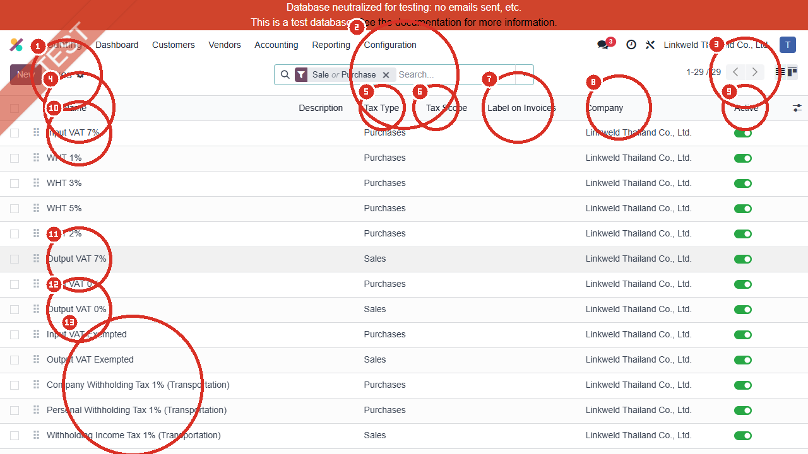
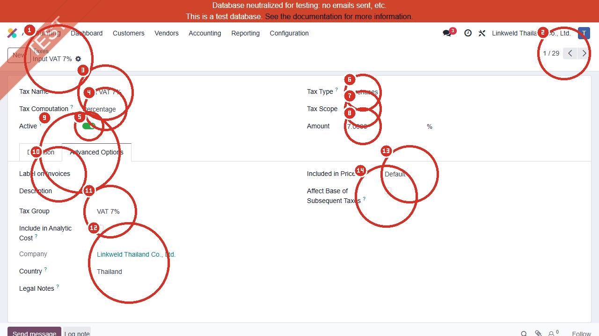
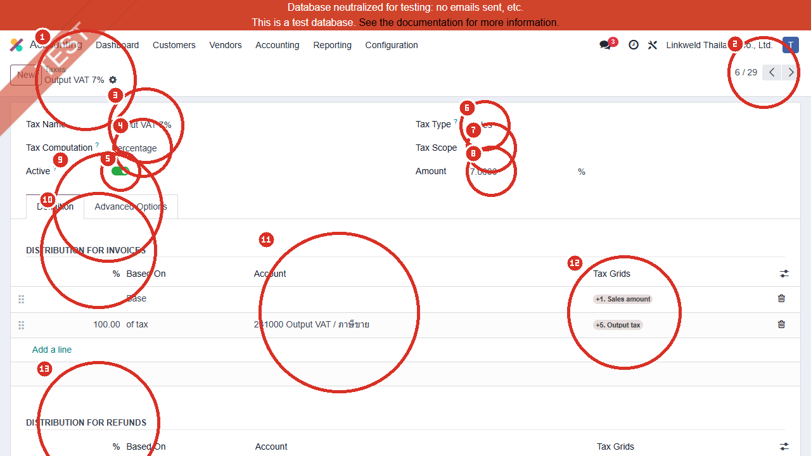
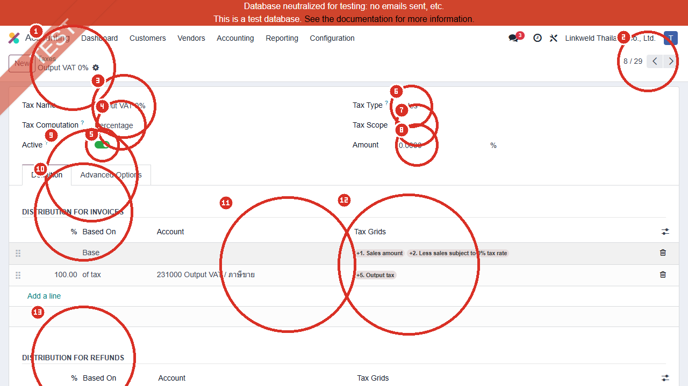
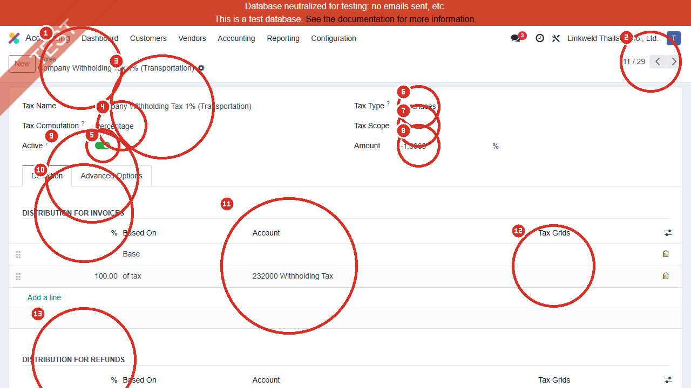

# ACC-009 คู่มือ Accounting > Configuration > Taxes

- บริษัท: Linkweld (Thailand) Co., Ltd.
- ระบบ: Odoo 18 Enterprise Staging
- วันที่ตรวจ: 16 กรกฎาคม 2026
- วิธีตรวจ: Evidence-first Read-only
- สถานะบท: `Confirmed` สำหรับ Active Tax list และ VAT/WHT ตัวอย่าง 4 รายการ; การคำนวณและ Tax Report จริงเป็น `Not Available`

## ขอบเขตและข้อจำกัด

- ตรวจ Active Taxes 29 รายการและเปิด Existing forms 4 รายการแบบ View mode
- อ่าน Definition, Advanced Options และ Repartition Lines โดยไม่แก้ Field/Line
- ไม่กด New, Import, Export, Duplicate, Save, Archive, Delete หรือ Tax Report
- ไม่เปิด Linked Account, Tax Group, Company, Country, Tag หรือ Transaction
- ไม่สร้าง Invoice, Bill, Credit Note, Payment หรือเอกสารทดสอบ
- ผลของ VAT/WHT ต่อ Journal, Rounding, PND และ Certificate ต้องทดสอบบน Clone UAT

หลักฐานโครงสร้าง:

- [ACC-009 Taxes extract](../evidence/accounting/ACC-009/ACC-009_taxes_extract.json)

## ภาพ 1: Active Taxes

| หมายเลข | จุดบนหน้าจอ | ผลการตรวจ |
|---|---|---|
| 1 | Taxes list | Accounting > Configuration > Taxes |
| 2 | Filter | Sale or Purchase และ Active |
| 3 | Pager | `1-29 / 29`; มี Active Taxes 29 รายการ |
| 4 | Tax Name | ชื่อสำหรับผู้ใช้เลือกบนเอกสาร |
| 5 | Description | ว่างในหลายรายการที่เห็น |
| 6 | Tax Type | Purchases 22, Sales 7 |
| 7 | Tax Scope | ว่างทั้ง 29 รายการ |
| 8 | Label on Invoices | ว่างในตัวอย่างที่ตรวจ |
| 9 | Company | Linkweld Thailand Co., Ltd. |
| 10 | Active | On ทั้ง List ที่อยู่ภายใต้ Active filter |
| 11 | Sequence handle | ลำดับมีผลต่อการคำนวณเมื่อ Tax กระทบ Base ต่อกัน |
| 12 | Optional columns | ใช้ปรับมุมมองเท่านั้น ไม่ได้เปลี่ยน Config |
| 13 | Visible rows | ภาพแสดง 13 แถว; Count 29 ยืนยันด้วย Read-only model read |

## สรุปจำนวน Tax ปัจจุบัน

| มิติ | ค่า |
|---|---|
| Active total | 29 |
| Tax Type | Purchases 22; Sales 7 |
| Tax Scope | ว่าง 29 |
| Tax Computation | Percentage 29 |
| Negative rates | -15% 1; -5% 3; -3% 3; -2% 3; -1% 3 |
| Zero rate | 0% 9 |
| Positive rates | 3% 1; 5% 1; 7% 3; 10% 1; 20% 1 |

ข้อควบคุม: ชื่อ WHT ไม่ได้ยืนยันว่า Tax หักจริง พบ WHT 1/2/3/5 ชื่อ Placeholder ที่ Rate 0% และพบ Company/Personal WHT ที่ Rate ติดลบจริง จึงต้องตรวจ Amount, Account และ Repartition Lines ทุกครั้ง

## ภาพ 2: Input VAT 7% Advanced Options

| หมายเลข | Field | ค่าปัจจุบัน |
|---|---|---|
| 1 | Tax Name | Input VAT 7% |
| 2 | Tax Computation | Percentage |
| 3 | Active | On |
| 4 | Tax Type | Purchases |
| 5 | Tax Scope | ว่าง |
| 6 | Amount | 7% |
| 7 | Label on Invoices / Description | ว่าง |
| 8 | Tax Group | VAT 7% |
| 9 | Company / Country | Linkweld Thailand Co., Ltd. / Thailand |
| 10 | Included in Price | Default |
| 11 | Affect Base of Subsequent Taxes | Off |
| 12 | Base Affected by Preceding Taxes | On |
| 13 | Include in Analytic Cost | Off |
| 14 | Tax Exigibility / Cash Basis account | Based on Invoice / ว่าง |

Repartition ที่ยืนยันจาก Read-only extract:

| Document | Base Grid | Tax Account | Tax Grid | Tax Closing |
|---|---|---|---|---|
| Invoice | +6 | 100640 Input VAT / ภาษีซื้อ | +7 | On |
| Refund | -6 | 100640 Input VAT / ภาษีซื้อ | -7 | On |

## ภาพ 3: Output VAT 7% Definition

| หมายเลข | Field / Line | ค่าปัจจุบัน |
|---|---|---|
| 1 | Tax Name | Output VAT 7% |
| 2 | Tax Computation / Amount | Percentage / 7% |
| 3 | Tax Type / Scope / Active | Sales / ว่าง / On |
| 4 | Sequence | 2 |
| 5 | Tax Group | VAT 7% |
| 6 | Included in Price | Default |
| 7 | Base behavior | Affect Subsequent Off; Affected by Preceding On |
| 8 | Tax Exigibility | Based on Invoice |
| 9 | Invoice Base | 100%; Grid +1 |
| 10 | Invoice Tax | 100%; Account 231000 Output VAT / ภาษีขาย; Grid +5 |
| 11 | Refund Base | 100%; Grid -1 |
| 12 | Refund Tax | 100%; Account 231000; Grid -5 |
| 13 | Use in Tax Closing | On สำหรับ Tax lines |

## ภาพ 4: Output VAT 0% Definition

| หมายเลข | Field / Line | ค่าปัจจุบัน |
|---|---|---|
| 1 | Tax Name | Output VAT 0% |
| 2 | Tax Computation / Amount | Percentage / 0% |
| 3 | Tax Type / Scope / Active | Sales / ว่าง / On |
| 4 | Sequence | 4 |
| 5 | Tax Group | Taxes |
| 6 | Included in Price | Default |
| 7 | Base behavior | Affect Subsequent Off; Affected by Preceding On |
| 8 | Tax Exigibility | Based on Invoice |
| 9 | Invoice Base | 100%; Grids +1 และ +2 |
| 10 | Invoice Tax | 100%; Account 231000; Grid +5; Amount เป็นศูนย์ |
| 11 | Refund Base | 100%; Grids -1 และ -2 |
| 12 | Refund Tax | 100%; Account 231000; Grid -5 |
| 13 | Use in Tax Closing | On สำหรับ Tax lines |

VAT 0% และ VAT Exempted เป็นคนละ Candidate. หลักฐานนี้เลือก Output VAT 0% ตาม Priority จึงห้ามนำผลนี้ไปแทนการตรวจ Output VAT Exempted

## ภาพ 5: Company Withholding Tax 1% (Transportation)

| หมายเลข | Field / Line | ค่าปัจจุบัน |
|---|---|---|
| 1 | Tax Name | Company Withholding Tax 1% (Transportation) |
| 2 | Tax Computation / Amount | Percentage / -1% |
| 3 | Tax Type / Scope / Active | Purchases / ว่าง / On |
| 4 | Sequence | 7 |
| 5 | Tax Group | TAX 1% |
| 6 | Included in Price | Default |
| 7 | Base behavior | Affect Subsequent Off; Affected by Preceding On |
| 8 | Tax Exigibility | Based on Invoice |
| 9 | Invoice Base | 100%; ไม่มี Tax Grid ที่เห็น |
| 10 | Invoice Tax | 100%; Account 232000 Withholding Tax; ไม่มี Grid |
| 11 | Refund Base | 100%; ไม่มี Grid |
| 12 | Refund Tax | 100%; Account 232000; ไม่มี Grid |
| 13 | Use in Tax Closing | On สำหรับ Tax lines |

ข้อค้นพบ: Rate ติดลบทำให้ WHT ลด Amount due ตาม Standard withholding behavior แต่การไม่มี Tax Grid ใน Repartition ที่เห็นทำให้ยังไม่ยืนยันว่า Tax นี้เข้า PND3/PND53 report ใด ต้องทดสอบ Report และ CSV จริงบน Clone UAT

## Field สำคัญและผลเมื่อ Config

| Field | หน้าที่ตาม Standard Odoo 18 | จุดควบคุม |
|---|---|---|
| Tax Computation / Amount | คำนวณ Fixed, Percentage, Group หรือ Formula ตาม Config | Linkweld 29 รายการเป็น Percentage; ตรวจ Rate จริง ไม่ใช้ชื่ออย่างเดียว |
| Tax Type | จำกัด Sales หรือ Purchases | WHT ฝั่ง Purchase และ Withholding Income Tax ฝั่ง Sales ต้องไม่สลับ |
| Tax Scope | จำกัด Goods/Services | ว่างทั้งหมด จึงไม่จำกัด Scope จาก Field นี้ |
| Sequence | กำหนดลำดับใช้ Tax | สำคัญเมื่อ Affect Base/Base Affected ทำงานร่วมกัน |
| Included in Price | Default/Excluded/Included | ตัวอย่างเป็น Default และ ACC-001 กำหนด Company default เป็น Tax Excluded |
| Affect Base | นำ Tax นี้ไปรวม Base ของ Tax ถัดไป | Off ในตัวอย่างทั้งสี่ |
| Base Affected | รับผลจาก Tax ก่อนหน้าที่ Affect Base | On ในตัวอย่างทั้งสี่ |
| Tax Exigibility | Based on Invoice หรือ Payment | ตัวอย่าง Based on Invoice; ไม่มี Cash Basis transition account |
| Repartition Lines | สร้าง Base/Tax Journal items และ Tax Grids | Factor tax lines ต้องรวม 100%; Account/Grid ต้องตรง Invoice และ Refund |
| Tax Grids | Tags สำหรับ Tax Return | VAT ตัวอย่างมี Grid; WHT ตัวอย่างไม่มี Grid ที่เห็น จึงต้อง Report UAT |
| Tax Group | รวมการแสดงผลและรายงานบางส่วน | ต้องไม่ใช้ Group แทนการตรวจ Account/Grid/Rate |

## Standard Odoo vs Pain Point

| หัวข้อ | Standard Odoo 18 | สภาพที่พบใน Linkweld | ข้อเสนอ |
|---|---|---|---|
| Thai baseline | l10n_th/l10n_th_reports มี VAT 7%, Exempt, WHT และ PND CSV | พบ VAT และ WHT หลายชุด 29 Active Taxes | Freeze Tax master และทำ Source-of-truth matrix |
| VAT 7% | Base/Tax repartition และ Grids ขับ Tax report | Input/Output 7% มี Accounts และ Grids แยก Invoice/Refund | Reconcile VAT-202-01/02 กับ GL และ Tax Closing |
| VAT 0% | Amount 0 แต่ Base Grid ระบุ Zero-rated sales | Output 0% ใช้ +1/+2 และ Refund -1/-2 | แยกจาก Exempted และตรวจเอกสาร/หลักฐานส่งออก |
| WHT | Negative tax ลด Amount due | พบ 13 Purchase WHT candidates; 4 ชื่อ WHT มี Rate 0 | ห้ามเลือกจาก Name; ใช้ Rate/Account/Partner type/PND mapping |
| WHT report | Thai localization รองรับ PND3/PND53 CSV | WHT 1% ตัวอย่างไม่มี Tax Grid ที่เห็น | ยืนยัน PND inclusion ด้วย Posted Clone-UAT bills และ Report export |
| Price inclusion | Default ตาม Company setting | ACC-001 เป็น Tax Excluded | ทดสอบ Product defaults, B2B/B2C และ rounding |
| Certificate/PDF | Standard Odoo ไม่สร้าง WHT certificate/PND PDF โดยตรง | Gap เดิมยังอยู่ | เลือก Minimal OCA certificate/report หลัง Fit-gap และ regression |

## Solution ที่แนะนำ

1. Freeze การสร้าง/แก้/Archive Tax จนกว่า Accounting Owner จะอนุมัติ Tax matrix
2. ทำ Tax master matrix 29 รายการ: Name, Rate, Sales/Purchase, Partner type, Use case, Account, Grid, Report, Product/Fiscal Position defaults และ Owner
3. แยก Placeholder WHT Rate 0 ออกจาก Tax ที่หักจริง และซ่อน/Deprecated เฉพาะหลัง Trace Dependency
4. Reconcile Input/Output VAT 7% และ VAT 0% กับ VAT-202-01/02, GL และ Credit Note signs
5. ทดสอบ Company WHT กับนิติบุคคล PND53 และ Personal WHT กับบุคคล PND3 แยกกัน
6. ตรวจว่า WHT ตัวอย่างที่ไม่มี Grid เข้า PND report ผ่านกลไกใด หากไม่เข้าให้แก้บน Clone UAT โดยไม่สร้าง Tax engine ซ้ำซ้อน
7. ตรวจ Rounding, Included in Price, Multi-tax sequence และ Foreign Currency ร่วมกับ Payment/WHT addons
8. หากต้องการ Certificate/PDF ให้เปรียบเทียบ Minimal OCA WHT certificate กับ OCA tax engine เต็มชุด และเลือก Change ที่เล็กที่สุดที่ผ่าน Policy

## รายการ UAT ขั้นต่ำบน Clone UAT เท่านั้น

| UAT ID | กรณีทดสอบ | ผลที่ต้องตรวจ | สถานะ |
|---|---|---|---|
| UAT-ACC-009-01 | Sales Invoice VAT 7% | Base, Output VAT 231000, +1/+5, Total และ rounding ถูกต้อง | Pending |
| UAT-ACC-009-02 | Vendor Bill Input VAT 7% | Base, Input VAT 100640, +6/+7 และ payable ถูกต้อง | Pending |
| UAT-ACC-009-03 | Sales Credit Note VAT 7% | Refund grids -1/-5 และ signs ตรง GL/Tax report | Pending |
| UAT-ACC-009-04 | Purchase Refund VAT 7% | Refund grids -6/-7 และ Input VAT reversal ถูกต้อง | Pending |
| UAT-ACC-009-05 | Output VAT 0% | Base เข้า Zero-rate grid +2 และไม่ปน Exempted | Pending |
| UAT-ACC-009-06 | Output VAT Exempted | Report แยกจาก VAT 0% และไม่เกิด Output VAT amount | Pending |
| UAT-ACC-009-07 | Company WHT 1% Transportation | ลด Payable 1%, ลง 232000 และเข้า PND53 ตาม Policy | Pending |
| UAT-ACC-009-08 | Personal WHT | Partner บุคคล, Rate, Account และ PND3 ถูกต้อง | Pending |
| UAT-ACC-009-09 | Placeholder WHT Rate 0 | ไม่ถูกผู้ใช้เลือกเป็น Tax หักจริงหรือสร้างผลลัพธ์ผิด | Pending |
| UAT-ACC-009-10 | WHT Refund/Cancellation/Reissue | Reversal, PND period และ Certificate reference ถูกต้อง | Pending |
| UAT-ACC-009-11 | Price Included/Excluded และ Multi-tax | Company default, sequence, base affected และ rounding ถูกต้อง | Pending |
| UAT-ACC-009-12 | VAT-202/PND report reconciliation | Excel/CSV totals ตรง Posted GL และไม่มี Duplicate tax source | Pending |

## สรุปสถานะ

- Confirmed Active Taxes 29 รายการ: Purchases 22, Sales 7 และทั้งหมดเป็น Percentage
- Confirmed Input/Output VAT 7% ใช้บัญชี 100640/231000 และมี Tax Grids แยก Invoice/Refund
- Confirmed Output VAT 0% ใช้ Base Grids สำหรับ Zero-rated sales และแยกจาก Exempted candidate
- Confirmed Company WHT 1% เป็น Rate -1% ลง 232000 แต่ไม่มี Tax Grid ที่เห็น จึงยังไม่ยืนยัน PND report inclusion
- พบ WHT candidates จำนวนมากและมี Placeholder ชื่อ WHT ที่ Rate 0; ห้ามตัดสินจาก Name
- ไม่มีการสร้าง แก้ Tax/Repartition/Grid หรือรัน Invoice/Bill/Tax Report ใดใน Odoo

อ้างอิง:

- [Odoo 18 Taxes](https://www.odoo.com/documentation/18.0/applications/finance/accounting/taxes.html)
- [Odoo 18 Tax computation](https://www.odoo.com/documentation/18.0/applications/finance/accounting/taxes/tax_computation.html)
- [Odoo 18 Thailand localization](https://www.odoo.com/documentation/18.0/applications/finance/fiscal_localizations/thailand.html)
- [Odoo 18 Withholding tax](https://www.odoo.com/documentation/18.0/applications/finance/accounting/taxes/retention.html)
