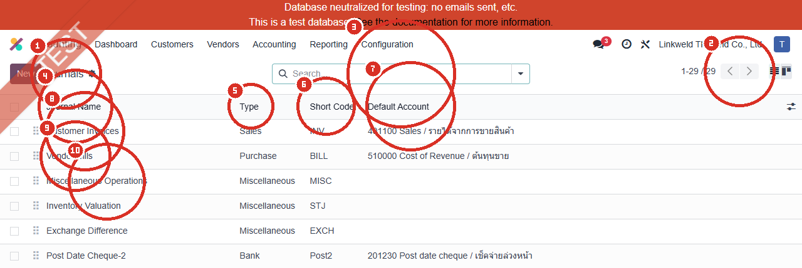
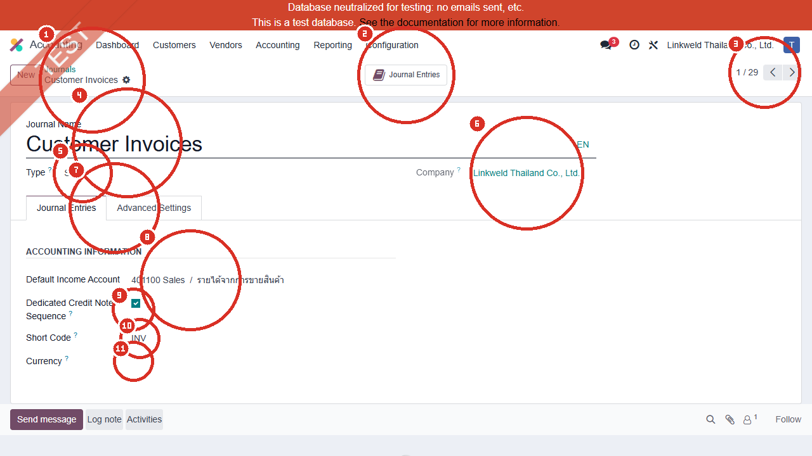
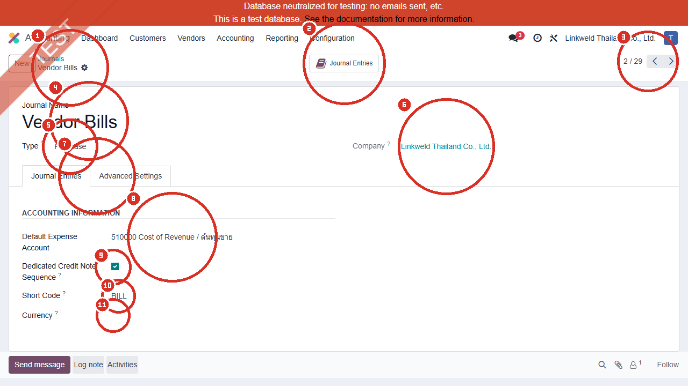
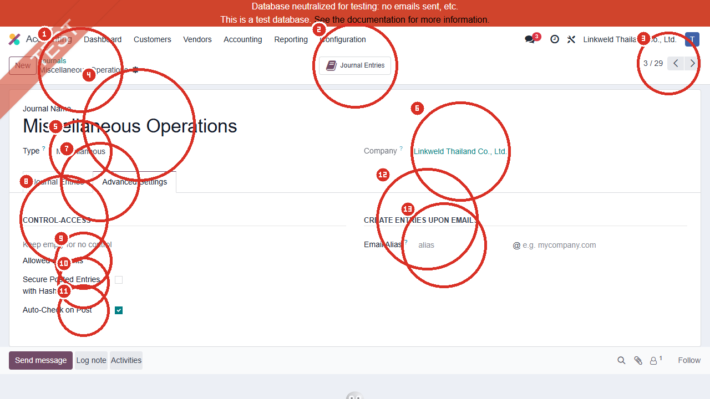

# ACC-010 คู่มือ Accounting > Configuration > Journals

- บริษัท: Linkweld (Thailand) Co., Ltd.
- ระบบ: Odoo 18 Enterprise Staging
- วันที่ตรวจ: 16 กรกฎาคม 2026
- วิธีตรวจ: Evidence-first Read-only
- สถานะบท: `Confirmed` สำหรับ Active Journal counts, ฟอร์มปลอดภัย 3 รายการ และ Bank summary แบบปกปิดข้อมูล; Runtime เป็น `Not Available`

## ขอบเขตและข้อจำกัด

- ตรวจ Active Journals 29 รายการและเปิด Existing forms 3 รายการแบบ View mode
- อ่าน Generic Bank ผ่าน Read-only model summary แต่ไม่เปิด/จับภาพ เพราะ Default Account และ Payment Method labels มีเลขบัญชีเต็ม
- ไม่กด Journal Entries, Transactions, Payments, Bank Account, Account, Payment Method หรือ Smart button
- ไม่กด New, Import, Export, Save, Archive, Delete หรือเปลี่ยน Sequence/Account/Method
- ไม่สร้างหรือ Post Journal Entry, Invoice, Bill, Payment หรือ Bank Transaction

หลักฐานโครงสร้าง:

- [ACC-010 Journals extract](../evidence/accounting/ACC-010/ACC-010_journals_extract.json)

## ภาพ 1: Active Journals แบบ Privacy-safe

| หมายเลข | จุดบนหน้าจอ | ผลการตรวจ |
|---|---|---|
| 1 | Journals list | Accounting > Configuration > Journals |
| 2 | Pager | `1-29 / 29`; Active total 29 |
| 3 | Journal Name | ชื่อระบุ Business flow ของ Journal |
| 4 | Type | Bank 20, Miscellaneous 4, Cash 3, Sales 1, Purchase 1 |
| 5 | Short Code | Prefix ของ Journal Entry sequence; ต้อง Unique และสั้น |
| 6 | Default Account | Account ที่ Journal ใช้เป็นค่าเริ่มต้นตาม Type/Flow |
| 7 | Customer Invoices | Sales journal, Code INV, Default 401100 |
| 8 | Vendor Bills | Purchase journal, Code BILL, Default 510000 |
| 9 | Miscellaneous Operations | Miscellaneous journal, Code MISC, Default ว่าง |
| 10 | Privacy boundary | ภาพหยุดก่อนแถวที่ Default Account label มีเลขบัญชีเต็ม |

## จำนวน Active Journals ตาม Type

| Type | จำนวน | ความหมายโดยย่อ |
|---|---:|---|
| Bank | 20 | Bank transactions, incoming/outgoing payments และ reconciliation |
| Miscellaneous / General | 4 | Manual/general entries และ system-specific postings |
| Cash | 3 | Cash register และ cash transactions |
| Sales | 1 | Customer invoices และ credit notes |
| Purchase | 1 | Vendor bills และ refunds |
| **รวม** | **29** | ตรงกับ UI |

Bank Journals 20 รายการไม่ถูกจัดเป็น Duplicate อัตโนมัติ เพราะอาจแทนหลายบัญชี/สกุลเงิน/Flow ต้องทำ Owner inventory โดยไม่เปิดเผยเลขบัญชี

## ภาพ 2: Customer Invoices Journal

| หมายเลข | Field | ค่าปัจจุบัน |
|---|---|---|
| 1 | Journal Name | Customer Invoices |
| 2 | Type | Sales |
| 3 | Company | Linkweld Thailand Co., Ltd. |
| 4 | Default Income Account | 401100 Sales / รายได้จากการขายสินค้า |
| 5 | Dedicated Credit Note Sequence | On |
| 6 | Short Code | INV |
| 7 | Currency | ว่าง; ใช้ Company currency |
| 8 | Advanced: Secure Posted Entries with Hash | Off |
| 9 | Allowed Accounts / Sequence Override | ว่าง / ว่าง |
| 10 | Auto-Check on Post | On; Runtime behavior ยังไม่ยืนยัน |
| 11 | Email/Communication | Alias บน localhost; Based on Invoice; Standard Odoo |

ไม่มี Incoming/Outgoing payment methods บน Sales journal ตัวอย่าง และ Journal Entries smart button ไม่ได้เปิด

## ภาพ 3: Vendor Bills Journal

| หมายเลข | Field | ค่าปัจจุบัน |
|---|---|---|
| 1 | Journal Name | Vendor Bills |
| 2 | Type | Purchase |
| 3 | Company | Linkweld Thailand Co., Ltd. |
| 4 | Default Expense Account | 510000 Cost of Revenue / ต้นทุนขาย |
| 5 | Dedicated Credit Note Sequence | On |
| 6 | Short Code | BILL |
| 7 | Currency | ว่าง; ใช้ Company currency |
| 8 | Advanced: Secure Posted Entries with Hash | Off |
| 9 | Allowed Accounts / Sequence Override | ว่าง / ว่าง |
| 10 | Auto-Check on Post | On; Runtime behavior ยังไม่ยืนยัน |
| 11 | Email Alias | vendor-bills@localhost ใน Neutralized staging |

ความเสี่ยง: Default Expense 510000 อาจเหมาะกับซื้อสินค้าเพื่อขาย แต่ไม่ควรถูกใช้เป็นค่าเริ่มต้นของค่าใช้จ่ายทั่วไปทั้งหมด ต้องทดสอบ Bill line ที่ไม่มี Product/Account และ Product Category mapping

## ภาพ 4: Miscellaneous Operations Advanced Settings

| หมายเลข | Field | ค่าปัจจุบัน |
|---|---|---|
| 1 | Journal Name | Miscellaneous Operations |
| 2 | Type | Miscellaneous |
| 3 | Company | Linkweld Thailand Co., Ltd. |
| 4 | Default Account | ว่าง |
| 5 | Dedicated Credit Note Sequence | Off |
| 6 | Short Code | MISC |
| 7 | Currency | ว่าง |
| 8 | Allowed Accounts | ว่าง หมายถึงไม่จำกัด Account จาก Field นี้ |
| 9 | Secure Posted Entries with Hash | Off |
| 10 | Sequence Override | ว่าง |
| 11 | Auto-Check on Post | On; Runtime behavior ยังไม่ยืนยัน |
| 12 | Email Alias | ว่าง |
| 13 | Journal Entries smart button | แสดงแต่ไม่ได้เปิด |

## Generic Bank Journal แบบ Sanitized Summary

| Field | ค่าปัจจุบันที่ปลอดภัย | ข้อจำกัด |
|---|---|---|
| Name / Type / Code | Bank / Bank / BNK1 | Exact unique 1 รายการ |
| Company / Currency | Linkweld Thailand Co., Ltd. / ว่าง | ใช้ Company currency |
| Default Account | มีค่า แต่ปกปิด | Label มีเลขบัญชีเต็ม |
| Bank Account | มีค่า แต่ปกปิด | ไม่เก็บเลขบัญชีในหลักฐาน |
| Suspense Account | 111001 Bank Suspense Account | ใช้พัก Bank transaction ก่อน Reconcile |
| Profit Account | 999002 Cash Difference Gain | ใช้ส่วนต่างกำไรตาม Flow ที่เกี่ยวข้อง |
| Loss Account | 999001 Cash Difference Loss | ใช้ส่วนต่างขาดทุนตาม Flow ที่เกี่ยวข้อง |
| Dedicated Credit Note Sequence | Off | Bank journal ไม่ใช่ Invoice journal |
| Secure Posted Entries with Hash | Off | Bank journal Standard ไม่มี Field นี้ในบาง View/Type; ค่า Model summary เป็น Off |
| Incoming Methods | Manual, Batch Deposit, SCB | Manual account ปกปิด; Batch Deposit/SCB ใช้ 111002 Outstanding Receipts |
| Outgoing Methods | Manual | Outstanding account label ปกปิด |

Payment Method `SCB` เป็น Flow เฉพาะที่ต้อง Trace Custom addon/Integration ownership. ไม่สรุปว่าเป็น Standard และไม่ได้เปิด Method form

## Field สำคัญและผลเมื่อ Config

| Field | Standard Odoo 18 | จุดควบคุม |
|---|---|---|
| Type | กำหนด Sales, Purchase, Cash, Bank, Credit Card หรือ Miscellaneous behavior | ห้ามเปลี่ยน Type หลังมี Entries โดยไม่มี migration plan |
| Short Code | Prefix ของ Journal Entry references | Unique 1-5 ตัวอักษร; Freeze หลัง Go-live |
| Currency | กำหนด Currency ของ Journal transactions | ว่างใช้ Company currency; Bank FX journal ต้องกำหนดให้ตรงบัญชี |
| Default Account | ค่า Account เริ่มต้นตาม Journal | ตรวจ Product/Partner/Document overrides และ fallback behavior |
| Dedicated Credit Note Sequence | แยก Sequence ของ Credit Notes/Refunds | ตรวจเลขที่ต่อเนื่องและข้อกำหนดภาษี |
| Allowed Accounts | จำกัด Accounts ที่เลือกได้ใน Journal | ว่างเปิดให้ทุก Account; ใช้ Access/Approval เพิ่ม |
| Secure Posted Entries with Hash | Hash Posted entries เพื่อ Data inalterability | หลัง Post ใน Restricted journal ปิดไม่ได้และแก้ Secured entry ไม่ได้ |
| Email Alias | สร้างเอกสารจาก PDF ที่ส่งเข้า Alias | Production domain, OCR, Vendor และ Auto-post controls ต้องทดสอบ |
| Suspense Account | พัก Bank transactions ก่อน Reconcile | Balance ควรสะท้อน Unreconciled transactions |
| Outstanding Accounts | พัก Registered payments จน Match Bank transaction | ว่างอาจไม่สร้าง Payment journal entry; Mapping ผิดทำให้สถานะ/ยอดคลาดเคลื่อน |
| Profit/Loss Accounts | บันทึก Cash/Bank difference | จำกัด Use case และ Approval |
| Payment Methods | กำหนด Manual, Check, Batch หรือ Integration flow | ตรวจ Method-specific Account, Access และ Reconciliation |

## Standard Odoo vs Pain Point

| หัวข้อ | Standard Odoo 18 | สภาพที่พบใน Linkweld | ข้อเสนอ |
|---|---|---|---|
| Journal inventory | แยก Journal ตาม Type/Flow | 29 Active; Bank 20 | ทำ Journal owner matrix และ Archive เฉพาะหลัง Dependency review |
| Sales default | Default Income เป็น fallback ของ Sales journal | 401100 Sales | ทดสอบ Product income override และ Revenue report |
| Purchase default | Default Expense เป็น fallback ของ Purchase journal | 510000 Cost of Revenue | ทดสอบ General expense bills ไม่ให้ลง COGS ผิด |
| Sequences | Short Code และ Credit Note sequence ควบคุมเลขที่ | INV/BILL แยก Credit Note; Override ว่าง | Reconcile sequence gaps/duplicates และ localization format |
| Data inalterability | เปิด Hash ต่อ Journal ได้และย้อนกลับไม่ได้หลัง Post | Hash Off ในตัวอย่าง Sales/Purchase/Misc | CFO/Auditor decision ก่อนเปิด; ห้ามทดลองบน Primary staging |
| Allowed Accounts | จำกัด Account choices | ว่างในทั้งสามตัวอย่าง | ใช้ role/approval หรือกำหนด Allowed Accounts หาก UAT พบ Posting risk |
| Auto-Check on Post | ไม่อยู่ใน Standard field set ที่เอกสารนี้ยืนยัน | On ในทั้งสามตัวอย่าง | Trace module owner และทดสอบผลก่อน Go-live |
| Bank privacy | Bank journal มี Bank Account/number | Generic Bank แสดงข้อมูลอ่อนไหว | จำกัด Screenshot/Export และใช้ sanitized register |
| Payment methods | Standard รองรับ Manual/Checks/Batch; Custom methods อาจเพิ่ม | พบ Batch Deposit และ SCB | Regression Payment, Cheque, WHT, Outstanding และ Reconciliation |

## Solution ที่แนะนำ

1. Freeze Journal master, Short Code, Type, Default Accounts, Payment Methods และ Outstanding Accounts จนกว่า Owner sign-off
2. ทำ Journal inventory 29 รายการ: Owner, Purpose, Type, Currency, Default/Suspense/Outstanding accounts, Sequence, Methods และ Status
3. ทดสอบ Vendor Bills fallback 510000 กับสินค้า, บริการ,ค่าใช้จ่ายทั่วไป, Assets, Landed Cost และ Expense clearing
4. Trace Field Auto-Check on Post ไปยัง Module/Owner และยืนยันว่าไม่ข้าม Approval หรือ Audit control
5. ให้ CFO/Auditor ตัดสิน Secure Hash/Audit Trail ร่วมกัน เพราะ Hash ปิดกลับไม่ได้หลัง Restricted journal มี Posted entry
6. ทดสอบ Bank journal/payment methods บน Clone UAT โดยใช้ข้อมูลบัญชีจำลอง ไม่เก็บเลขจริงในหลักฐาน
7. Reconcile Suspense/Outstanding balances และ Payment states ก่อน Go-live
8. จำกัดสิทธิ์ Journal config, Sequence, Bank Account และ Payment Method ให้ System Admin/Accounting Manager ที่อนุมัติ

## รายการ UAT ขั้นต่ำบน Clone UAT เท่านั้น

| UAT ID | กรณีทดสอบ | ผลที่ต้องตรวจ | สถานะ |
|---|---|---|---|
| UAT-ACC-010-01 | Sales Invoice posting | Journal INV, 401100/Product account, VAT, Sequence และ Communication ถูกต้อง | Pending |
| UAT-ACC-010-02 | Sales Credit Note | Dedicated sequence, reversal signs, Tax grids และ original reference ถูกต้อง | Pending |
| UAT-ACC-010-03 | Vendor Bill สินค้า | Product/Category account override ใช้ COGS ตาม Policy | Pending |
| UAT-ACC-010-04 | Vendor Bill ค่าใช้จ่ายทั่วไป | ไม่ Default ลง 510000 Cost of Revenue ผิดประเภท | Pending |
| UAT-ACC-010-05 | Vendor Refund | Dedicated sequence, VAT/WHT reversal และ payable ถูกต้อง | Pending |
| UAT-ACC-010-06 | Miscellaneous Entry | Allowed account/access, balanced debit-credit และ approval ถูกต้อง | Pending |
| UAT-ACC-010-07 | Auto-Check on Post | พฤติกรรมและ Module owner ชัดเจน ไม่ข้าม Review control | Pending |
| UAT-ACC-010-08 | Email Alias/OCR | Neutralized UAT ไม่ส่งออก; Production alias สร้าง Draft ตาม Policy ไม่ Auto-post ผิด | Pending |
| UAT-ACC-010-09 | Bank Suspense/Reconciliation | 111001 เคลียร์ตาม Bank transaction และไม่ค้างผิดปกติ | Pending |
| UAT-ACC-010-10 | Incoming Batch Deposit/SCB | 111002, Payment state, Cheque/WHT และ Bank match ถูกต้อง | Pending |
| UAT-ACC-010-11 | Outgoing Manual Payment | Outstanding payment account, cheque, FX และ reconciliation ถูกต้อง | Pending |
| UAT-ACC-010-12 | Hash/Sequence/Access/Privacy | Decision ผ่าน CFO/Auditor; User แก้ Config/เลขบัญชีไม่ได้ และ Export ไม่รั่วข้อมูล | Pending |

## สรุปสถานะ

- Confirmed Active Journals 29: Bank 20, Miscellaneous 4, Cash 3, Sales 1, Purchase 1
- Customer Invoices ใช้ Default Income 401100; Vendor Bills ใช้ Default Expense 510000 Cost of Revenue
- Sales/Purchase เปิด Dedicated Credit Note Sequence; Currency และ Sequence Override ว่าง
- Sales/Purchase/Misc เปิด Auto-Check on Post และปิด Secure Hash; Runtime/owner ของ Auto-Check ยังไม่ยืนยัน
- Generic Bank มี Suspense 111001, Profit/Loss 999002/999001 และ Methods Manual/Batch Deposit/SCB โดยข้อมูลเลขบัญชีถูกปกปิด
- ไม่มีการเปิด Journal Entries/Transactions หรือสร้าง แก้ Post Journal/Payment ใดใน Odoo

อ้างอิง:

- [Odoo 18 Journals](https://www.odoo.com/documentation/18.0/applications/finance/accounting/get_started/journals.html)
- [Odoo 18 Payments](https://www.odoo.com/documentation/18.0/applications/finance/accounting/payments.html)
- [Odoo 18 Data inalterability](https://www.odoo.com/documentation/18.0/applications/finance/accounting/reporting/data_inalterability.html)
