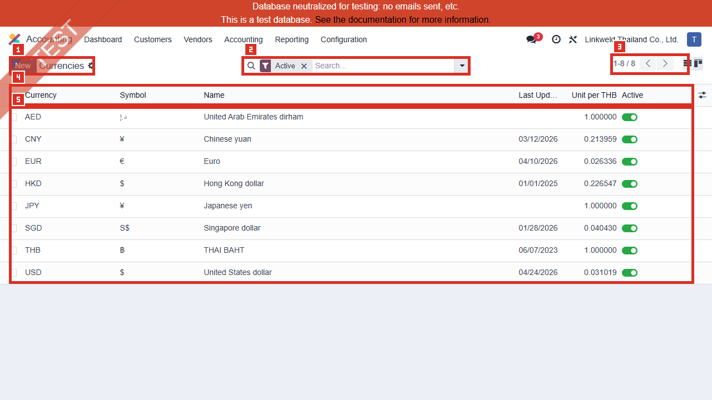
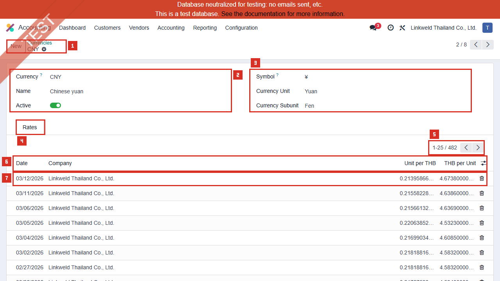
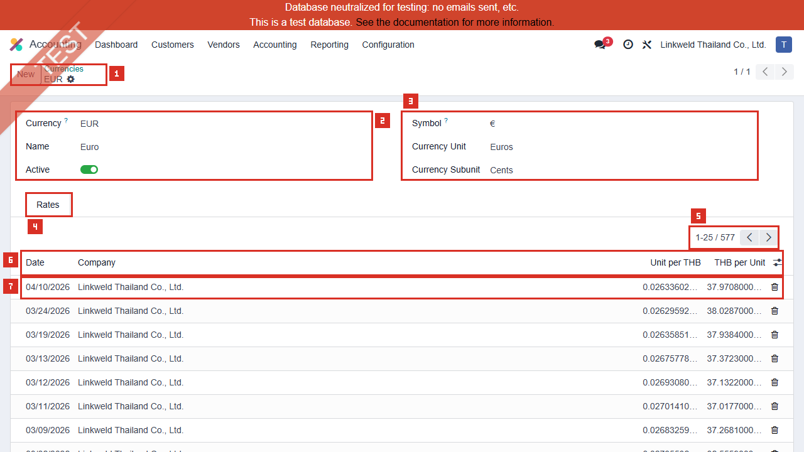
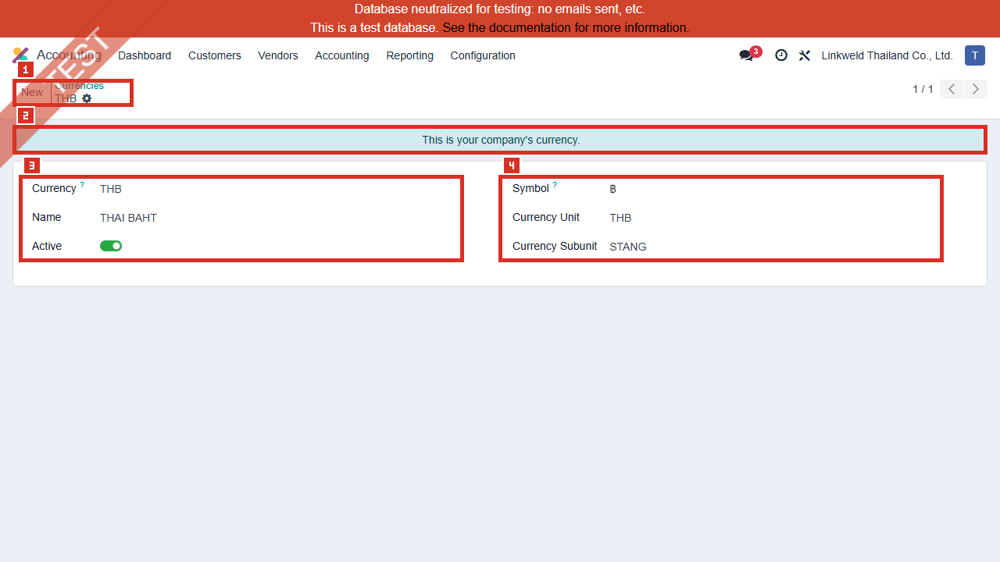
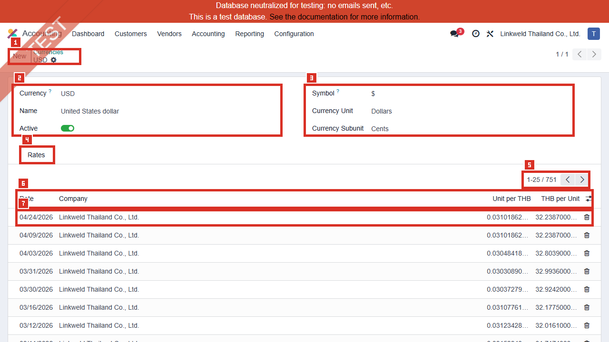

# ACC-011 คู่มือ Accounting > Configuration > Currencies

- บริษัท: Linkweld (Thailand) Co., Ltd.
- ระบบ: Odoo 18 Enterprise Staging
- วันที่ตรวจ: 16 กรกฎาคม 2026
- วิธีตรวจ: Evidence-first Read-only
- สถานะบท: `Confirmed` สำหรับ Active currency list และค่าที่เห็นในฟอร์ม CNY/EUR/THB/USD; Provider refresh และผลธุรกรรมเป็น `Not Available`

## ขอบเขตและข้อจำกัด

- ตรวจ Active Currencies ทั้ง 8 รายการและเปิด Existing forms ของ CNY, EUR, THB และ USD แบบ View mode
- อ่าน Rates table ของ CNY, EUR และ USD โดยไม่กด Add a line; THB เป็น Company currency จึงไม่มี Rates table บนฟอร์ม
- ค่า Decimal Places, Rounding, Current Rate และจำนวน rate rows บางส่วนมาจาก Read-only model inspection ไม่ใช่ค่าที่แสดงครบทุกช่องในภาพ
- ไม่กด New, Import, Export, Edit, Save, Activate/Deactivate, Archive, Delete, Add a line หรือ Update Rates
- ไม่เปิด Provider/Service, Linked Company, Smart button หรือ Report และไม่สร้าง/แก้อัตราหรือธุรกรรมใด
- วันที่ใน Rate row ยืนยันเพียงวันที่ของข้อมูลที่เก็บไว้ ไม่ใช่หลักฐานว่า Provider refresh สำเร็จ

หลักฐานโครงสร้าง:

- [ACC-011 Currencies extract](../evidence/accounting/ACC-011/ACC-011_currencies_extract.json)

## ภาพ 1: Active Currencies

| หมายเลข | จุดบนหน้าจอ | ผลการตรวจ |
|---|---|---|
| 1 | เมนู Currencies | Accounting > Configuration > Currencies |
| 2 | Active filter | แสดงเฉพาะสกุลเงินที่ Active |
| 3 | Pager | `1-8 / 8`; มี 8 รายการในหน้าเดียว |
| 4 | Columns | Currency, Symbol, Name, Last Update, Unit per THB และ Active |
| 5 | Active rows | AED, CNY, EUR, HKD, JPY, SGD, THB และ USD |

## ค่าใน Active Currency List

| Currency | Last Update ที่แสดง | Unit per THB ที่แสดง | ประเด็นควบคุม |
|---|---|---:|---|
| AED | ว่าง | 1.000000 | ความเสี่ยงสูงหากนำไปใช้ เพราะยังไม่มีวันที่และอัตรา 1:1 กับ THB |
| CNY | 03/12/2026 | 0.213959 | มีประวัติ rate; ต้องตรวจ Source/Cutoff ตาม Policy |
| EUR | 04/10/2026 | 0.026336 | มีประวัติ rate; ต้องตรวจ Source/Cutoff ตาม Policy |
| HKD | 01/01/2025 | 0.226547 | วันที่เก่ากว่ารายการตัวอย่างอื่นอย่างชัดเจน |
| JPY | ว่าง | 1.000000 | ความเสี่ยงสูงหากนำไปใช้ เพราะยังไม่มีวันที่และอัตรา 1:1 กับ THB |
| SGD | 01/28/2026 | 0.040430 | ต้องตรวจความถี่การอัปเดตและรายการใช้งานจริง |
| THB | 06/07/2023 | 1.000000 | Company currency ใช้อัตรา 1; วันที่ใน list ไม่ใช่ Provider proof |
| USD | 04/24/2026 | 0.031019 | มีประวัติ rate; ต้องตรวจ Source/Cutoff ตาม Policy |

`Unit per THB` หมายถึงจำนวนหน่วยสกุลเงินต่างประเทศต่อ 1 THB ส่วน `THB per Unit` เป็นค่ากลับกัน ตัวอย่าง CNY ล่าสุดใน UI คือ 0.213958663186 CNY ต่อ THB และ 4.673800000000 THB ต่อ CNY

## ภาพ 2: CNY Rates

| หมายเลข | Field/Area | ค่าปัจจุบัน |
|---|---|---|
| 1 | Record navigation | CNY; Exact unique Active record ID 7 |
| 2 | Identity | Currency CNY, Name Chinese yuan, Active On |
| 3 | Symbol/Unit | `¥` ก่อนจำนวนเงิน; Yuan / Fen |
| 4 | Rates tab | แสดงตารางประวัติอัตราเดิม |
| 5 | Pager | `1-25 / 482`; Model count 482 rows สำหรับบริษัทนี้ |
| 6 | Rate columns | Date, Company, Unit per THB, THB per Unit |
| 7 | Latest visible row | 03/12/2026; Linkweld Thailand Co., Ltd.; 0.213958663186 / 4.673800000000 |

Model read ยืนยัน Decimal Places 2, Rounding 0.01, Current Rate 0.2139586631862724 และ Inverse Rate 4.6738

## ภาพ 3: EUR Rates

| หมายเลข | Field/Area | ค่าปัจจุบัน |
|---|---|---|
| 1 | Record navigation | EUR; Exact unique Active record ID 1 |
| 2 | Identity | Currency EUR, Name Euro, Active On |
| 3 | Symbol/Unit | `€` หลังจำนวนเงิน; Euros / Cents |
| 4 | Rates tab | แสดงตารางประวัติอัตราเดิม |
| 5 | Pager | Model count 577 rows สำหรับบริษัทนี้ |
| 6 | Rate columns | Date, Company, Unit per THB, THB per Unit |
| 7 | Latest visible row | 04/10/2026; Linkweld Thailand Co., Ltd.; 0.026336026631 / 37.970800000000 |

Model read ยืนยัน Decimal Places 2, Rounding 0.01, Current Rate 0.02633602663099013 และ Inverse Rate 37.9708

## ภาพ 4: THB Company Currency

| หมายเลข | Field/Area | ค่าปัจจุบัน |
|---|---|---|
| 1 | Record navigation | THB; Exact unique Active record ID 132 |
| 2 | Company currency banner | `This is your company's currency.` |
| 3 | Identity | Currency THB, Name THAI BAHT, Active On |
| 4 | Symbol/Unit | `฿` หลังจำนวนเงิน; THB / STANG |

THB มี Current/Inverse Rate เท่ากับ 1 และไม่มี Rates table บนฟอร์ม Model read พบ 76 company-rate rows และวันที่ 2023-06-07 แต่ค่านี้ไม่ปรากฏบนฟอร์ม จึงห้ามอธิบายว่าเป็นวันที่ Provider refresh ที่ผู้ใช้เห็น

## ภาพ 5: USD Rates

| หมายเลข | Field/Area | ค่าปัจจุบัน |
|---|---|---|
| 1 | Record navigation | USD; Exact unique Active record ID 2 |
| 2 | Identity | Currency USD, Name United States dollar, Active On |
| 3 | Symbol/Unit | `$` ก่อนจำนวนเงิน; Dollars / Cents |
| 4 | Rates tab | แสดงตารางประวัติอัตราเดิม |
| 5 | Pager | Model count 751 rows สำหรับบริษัทนี้ |
| 6 | Rate columns | Date, Company, Unit per THB, THB per Unit |
| 7 | Latest visible row | 04/24/2026; Linkweld Thailand Co., Ltd.; 0.031018620478 / 32.238700000000 |

Model read ยืนยัน Decimal Places 2, Rounding 0.01, Current Rate 0.031018620477872866 และ Inverse Rate 32.2387

## Field สำคัญและผลเมื่อ Config

| Field | Standard Odoo 18 | จุดควบคุม Linkweld |
|---|---|---|
| Active | เปิดให้เลือก Currency ในเอกสาร/Journal ที่เกี่ยวข้อง | Active เฉพาะสกุลที่มี Owner, Rate source และการใช้งานจริง |
| Main/Company Currency | เป็นฐานของบัญชีและรายงานบริษัท | THB ยืนยันเป็น Company currency; ห้ามเปลี่ยนหลังมีรายการโดยไม่มี migration plan |
| Rate Date | วันที่เริ่มใช้อัตราที่บันทึก | กำหนด Cutoff, Time zone, Weekend/Holiday และ Backdate policy |
| Unit per THB | จำนวน Foreign currency ต่อ 1 THB | ตรวจทิศทางอัตรา ไม่กรอกกลับด้าน |
| THB per Unit | จำนวน THB ต่อ 1 Foreign currency | ต้องเป็นค่ากลับกันและผ่าน tolerance control |
| Decimal Places | จำนวนทศนิยมของ Currency | มีผลต่อการแสดงผลและการปัดเศษ; ห้ามเปลี่ยนโดยไม่ทดสอบเอกสารเดิม |
| Rounding Factor | หน่วยเล็กสุดที่ระบบใช้ปัด | ตัวอย่าง 0.01; ต้องสอดคล้องกับสกุลและ Payment method |
| Symbol/Position | รูปแบบแสดงจำนวนเงิน | ไม่เปลี่ยนผล GL แต่มีผลต่อเอกสารและการตีความผู้ใช้ |
| Automatic Rates | Standard รองรับ Scheduled provider update | ACC-001 แสดง Service Bank of Thailand แต่ Interval เป็น Manually; Scheduled outcome ยังไม่ยืนยัน |

## Standard Odoo vs Pain Point

| หัวข้อ | Standard Odoo 18 | สภาพที่พบใน Linkweld | ข้อเสนอ |
|---|---|---|---|
| Multi-currency | เก็บจำนวน Foreign และ Company currency และสร้าง Exchange Difference ตาม Flow | Active 8 สกุล; มีประวัติ CNY/EUR/USD | ใช้ Standard ก่อน Custom และทดสอบ Invoice/Bill/Payment/Reconcile ครบ |
| Manual rates | ผู้มีสิทธิ์เพิ่ม Rate row ตามวันที่ได้ | ACC-001 กำหนด Interval Manually | ทำ Rate maker-checker, source attachment และ cutoff รายวัน |
| Automatic rates | Standard รองรับ Provider update ตาม Interval | ยังไม่มีหลักฐานการรันหรือ Provider response | ทดสอบบน Clone UAT และทำ Failure/holiday fallback ก่อนเปิด Scheduled |
| Missing/stale rates | ระบบใช้ข้อมูล Rate ที่มีตามวันที่เอกสาร | AED/JPY ไม่มี date และแสดง 1.000000; HKD/SGD เก่ากว่า | Block use หรือ Deactivate หลัง Dependency review จนมี Rate ที่อนุมัติ |
| Rate provenance | Rate row มี Date/Company/values | วันที่ไม่บอก Source หรือผู้อนุมัติ | เพิ่ม Daily control register และ Owner sign-off โดยไม่แก้ Core |
| History volume | เก็บหลาย Rate rows ได้ | CNY 482, EUR 577, USD 751 | ตรวจ duplicate date, gap, outlier และ company scope ก่อน Go-live |

## Solution ที่แนะนำ

1. Accounting อนุมัติ Exchange-rate policy: แหล่งอัตรา, Buy/Sell/Mid reference, Cutoff time, Time zone, Weekend/Holiday, Backdate และ Revaluation
2. Freeze การแก้ Currency/Rate และจำกัดสิทธิ์ให้ Accounting Manager/System Admin ที่ได้รับอนุมัติ แยกผู้บันทึกกับผู้ตรวจ
3. ตรวจ Active Currency usage จาก Existing documents ก่อน Deactivate; ห้ามตัด AED/JPY จากชื่อหรืออัตราเพียงอย่างเดียว
4. แก้ AED/JPY 1.000000 และ Currency ที่ล้าสมัยเฉพาะบน Clone UAT หลังยืนยัน Source และ Effective date
5. ใช้ Standard Odoo automatic/manual rates ก่อนพัฒนา Custom; หากเปิด Provider ให้มี Monitoring, Failure alert, Last successful run และ fallback approval
6. ทำ Rate reconciliation รายวัน: Unit/Inverse, duplicate date, missing business day, outlier tolerance และ company scope
7. ทดสอบ Realized/Unrealized FX, Exchange Difference Journal/Accounts, Bank foreign currency และ Tax/WHT rounding ก่อน Go-live
8. เก็บ Audit evidence ของ Source, Date, Value, Approver และ UAT result โดยไม่เก็บ credential/provider token

## รายการ UAT ขั้นต่ำบน Clone UAT เท่านั้น

| UAT ID | กรณีทดสอบ | ผลที่ต้องตรวจ | สถานะ |
|---|---|---|---|
| UAT-ACC-011-01 | Foreign-currency Customer Invoice | Document currency, THB equivalent, VAT, receivable และ rate date ถูกต้อง | Pending |
| UAT-ACC-011-02 | Customer Payment ต่างวัน | Payment rate, residual, realized FX และ Exchange Difference entry ถูกต้อง | Pending |
| UAT-ACC-011-03 | Foreign-currency Vendor Bill | Bill currency, THB payable, Input VAT/WHT และ rounding ถูกต้อง | Pending |
| UAT-ACC-011-04 | Vendor Payment/WHT | Payment, WHT deduction, outstanding account และ realized FX ถูกต้อง | Pending |
| UAT-ACC-011-05 | Foreign-currency Bank Journal | Journal currency, statement/import, reconciliation และ company amount ถูกต้อง | Pending |
| UAT-ACC-011-06 | Manual Rate Effective Date | ก่อน/ตรง/หลัง Rate date เลือกอัตราตาม Policy และไม่กลับทิศ | Pending |
| UAT-ACC-011-07 | Missing Rate AED/JPY | ระบบไม่ใช้อัตรา 1:1 โดยไม่มี Warning/Approval และมี controlled fallback | Pending |
| UAT-ACC-011-08 | Weekend/Holiday/Backdate | ใช้อัตราตาม policy เดียวกันและมีหลักฐาน cutoff | Pending |
| UAT-ACC-011-09 | Duplicate/Outlier Rate | Control ตรวจ duplicate date และการเปลี่ยนเกิน tolerance | Pending |
| UAT-ACC-011-10 | Automatic Provider Failure | ไม่เขียนค่าผิด/ซ้ำ, แจ้งเตือน Owner และ fallback ได้โดยไม่ expose token | Pending |
| UAT-ACC-011-11 | Revaluation/Period Close | Unrealized FX, reversal, lock date และรายงาน GL ถูกต้อง | Pending |
| UAT-ACC-011-12 | Access/Audit/Regression | User ทั่วไปแก้ Rate ไม่ได้; Invoice/Bill/Payment/Cheque/WHT/Reports ไม่ regression | Pending |

## สรุปสถานะ

- Confirmed Active currencies 8: AED, CNY, EUR, HKD, JPY, SGD, THB และ USD
- THB เป็น Company currency; CNY/EUR/USD มี Rates history สำหรับ Linkweld company
- AED และ JPY แสดง Rate 1.000000 โดยไม่มี Last Update เป็นความเสี่ยงที่ต้องตรวจการใช้งานและ Source ก่อน Go-live
- Rate dates ใน UI ไม่ยืนยัน Provider refresh และ ACC-001 ระบุ Interval เป็น Manually
- ไม่มี Other-company active rate rows ในขอบเขต model read ที่ใช้
- ไม่มีการ Update Rates, เรียก Provider, เพิ่ม/แก้ Rate, เปิด Report หรือสร้าง/แก้ธุรกรรมใดใน Odoo

อ้างอิง:

- [Odoo 18 ระบบหลายสกุลเงิน](https://www.odoo.com/documentation/18.0/th/applications/finance/accounting/get_started/multi_currency.html)
