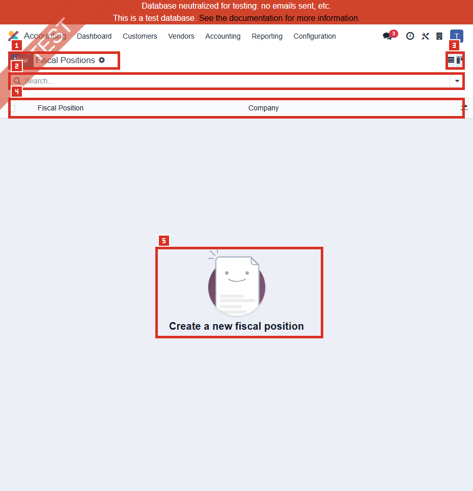

# ACC-012 คู่มือ Accounting > Configuration > Fiscal Positions

- บริษัท: Linkweld (Thailand) Co., Ltd.
- ระบบ: Odoo 18 Enterprise Staging
- วันที่ตรวจ: 16 กรกฎาคม 2026
- วิธีตรวจ: Evidence-first Read-only
- สถานะบท: `Confirmed` เฉพาะ Active Fiscal Positions เท่ากับ 0; ค่า Mapping และผลธุรกรรมเป็น `Not Available`

## ขอบเขตและข้อจำกัด

- เปิดเมนู Accounting > Configuration > Fiscal Positions สำเร็จใน Active/default list
- ตรวจ company scope `allowed_company_ids=[1]` และ domain Active ที่เป็น Global หรือ Company 1 ได้ผล 0 ทั้งคู่
- ไม่มี Existing record จึงไม่เปิดฟอร์ม Tax Mapping หรือ Account Mapping และไม่ใช้ record อื่นแทน
- ยืนยันเพียงว่าไม่มี Active Fiscal Position ในขอบเขตนี้ ไม่ได้ยืนยันว่า Fiscal Position ไม่จำเป็น
- ไม่ตรวจ Historical inactive records, Partner assignments หรือ Existing transaction outcomes
- ไม่กด New, Import, Export, Edit, Save, Archive, Delete, Duplicate, Add a line หรือ linked record ใด
- ไม่สร้าง/แก้ Partner, Product, Tax, Account, Sales Order, Purchase Order, Invoice, Bill, POS หรือ eCommerce transaction

หลักฐานโครงสร้าง:

- [ACC-012 Fiscal Positions extract](../evidence/accounting/ACC-012/ACC-012_fiscal_positions_extract.json)

## ภาพ 1: Active Fiscal Positions เป็นรายการว่าง

| หมายเลข | จุดบนหน้าจอ | ผลการตรวจ |
|---|---|---|
| 1 | เมนูและ New button | Fiscal Positions เปิดได้; New แสดงแต่ไม่ได้กด |
| 2 | Search | ว่าง ไม่มี filter/search term เพิ่ม |
| 3 | View controls | List view เปิดตามปกติ ไม่มี action ถูกเรียก |
| 4 | Columns | Fiscal Position และ Company |
| 5 | Empty state | `Create a new fiscal position`; ไม่มี row และไม่มี pager count |

## จำนวน Active Fiscal Positions

| กลุ่ม | จำนวน | สถานะหลักฐาน |
|---|---:|---|
| Active company/global total | 0 | Confirmed |
| Detect Automatically | 0 | Confirmed จาก zero active total |
| Manual | 0 | Confirmed จาก zero active total |
| VAT Required | 0 | Confirmed จาก zero active total |
| Foreign VAT | 0 | Confirmed จาก zero active total |
| Country / Country Group scope | 0 / 0 | Confirmed จาก zero active total |
| มี Tax Mapping | 0 | Confirmed จาก zero active total |
| มี Account Mapping | 0 | Confirmed จาก zero active total |
| Historical inactive records | Not Available | ไม่ได้ถอด Active filter หรือค้นหา Archived |

## Field ที่ Model รองรับแต่ไม่มีค่าปัจจุบันให้ตรวจ

Read-only `fields_get` ยืนยันว่ามี field ต่อไปนี้ แต่ไม่มี Active record จึงไม่มี Current value:

| กลุ่ม | Fields | ผลเมื่อมีการ Config |
|---|---|---|
| Identity/Order | `sequence`, `name`, `active`, `company_id` | ชื่อ, Company scope และลำดับการพิจารณา |
| Mappings | `tax_ids`, `account_ids` | แทน Tax/Account จากค่าตั้งต้นของ Product |
| Automatic criteria | `auto_apply`, `vat_required` | ตรวจอัตโนมัติและเงื่อนไข VAT ของ Partner |
| Geography | `company_country_id`, `country_id`, `country_group_id`, `state_ids`, `zip_from`, `zip_to` | จำกัดตามประเทศ/กลุ่มประเทศ/รัฐ/รหัสไปรษณีย์ |
| Foreign VAT | `foreign_vat`, `foreign_vat_header_mode` | รองรับกรณี VAT ต่างประเทศตาม configuration ที่เกี่ยวข้อง |

## Standard Odoo 18

Fiscal Position ใช้แทน Tax และ Account ที่มาจาก Product/Partner ตามกฎของธุรกรรม โดยใช้งานได้สามทาง:

1. Detect Automatically ตามเงื่อนไข VAT และภูมิศาสตร์
2. เลือก Manual บน Sales Order, Invoice หรือ Bill ก่อนเพิ่ม Product lines
3. กำหนดเป็นค่าเริ่มต้นบน Partner

Tax Mapping สามารถแทน Tax เดิม, ลบ Tax โดยปล่อย Tax to Apply ว่าง หรือแทน Tax เดิมด้วยหลาย Tax lines ได้ Mapping จะทำงานกับ Active taxes เท่านั้น ลำดับ Fiscal Position สำคัญเมื่อเงื่อนไข Automatic หลายรายการตรงพร้อมกัน

## Standard vs Pain Point

| หัวข้อ | Standard Odoo 18 | สภาพที่พบใน Linkweld | ข้อเสนอ |
|---|---|---|---|
| Domestic default | Product/Partner default taxes/accounts ทำงานได้โดยไม่ต้องมี Fiscal Position | Active Fiscal Position = 0 | ถ้า Flow ทั้งหมดใช้ Default ได้ถูกต้อง การคง 0 อาจเหมาะสม แต่ต้องพิสูจน์ด้วย UAT |
| Tax replacement | แทน/ลบ/แยก Tax ตาม mapping | ไม่มี Active Tax Mapping | ทำ Fit-gap สำหรับ Export 0%, Exempt, WHT และ Foreign cases ก่อนสร้าง |
| Account replacement | เปลี่ยน Revenue/Expense account ตาม context | ไม่มี Active Account Mapping | ห้ามสร้างเพียงเพื่อแก้ COA ผิด; แก้ Product/Category master ก่อนเมื่อเป็น root cause |
| Automatic detection | ใช้ VAT/Country/Country Group/State/ZIP และ Sequence | ไม่มี Active automatic rule | สร้างเฉพาะเมื่อเงื่อนไขไม่ทับซ้อนและมี Negative tests |
| Manual/Partner | เลือกบนเอกสารหรือผูก Partner ได้ | ไม่มี Active candidate ให้เลือก/ผูก | ออกแบบ Owner, applicability และ defaulting policy ก่อน assignment |
| Thailand tax | Localization มี VAT 7%, VAT Exempted และ WHT-related taxes/reports | ไม่พบ Fiscal Position เชื่อม Tax เหล่านี้ | ไม่สรุปว่า Tax flow ผิด; ต้องตรวจ Existing documents และ report reconciliation |
| Historical data | Archived Fiscal Position อาจยังอ้างจากเอกสารเดิม | ไม่ได้ตรวจ inactive records | ทำ dependency trace ก่อนสร้างชื่อ/กฎซ้ำหรือ Reactivate |

## Pain Point และความเสี่ยง

- Zero active records ไม่ใช่ defect โดยอัตโนมัติ หาก Linkweld ใช้ Tax/Account defaults และผู้ใช้เลือก Tax โดยตรงอย่างถูก Policy
- Cross-border, Export 0%, Exempt, Import, Foreign VAT, WHT หรือ Customer/Vendor geography อาจต้องมี rule เพื่อป้องกันการเลือกผิด แต่ยังไม่มี requirement/evidence เพียงพอ
- Fiscal Position ที่ Detect Automatically ผิดอาจเปลี่ยน Tax, Tax Grid, Revenue/Expense account และยอด Receivable/Payable โดยผู้ใช้อาจไม่สังเกต
- Sequence ซ้อนกันอาจทำให้ rule แรกชนะ แม้ rule ถัดไปตั้งใจให้เฉพาะกว่า
- Tax Mapping ไปยัง inactive/ผิดประเภท Tax หรือ Account Mapping ไปยังบัญชีผิดสามารถกระทบ VAT/WHT reports, PND source data, margin และ GL
- การสร้าง rule จากชื่อประเทศหรือคำว่า Export เพียงอย่างเดียวไม่เพียงพอ ต้องมี Tax/Legal owner อนุมัติ

## Solution ที่แนะนำ

1. ทำ Fiscal Position requirement matrix ก่อนสร้าง record: Scenario, Customer/Vendor, Country, VAT status, Product tax, Target tax, Account, Document, Report และ Owner
2. ตรวจ Existing SO/PO/Invoice/Bill/Partner แบบ Read-only ว่ามีการเลือก Tax/Account/Fiscal Position อย่างไร และมี Historical inactive record หรือไม่
3. แยก Use case ที่ Standard defaults เพียงพอออกจาก Use case ที่ต้อง Mapping; ห้ามสร้าง Fiscal Position เพื่อแก้ master data ที่ตั้งผิด
4. ออกแบบ Auto-detection ให้เงื่อนไขไม่ทับซ้อน จัด Sequence จาก Specific ไป General และทำ Negative tests ทุก rule
5. ใช้ Tax ที่ Active และตรวจ Tax Grid/Account/Refund signs กับ ACC-009 ก่อน Mapping
6. ทดสอบบน Clone UAT ก่อน assignment ให้ Partner หรือเอกสาร และห้ามทดลองบน Primary staging
7. จำกัดสิทธิ์ Create/Edit/Archive Fiscal Position และ mappings ให้ Accounting Manager/System Admin ที่ได้รับอนุมัติ
8. เมื่อ UAT ผ่าน ให้ทำ Mapping register, owner approval, effective date, rollback และ regression suite สำหรับ Sales/Purchase/Accounting/POS/eCommerce

## Acceptance Criteria ก่อน Go-live

- ทุก Fiscal Position ที่เสนอมี Business/Tax owner และกฎหมายหรือ Policy รองรับ
- Default Tax/Account, Source mapping และ Target mapping ระบุชัดและไม่ชี้ไป inactive record
- Automatic criteria ไม่ทับซ้อน หรือมี Sequence/negative test ที่พิสูจน์ผล
- Domestic transactions ที่ไม่ควรถูก Mapping ยังคง Tax/Account เดิม
- VAT/WHT/PND/GL reports reconcile กับ expected journal items
- User ทั่วไปไม่สามารถแก้ Fiscal Position หรือ mappings ได้
- Historical documents และ inactive records ไม่ถูกเปลี่ยนหรือสร้างชื่อซ้ำโดยไม่ตั้งใจ

## รายการ UAT ขั้นต่ำบน Clone UAT เท่านั้น

| UAT ID | กรณีทดสอบ | ผลที่ต้องตรวจ | สถานะ |
|---|---|---|---|
| UAT-ACC-012-01 | Domestic sale ไม่มี Fiscal Position | Product tax, Output VAT, revenue, receivable และ Tax Grid คง Default ที่อนุมัติ | Pending |
| UAT-ACC-012-02 | Export sale 0% | เงื่อนไข, VAT 0%, Tax Grid, invoice wording และ revenue ถูกต้อง | Pending |
| UAT-ACC-012-03 | VAT-exempt sale | ไม่สับสนกับ Zero-rated; Tax/report classification ถูกต้อง | Pending |
| UAT-ACC-012-04 | Foreign customer automatic rule | Country/VAT criteria ตรงจึงใช้ rule; domestic/negative case ไม่ถูกใช้ | Pending |
| UAT-ACC-012-05 | Domestic vendor bill + WHT | Purchase tax, WHT, payable, PND source และ payment regression ถูกต้อง | Pending |
| UAT-ACC-012-06 | Foreign vendor/import | Import VAT, expense/asset/landed-cost account และ currency ถูกต้อง | Pending |
| UAT-ACC-012-07 | Partner default assignment | Partner ที่อนุมัติ default ถูกต้อง; Partner อื่นไม่ถูกกระทบ | Pending |
| UAT-ACC-012-08 | Manual selection on SO/PO/Invoice/Bill | เลือกก่อนเพิ่ม lines แล้ว Tax/Account เปลี่ยนตาม mapping และ trace ได้ | Pending |
| UAT-ACC-012-09 | Tax removal/one-to-many replacement | Tax to Apply ว่างหรือตั้งหลาย lines ให้ผลตาม Policy โดยไม่ duplicate tax | Pending |
| UAT-ACC-012-10 | Account mapping | Revenue/Expense account เปลี่ยนเฉพาะ scope ที่อนุมัติ และ margin/GL ถูกต้อง | Pending |
| UAT-ACC-012-11 | Overlapping automatic criteria | Specific rule ชนะตาม Sequence; boundary Country/State/ZIP/VAT ผ่าน | Pending |
| UAT-ACC-012-12 | Access/report/regression | User ทั่วไปแก้ไม่ได้; VAT/WHT/PND/GL/POS/eCommerce ไม่ regression | Pending |

## สรุปสถานะ

- Active Fiscal Positions ใน Linkweld company/global scope เท่ากับ 0
- ไม่มี Existing form, Tax Mapping, Account Mapping หรือ Automatic rule ให้ตรวจ
- ผลนี้ไม่พิสูจน์ว่า Fiscal Positions ไม่จำเป็น และไม่พิสูจน์ผล Cross-border/Export/Exempt/WHT
- Recommendation คือทำ Fit-gap และ Clone-UAT ก่อนสร้างหรือผูก Fiscal Position ใด
- ไม่มีการสร้าง แก้ ใช้ หรือ Archive Fiscal Position และไม่มี Transaction/Report ถูกเปิดหรือเปลี่ยน

อ้างอิง:

- [Odoo 18 Fiscal Positions](https://www.odoo.com/documentation/18.0/applications/finance/accounting/taxes/fiscal_positions.html)
- [Odoo 18 Fiscal Position model reference](https://www.odoo.com/documentation/18.0/developer/reference/standard_modules/account/account_fiscal_position.html)
- [Odoo 18 Thailand localization](https://www.odoo.com/documentation/18.0/applications/finance/fiscal_localizations/thailand.html)
