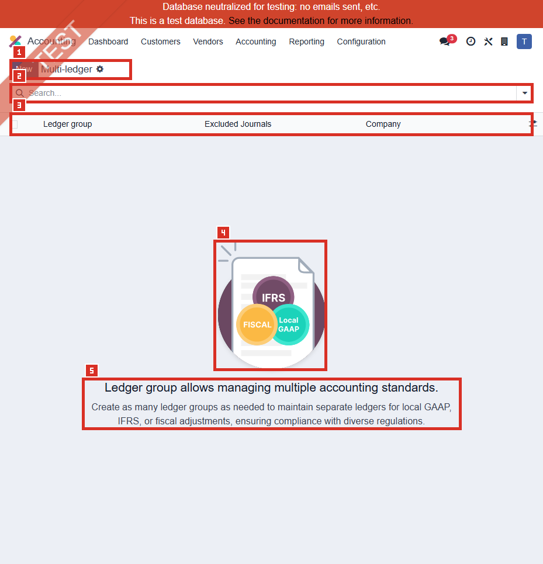

# ACC-013 คู่มือ Accounting > Configuration > Journal Groups / Multi-ledger

- บริษัท: Linkweld (Thailand) Co., Ltd.
- ระบบ: Odoo 18 Enterprise Staging
- วันที่ตรวจ: 16 กรกฎาคม 2026
- วิธีตรวจ: Evidence-first Read-only
- สถานะบท: `Confirmed` เฉพาะจำนวน Journal Groups เท่ากับ 0 และ schema ที่ตรวจพบ; ผล Multi-ledger/Report เป็น `Not Available`

## ขอบเขตและข้อจำกัด

- เปิดเมนูที่ Inventory เรียกว่า Journal Groups สำเร็จ โดยหน้า Odoo ใช้ชื่อจริงว่า `Multi-ledger`
- Default domain เป็น `[]`; model ไม่มี `active` field จึงไม่เรียกหน้านี้ว่า Active list/filter
- ตรวจ `allowed_company_ids=[1]`, `current_company_id=1`; Total, Global และ Company 1 เท่ากับ 0
- ไม่มี Existing record จึงไม่เปิดฟอร์มและไม่ใช้ record อื่นแทน
- ไม่เปิด Financial Report, Journal, Journal Entry, Account, Company หรือ linked record ใด
- ไม่กด New, Import, Export, Edit, Save, Archive, Delete, Duplicate หรือเพิ่ม/ลบ Excluded Journal
- ไม่เก็บ Journal/Account label หรือเลขบัญชีธนาคารใดในหลักฐาน

หลักฐานโครงสร้าง:

- [ACC-013 Journal Groups extract](../evidence/accounting/ACC-013/ACC-013_journal_groups_extract.json)

## ภาพ 1: Multi-ledger เป็นรายการว่าง

| หมายเลข | จุดบนหน้าจอ | ผลการตรวจ |
|---|---|---|
| 1 | Page title และ New | ชื่อหน้า `Multi-ledger`; New แสดงแต่ไม่ได้กด |
| 2 | Search | ว่าง; default domain `[]` |
| 3 | Columns | Ledger group, Excluded Journals, Company |
| 4 | Help illustration | Local GAAP, IFRS และ Fiscal เป็นตัวอย่างแนวคิดใน Empty state |
| 5 | Help text | อธิบายการสร้าง Ledger groups หลายชุดเพื่อแยกมาตรฐานบัญชี; ไม่ใช่หลักฐานว่า Linkweld ใช้งานแล้ว |

Exact help heading:

> Ledger group allows managing multiple accounting standards.

Exact help text:

> Create as many ledger groups as needed to maintain separate ledgers for local GAAP, IFRS, or fiscal adjustments, ensuring compliance with diverse regulations.

## จำนวนและ Default behavior

| รายการ | ค่าที่ตรวจพบ | สถานะหลักฐาน |
|---|---|---|
| Model | `account.journal.group` | Confirmed |
| Default domain | `[]` | Confirmed |
| Default order | `sequence ASC, id ASC` | Confirmed |
| Page / count limit | 80 / 10001 | Confirmed |
| Total records | 0 | Confirmed |
| Global records | 0 | Confirmed |
| Company 1 records | 0 | Confirmed |
| Excluded journal relationships | 0 | Confirmed จาก zero records |
| Pager | ไม่แสดง | Confirmed |
| Existing form/report result | Not Available | ไม่มี record และไม่ได้รัน Report |

## Schema ที่ตรวจพบ

| Field | Label / Type | หน้าที่เมื่อ Config |
|---|---|---|
| `name` | Ledger group / Char / Required | ชื่อ Ledger ที่ผู้ใช้เลือกในรายงาน |
| `company_id` | Company / Many2one | จำกัด Ledger group ตาม Company หรือ Global scope ตามค่าที่กำหนด |
| `excluded_journal_ids` | Excluded Journals / Many2many `account.journal` | ระบุ Journal ที่ต้องตัดออกจาก Ledger view นั้น |
| `sequence` | Sequence / Integer | กำหนดลำดับแสดง/พิจารณาตาม UI behavior ที่เกี่ยวข้อง |

ข้อควรระบุให้ถูกต้อง:

- ไม่มี `active` field ใน schema ที่ตรวจ
- ไม่มี Included Journals หรือ Selected Journals field แยกต่างหาก
- ไม่มี reporting-behavior field อื่นใน schema ที่ตรวจ
- รายการ Journal ที่อยู่ใน Ledger ต้องพิสูจน์จาก Excluded Journals และ Report output ไม่ใช่เดาจากชื่อ Group

## Standard Odoo 18

Odoo 18 อธิบาย Multi-ledger เป็นส่วนหนึ่งของเครื่องมือ Consolidation/Financial reporting โดย:

- Regular ledger ใช้บันทึกรายการประจำวันตามปกติของแต่ละบริษัท
- Multi-ledger สามารถใช้มุมมองที่รวม/ตัด Journal adjustment ตาม Ledger ที่กำหนด
- การสร้าง Ledger ต้องกำหนด Name, Company และ Journal ที่ต้อง Exclude
- Financial reports โดยทั่วไปเริ่มจาก statutory/regular view และผู้ใช้ต้องเลือก Multi-ledger ที่เหมาะสมเมื่อต้องการมุมมองอื่น

Odoo 18 release notes ระบุว่า Multi-ledger usability ใน multi-company ได้รับการปรับปรุงด้าน grouping, default selection และ filtering แต่หลักฐาน Linkweld บทนี้ไม่ได้รัน Report จึงยังไม่ยืนยันผลเหล่านั้นใน staging

## Standard vs Pain Point

| หัวข้อ | Standard Odoo 18 | สภาพที่พบใน Linkweld | ข้อเสนอ |
|---|---|---|---|
| Primary/regular ledger | รายงานตาม Journal ของ Company ใน statutory view | ไม่พบ Alternative Ledger group | ใช้ current path ต่อได้หากตอบ Requirement และ Auditor sign-off |
| Multi-standard reporting | แยกมุมมอง Local GAAP, IFRS, Tax/Fiscal หรือ consolidation adjustment ได้ | Total groups = 0 | ทำ Fit-gap ก่อนสร้าง; ข้อความ Help ไม่ใช่ Requirement |
| Excluded Journals | Ledger ระบุ Journal ที่ไม่รวม | ไม่มี Excluded relationship | ทำ Journal-by-standard matrix และ reconcile ยอด |
| Company scope | Ledger group ผูก Company ได้ | Company/Global records = 0 | ห้ามใช้ Global โดยไม่มี multi-company governance |
| Sequence | ลำดับข้อมูลตาม sequence แล้ว id | ไม่มีค่าปัจจุบัน | กำหนด naming/sequence convention เมื่อมีหลาย Ledger |
| Reports | ผู้ใช้เลือก Ledger ใน Financial Reports | ไม่ได้เปิด Report | ต้องทดสอบ Balance Sheet, P&L, Trial Balance และ Tax/Consolidation outputs |
| Privacy | Excluded Journals อาจแสดง Journal names ที่มีข้อมูลธนาคาร | Empty list ปลอดภัย; ไม่มี label | ใช้ชื่อ Journal ที่ไม่ฝังเลขบัญชี และจำกัด Screenshot/Export |

## Pain Point และความเสี่ยง

- Zero groups ไม่ใช่ defect โดยอัตโนมัติ หาก Linkweld ต้องการเพียง statutory/primary ledger และไม่มี parallel-standard requirement
- ถ้ามี IFRS, Tax book, consolidation หรือ management adjustments แต่ไม่มี Ledger separation ผู้ใช้อาจต้องพึ่ง Manual filter ที่ควบคุมยาก
- Exclude Journal ผิดชุดทำให้รายงานขาดหรือเกิน adjustment และอาจไม่ reconcile กับ GL/งบที่อนุมัติ
- Journal เดียวอาจมีรายการหลายวัตถุประสงค์ หากแยกด้วย Journal ไม่ชัด Multi-ledger จะไม่แก้ปัญหาที่ source design
- Global group หรือ multi-company filter ที่ผิดอาจผสมข้อมูลคนละ Company
- ชื่อ Local GAAP/IFRS/Fiscal ใน Help text ไม่ยืนยันว่าบริษัทมีภาระรายงานเหล่านี้ ต้องให้ CFO/Auditor/Tax owner ตัดสิน
- Multi-ledger เป็น Reporting/configuration control ไม่ควรถูกใช้เพื่อซ่อน posting ผิดหรือแทน Journal governance

## Solution ที่แนะนำ

1. ยืนยัน Requirement ก่อน: Statutory/TFRS, IFRS, Tax adjustments, Consolidation, Management reporting และ Auditor deliverables
2. ทำ Journal inventory จาก ACC-010 แบบ Privacy-safe พร้อม Purpose, Company, Currency, Posting source, Adjustment type และ Owner
3. สร้าง Ledger matrix: Ledger name, Company, Included-by-default journals, Excluded journals, Report, Expected balance และ Approver
4. แยก Adjustment journals ให้มีวัตถุประสงค์ชัดก่อนใช้ Exclusion; ห้ามแยกจากชื่อ Journal อย่างเดียว
5. ทดสอบ Ledger แต่ละชุดบน Clone UAT โดยใช้ Same posted dataset และ reconcile ถึง Trial Balance/Balance Sheet/P&L
6. ทดสอบ multi-company selector, exchange rates, consolidation adjustments และ report filters โดยไม่สร้าง entry เพิ่มระหว่าง comparison
7. จำกัดสิทธิ์ Create/Edit/Delete Ledger groups และ Excluded Journals ให้ Accounting Manager/System Admin ที่ได้รับอนุมัติ
8. หากไม่มี Requirement ให้บันทึก Decision ว่า `No Multi-ledger required` พร้อม CFO/Auditor sign-off แทนการสร้าง Group เปล่า

## Acceptance Criteria ก่อน Go-live

- ทุก Ledger group มี Accounting-standard scope, Company, Owner และ Report purpose ที่อนุมัติ
- Excluded Journal matrix ครบ ไม่มี Journal สำคัญหลุดหรือถูกตัดซ้ำ
- Statutory view ยังคงตรง GL และงบที่อนุมัติ
- Alternative Ledger แต่ละชุด reconcile จาก same dataset และอธิบาย Difference ได้
- Multi-company/Company scope ไม่ทำให้ข้อมูลข้ามบริษัทผิดพลาด
- ผู้ใช้ทั่วไปแก้ Group, Sequence หรือ Excluded Journals ไม่ได้
- Journal/Account/Bank privacy ไม่รั่วผ่าน List, Export หรือ Screenshot
- Rollback คือยกเลิกการใช้ Group/restore mapping ที่อนุมัติ โดยไม่ลบ Posted entries

## รายการ UAT ขั้นต่ำบน Clone UAT เท่านั้น

| UAT ID | กรณีทดสอบ | ผลที่ต้องตรวจ | สถานะ |
|---|---|---|---|
| UAT-ACC-013-01 | Baseline ไม่มี Ledger group | Statutory Trial Balance, Balance Sheet และ P&L ตรง current approved baseline | Pending |
| UAT-ACC-013-02 | Local GAAP/TFRS Ledger | Journal scope และยอดรายงานตรง matrix ที่ CFO/Auditor อนุมัติ | Pending |
| UAT-ACC-013-03 | IFRS Ledger | IFRS adjustment journals ถูก include/exclude ตาม design และ Difference อธิบายได้ | Pending |
| UAT-ACC-013-04 | Fiscal/Tax Ledger | Tax adjustment journals แยกถูกต้องโดยไม่เปลี่ยน VAT/WHT/PND source entries | Pending |
| UAT-ACC-013-05 | Excluded Journal positive test | Journal ที่กำหนด Exclude ไม่ปรากฏใน Ledger report ที่เลือก | Pending |
| UAT-ACC-013-06 | Non-excluded Journal negative test | Journal ปกติยังปรากฏครบและยอดไม่หาย | Pending |
| UAT-ACC-013-07 | Sequence/default selection | หลาย Ledger แสดงตาม convention และ Default ไม่ทำให้ผู้ใช้เปิดรายงานผิดชุด | Pending |
| UAT-ACC-013-08 | Company/Global scope | Group ใช้เฉพาะ Company ที่อนุมัติและไม่ข้ามข้อมูลบริษัท | Pending |
| UAT-ACC-013-09 | Multi-company consolidation | Selector, adjustment journals, mappings และ contribution reconcile ถูกต้อง | Pending |
| UAT-ACC-013-10 | Currency/translation | Current company rates, historical/average/closing translation และ CTA ถูกต้องตาม policy | Pending |
| UAT-ACC-013-11 | Access/privacy/audit | User ทั่วไปแก้ไม่ได้; Journal names/Export/Screenshot ไม่รั่วเลขบัญชี | Pending |
| UAT-ACC-013-12 | Regression/rollback | Payments, reconciliation, VAT/WHT, Assets และ reports เดิมไม่ regression; rollback ไม่แตะ Posted entries | Pending |

## สรุปสถานะ

- Journal Groups menu เปิดหน้า `Multi-ledger` และไม่มี record ใน company context ที่ตรวจ
- Model มีเฉพาะ Ledger group, Company, Excluded Journals, Sequence และ metadata; ไม่มี Active/Included field
- ไม่ได้รัน Report จึงยังไม่ยืนยัน Local GAAP, IFRS, Fiscal, consolidation หรือ transaction effect
- Zero groups ไม่ยืนยันว่าจำเป็นหรือไม่จำเป็น ต้องมี Requirement และ CFO/Auditor decision
- ไม่มีการสร้าง แก้ ลบ Ledger group, Excluded Journal, Report filter หรือ Odoo transaction ใด

อ้างอิง:

- [Odoo 18 Consolidation and Multi-ledgers](https://www.odoo.com/documentation/18.0/applications/finance/accounting/get_started/consolidation.html)
- [Odoo 18 Release Notes - Multi-ledger](https://www.odoo.com/odoo-18-release-notes)
