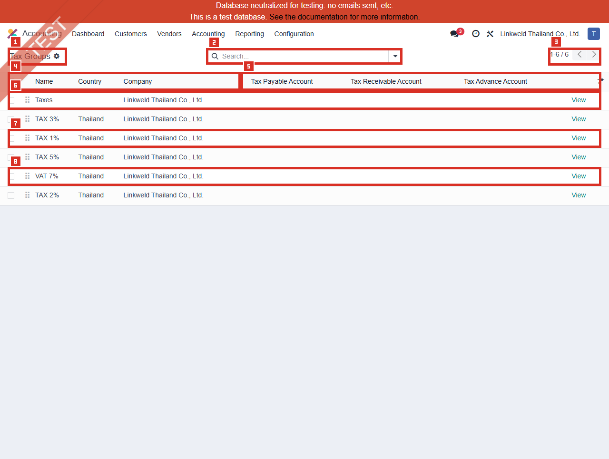
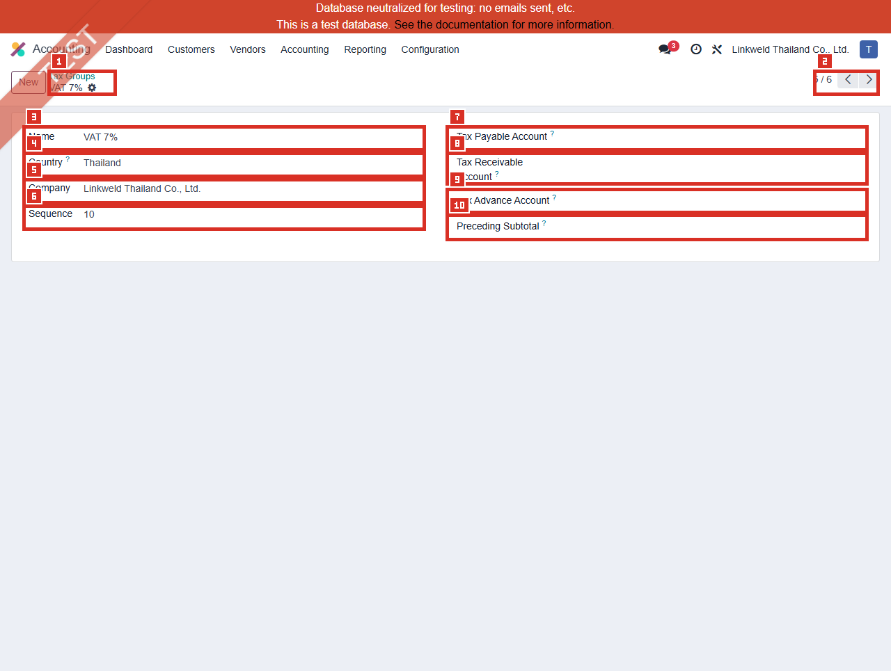
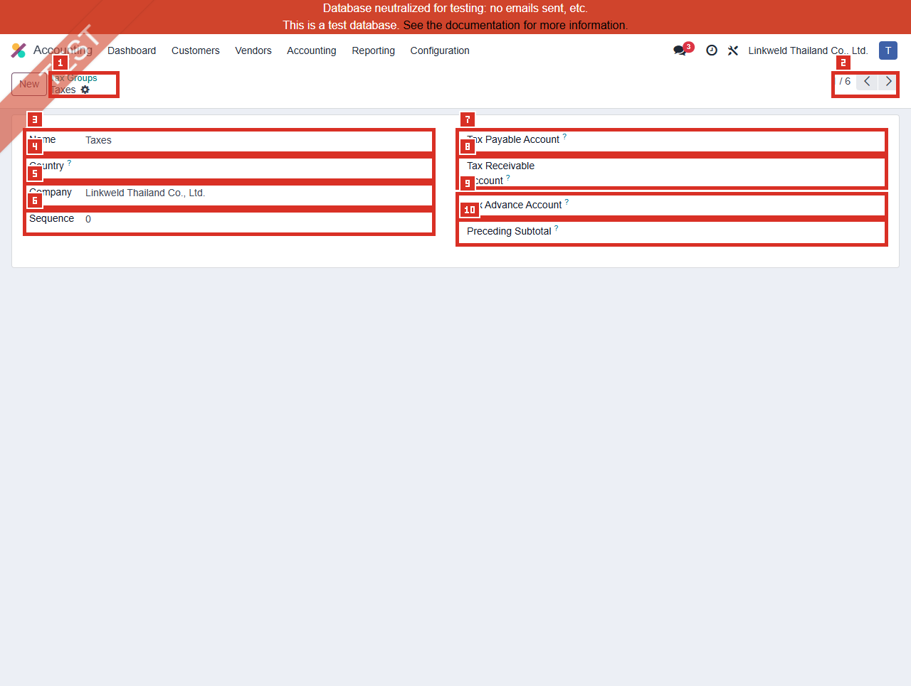

# ACC-014 คู่มือ Accounting Tax Groups (Developer-hidden configuration)

- บริษัท: Linkweld (Thailand) Co., Ltd.
- ระบบ: Odoo 18 Enterprise Staging
- วันที่ตรวจ: 16 กรกฎาคม 2026
- วิธีตรวจ: Evidence-first Read-only
- สถานะบท: `Confirmed` สำหรับ 6 Tax Groups, schema และค่าฟอร์ม 3 กลุ่ม; Tax Closing/Report เป็น `Not Available`

## Access และขอบเขต

- เมนู Accounting > Configuration ของผู้ใช้นี้ **ไม่แสดง Tax Groups**
- Local Odoo 18 source กำหนด `account.menu_action_tax_group` ด้วย `groups="base.group_no_one"`
- ไม่ได้เปิด Developer Mode และไม่เปิด Developer > Technical menu
- โหลด Standard action `account.action_tax_group` แบบ Read-only ผ่าน `/web/action/load` และเปิด route ที่สังเกตได้ `/odoo/action-235`
- Direct action เปิดได้สำหรับ authenticated user นี้ แต่ไม่ได้แปลว่าควรเปิดเมนูหรือให้สิทธิ์แก้ไขแก่ Business users
- หน้า list เป็น editable presentation ตาม Standard แต่ไม่คลิก cell, ไม่เข้า inline edit และเปิดฟอร์มผ่าน `View` เท่านั้น
- ไม่เปิด Tax, Account, Company, Country, Tax Closing, Tax Report หรือ Technical view ใด

หลักฐานโครงสร้าง:

- [ACC-014 Tax Groups extract](../evidence/accounting/ACC-014/ACC-014_tax_groups_extract.json)

## ภาพ 1: Tax Groups list

| หมายเลข | จุดบนหน้าจอ | ผลการตรวจ |
|---|---|---|
| 1 | Page title | Tax Groups; เปิดจาก Direct action ไม่ใช่เมนูที่มองเห็น |
| 2 | Search | ว่าง; default domain `[]` |
| 3 | Pager | `1-6 / 6` |
| 4 | Identity columns | Name, Country, Company |
| 5 | Closing-account columns | Tax Payable, Tax Receivable และ Tax Advance Account |
| 6 | Taxes | Sequence 0, Country ว่าง, Company 1, accounts ว่าง |
| 7 | TAX 1% | Sequence 10, Thailand, Company 1, accounts ว่าง |
| 8 | VAT 7% | Sequence 10, Thailand, Company 1, accounts ว่าง |

รายการตาม Default order `sequence ASC, id ASC`:

| ลำดับ | Tax Group | Sequence | Country | Company | Payable / Receivable / Advance |
|---:|---|---:|---|---|---|
| 1 | Taxes | 0 | ว่าง | Linkweld Thailand Co., Ltd. | ว่าง / ว่าง / ว่าง |
| 2 | TAX 3% | 10 | Thailand | Linkweld Thailand Co., Ltd. | ว่าง / ว่าง / ว่าง |
| 3 | TAX 1% | 10 | Thailand | Linkweld Thailand Co., Ltd. | ว่าง / ว่าง / ว่าง |
| 4 | TAX 5% | 10 | Thailand | Linkweld Thailand Co., Ltd. | ว่าง / ว่าง / ว่าง |
| 5 | VAT 7% | 10 | Thailand | Linkweld Thailand Co., Ltd. | ว่าง / ว่าง / ว่าง |
| 6 | TAX 2% | 10 | Thailand | Linkweld Thailand Co., Ltd. | ว่าง / ว่าง / ว่าง |

## จำนวนและ Field coverage

| รายการ | มีค่า | ว่าง | ข้อสังเกต |
|---|---:|---:|---|
| Tax Payable Account | 0 | 6 | ต้องพิสูจน์ Tax Closing policy/behavior |
| Tax Receivable Account | 0 | 6 | ต้องพิสูจน์ Tax refund/receivable closing behavior |
| Tax Advance Account | 0 | 6 | Requirement ของ Advance tax ยังไม่ยืนยัน |
| Preceding Subtotal | 0 | 6 | ไม่มี label พิเศษก่อนแสดง Tax Group |
| PoS receipt label | 0 | 6 | Field มีใน model แต่ไม่แสดงบนฟอร์มที่ตรวจ |
| Country Thailand | 5 | - | TAX 1/2/3/5 และ VAT 7% |
| Country ว่าง | 1 | - | Taxes; ไม่ได้หมายถึง Global เพราะ Company ยังเป็น Company 1 |

Sequence 10 ซ้ำ 5 กลุ่มไม่ใช่ defect โดยอัตโนมัติ เพราะ Standard order ใช้ `id` เป็นลำดับรอง แต่ต้องทดสอบการจัดลำดับใน Document totals หากมีผลทางธุรกิจ

## ภาพ 2: VAT 7% Tax Group

| หมายเลข | Field | ค่าปัจจุบัน |
|---|---|---|
| 1 | Breadcrumb | Tax Groups > VAT 7% |
| 2 | Pager | Existing record navigation; ไม่สร้าง record |
| 3 | Name | VAT 7% |
| 4 | Country | Thailand |
| 5 | Company | Linkweld Thailand Co., Ltd. |
| 6 | Sequence | 10 |
| 7 | Tax Payable Account | ว่าง |
| 8 | Tax Receivable Account | ว่าง |
| 9 | Tax Advance Account | ว่าง; field จริงคือ `advance_tax_payment_account_id` |
| 10 | Preceding Subtotal | ว่าง |

ACC-009 ยืนยัน Input VAT 7% และ Output VAT 7% อ้าง Tax Group นี้ แต่ไม่ได้รัน Tax Closing ในบทนี้ จึงยังไม่ยืนยันผล Closing entry

## ภาพ 3: TAX 1% Tax Group

| หมายเลข | Field | ค่าปัจจุบัน |
|---|---|---|
| 1 | Breadcrumb | Tax Groups > TAX 1% |
| 2 | Pager | Existing record navigation |
| 3 | Name | TAX 1% |
| 4 | Country | Thailand |
| 5 | Company | Linkweld Thailand Co., Ltd. |
| 6 | Sequence | 10 |
| 7 | Tax Payable Account | ว่าง |
| 8 | Tax Receivable Account | ว่าง |
| 9 | Tax Advance Account | ว่าง |
| 10 | Preceding Subtotal | ว่าง |

ACC-009 ยืนยัน Company Withholding Tax 1% อ้างกลุ่ม TAX 1% แต่ไม่พบ Tax Grid บน WHT sample ดังนั้น PND/Closing outcome ต้องทดสอบร่วมกับ Tax, Bill, Payment และ Report ไม่สรุปจากชื่อ Group

## ภาพ 4: Taxes Tax Group

| หมายเลข | Field | ค่าปัจจุบัน |
|---|---|---|
| 1 | Breadcrumb | Tax Groups > Taxes |
| 2 | Pager | Existing record navigation |
| 3 | Name | Taxes |
| 4 | Country | ว่าง |
| 5 | Company | Linkweld Thailand Co., Ltd. |
| 6 | Sequence | 0 |
| 7 | Tax Payable Account | ว่าง |
| 8 | Tax Receivable Account | ว่าง |
| 9 | Tax Advance Account | ว่าง |
| 10 | Preceding Subtotal | ว่าง |

ACC-009 ยืนยัน Output VAT 0% ใช้ Tax Group Taxes แต่ชื่อและ Country ว่างไม่พิสูจน์ว่าใช้กับ Tax ใดทั้งหมด ต้อง Trace linked taxes แบบ Read-only ก่อนเปลี่ยน

## Standard Odoo 18

| Field/Behavior | Standard behavior | จุดควบคุม |
|---|---|---|
| Tax Group | Taxes ในกลุ่มเดียวกันถูกรวมเป็นยอดเดียวในส่วน Totals ของ Invoice/PDF/Portal | Name ต้องสื่อความหมายและไม่ทำให้ VAT 0%, Exempt, WHT สับสน |
| Sequence | จัดลำดับ Group โดย `sequence, id` | Duplicate sequence ใช้ได้แต่ต้องทดสอบ display order |
| Country/Company | กำหนด scope ของ Tax Group | Country ว่างไม่เท่ากับ Company ว่าง; Company field เป็น Required |
| Tax Payable Account | Counterpart ของ Tax Closing เมื่อเป็นยอดชำระให้หน่วยงาน | ต้องเป็น account ที่ผ่าน type/reconcile/non-trade validation ของ Odoo |
| Tax Receivable Account | Counterpart ของ Tax Closing เมื่อเป็นยอดรับคืน/เป็นคุณต่อบริษัท | ต้อง reconcile และแยกจาก Trade AR/AP ตาม policy |
| Tax Advance Account | Advance/downpayment ที่ Tax Closing นำมาพิจารณา | ใช้เฉพาะเมื่อมี approved advance-tax flow |
| Preceding Subtotal | Label subtotal ก่อนแสดง Tax Group บนเอกสาร | ว่างใช้ Standard subtotal behavior |
| PoS receipt label | Label สำหรับ PoS receipt | ว่างในทุกกลุ่มและไม่แสดงบนฟอร์มที่ตรวจ |

Odoo 18 Tax Return workflow แนะนำให้ Lock Tax Return date ก่อนสร้าง Closing Entry และ Tax Closing สามารถสร้าง Journal Entry จาก Tax Return report ได้ เอกสาร Custom Tax Report ของ Odoo ระบุให้กำหนดทั้ง Tax Payable และ Tax Receivable accounts สำหรับ Tax ที่ใช้กับ Closing แต่ Linkweld Thailand policy/standard report ต้องพิสูจน์บน Clone UAT ก่อนแก้บัญชีทั้ง 6 กลุ่ม

## Standard vs Pain Point

| หัวข้อ | Standard Odoo 18 | สภาพ Linkweld | ข้อเสนอ |
|---|---|---|---|
| Tax Group totals | รวม Taxes ตาม Group บนเอกสาร | มี 6 groups และ ACC-009 อ้าง VAT 7%, TAX 1%, Taxes | Reconcile Invoice/Bill/Credit Note totals กับ Tax definition |
| Tax Closing accounts | ใช้ Payable/Receivable counterpart | ว่าง 6/6 | ทดสอบ Current closing behavior ก่อนกำหนดบัญชี |
| Tax Advance | รองรับ Advance tax payment account | ว่าง 6/6 | ใช้เฉพาะเมื่อ Tax owner ยืนยัน flow |
| Thailand reporting | Localization มี VAT/PND outputs | Group accounts/grids ไม่ได้พิสูจน์ report outcome | Reconcile VAT-202, PND source, Tax Return และ GL |
| Access | Menu เป็น developer-hidden surface | Direct action เปิดได้ แต่เมนูไม่เห็น | จำกัดการแก้ผ่าน approved Accounting admin flow |
| Sequence | Group order ใช้ sequence/id | 5 groups ใช้ Sequence 10 | ทำ naming/order decision และ UAT display |
| Country | Group จำกัดประเทศได้ | Taxes ไม่มี Country; 5 groups เป็น Thailand | ตรวจ linked taxes ก่อนเติม Country |

## Pain Point และความเสี่ยง

- Payable/Receivable ว่างทุกกลุ่มเป็น configuration risk สำหรับ Tax Closing แต่ยังไม่ใช่ defect ที่ยืนยัน เพราะไม่ได้รัน Closing/Report
- การใส่บัญชีผิดอาจสร้าง Closing entry ไป Trade AR/AP, บัญชีที่ไม่ Reconcile หรือผิด Company
- TAX 1/2/3/5 เป็นชื่อ Group ไม่ยืนยัน WHT rate, PND type หรือ account; ผู้ใช้ต้องเลือก Tax record ที่ถูกต้องจาก ACC-009
- Taxes group Country ว่างอาจถูกใช้หลาย Tax; เปลี่ยน Country/Sequence โดยไม่ Trace linked taxes สามารถเปลี่ยน document presentation หรือ report behavior
- Direct action access แม้เมนูซ่อนอยู่ต้องผ่าน Access review; ไม่ควรเปิด Developer Mode ให้ Business users เพื่อแก้ Master นี้
- Tax Group ไม่มี Active field; ห้ามอธิบายว่า 6 records เป็น Active filter result
- Tax Closing มี Lock Date/Posted-entry impact จึงห้ามทดสอบบน Primary staging

## Solution ที่แนะนำ

1. Freeze Tax Group, Sequence, Country และ Closing accounts จนกว่า Accounting/Tax owner อนุมัติ
2. ทำ Tax-to-Group matrix จาก ACC-009: Tax, Sales/Purchase, Rate, Account, Grid, Group, PND/VAT report และ Owner
3. ทดสอบ Current blank-account behavior บน Clone UAT ก่อนกำหนดบัญชี เพื่อแยก Requirement gap จาก localization behavior
4. หากต้องใช้ Closing accounts ให้สร้าง/เลือก Non-trade Receivable/Payable ที่ Allow Reconciliation และ Company ถูกต้องตาม Odoo validation
5. Reconcile Tax Return proposal/Closing entry กับ VAT-202-01/02, PND3/PND53 source, GL และ Trial Balance
6. ทดสอบ Refund, Carryover, Advance tax, Lock Tax Return date และ correction ในงวดถัดไป
7. กำหนด Access role สำหรับ Tax Group/Tax Grid/Closing accounts โดยไม่เปิด Developer Mode ให้ผู้ใช้ทั่วไป
8. เก็บ Before/After config, report, journal entry, approver และ rollback plan โดยไม่ลบ Posted entry

## Acceptance Criteria ก่อน Go-live

- Tax ทุกตัวเชื่อม Group ที่ถูก Policy และ Group name ไม่ทำให้ VAT/WHT/Exempt สับสน
- Tax Payable/Receivable/Advance account decision มี Tax/CFO approval และ Company/account type ถูกต้อง
- Tax Closing proposal reconcile กับ Tax Report, Tax Grids และ GL
- VAT 7%, VAT 0%, Exempt, WHT และ Refund signs ถูกต้อง
- Sequence/Preceding Subtotal/PoS label แสดงผลตาม Document requirement
- Lock Date และ correction flow ป้องกันการแก้งวดยื่นภาษีแล้ว
- ผู้ใช้ทั่วไปเข้าถึง/แก้ Developer-hidden configuration ไม่ได้
- ไม่มีเลขบัญชีธนาคารหรือข้อมูลลับใน Screenshot/Export/Handoff

## รายการ UAT ขั้นต่ำบน Clone UAT เท่านั้น

| UAT ID | กรณีทดสอบ | ผลที่ต้องตรวจ | สถานะ |
|---|---|---|---|
| UAT-ACC-014-01 | Access/menu visibility | Accounting user ไม่เห็นเมนูซ่อนและแก้ Tax Group ไม่ได้; approved admin access trace ได้ | Pending |
| UAT-ACC-014-02 | VAT 7% Invoice/Bill | Group totals, accounts, grids, VAT-202 และ refund signs ถูกต้อง | Pending |
| UAT-ACC-014-03 | TAX 1% WHT flow | Bill, WHT, payment, account, PND source และ group display ถูกต้อง | Pending |
| UAT-ACC-014-04 | Taxes group VAT 0%/Exempt | Zero-rated กับ Exempt ไม่ปะปนและ Country/Group presentation ถูกต้อง | Pending |
| UAT-ACC-014-05 | Current blank-account Tax Closing | ระบบ Block/Warn/Propose อย่างไรโดยไม่ Post; บันทึก actual result | Pending |
| UAT-ACC-014-06 | Payable closing scenario | Net tax payable ไป approved Non-trade Payable และ reconcile ถูกต้อง | Pending |
| UAT-ACC-014-07 | Receivable/refund closing | Net tax receivable ไป approved Non-trade Receivable และ carryover/refund ถูกต้อง | Pending |
| UAT-ACC-014-08 | Advance tax payment | Advance account ถูกนำมาคำนวณเฉพาะ approved flow และไม่ duplicate | Pending |
| UAT-ACC-014-09 | Sequence/document totals | Group order, subtotal, invoice PDF/portal และ rounding ถูกต้อง | Pending |
| UAT-ACC-014-10 | Country/company scope | Thailand/blank Country และ Company 1 ไม่กระทบ Tax ต่างประเทศหรือบริษัทอื่น | Pending |
| UAT-ACC-014-11 | Lock/correction/reversal | Lock Tax Return date, Closing entry refresh/post และ correction งวดถัดไปถูกต้อง | Pending |
| UAT-ACC-014-12 | Report/access/regression | VAT/WHT/PND/GL/PoS/Payments ไม่ regression; rollback ไม่แตะ Posted entries | Pending |

## สรุปสถานะ

- Tax Groups มี 6 records ทั้งหมดเป็น Company 1; Thailand 5 และ Country ว่าง 1
- VAT 7%, TAX 1% และ Taxes อ้างอิงจาก ACC-009 และมี Closing/Advance accounts ว่าง
- ทุกกลุ่มมี Payable, Receivable, Advance, Preceding Subtotal และ PoS label ว่าง
- เมนูถูกซ่อนด้วย `base.group_no_one`; action เปิดตรงได้แต่ไม่ได้ใช้ Developer Mode
- Tax Closing, Tax Report, Posting, PoS และ Sequence outcome ยังไม่ยืนยัน
- ไม่มี Tax Group, Account, Tax, Closing entry, Report filter หรือ Odoo transaction ถูกสร้าง/แก้/รัน

อ้างอิง:

- [Odoo 18 Taxes](https://www.odoo.com/documentation/18.0/applications/finance/accounting/taxes.html)
- [Odoo 18 Tax Return and Closing](https://www.odoo.com/documentation/18.0/applications/finance/accounting/reporting/tax_returns.html)
- [Odoo 18 Custom tax report closing configuration](https://www.odoo.com/documentation/18.0/applications/finance/accounting/reporting/customize.html)
- [Odoo 18 Thailand localization](https://www.odoo.com/documentation/18.0/applications/finance/fiscal_localizations/thailand.html)
