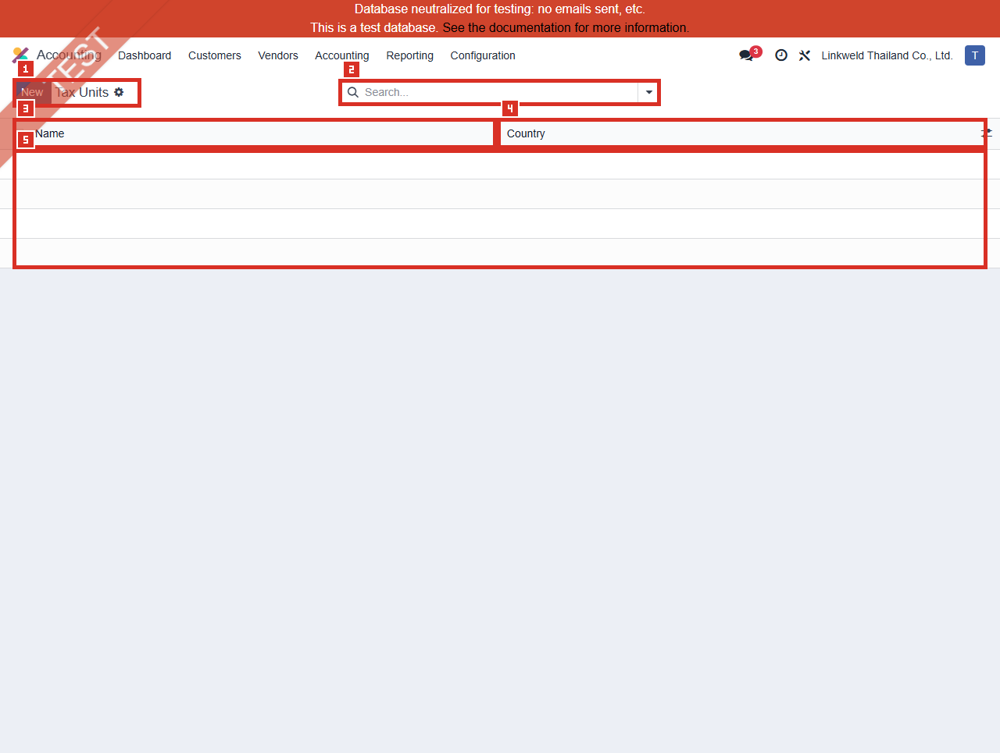

# ACC-015 คู่มือ Accounting Tax Units (Developer-hidden configuration)

- บริษัท: Linkweld (Thailand) Co., Ltd.
- ระบบ: Odoo 18 Enterprise Staging
- วันที่ตรวจ: 16 กรกฎาคม 2026
- วิธีตรวจ: Evidence-first Read-only
- สถานะบท: `Confirmed` สำหรับ zero Tax Units, access และ schema; membership/report/synchronization เป็น `Not Available`

## Access และขอบเขต

- เมนู Accounting > Configuration ของผู้ใช้นี้ **ไม่แสดง Tax Units**
- Local Odoo 18 source จำกัด `account_reports.menu_view_tax_units` ด้วย `groups="base.group_no_one"`
- ไม่ได้เปิด Developer Mode และไม่เปิด Developer > Technical
- โหลด Standard action `account_reports.action_view_tax_units` แบบ Read-only ผ่าน `/web/action/load` และเปิด route ที่สังเกตได้ `/odoo/action-647`
- Direct action เปิดได้สำหรับ user นี้ แต่ไม่ได้แปลว่าควรเปิดเมนูหรือให้สิทธิ์แก้แก่ Business users
- ไม่เปิดฟอร์ม จึงไม่แสดงและไม่อ่าน Tax ID, Companies, Main Company หรือปุ่ม Synchronize
- ไม่เปลี่ยน Company selector และไม่เปิด Tax Report, Tax Return, Consolidation หรือ linked record ใด

หลักฐานโครงสร้าง:

- [ACC-015 Tax Units extract](../evidence/accounting/ACC-015/ACC-015_tax_units_extract.json)

## ภาพ 1: Tax Units เป็นรายการว่าง

| หมายเลข | จุดบนหน้าจอ | ผลการตรวจ |
|---|---|---|
| 1 | Page title และ New | Tax Units; New แสดงแต่ไม่ได้กด |
| 2 | Search | ว่าง; UI domain `[]` |
| 3 | Name column | ไม่มี record |
| 4 | Country column | ไม่มี record |
| 5 | Empty list | Total 0 และไม่มี pager |

Request ส่ง Order เป็น empty string จึงไม่ระบุ user-visible sort ที่ไม่ได้ปรากฏในหลักฐาน

## จำนวนที่ตรวจพบ

| รายการ | จำนวน | สถานะหลักฐาน |
|---|---:|---|
| Tax Units | 0 | Confirmed |
| Countries represented | 0 | Confirmed จาก zero units |
| Member-company relationships | 0 | Confirmed จาก zero units |
| Main Companies | 0 | Confirmed จาก zero units |
| Tax ID present | 0 | Implied by zero units; ไม่ได้อ่านค่า Tax ID |
| Fiscal Positions Synchronised = True | 0 | Implied by zero units |
| Fiscal Positions Synchronised = False | 0 | Implied by zero units |
| Existing forms sampled | 0 | ไม่มี record และไม่ใช้ substitute |

## Schema ที่ยืนยันจาก fields_get

| Field | Label / Type | Required | จุดควบคุม |
|---|---|---|---|
| `name` | Name / Char | Yes | ชื่อ Unit สำหรับ Report selector |
| `country_id` | Country / Many2one | Yes | ประเทศของ Tax Unit และ Tax ID validation |
| `vat` | Tax ID / Char | Yes | Tax identifier สำหรับการยื่นของ Unit; ห้ามเก็บในหลักฐานทั่วไป |
| `company_ids` | Companies / Many2many | Yes | บริษัทสมาชิกของ Unit |
| `main_company_id` | Main Company / Many2one | Yes | บริษัทตัวแทนที่รายงานและชำระภาษี |
| `fpos_synced` | Fiscal Positions Synchronised / Computed Boolean | Read-only | ระบุว่า Fiscal Position ครบตามสมาชิกหรือไม่ |

## Critical prohibited action: Synchronize Fiscal Positions

Local Odoo 18 source แสดงว่า `action_sync_unit_fiscal_positions` สามารถ:

1. ลบ Fiscal Positions ที่ Tax Unit สร้างไว้เดิม
2. สร้าง Fiscal Position ใหม่สำหรับบริษัทสมาชิก โดย map Taxes ของบริษัทไปเป็น no tax
3. Assign Fiscal Position ให้ Partner ของบริษัทสมาชิกอื่น

ดังนั้นปุ่ม Synchronize ไม่ใช่การ Refresh แบบอ่านอย่างเดียว แต่เป็นการเปลี่ยน Master data และ Partner defaults หลายบริษัท ห้ามกดบน Primary staging และห้ามทดสอบก่อน Legal/Tax design, backup, dependency trace และ Clone-UAT approval

ACC-012 ยืนยันว่า Active Fiscal Positions ปัจจุบันเท่ากับ 0 การ Synchronize Tax Unit ครั้งแรกจึงอาจสร้าง configuration ใหม่จำนวนมากและเปลี่ยนสภาพที่ตรวจไว้ใน ACC-012

## Standard Odoo 18

Odoo อธิบาย Tax Unit ว่าเป็นกลุ่มกิจการที่เป็นนิติบุคคลแยกกันแต่ได้รับอนุญาตให้รายงาน VAT ร่วมกัน คุณสมบัตินี้:

- ใช้เฉพาะ Multi-company environment
- ไม่ได้เป็นข้อบังคับโดยอัตโนมัติ
- บริษัทสมาชิกต้องอยู่ประเทศเดียวกันและใช้ Main currency เดียวกัน
- ต้องมี Main/Representative Company อยู่ในสมาชิก
- Tax Unit ใช้ Tax ID สำหรับการยื่นของ Unit โดยบริษัทสมาชิกยังคง Tax ID เชิงพาณิชย์ของตน
- Representative Company สามารถดู Aggregated Tax Report ของสมาชิกและ Export ตาม Localization support
- Intercompany VAT/Fiscal Position design ต้องเป็นไปตามกฎหมายและ Localization ของประเทศนั้น

Local source เพิ่ม constraints ว่า Unit ต้องมีอย่างน้อย 2 บริษัท, Main Company ต้องเป็นสมาชิก, บริษัทอยู่ได้ไม่เกินหนึ่ง Unit ต่อ Country และ Tax ID ต้อง validate กับ Country

## Standard vs Pain Point

| หัวข้อ | Standard Odoo 18 | สภาพ Linkweld | ข้อเสนอ |
|---|---|---|---|
| Applicability | Optional และใช้เฉพาะ Multi-company tax grouping | Tax Units = 0; allowed context มี Company 1 | ให้ Legal/Tax ตัดสินก่อน ไม่สร้างจาก availability ของ feature |
| Membership | อย่างน้อย 2 companies ประเทศ/สกุลเดียวกัน | ไม่มี membership design | ทำ legal entity/currency/country eligibility matrix |
| Representative | Main Company รายงาน/ชำระภาษี | ไม่มี Main Company | กำหนด Owner, Tax ID, filing และ payment responsibility |
| Tax ID | Unit มี Tax ID สำหรับ return | ไม่อ่าน/ไม่เก็บค่า | ใช้ privacy-restricted master และ masked evidence |
| Fiscal Positions | Intercompany rules อาจใช้ Fiscal Position | ACC-012 Active FP = 0 | ออกแบบก่อน Sync; ห้ามกด auto-sync บน staging |
| Aggregated report | Representative ดู Tax Report รวมสมาชิก | ไม่ได้เปิด Report | Reconcile per-company ถึง aggregated total/XML |
| Access | Menu developer-hidden | Direct action accessible read-only | จำกัด config/sync ให้ approved System Admin + Tax owner |

## Pain Point และความเสี่ยง

- Zero Tax Units ไม่ใช่ defect หาก Linkweld ไม่มี legal multi-company Tax Unit requirement
- Standard documentation อธิบาย VAT Tax Unit ทั่วไป แต่ไม่ได้ยืนยันว่า Linkweld Thailand มีสิทธิ์/ภาระตามกฎหมายไทย ต้องให้ Tax/Legal advisor ตัดสิน
- Sync Fiscal Positions อาจลบ/สร้าง mappings และเปลี่ยน Partner defaults หลายบริษัท เป็น Critical master-data change
- Tax ID เป็นข้อมูลนิติบุคคลที่ต้องจำกัดการแสดง, Export, Screenshot และ Handoff
- Membership ผิด Company/Country/Currency ทำให้ Tax Report aggregate ผิดหรือระบบ Block ด้วย validation
- Aggregated report อาจซ่อนความต่างระหว่างบริษัทหาก per-company reconciliation ไม่ครบ
- การใช้ 0%/no-tax Fiscal Position ระหว่างสมาชิกโดยไม่มี legal basis ทำให้ VAT/WHT/PND ผิด

## Solution ที่แนะนำ

1. ทำ Legal/Tax applicability decision: บริษัทใดเป็นนิติบุคคลสมาชิก, ประเทศ, สกุลเงิน, VAT registration และกฎหมายอนุญาตหรือไม่
2. หากไม่ต้องใช้ ให้บันทึก `No Tax Unit required` พร้อม CFO/Tax/Legal sign-off และคง zero records
3. หากต้องใช้ ให้ทำ Tax Unit design: Unit name, Country, masked Tax ID, Members, Main Company, Filing/Payment owner และ effective date
4. Trace ACC-012 Fiscal Positions, Partner defaults, intercompany SO/PO/Invoice/Bill และ Tax mappings ก่อน Sync
5. Clone database และ export dependency register ก่อนเรียก Sync; เปรียบเทียบ Fiscal Position IDs/mappings/Partner assignments ก่อนและหลัง
6. ทดสอบ per-company Tax Return ก่อน แล้ว reconcile Aggregated Tax Report/XML ถึง VAT/WHT/PND/GL
7. จำกัดสิทธิ์ Tax Unit และ Sync action ให้ System Admin + Tax Manager ที่ได้รับอนุมัติ พร้อม audit log/two-person approval
8. Rollback ต้อง restore mappings/Partner defaults จาก evidence ห้ามลบ Posted entries หรือแก้ Tax history โดยตรง

## Acceptance Criteria ก่อน Go-live

- Legal/Tax advisor ยืนยัน Tax Unit applicability และสมาชิกทุกบริษัท
- Members อย่างน้อย 2 บริษัท อยู่ประเทศและ Main currency เดียวกัน
- Main Company เป็นสมาชิกและรับผิดชอบ Filing/Payment ชัดเจน
- Tax ID validate และไม่รั่วใน Screenshot/Export/Handoff
- Fiscal Position mappings และ Partner assignments ผ่าน Owner review ก่อน/หลัง Sync
- Intercompany transactions ใช้ VAT/WHT ตามกฎหมาย ไม่ใช่ no-tax จาก automation โดยไม่มี basis
- Aggregated Tax Report reconcile กับ per-company reports, GL และ submitted return
- ผู้ใช้ทั่วไปไม่เห็น/แก้ Tax Unit และไม่สามารถเรียก Synchronize action

## รายการ UAT ขั้นต่ำบน Clone UAT เท่านั้น

| UAT ID | กรณีทดสอบ | ผลที่ต้องตรวจ | สถานะ |
|---|---|---|---|
| UAT-ACC-015-01 | No-Tax-Unit baseline | Per-company Tax Return/GL ทำงานเดิมและมี signed decision หากไม่ใช้ | Pending |
| UAT-ACC-015-02 | Eligible 2-company Unit | Same Country/Currency, Main Company และ membership ผ่าน constraints | Pending |
| UAT-ACC-015-03 | Invalid membership boundaries | 1 company, different country/currency, Main not member และ duplicate Country membership ถูก Block | Pending |
| UAT-ACC-015-04 | Tax ID validation/privacy | Country match, validation, masking, role access และ Export control ถูกต้อง | Pending |
| UAT-ACC-015-05 | First Fiscal Position sync | Generated mappings/External IDs/Partner assignments ตรง approved design | Pending |
| UAT-ACC-015-06 | Sync negative scope | Non-member companies/partners/taxes ไม่ถูกเปลี่ยน | Pending |
| UAT-ACC-015-07 | Re-sync and rollback | Delete/recreate behavior trace ได้; approved custom mappings ไม่สูญหายหรือ restore ได้ | Pending |
| UAT-ACC-015-08 | Intercompany sale/purchase | VAT/WHT/Fiscal Position ถูกกฎหมายและไม่ใช้ 0% ผิด | Pending |
| UAT-ACC-015-09 | Aggregated Tax Report | Main Company total เท่ากับผลรวมที่ reconcile ของสมาชิก | Pending |
| UAT-ACC-015-10 | XML/export/report filters | Main Company/Tax ID/output period ถูกต้องและไม่รั่วข้อมูล | Pending |
| UAT-ACC-015-11 | Access/audit/concurrency | User ทั่วไปเรียก Sync ไม่ได้; two-person approval และ logs ครบ | Pending |
| UAT-ACC-015-12 | Regression/close | VAT-202, WHT/PND, Closing, Payments, Lock Date และ per-company reports ไม่ regression | Pending |

## สรุปสถานะ

- Tax Units เป็น developer-hidden surface และมี zero records ใน context ที่ตรวจ
- ไม่มี Tax ID ถูกอ่านหรือเก็บ และไม่มีฟอร์มถูกเปิด
- Tax Unit membership, Main Company, synchronization และ aggregated report ยังไม่ยืนยัน
- Synchronize Fiscal Positions เป็น Critical write action และไม่เคยถูกเรียก
- ไม่มี Fiscal Position, Partner, Company, Tax, Report หรือ Odoo transaction ถูกสร้าง/แก้/ลบ/รัน

อ้างอิง:

- [Odoo 18 Tax Units](https://www.odoo.com/documentation/18.0/applications/finance/accounting/get_started/tax_units.html)
- [Odoo 18 Fiscal Positions](https://www.odoo.com/documentation/18.0/applications/finance/accounting/taxes/fiscal_positions.html)
- [Odoo 18 Thailand localization](https://www.odoo.com/documentation/18.0/applications/finance/fiscal_localizations/thailand.html)
