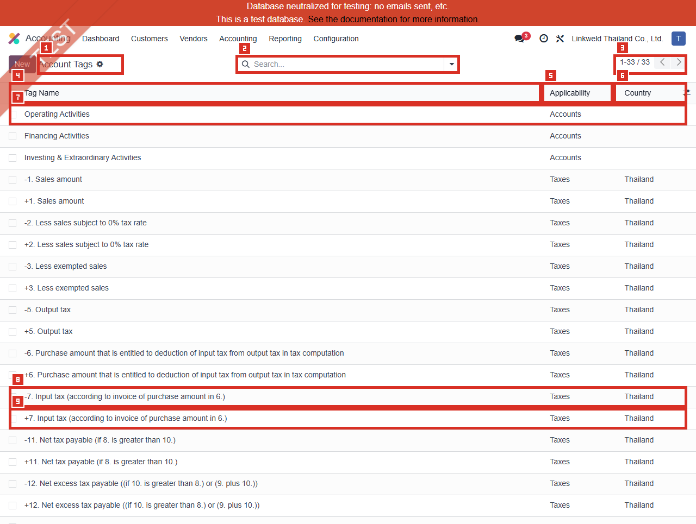
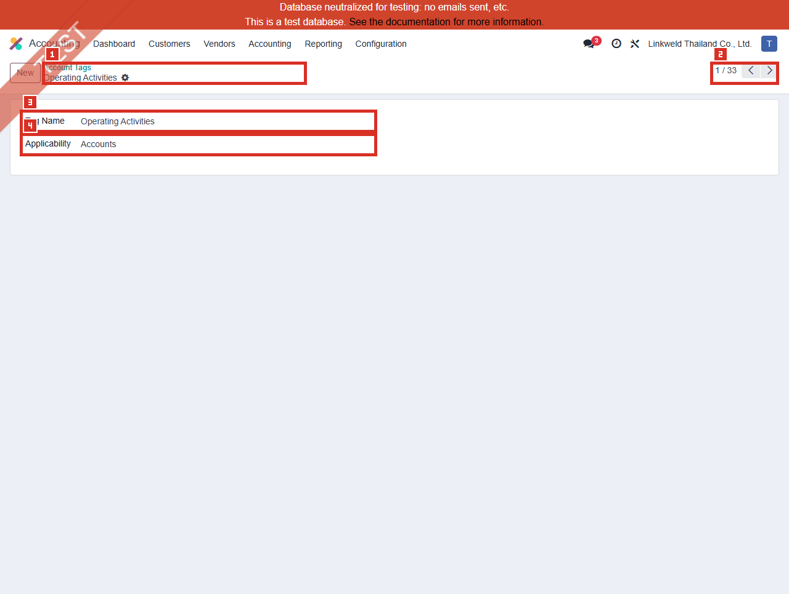
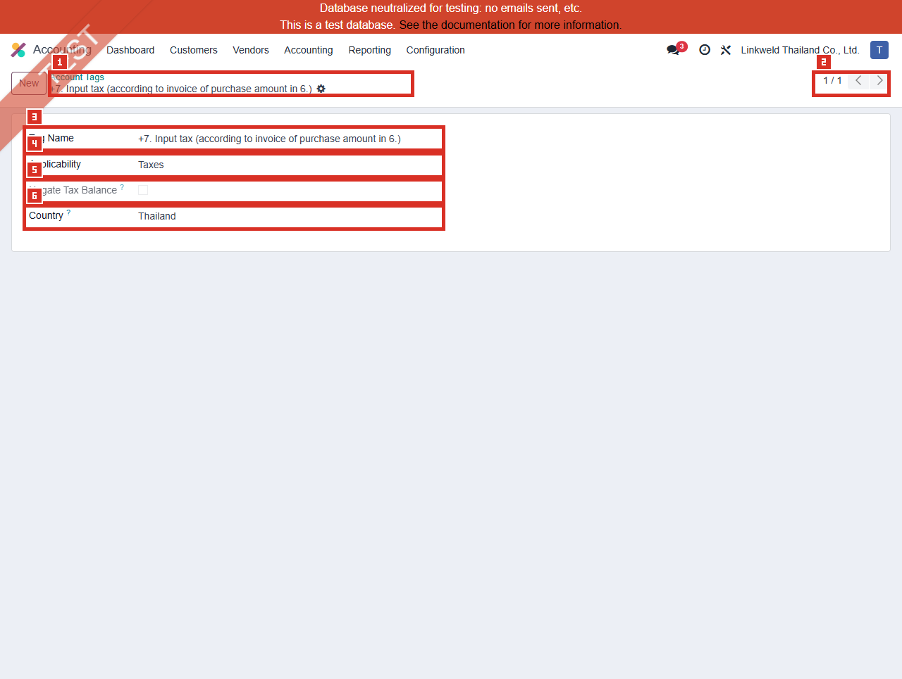
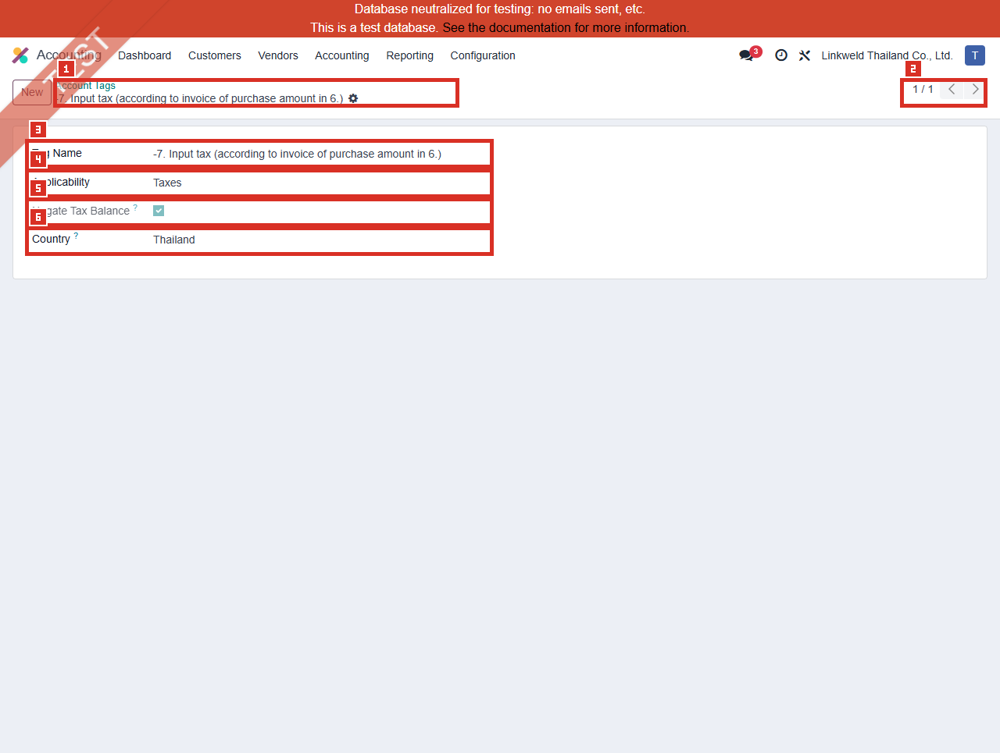

# ACC-016 คู่มือ Accounting Account Tags (Developer-hidden configuration)

- บริษัท: Linkweld (Thailand) Co., Ltd.
- ระบบ: Odoo 18 Enterprise Staging
- วันที่ตรวจ: 16 กรกฎาคม 2026
- วิธีตรวจ: Evidence-first Read-only
- สถานะบท: `Confirmed` สำหรับ 33 Active tags, schema, structural tax-tag pairs และ aggregate usage; Cash Flow/Tax Report/Posting เป็น `Not Available`

## Access และขอบเขต

- เมนู Accounting > Configuration ของผู้ใช้นี้ **ไม่แสดง Account Tags**
- Local Odoo 18 source จำกัด `account_accountant.account_tag_menu` ด้วย `groups="base.group_no_one"`
- ไม่เปิด Developer Mode และไม่เปิด Developer > Technical
- โหลด Standard action `account_accountant.account_tag_action` แบบ Read-only ผ่าน `/web/action/load` และเปิด route ที่สังเกตได้ `/odoo/action-612`
- Direct action เปิดได้สำหรับ user นี้ แต่ไม่ได้แปลว่าควรเปิดเมนูหรือให้สิทธิ์แก้แก่ Business users
- เปิดเฉพาะ Existing form แบบ View state; ไม่มี Save/Discard และไม่เปลี่ยน field/checkbox ใด
- ไม่เปิด Account, Tax, Tax Repartition Line, Product, Journal Item, Tax Report, Cash Flow Statement หรือ linked record ใด

หลักฐานโครงสร้าง:

- [ACC-016 Account Tags extract](../evidence/accounting/ACC-016/ACC-016_account_tags_extract.json)

## ภาพ 1: Account Tags list

| หมายเลข | จุดบนหน้าจอ | ผลการตรวจ |
|---|---|---|
| 1 | Page title และ New | Account Tags; New แสดงแต่ไม่ได้กด |
| 2 | Search | ว่าง ไม่มี active search chip |
| 3 | Pager | `1-33 / 33` |
| 4 | Tag Name | แสดงชื่อ Tag ทั้ง Account และ Tax Grid |
| 5 | Applicability | Accounts หรือ Taxes; ไม่พบ Products |
| 6 | Country | Tax tags ทั้งหมดเป็น Thailand; Account tags ว่าง |
| 7 | Account tags | Operating, Financing, Investing & Extraordinary Activities |
| 8 | Positive tax tag | ตัวอย่าง `+7. Input tax...` |
| 9 | Negative tax tag | ตัวอย่าง `-7. Input tax...` |

จำนวนที่ยืนยัน:

| รายการ | จำนวน |
|---|---:|
| Active/default tags | 33 |
| Archived tags | 0 |
| Applicability = Accounts | 3 |
| Applicability = Taxes | 30 |
| Applicability = Products | 0 |
| Thailand tax tags | 30 |
| Tax Negate = False / True | 15 / 15 |
| Exact positive/negative pairs | 15 |
| Missing pair | 0 |
| Duplicate `(name, applicability, country)` | 0 |

Model `account.account.tag` ไม่มี `company_id` จึงต้องอธิบายว่าเป็น Tag ที่อ่านภายใต้ Company context ไม่ใช่ master ที่เป็นเจ้าของโดย Company 1

## ภาพ 2: Operating Activities

| หมายเลข | จุดบนหน้าจอ | ผลการตรวจ |
|---|---|---|
| 1 | Breadcrumb/title | Operating Activities |
| 2 | Pager | Record 1 จาก 33 ใน View context |
| 3 | Tag Name | Operating Activities |
| 4 | Applicability | Accounts |

Aggregate read-only count พบ Account ที่ใช้ Tag ใดๆ 2 บัญชี แต่ `Operating Activities` มี usage 0 ไม่ได้อ่านชื่อ/เลขบัญชีเพื่อรักษา Privacy และไม่เปิด Journal Items ดังนั้นยังสรุปไม่ได้ว่า Cash Flow Statement จัดหมวด Operating/Investing/Financing ครบหรือถูกต้อง

## ภาพ 3: Positive input-tax grid

| หมายเลข | จุดบนหน้าจอ | ผลการตรวจ |
|---|---|---|
| 1 | Breadcrumb/title | `+7. Input tax (according to invoice of purchase amount in 6.)` |
| 2 | Search result pager | Exact unique result 1/1 |
| 3 | Tag Name | Positive Tax Grid name |
| 4 | Applicability | Taxes |
| 5 | Negate Tax Balance | Off และ field แสดงแบบ Read-only |
| 6 | Country | Thailand |

เลือก Tag นี้เพราะเป็น positive Thailand tax tag ที่มี aggregate Tax Repartition Line usage สูงสุดใน candidate ที่อ่านได้ คือ 6 lines ไม่ได้เปิด Tax, repartition line หรือ transaction ใด

## ภาพ 4: Negative input-tax grid

| หมายเลข | จุดบนหน้าจอ | ผลการตรวจ |
|---|---|---|
| 1 | Breadcrumb/title | `-7. Input tax (according to invoice of purchase amount in 6.)` |
| 2 | Search result pager | Exact unique result 1/1 |
| 3 | Tag Name | Negative counterpart ของภาพ 3 |
| 4 | Applicability | Taxes |
| 5 | Negate Tax Balance | On และ field แสดงแบบ Read-only |
| 6 | Country | Thailand |

Negative counterpart มี aggregate Tax Repartition Line usage 2 lines คู่ `+/-` ครบเชิงโครงสร้าง แต่ usage count ต่างกันไม่ใช่ defect โดยอัตโนมัติ เพราะ Invoice/Refund/Base/Tax repartition ใช้จำนวน line ต่างกันได้ ต้องพิสูจน์ signs และ totals จาก Existing-document traceability หรือ Clone UAT

## Schema และความหมายเชิงควบคุม

| Field | Standard Odoo 18 | จุดควบคุม Linkweld |
|---|---|---|
| Tag Name | Required; ใช้ระบุ Account/Tax/Product tag | ห้ามเปลี่ยนชื่อ Tax Grid โดยไม่มี report-expression trace |
| Applicability | Accounts, Taxes หรือ Products | เปลี่ยนทำให้ Tag ใช้กับ model/flow ต่างประเภท |
| Active | Archive แทนการลบ | ปัจจุบัน 33 Active, Archived 0 |
| Negate Tax Balance | กลับเครื่องหมาย absolute balance ใน Tax Report computation | Standard form แสดง Read-only; คู่ลบ 15 records เป็น On |
| Country | ใช้กับ Tax tags ตามประเทศ | Tax tags ทั้ง 30 เป็น Thailand |
| Company | ไม่มี field ใน core model | ห้ามอธิบายว่า Tag เป็น Company-owned |

Local source กำหนด uniqueness ที่ `(name, applicability, country_id)` และป้องกันการลบ master Account tags Operating, Financing และ Investing ที่ใช้กับ Chart template

## Standard vs Pain Point

| หัวข้อ | Standard Odoo 18 | สภาพ Linkweld | ข้อเสนอ |
|---|---|---|---|
| Account tags | บางรายงานต้องใช้ Tag บน Account | Account tags 3; มี Tagged accounts 2 แต่ Operating usage 0 | ทำ Account-to-Cash-Flow-class matrix และ reconcile report |
| Tax grids | Tags บน Base/Tax journal items ใช้ดึง Tax Return | 30 tags, 15 structural pairs, 28 repartition lines use tags | Reconcile Tax-to-Repartition-to-Grid-to-Report |
| Positive/negative pair | Report engine ใช้ `+/-` variants สำหรับ sign | ครบ 15 คู่ ไม่มี pattern mismatch | Freeze names/pairs; ทดสอบ Invoice/Refund signs |
| Product tags | Model รองรับ Applicability Products | 0 Product tags และ usage 0 | ไม่สร้างจนมี approved report requirement |
| Country | Tax tag จำกัดประเทศได้ | Tax tags ทั้งหมด Thailand | ตรวจ foreign VAT/localization ก่อนเพิ่มประเทศ |
| Access | Menu developer-hidden | Direct action เปิด read-only ได้ | จำกัด edit ให้ approved Accounting admin |
| Company scope | Core tag ไม่มี company_id | อ่านใน Company 1 context | วิเคราะห์ downstream records แยก Company |

## Pain Point และความเสี่ยง

- Tax-tag pair ครบไม่ได้พิสูจน์ว่า Tax Return, VAT-202 หรือ PND totals ถูกต้อง เพราะต้องตรวจ Tax Repartition, posted Journal Items, period, refund signs และ report expressions
- `Operating Activities` ไม่มี account usage อาจทำให้ Cash Flow classification ไม่ครบ แต่ยังไม่ใช่ defect จนกว่าจะดู Account mapping และ Cash Flow output
- มีเพียง 2 accessible accounts ที่ใช้ Tag ใดๆ จึงต้องตรวจว่าบัญชีที่ควรอยู่ Operating/Investing/Financing ใช้ Standard type/prefix หรือ Tag อย่างไร
- เปลี่ยนชื่อ, Country, Applicability, Active หรือคู่ `+/-` ของ Tax Tag อาจทำให้ Tax report expression หา transaction เดิมไม่ตรง
- Tax Grid labels เป็นเลขแบบฟอร์มเชิง Localization; ชื่ออย่างเดียวไม่พิสูจน์ VAT 202, PND3 หรือ PND53
- Tag ไม่มี Company field อาจถูกนำไปใช้กับ downstream records หลายบริษัท ต้องทดสอบ Company selector และ report isolation
- Direct action access ต้องผ่าน Access review; ห้ามเปิด Developer Mode ให้ Business users เพื่อแก้ master นี้

## Solution ที่แนะนำ

1. Freeze Account Tag และ Tax Tag master จนกว่า Accounting/Tax owner อนุมัติ
2. ทำ Account-to-Tag matrix สำหรับ Operating, Investing, Financing พร้อม Account type, report purpose, Company และ Owner
3. ทำ Tax-to-Repartition-to-Grid matrix ต่อจาก ACC-009: Tax, Invoice/Refund, Base/Tax line, Account, `+/-` tag, report line และ expected sign
4. Reconcile Existing posted sample หรือ Clone-UAT Invoice/Bill/Credit Note กับ Journal Items, Tax Return, VAT-202 และ GL
5. เปิด Cash Flow Statement บน Clone UAT และ reconcile Operating/Investing/Financing กับ Trial Balance และ approved mapping
6. หากต้องแก้ Tag ให้ทำ dependency extract ก่อน: Accounts, Products, Tax Repartition Lines, Report expressions และ historical posted lines
7. จำกัดสิทธิ์แก้ Account Tags ให้ System Admin/Accounting Manager ที่ได้รับอนุมัติ พร้อม two-person review
8. ห้ามลบหรือ rename Tax Grid เพื่อแก้รายงานย้อนหลังโดยตรง; ใช้ approved migration, effective date และ rollback evidence

## Acceptance Criteria ก่อน Go-live

- Account tags ที่ใช้กับ Cash Flow มี approved Account mapping และไม่ขาด Operating/Investing/Financing category ที่จำเป็น
- Tax tags มีคู่ `+/-`, Country และ `tax_negate` ตรง Localization/report expression
- Invoice, Bill, Credit Note และ Refund สร้าง Base/Tax tags และ signs ถูกต้อง
- Tax Return reconcile กับ Tax Grid journal items, VAT-202, GL และ Trial Balance
- WHT/PND source ไม่อาศัยการเดาจากชื่อ Tax Tag
- Company selector ไม่ทำให้ Tag usage หรือ report ข้ามบริษัทโดยไม่ตั้งใจ
- Product applicability ถูกคงไว้ที่ zero หรือมี requirement/owner/UAT ชัดเจนก่อนสร้าง
- Business user มองไม่เห็น/แก้ developer-hidden master และไม่มีข้อมูลลับใน evidence

## รายการ UAT ขั้นต่ำบน Clone UAT เท่านั้น

| UAT ID | กรณีทดสอบ | ผลที่ต้องตรวจ | สถานะ |
|---|---|---|---|
| UAT-ACC-016-01 | Access/menu visibility | Accounting user ไม่เห็นเมนูและแก้ Tag ไม่ได้; approved admin access trace ได้ | Pending |
| UAT-ACC-016-02 | Account-tag inventory | Account-to-Operating/Investing/Financing mapping ครบและมี Owner | Pending |
| UAT-ACC-016-03 | Cash Flow baseline | Cash Flow categories reconcile กับ Trial Balance/GL โดยไม่ใช้ Tag ผิด | Pending |
| UAT-ACC-016-04 | Positive input VAT grid | Bill ใช้ `+6/+7` ตาม approved Thailand grid และยอดตรง Tax Return | Pending |
| UAT-ACC-016-05 | Refund negative grid | Vendor Credit Note ใช้ `-6/-7`, signs และ GL ถูกต้อง | Pending |
| UAT-ACC-016-06 | Output VAT 7% | Invoice/Credit Note ใช้ Output grids และ VAT-202 ถูกต้อง | Pending |
| UAT-ACC-016-07 | VAT 0% vs Exempt | Base grids ไม่ปะปนและ report line ถูกต้อง | Pending |
| UAT-ACC-016-08 | WHT/PND path | Tax/Repartition/Tags/Account/PND source reconcile โดยไม่เดาจากชื่อ | Pending |
| UAT-ACC-016-09 | Pair integrity negative test | Missing/renamed/wrong-country/wrong-negate Tag ถูก detect ก่อน report | Pending |
| UAT-ACC-016-10 | Company isolation | Company selector และ shared Tag ไม่รวม Journal Items ข้ามบริษัท | Pending |
| UAT-ACC-016-11 | Archive/rename dependency | Dependency report และ rollback ป้องกัน historical report regression | Pending |
| UAT-ACC-016-12 | Full reporting regression | Tax Return, Cash Flow, VAT/WHT, Closing, GL, Trial Balance และ exports ไม่ regression | Pending |

## สรุปสถานะ

- Account Tags มี 33 Active records: Accounts 3, Taxes 30, Products 0 และไม่มี Archived
- Thailand Tax tags มี 15 positive/negative pairs ครบ; `tax_negate` และชื่อ `+/-` สอดคล้องเชิงโครงสร้าง
- Tax Repartition Lines 28 lines ใช้ Tag แต่ไม่ได้เปิด Tax/transaction/report
- มี Tagged accounts 2 บัญชี แต่ Operating Activities usage เป็น 0; Cash Flow outcome ยังไม่ยืนยัน
- เมนูถูกซ่อนด้วย `base.group_no_one`; direct action เปิดได้โดยไม่เปิด Developer Mode
- ไม่มี Tag, Account, Tax, Product, Report, Journal Item หรือ Odoo transaction ถูกสร้าง/แก้/ลบ/รัน

อ้างอิง:

- [Odoo 18 Chart of Accounts - Tags](https://www.odoo.com/documentation/18.0/applications/finance/accounting/get_started/chart_of_accounts.html)
- [Odoo 18 Taxes and Tax Grids](https://www.odoo.com/documentation/18.0/applications/finance/accounting/taxes.html)
- [Odoo 18 Tax Return](https://www.odoo.com/documentation/18.0/applications/finance/accounting/reporting/tax_returns.html)
- [Odoo 18 Custom Reports - Tax Tags](https://www.odoo.com/documentation/18.0/applications/finance/accounting/reporting/customize.html)
- [Odoo 18 Reporting and Cash Flow Statement](https://www.odoo.com/documentation/18.0/applications/finance/accounting/reporting.html)
- [Odoo 18 Account Tag model reference](https://www.odoo.com/documentation/18.0/developer/reference/standard_modules/account/account_account_tag.html)
