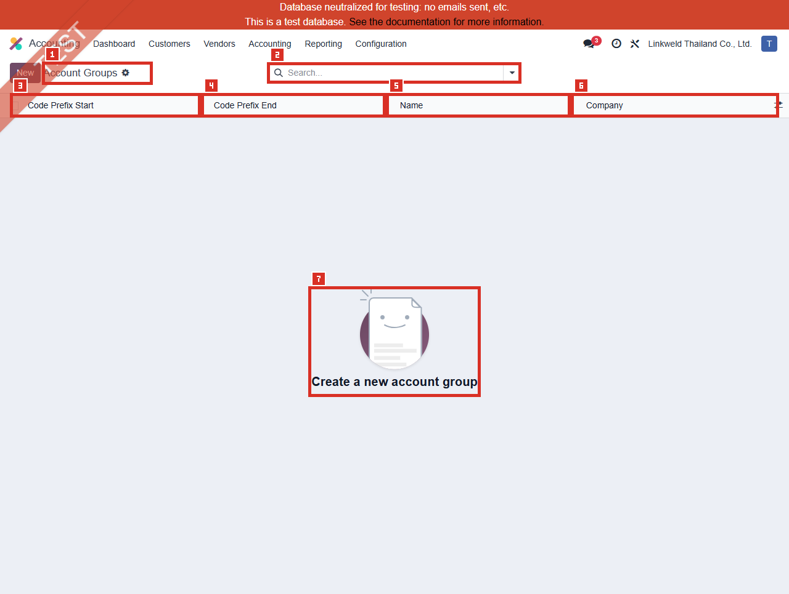

# ACC-017 คู่มือ Accounting Account Groups (Developer-hidden configuration)

- บริษัท: Linkweld (Thailand) Co., Ltd.
- ระบบ: Odoo 18 Enterprise Staging
- วันที่ตรวจ: 16 กรกฎาคม 2026
- วิธีตรวจ: Evidence-first Read-only
- สถานะบท: `Confirmed` สำหรับ zero Account Groups, schema และ zero computed assignments; Trial Balance/Report behavior เป็น `Not Available`

## Access และขอบเขต

- เมนู Accounting > Configuration ของผู้ใช้นี้ **ไม่แสดง Account Groups**
- Local Odoo 18 source จำกัด `account_accountant.menu_account_group` ด้วย `groups="base.group_no_one"`
- ไม่เปิด Developer Mode และไม่เปิด Developer > Technical
- โหลด Standard action `account_accountant.action_account_group_tree` แบบ Read-only ผ่าน `/web/action/load` และเปิด route ที่สังเกตได้ `/odoo/action-613`
- Direct action เปิดได้สำหรับ user นี้ แต่ Account Groups เป็น advanced configuration ไม่ใช่เมนูปกติสำหรับ Business users
- ไม่เปิดฟอร์ม เพราะไม่มี Existing record และไม่ใช้ข้อมูลอื่นทดแทน
- ไม่เปิด Chart of Accounts, Account, Company, Trial Balance, General Ledger, Financial Report หรือ Journal Item

หลักฐานโครงสร้าง:

- [ACC-017 Account Groups extract](../evidence/accounting/ACC-017/ACC-017_account_groups_extract.json)

## ภาพ 1: Account Groups เป็นรายการว่าง

| หมายเลข | จุดบนหน้าจอ | ผลการตรวจ |
|---|---|---|
| 1 | Page title และ New | Account Groups; New แสดงแต่ไม่ได้กด |
| 2 | Search | ว่าง ไม่มี default filter chip |
| 3 | Code Prefix Start | ไม่มี record |
| 4 | Code Prefix End | ไม่มี record |
| 5 | Name | ไม่มี record |
| 6 | Company | ไม่มี record |
| 7 | Empty state | `Create a new account group`; Total 0 และไม่มี pager |

UI request ส่ง domain `[]`, offset 0, limit 80, count limit 10001 และ Order เป็น empty string จึงไม่ระบุ user-visible sort ที่ไม่ได้ปรากฏในหลักฐาน ส่วน Local model กำหนด `_order = code_prefix_start`

## จำนวนที่ตรวจพบ

| รายการ | จำนวน | สถานะ |
|---|---:|---|
| Account Groups | 0 | Confirmed |
| Company 1/root-company groups | 0 | Confirmed |
| Global / Other-company groups | 0 / 0 | Confirmed |
| Single-prefix / Range groups | 0 / 0 | Confirmed |
| Top-level / Child groups | 0 / 0 | Confirmed |
| Parent-child relationships | 0 | Confirmed |
| Maximum hierarchy depth | 0 | Confirmed |
| Same-granularity overlaps | 0 | Implied by zero groups |
| Existing forms sampled | 0 | ไม่มี record; ไม่ใช้ substitute |

## Aggregate Account relationship

`account.account.group_id` เป็น Computed, Read-only และ Non-stored field การตรวจจึงใช้ `search_read` เฉพาะ `id` และ `group_id` แทนการใช้ domain aggregate บน non-stored field

| รายการ | จำนวน |
|---|---:|
| Non-deprecated Company-1 accounts | 353 |
| Accounts with computed Group | 0 |
| Accounts without computed Group | 353 |

ไม่ได้อ่านชื่อบัญชี, Full account code, Balance, Journal Item หรือ Transaction value จึงยืนยันได้เพียงว่าไม่มี assignment จาก `account.group` ใน context นี้ ไม่ได้ยืนยันว่าโครงสร้าง Chart of Accounts หรือรายงานผิด

## Schema และกฎควบคุม

| Field | Schema | จุดควบคุม |
|---|---|---|
| Name | Char, Required, writable | ชื่อหัวข้อที่ใช้แสดง hierarchy |
| Code Prefix Start | Char, Stored, writable | จุดเริ่มช่วงบัญชีที่จะเข้า Group |
| Code Prefix End | Char, Stored, writable | จุดสิ้นสุดช่วง; ต้องยาวเท่ากับ Start |
| Company | Required Many2one, Read-only | ใช้ root company ตาม Standard model |
| Parent | Optional Many2one, Read-only | ระบบคำนวณจากช่วง Prefix ที่ครอบอยู่ |
| Active | ไม่มี field | ห้ามอธิบายว่าเป็น Active list หรือ Archive flow |

Local Odoo 18 source กำหนดว่า:

1. ความยาว Start และ End ต้องเท่ากัน
2. Range ที่มีความละเอียดเท่ากันใน Company เดียวกันห้าม overlap
3. Nested range ที่ Prefix length ต่างกันสามารถเป็น hierarchy ที่ถูกต้อง ไม่ใช่ overlap defect โดยอัตโนมัติ
4. การสร้างหรือเปลี่ยน Prefix จะคำนวณ Parent ใหม่ให้เป็น range ที่ครอบและเฉพาะที่สุด
5. การลบ Group จะย้าย direct children ไป Parent ของ Group ที่ถูกลบก่อน unlink

กฎเหล่านี้ไม่ได้ถูกทดสอบด้วยการเขียนข้อมูลในรอบนี้

## Standard Odoo 18

Odoo อธิบาย Account Groups ว่าใช้รวมหลายบัญชีเป็น Sub-accounts ของบัญชี/หัวข้อใหญ่ เพื่อจัดกลุ่มรายงาน เช่น Trial Balance โดยทั่วไป Regular users ไม่จำเป็นต้องสร้างเอง และการสร้าง Manual Group เป็น Rare/Advanced use case ผ่าน Developer Mode

Standard documentation แนะนำ Manual Group ด้วย Name, Code Prefix และ Company และใช้ Trial Balance option `Hierarchy and Subtotals` เพื่อดูผล แต่ Linkweld ยังไม่มี Group และไม่ได้เปิด Trial Balance ในรอบนี้

## Standard vs Pain Point

| หัวข้อ | Standard Odoo 18 | สภาพ Linkweld | ข้อเสนอ |
|---|---|---|---|
| Necessity | Manual groups เป็น Rare/Advanced | Groups = 0 | ให้ CFO/Accounting ตัดสินจาก report requirement ไม่สร้างเพราะมีเมนู |
| Assignment | Account code ตรง Prefix จะได้ computed group | 353 accounts มี group_id ว่าง | ทำ desired hierarchy matrix ก่อนสร้าง Group แรก |
| Hierarchy | Nested prefixes สร้าง Parent/Child อัตโนมัติ | ไม่มี hierarchy | ออกแบบ Top-level/Child พร้อม non-overlap validation |
| Trial Balance | แสดง Hierarchy and Subtotals | ไม่ได้เปิด Report | เก็บ baseline และ reconcile total ก่อน/หลังบน Clone UAT |
| Company | Group เป็นของ root company | Company 1 groups = 0 | ทดสอบ Company selector และ shared account behavior |
| Access | Developer-only advanced surface | Direct action เปิด read-only ได้ | จำกัด write access ให้ approved admin |

## Pain Point และความเสี่ยง

- Zero Account Groups ไม่ใช่ defect โดยอัตโนมัติ เพราะ Odoo ระบุว่า Regular users โดยทั่วไปไม่ต้องสร้าง Manual Group
- Zero computed assignments ไม่พิสูจน์ว่า Trial Balance hierarchy/subtotal ผิด เพราะรายงานอาจยังจัดด้วย Account Type หรือ report structure อื่น
- การสร้าง Group แรกอาจ assign บัญชีเดิมหลายบัญชีโดยอัตโนมัติตาม Prefix แม้ไม่ได้แก้ Account master ทีละรายการ
- Prefix ที่กว้างหรือผิด Company อาจรวม Asset, Liability, Income หรือ Expense ผิดหัวข้อและทำให้ Report presentation เข้าใจผิด
- การแก้ Prefix สามารถคำนวณ Parent ใหม่และเปลี่ยน Historical period presentation โดยไม่เปลี่ยน Posted debit/credit
- การลบ Parent Group มี side effect ย้าย Children ไป Parent อื่น จึงต้องมี rollback hierarchy
- Nested different-length range อาจถูกต้อง; ห้ามใช้ logic ตรวจ overlap แบบง่ายที่ตีความ Nested hierarchy เป็น defect
- Account Group ไม่ควรใช้เพื่อซ่อน Account Type หรือ Posting ที่ผิด ต้องแก้ source master/policy แทน

## Solution ที่แนะนำ

1. บันทึก decision ว่า Linkweld ต้องการ Trial Balance hierarchy เพิ่มจาก Account Type/รายงานปัจจุบันหรือไม่
2. หากไม่ต้องใช้ ให้บันทึก `No manual Account Groups required` พร้อม CFO/Accounting sign-off และคง zero records
3. หากต้องใช้ ให้ทำ Group design matrix: Name, Start/End, Prefix length, Parent, Company, expected account count และ Report subtotal
4. Export privacy-safe aggregate ของ Account Code ranges และตรวจ coverage/gaps โดยไม่เปิดเผย Bank-account labels
5. ตรวจ equal-length, start <= end, same-granularity overlap และ nested parent logic ก่อน Import/Create
6. Clone database แล้วสร้าง Group จาก Top-level ไป Child พร้อม snapshot `group_id` ก่อน/หลัง
7. Reconcile Trial Balance Hierarchy/Subtotals กับ Flat Trial Balance, GL และ Financial Statements; Total debit/credit ต้องไม่เปลี่ยน
8. จำกัดสิทธิ์ Group write ให้ approved System Admin/Accounting Manager พร้อม two-person review และ rollback mapping

## Acceptance Criteria ก่อน Go-live

- มี signed decision ว่าต้องใช้หรือไม่ใช้ Manual Account Groups
- ทุก Prefix range มี Owner, Company, Parent และ expected Account coverage ชัดเจน
- Start/End lengths เท่ากัน, range ไม่กลับด้าน และ same-granularity ไม่ overlap
- Nested ranges สร้าง Parent/Child ตาม design และไม่ถูกตีความเป็น overlap ผิด
- Account assignment ก่อน/หลังตรง approved matrix; ไม่มีบัญชีตกหล่นหรือเข้า Group ผิด
- Trial Balance hierarchy/subtotals reconcile กับ Flat Trial Balance, GL และ Financial Statements
- Posted debit/credit, Account Type, Tax, Stock valuation และ Costing ไม่เปลี่ยนจากการจัด Group
- Business user ไม่เห็น/แก้ developer-hidden master และ rollback คืน hierarchy ได้

## รายการ UAT ขั้นต่ำบน Clone UAT เท่านั้น

| UAT ID | กรณีทดสอบ | ผลที่ต้องตรวจ | สถานะ |
|---|---|---|---|
| UAT-ACC-017-01 | Zero-group baseline | Flat Trial Balance/GL totals และ report options ถูกบันทึกก่อนเปลี่ยน | Pending |
| UAT-ACC-017-02 | No-group decision | หากไม่ใช้ มี CFO/Accounting sign-off และ zero groups ไม่กระทบ reporting | Pending |
| UAT-ACC-017-03 | Single-prefix group | Account codes ที่ตรง Prefix ได้ computed group ตาม expected count | Pending |
| UAT-ACC-017-04 | Range group | Start-End ครอบเฉพาะ approved accounts และไม่ข้าม Account class | Pending |
| UAT-ACC-017-05 | Nested hierarchy | Top-level/Child ต่าง Prefix length สร้าง Parent ที่เฉพาะที่สุด | Pending |
| UAT-ACC-017-06 | Invalid boundaries | Unequal length, start > end และ same-length overlap ถูก Block | Pending |
| UAT-ACC-017-07 | Company isolation | Root company, other company และ shared accounts ไม่ปะปน | Pending |
| UAT-ACC-017-08 | 353-account assignment | Grouped/Ungrouped counts reconcile กับ approved mapping | Pending |
| UAT-ACC-017-09 | Trial Balance hierarchy | Hierarchy/Subtotals ตรง Group design และ Total เท่า Flat report | Pending |
| UAT-ACC-017-10 | MRP/Stock/Tax accounts | WIP, COGS, valuation, clearing และ tax accounts อยู่หัวข้อที่ถูกต้อง | Pending |
| UAT-ACC-017-11 | Prefix change/delete | Parent adaptation, child reparenting, historical report และ rollback trace ได้ | Pending |
| UAT-ACC-017-12 | Access/full regression | User ทั่วไปแก้ไม่ได้; GL/BS/P&L/Tax/Stock/Costing totals ไม่ regression | Pending |

## สรุปสถานะ

- Account Groups เป็น developer-hidden surface และมี zero records ใน context ที่ตรวจ
- 353 Non-deprecated Company-1 accounts มี computed `group_id` ว่างทั้งหมด
- ไม่มี Active field, Existing form, Parent/Child hierarchy หรือ Prefix range ให้สุ่มตัวอย่าง
- Trial Balance, Hierarchy/Subtotals และ Financial Reports ยังไม่ได้เปิดและยังไม่ยืนยัน
- ไม่มี Group, Account, Company, Report, Journal Item หรือ Odoo transaction ถูกสร้าง/แก้/ลบ/รัน

อ้างอิง:

- [Odoo 18 Chart of Accounts - Account Groups](https://www.odoo.com/documentation/18.0/applications/finance/accounting/get_started/chart_of_accounts.html#account-groups)
