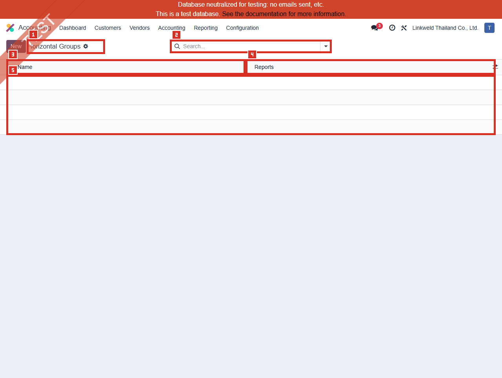

# ACC-018 คู่มือ Accounting Horizontal Groups (Developer-hidden configuration)

- บริษัท: Linkweld (Thailand) Co., Ltd.
- ระบบ: Odoo 18 Enterprise Staging
- วันที่ตรวจ: 16 กรกฎาคม 2026
- วิธีตรวจ: Evidence-first Read-only
- สถานะบท: `Confirmed` สำหรับ zero Horizontal Groups/Rules/Report links และ schema; report/domain outcomes เป็น `Not Available`

## Access และขอบเขต

- เมนู Accounting > Configuration ของผู้ใช้นี้ **ไม่แสดง Horizontal Groups**
- Local Odoo 18 Enterprise source จำกัด `account_reports.menu_action_account_report_horizontal_groups` ด้วย `groups="base.group_no_one"`
- ไม่เปิด Developer Mode และไม่เปิด Developer > Technical
- โหลด Standard action `account_reports.action_account_report_horizontal_groups` แบบ Read-only ผ่าน `/web/action/load` และเปิด route ที่สังเกตได้ `/odoo/action-756`
- Direct action เปิดได้สำหรับ user นี้ แต่เป็น Advanced report configuration ไม่ใช่เมนูปกติสำหรับ Business users
- ไม่เปิดฟอร์ม เพราะไม่มี Existing record และไม่ใช้ข้อมูลอื่นทดแทน
- ไม่เปิด Account Report, Tax Report, Tax Unit, Journal Item, Account, Partner, Analytic record, Company หรือ Domain widget
- ไม่เรียก `_get_matching_records` และไม่ประเมิน Domain กับข้อมูลธุรกิจใด

หลักฐานโครงสร้าง:

- [ACC-018 Horizontal Groups extract](../evidence/accounting/ACC-018/ACC-018_horizontal_groups_extract.json)

## ภาพ 1: Horizontal Groups เป็นรายการว่าง

| หมายเลข | จุดบนหน้าจอ | ผลการตรวจ |
|---|---|---|
| 1 | Page title และ New | Horizontal Groups; New แสดงแต่ไม่ได้กด |
| 2 | Search | ว่าง ไม่มี default filter chip |
| 3 | Name | ไม่มี record |
| 4 | Reports | ไม่มี Report chip หรือ record |
| 5 | Empty list area | Total 0; สี่แถวว่างเป็น spacer ของ grid ไม่ใช่ business records |

UI request ส่ง domain `[]`, offset 0, limit 80, count limit 10001 และ Order เป็น empty string ไม่มี pager เพราะ total เป็นศูนย์

## จำนวนที่ตรวจพบ

| รายการ | จำนวน |
|---|---:|
| Horizontal Groups | 0 |
| Rules | 0 |
| Groups with/without Rules | 0 / 0 |
| Groups with/without Reports | 0 / 0 |
| Report links / Distinct Reports | 0 / 0 |
| Duplicate Group names | 0 |
| Domain values read/evaluated | 0 / 0 |
| Existing forms sampled | 0 |

Model `account.report.horizontal.group` ไม่มี `company_id` และไม่มี `active` จึงต้องอธิบายว่าเป็น Global report configuration ที่อ่านภายใต้ Company context ไม่ใช่ Company-owned master และไม่มี Archive flow ที่ยืนยันจาก schema

## Schema และความหมายเชิงควบคุม

### Horizontal Group

| Field | Schema | จุดควบคุม |
|---|---|---|
| Name | Required Char | ต้อง unique ตาม Local source และสื่อ report purpose |
| Rules | Required One2many | กำหนดระดับคอลัมน์และ record population |
| Reports | Many2many `account.report` | จำกัด Reports ที่มี Horizontal Group option |
| Company | ไม่มี field | Company isolation ต้องมาจาก Rule/Report/selector context |
| Active | ไม่มี field | ห้ามอธิบายว่าเป็น Active/Archived list |

### Horizontal Group Rule

| Field | Schema | จุดควบคุม |
|---|---|---|
| Horizontal Group | Required Many2one | Owner group ของ Rule |
| Field | Required Selection | เลือกเฉพาะ relational field จาก `account.move.line`; พบ 34 candidate fields |
| Domain | Required Char | Domain ของ related model; ห้ามกว้าง/ซ้อน/รั่วข้อมูล |
| Model | Computed, Read-only, Non-stored | Derived จาก comodel ของ Field ที่เลือก |

Local source ของ `_get_matching_records` ใช้ Field ที่เลือกเพื่อหา related model, parse Domain ด้วย `ast.literal_eval` แล้วค้น record ของ model นั้น การเปิด/รัน Rule จึงไม่ใช่การอ่าน config อย่างเดียวเสมอไปและอาจคืน Partner, Account, Analytic หรือ Company records ตาม Field/Domain

รอบนี้ไม่มี Rule จึงไม่อ่าน Domain text, ไม่ค้น matching records และไม่เปิด field selector

## Standard Odoo 18

Odoo อธิบาย Horizontal Groups เป็นเครื่องมือ Consolidation ที่ใช้ร่วมกับ Multi-ledgers เพื่อดู Consolidated Balance Sheet หรือ P&L และแสดงสัดส่วนที่แต่ละบริษัทมีต่อยอดรวม Group ประกอบด้วย Group Name, Reports และ Rules ที่เลือก Field/Domain

Standard documentation เตือนว่ารายงานเปิดด้วย Statutory view ตาม Regular ledger โดยปกติ และต้องเลือก Multi-ledger ที่รวม Consolidation adjustments เพื่อเห็นภาพ Consolidation เต็ม ดังนั้น Horizontal Group ไม่สามารถแทน Ledger design, Account mapping, Currency translation หรือ elimination policy ได้

## Cross-configuration observation

| Configuration | ผลที่ยืนยัน |
|---|---:|
| ACC-013 Multi-ledger | 0 records |
| ACC-015 Tax Units | 0 records |
| ACC-018 Horizontal Groups | 0 records |

ผลรวมนี้ยืนยันเพียงว่าไม่พบ configured Multi-ledger/Tax Unit/Horizontal Group path ไม่ได้พิสูจน์ว่า Linkweld ไม่มี Consolidation, multi-company VAT หรือ management-report requirement

## Standard vs Pain Point

| หัวข้อ | Standard Odoo 18 | สภาพ Linkweld | ข้อเสนอ |
|---|---|---|---|
| Consolidation columns | แสดง contribution แยกตาม Rule | Groups/Rules = 0 | ทำ Consolidation requirement ก่อนสร้าง |
| Report scope | Group ผูกกับ Reports | Report links = 0 | ระบุ BS/P&L/Tax/Management report owner |
| Rule Field | Relational AML field | ไม่มี Rule | เลือก Company/Analytic/Partner field เฉพาะที่ approved |
| Rule Domain | กรอง related records | ไม่มี Domain | ทำ coverage/overlap/privacy/performance review |
| Multi-ledger | ใช้รวม adjustments | ACC-013 = 0 | ออกแบบ Ledger/Excluded Journal ก่อน |
| Tax Unit | อาจสร้าง Horizontal Group path | ACC-015 = 0 | ใช้เมื่อ Legal/Tax อนุมัติเท่านั้น |
| Access | Developer-hidden | Direct action เปิด read-only ได้ | จำกัด write/report design ให้ approved admin |

## Pain Point และความเสี่ยง

- Zero Horizontal Groups ไม่ใช่ defect หากไม่มี approved Consolidation/column-split requirement
- Zero groups ไม่พิสูจน์ว่า consolidated totals หรือ Tax Unit aggregation ถูกต้อง เพราะไม่มี report ถูกเปิด
- Rule Domain ที่เป็น `[]` หรือกว้างเกินไปอาจรวมทุก record ของ related model ทำให้คอลัมน์จำนวนมากหรือข้อมูลผิด scope
- Rules ที่ overlap สามารถทำให้ contribution ซ้ำหรือตีความ total ผิด แม้ Grand Total อาจดูสมเหตุผล
- Rules ที่มี gap อาจตัด Company/Analytic/Partner ออกจากคอลัมน์โดยไม่ชัดเจน
- Field/Domain อาจเปิดเผย Partner, Account, Analytic หรือ identifier ใน Screenshot/Export
- ไม่มี `company_id` บน Group จึงต้องบังคับ Company isolation ผ่าน approved Rule และ report context
- Domain ที่ซับซ้อนหรือ related model จำนวนมากมี Performance risk โดยเฉพาะ PDF/XLSX และ period comparison
- Horizontal Group ไม่ควรใช้แทน Account mapping, Multi-ledger, elimination, currency translation หรือ correction ของ source posting

## Solution ที่แนะนำ

1. ทำ Consolidation/Management reporting decision: Legal entities, reports, currencies, ledgers, adjustments, eliminations และ owner
2. หากไม่ใช้ ให้บันทึก `No Horizontal Groups required` พร้อม CFO/Accounting sign-off และคง zero records
3. หากใช้ ให้ทำ Group design matrix: Name, Reports, Rule level, AML Field, Related model, sanitized Domain, expected members และ column order
4. ออกแบบ Rules ให้ mutually exclusive และ collectively complete หรือบันทึก exception อย่างชัดเจน
5. ตรวจ Domain privacy, allowed companies, inactive records, empty set, broad set และ record-count ceiling ก่อนรัน Report
6. สร้าง Multi-ledger/adjustment policy และ Account mapping ก่อนทดสอบ Consolidated BS/P&L
7. Clone database แล้ว reconcile แต่ละ Horizontal column, Total column, Flat report, GL และ per-company reports
8. จำกัดสิทธิ์แก้ Group/Rule/Report ให้ System Admin + Reporting owner พร้อม two-person review, performance evidence และ rollback

## Acceptance Criteria ก่อน Go-live

- มี signed decision ว่าต้องใช้หรือไม่ใช้ Horizontal Groups
- Group Name, Reports, Rule levels, Field/Model และ Domain มี Owner/Approval
- Rule coverage ครบตาม scope, ไม่ overlap และไม่มี sensitive identifier ใน UI/Export
- Company selector, Regular/Multi-ledger และ consolidation adjustments ถูกต้อง
- แต่ละ column reconcile กับ per-company/analytic source และ Total เท่า approved consolidated report
- Currency translation, eliminations และ Account mapping ไม่ถูกแทนด้วย Domain workaround
- PDF/XLSX/Comparison ทำงานภายใน performance target และไม่เปิดเผยข้อมูลเกินสิทธิ์
- Business user ไม่เห็น/แก้ developer-hidden config และ rollback คืน report option ได้

## รายการ UAT ขั้นต่ำบน Clone UAT เท่านั้น

| UAT ID | กรณีทดสอบ | ผลที่ต้องตรวจ | สถานะ |
|---|---|---|---|
| UAT-ACC-018-01 | Zero-group baseline | Reports เดิมไม่มี Horizontal filter และ totals ถูกบันทึกก่อนเปลี่ยน | Pending |
| UAT-ACC-018-02 | No-group decision | หากไม่ใช้ มี CFO/Accounting sign-off และ report requirement ครบ | Pending |
| UAT-ACC-018-03 | Company contribution | BS/P&L columns แยก Company ครบ ไม่ overlap/gap | Pending |
| UAT-ACC-018-04 | Multi-ledger adjustments | Regular vs Consolidation ledger รวม adjustment journals ถูกต้อง | Pending |
| UAT-ACC-018-05 | Tax Unit path | หากมี legal Tax Unit คอลัมน์/Tax Report aggregate ถูกต้อง | Pending |
| UAT-ACC-018-06 | Safe Field/Domain | Related model, Domain syntax, allowed company และ expected members ถูกต้อง | Pending |
| UAT-ACC-018-07 | Broad/empty Domain negative | `[]`, all-record หรือ empty-result Rule ถูก detect/approve ไม่เงียบ | Pending |
| UAT-ACC-018-08 | Overlap/gap negative | สมาชิกซ้ำ/ตกหล่นถูกตรวจและ Total ไม่ double count | Pending |
| UAT-ACC-018-09 | Multi-level Rules | Header levels, column order, total column และ comparison ถูกต้อง | Pending |
| UAT-ACC-018-10 | Report-link scope | Group ปรากฏเฉพาะ approved Reports และไม่เปลี่ยน report อื่น | Pending |
| UAT-ACC-018-11 | Privacy/performance | Domain/UI/PDF/XLSX ไม่รั่ว identifier และผ่าน response-time ceiling | Pending |
| UAT-ACC-018-12 | Access/full regression | User ทั่วไปแก้ไม่ได้; BS/P&L/Tax/GL/Consolidation totals ไม่ regression | Pending |

## สรุปสถานะ

- Horizontal Groups เป็น developer-hidden Enterprise configuration และมี zero records
- Rules, Report links และ Domain values เป็นศูนย์; ไม่มี form หรือ report ถูกเปิด
- Model ไม่มี Active/Company field และ Rule Field มี 34 relational candidates
- ACC-013 Multi-ledger, ACC-015 Tax Units และ ACC-018 Horizontal Groups เป็น zero configuration ทั้งหมด
- Report columns, Consolidation, Tax aggregation, Company isolation และ Performance ยังไม่ยืนยัน
- ไม่มี Group, Rule, Report, Domain, Journal Item หรือ Odoo transaction ถูกสร้าง/แก้/ลบ/รัน

อ้างอิง:

- [Odoo 18 Consolidation - Horizontal Groups](https://www.odoo.com/documentation/18.0/applications/finance/accounting/get_started/consolidation.html)
- [Odoo 18 Custom Reports](https://www.odoo.com/documentation/18.0/applications/finance/accounting/reporting/customize.html)
- [Odoo 18 Accounting Reports](https://www.odoo.com/documentation/18.0/applications/finance/accounting/reporting.html)
