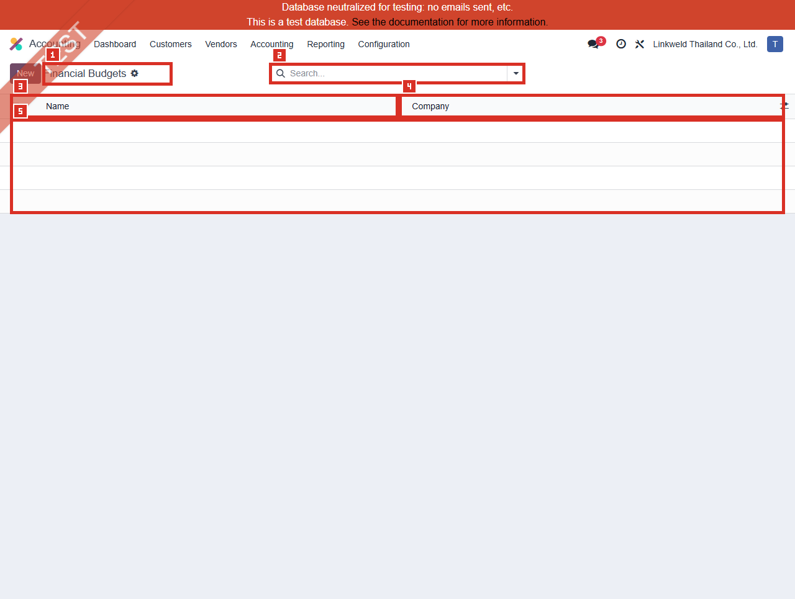

# ACC-019 คู่มือ Accounting Financial Budgets

- บริษัท: Linkweld (Thailand) Co., Ltd.
- ระบบ: Odoo 18 Enterprise Staging
- วันที่ตรวจ: 16 กรกฎาคม 2026
- วิธีตรวจ: Evidence-first Read-only with Financial-data privacy
- สถานะบท: `Confirmed` สำหรับ zero Financial Budgets/Items, access และ schema; budget/report outcomes เป็น `Not Available`

## Access และขอบเขต

- Financial Budgets **แสดงในเมนูปกติ** Accounting > Configuration สำหรับผู้ใช้นี้
- เปิดผ่านเมนูปกติที่ route `/odoo/action-1452`; ไม่ใช้ Direct developer action workaround
- Standard action คือ `account_reports.action_account_report_budget_tree` บน model `account.report.budget`
- ไม่เปิด Developer Mode และไม่เปิด Developer > Technical
- ไม่เปิดฟอร์ม เพราะไม่มี Existing Budget และไม่ใช้ข้อมูลอื่นทดแทน
- ไม่เปิด Budget Report, Profit and Loss, Accounting Report, Account, Journal Item, Analytic record, Company, PDF/XLSX หรือ Report cell
- ไม่อ่าน/เก็บ Exact Amount, Account name/code, Budget name, Month หรือ Item ID

หลักฐานโครงสร้าง:

- [ACC-019 Financial Budgets extract](../evidence/accounting/ACC-019/ACC-019_financial_budgets_extract.json)

## ภาพ 1: Financial Budgets เป็นรายการว่าง

| หมายเลข | จุดบนหน้าจอ | ผลการตรวจ |
|---|---|---|
| 1 | Page title และ New | Financial Budgets; New แสดงแต่ไม่ได้กด |
| 2 | Search | ว่าง ไม่มี default filter chip |
| 3 | Name | ไม่มี Budget record |
| 4 | Company | ไม่มี Budget record |
| 5 | Empty list area | Total 0; สี่แถวว่างเป็น spacer ไม่ใช่ Budget Items |

List มี Sequence handle แบบไม่มี label แต่ไม่มี record ให้ลาก UI request ใช้ domain `[]`, order `sequence ASC, id ASC`, offset 0, limit 80 และ count limit 10001 ไม่มี pagerเพราะ total เป็นศูนย์

## จำนวนที่ตรวจพบแบบ Sanitized

| รายการ | จำนวน |
|---|---:|
| Company-1 Financial Budgets | 0 |
| Budgets with / without Items | 0 / 0 |
| Budget Items | 0 |
| Distinct Accounts | 0 |
| Positive / Negative / Zero Items | 0 / 0 / 0 |
| Duplicate `(Budget, Account, Month)` groups | 0 |
| Blank Account / Date | 0 / 0 |
| Duplicate trimmed Budget names | 0 |
| Duplicate Sequence values | 0 |
| Existing forms sampled | 0 |

Earliest/Latest Month และ Amount totals เป็น `Not Available` ไม่มี Account, Month หรือ Amount ถูกเปิดเผย

## Schema และความหมายเชิงควบคุม

### Financial Budget

| Field | Schema | จุดควบคุม |
|---|---|---|
| Sequence | Integer, writable | กำหนดลำดับ Budget ใน selector/list; ห้ามลากโดยไม่มี approval |
| Name | Required Char | Local source trim ช่องว่างตอน Create; ชื่อต้อง unique เชิง policy แม้ไม่พบ SQL uniqueness |
| Items | One2many | Account/Month/Amount lines ของ Budget |
| Company | Required Many2one | Budget เป็น Company-owned configuration |
| Active/Status/Approver | ไม่พบใน core model | ไม่มี Archive/Approval workflow ที่ยืนยันจาก schema |

### Budget Item

| Field | Schema | จุดควบคุม |
|---|---|---|
| Budget | Required Many2one, cascade delete | ลบ Budget จะลบ Items ตามไปด้วย |
| Account | Required Many2one | ต้องเป็น approved P&L scope สำหรับ Financial Budget |
| Amount | Float | ข้อมูล Financial planning ที่ต้องจำกัดสิทธิ์/หลักฐาน |
| Date | Required Date | UI แสดงเป็น Month และใช้กระจายยอดตาม period |

## Critical write behavior

Local source ของ `_create_or_update_budget_items` ทำงานเมื่อเขียนค่าจาก Report cell โดย:

1. หา Existing Items ของ Budget/Account ในช่วงวันที่
2. คำนวณส่วนต่างจากยอดที่ผู้ใช้กรอก
3. แบ่งส่วนต่างเท่าๆ กันตามเดือนด้วยการปัดเศษลง
4. ใส่เศษจากการปัดในเดือนสุดท้าย
5. Update Existing Items หรือ Create Monthly Items ใหม่

ดังนั้นการกรอก Budget column ใน Profit and Loss/Report ไม่ใช่การทดลองหน้าจอ แต่เป็นการสร้างหรือแก้ข้อมูล Budget Items หลายเดือน ห้ามทดสอบบน Primary staging

นอกจากนี้ Duplicate จะ copy ทุก Budget Item และ Delete จะ cascade ลบ Items ทั้งหมด จึงต้องมี approval, backup และ rollback evidence

## Standard Odoo 18

Odoo แยก Financial Budgets ออกจาก Analytic Budgets:

- Financial Budget ผูกกับ General Ledger income/expense accounts ที่แสดงใน Profit and Loss และใช้ดูภาพเศรษฐกิจรวมของบริษัท
- Analytic Budget ใช้ Analytic Accounts/Plans เพื่อติดตาม Project, Department หรือกลุ่มธุรกรรม

เอกสาร Odoo ระบุว่า Financial Budget สร้างจาก Profit and Loss โดยเลือก Period, กด Budget, ตั้งชื่อ และใส่ Amount ตาม Account ระบบแสดง Budget column และ `%` เทียบผลปัจจุบัน การแบ่ง Period จะปรับ Amount ตามช่วงเวลา

รอบนี้ไม่มี Budget และไม่ได้เปิด Profit and Loss จึงยังไม่ยืนยัน Budget column, percentage, period split, actual comparison หรือ report export

## Standard vs Pain Point

| หัวข้อ | Standard Odoo 18 | สภาพ Linkweld | ข้อเสนอ |
|---|---|---|---|
| Financial planning | Budget ผูก P&L Accounts | Budgets = 0 | ทำ CFO/FP&A requirement ก่อนสร้าง |
| Period | Report date range กระจายยอดรายเดือน | ไม่มี Items/Months | กำหนด Fiscal period และ monthly profile |
| Comparison | Budget column และ % เทียบ Actual | ไม่ได้เปิด P&L | Reconcile Actual/Budget/Variance กับ GL |
| Company | Budget มี Company | Company-1 count 0 | ทดสอบ Company selector และ shared Accounts |
| Approval | Core schema ไม่มี Status/Approver | ไม่มี workflow ให้ตรวจ | กำหนด role/two-person approval และ change log |
| Privacy | Amount/Account เป็นข้อมูลแผน | ไม่อ่านค่าใด | จำกัด Screenshot/Export และ report access |

## Pain Point และความเสี่ยง

- Zero Financial Budgets ไม่ใช่ defect หาก Linkweld ยังไม่อนุมัติ Budgeting process ใน Odoo
- หากธุรกิจใช้ Excel/ระบบอื่นอยู่ Zero records อาจสะท้อนระบบต้นทาง ไม่ใช่การขาด Control โดยอัตโนมัติ ต้องระบุ Source of Truth
- Core model ไม่มี Status/Approver จึงไม่เห็น Draft/Approved/Locked lifecycle จาก schema นี้
- การกรอก Report cell สามารถสร้าง/แก้ Items หลายเดือนและมี rounding remainder ในเดือนสุดท้าย
- Duplicate `(Budget, Account, Month)` ไม่มี SQL constraint ที่ยืนยันจาก model; ต้องตรวจ duplicate policy ก่อน Import/Write
- Sign convention ของ Revenue/Expense และ negative items อาจทำให้ Variance ตีความกลับด้าน
- Sequence handle เป็น writable control และอาจเปลี่ยน selector order โดยไม่สร้าง Audit decision
- Exact Amount, Accounts, Month และ Budget names เป็นข้อมูล Confidential ห้ามใส่ใน handoff ทั่วไป
- Budget ไม่สร้าง Journal Entry โดยตัวมันเอง แต่ Report/decision อาจผิดหาก Account scope, period หรือ Actual mapping ไม่ถูกต้อง

## Solution ที่แนะนำ

1. กำหนด Source of Truth: Odoo Financial Budget, Analytic Budget, Excel หรือ BI และ Owner ของแต่ละระดับ
2. หากไม่ใช้ Odoo ให้บันทึก `No Odoo Financial Budgets required` พร้อม CFO/FP&A sign-off และ interface/reconciliation policy
3. หากใช้ ให้ทำ Budget policy: Company, Fiscal year, Version/Scenario, P&L Account scope, sign, currency, monthly profile, approval, lock และ revision
4. ทำ privacy-safe import template ที่ตรวจ Required Account/Month/Amount, duplicate key และ Company
5. Clone database แล้วทดสอบ Report-cell monthly generation, rounding remainder, partial-period edit และ rollback
6. Reconcile Budget Items ถึง P&L Budget column, Actual, Variance %, GL และ approved source workbook
7. จำกัด Create/Edit/Duplicate/Delete/Export ให้ FP&A + Accounting Manager พร้อม two-person approval และ change evidence
8. เก็บ Amount/Account ใน restricted evidence; handoff ทั่วไปเก็บเฉพาะ counts/status/risk

## Acceptance Criteria ก่อน Go-live

- CFO/FP&A อนุมัติ Source of Truth, scope, period, sign, owner และ privacy classification
- Budget Name/Company/Version ไม่ซ้ำเชิงธุรกิจและ Sequence มี policy
- ทุก Item ใช้ approved P&L Account, valid Month และ sign ที่ถูกต้อง
- ไม่มี duplicate `(Budget, Account, Month)` หรือมี documented aggregation rule
- Monthly generation และ rounding remainder รวมเท่ากับ approved period amount
- P&L Budget/Actual/Variance reconcile กับ Items, GL และ approved workbook
- Company selector, shared Accounts และ access ไม่เปิดเผย Budget ข้ามบริษัท
- Duplicate/Delete/Revision/Export มี approval, backup, audit evidence และ rollback

## รายการ UAT ขั้นต่ำบน Clone UAT เท่านั้น

| UAT ID | กรณีทดสอบ | ผลที่ต้องตรวจ | สถานะ |
|---|---|---|---|
| UAT-ACC-019-01 | Zero-budget baseline | P&L/Reporting เดิมทำงานและมี Source-of-Truth decision | Pending |
| UAT-ACC-019-02 | Create Budget identity | Name trim, Company, Sequence และ access ตรง policy | Pending |
| UAT-ACC-019-03 | P&L Account scope | เฉพาะ approved Income/Expense accounts รับ Budget Items | Pending |
| UAT-ACC-019-04 | Monthly distribution | Period amount แบ่งครบทุกเดือนและ total เท่าต้นทาง | Pending |
| UAT-ACC-019-05 | Rounding remainder | เศษปัดเศษอยู่เดือนสุดท้ายและ total ไม่คลาดเคลื่อน | Pending |
| UAT-ACC-019-06 | Revenue/Expense signs | Positive/negative convention และ Variance % ตรง policy | Pending |
| UAT-ACC-019-07 | Duplicate key/import | Duplicate Budget/Account/Month ถูก Block หรือ aggregate ตาม rule | Pending |
| UAT-ACC-019-08 | Partial period/revision | Date split, edit existing Items และ version/revision trace ได้ | Pending |
| UAT-ACC-019-09 | Duplicate/delete rollback | Copy Items ครบ; cascade delete ถูกจำกัดและ restore ได้ | Pending |
| UAT-ACC-019-10 | Company isolation | Company selector/shared Accounts ไม่ปะปน Budget/Actual | Pending |
| UAT-ACC-019-11 | P&L/report reconciliation | Budget, Actual, Variance, GL, workbook, PDF/XLSX ตรงกัน | Pending |
| UAT-ACC-019-12 | Access/privacy/regression | User ทั่วไปแก้/Export ไม่ได้; Accounting/Tax/Stock/MRP totals ไม่ regression | Pending |

## สรุปสถานะ

- Financial Budgets เป็นเมนูปกติที่ผู้ใช้นี้เข้าถึงได้
- Company-1 Budgets และ Budget Items เป็นศูนย์ ไม่มี form ให้สุ่มตัวอย่าง
- ไม่มี Amount, Account, Month, Budget name หรือ Financial value ถูกอ่าน/เก็บ
- Budget Report, P&L Budget column, Actual/Variance และ monthly generation ยังไม่ยืนยัน
- `_create_or_update_budget_items`, Duplicate, Delete และ sequence reorder ไม่เคยถูกเรียก
- ไม่มี Budget, Item, Account, Report, Journal Item หรือ Odoo transaction ถูกสร้าง/แก้/ลบ/รัน

อ้างอิง:

- [Odoo 18 Budgets](https://www.odoo.com/documentation/18.0/applications/finance/accounting/reporting/budget.html)
- [Odoo 18 Accounting and Budget Report](https://www.odoo.com/documentation/18.0/applications/finance/accounting.html)
