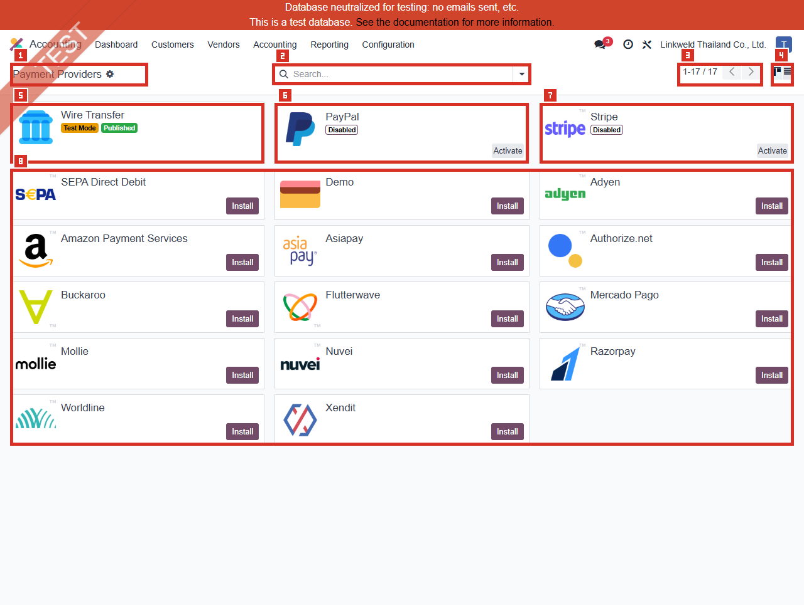
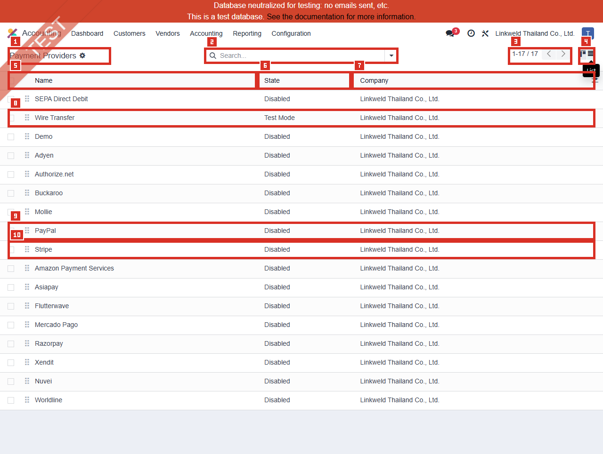

# ACC-020 คู่มือ Accounting Payment Providers

- บริษัท: Linkweld (Thailand) Co., Ltd.
- ระบบ: Odoo 18 Enterprise Staging
- วันที่ตรวจ: 18 กรกฎาคม 2026
- วิธีตรวจ: Evidence-first Read-only with strict credential/payment-data privacy
- สถานะบท: `Confirmed` สำหรับ access, safe inventory, state/module/publication counts และ schema ที่อนุญาต; checkout/payment/accounting outcomes เป็น `Not Available`

## Access และขอบเขต

- Payment Providers **แสดงในเมนูปกติ** Accounting > Configuration สำหรับผู้ใช้นี้
- เปิดผ่าน route `/odoo/action-276`; action คือ `payment.action_payment_provider` บน model `payment.provider`
- Default view เป็น Kanban และเปลี่ยนไป Standard List แบบ read-only ได้
- ไม่เปิด Developer Mode และไม่เปิด Developer > Technical
- ไม่เปิด Provider card/row/form เพราะ Standard form เปิดหน้า Credentials และ addon ของแต่ละ Provider อาจแสดง API key, secret, merchant ID, webhook หรือ endpoint
- ไม่เปิด Credentials, Configuration, Messages, Payment Methods, Journal, Country, Currency, Website, Tokens, Transactions, Payments หรือ Reports
- schema ตรวจเฉพาะ safe core-field whitelist; ไม่ request provider-specific field หรือข้อความ
- ไม่อ่าน Journal identity, exact Maximum Amount, credential, token, transaction หรือ payment value

หลักฐานโครงสร้าง:

- [ACC-020 Payment Providers extract](../evidence/accounting/ACC-020/ACC-020_payment_providers_extract.json)

## ภาพ 1: Payment Providers Kanban

| หมายเลข | จุดบนหน้าจอ | ผลการตรวจ |
|---|---|---|
| 1 | Page title | Payment Providers ผ่านเมนูปกติ |
| 2 | Search | ว่าง ไม่มี default filter chip |
| 3 | Pager | `1-17 / 17`; ทั้งหมดอยู่หน้าเดียว |
| 4 | View switch | ใช้เปิด Standard List เท่านั้น |
| 5 | Wire Transfer | Test Mode และ Published; ไม่เปิด card |
| 6 | PayPal | Installed แต่ Disabled; Activate ไม่ได้กด |
| 7 | Stripe | Installed แต่ Disabled; Activate ไม่ได้กด |
| 8 | Provider catalog | 14 รายการยังไม่ติดตั้ง; Install ไม่ได้กด |

Kanban request ใช้ domain `[]`, order ว่าง, offset 0, limit 80 และ count limit 10001

## ภาพ 2: Payment Providers List

| หมายเลข | จุดบนหน้าจอ | ผลการตรวจ |
|---|---|---|
| 1 | Page title | Payment Providers |
| 2 | Search | ว่าง ไม่มี default filter chip |
| 3 | Pager | `1-17 / 17` |
| 4 | Kanban/List switch | List เปิดด้วย standard view switch |
| 5 | Name | รายชื่อ Provider ที่ปลอดภัย |
| 6 | State | Disabled / Enabled / Test Mode |
| 7 | Company | Linkweld Thailand Co., Ltd. ทุกแถว |
| 8 | Wire Transfer | Test Mode; ไม่เปิด form |
| 9 | PayPal | Disabled |
| 10 | Stripe | Disabled |

List เป็น `create=false`, request ใช้ domain `[]`, order `sequence ASC, id ASC`, limit 80 และ count limit 10001 ไม่กด cell, handle หรือ optional control

## จำนวนที่ตรวจพบแบบ Sanitized

| รายการ | จำนวน |
|---|---:|
| Accessible / Visible Providers | 17 / 17 |
| Disabled / Enabled / Test Mode | 16 / 0 / 1 |
| Company 1 / Global / Other accessible | 17 / 0 / 0 |
| Installed / Not Installed / To-buy | 3 / 14 / 0 |
| Published / Unpublished flags | 9 / 8 |
| Code `custom` / `paypal` / `stripe` / `none` | 1 / 1 / 1 / 14 |
| Supported Payment Method links / Providers with links | 1 / 1 |
| Country restrictions / Currency restrictions | 0 / 1 |
| Allow Tokenization / Manual Capture / Express Checkout | 1 / 0 / 1 |
| Tokenization / Manual Capture Full Only / Express capability | 1 / 1 / 1 |
| Refund Partial / Unsupported | 1 / 16 |
| Maximum Amount present / missing | 0 / 17 |
| Payment Journal present / missing | 1 / 16 |

`Published = 9` เป็น raw flag เชิงโครงสร้าง ไม่ได้แปลว่า Provider ทั้งเก้ารายรับชำระเงินจริงได้ เพราะ State, module installation, Company, payment method, country/currency, amount และ requested feature ยังเป็นเงื่อนไขร่วม

## Safe Provider inventory

### Test Mode

- Wire Transfer: 1 รายการ; Kanban แสดง Published

### Enabled

- 0 รายการ

### Installed แต่ Disabled

- PayPal
- Stripe

### Not Installed

- SEPA Direct Debit
- Demo
- Adyen
- Amazon Payment Services
- Asiapay
- Authorize.net
- Buckaroo
- Flutterwave
- Mercado Pago
- Mollie
- Nuvei
- Razorpay
- Worldline
- Xendit

ไม่เปิด form ของรายการใดและไม่ใช้รายการอื่นทดแทน

## Schema และความหมายเชิงควบคุม

| Field/กลุ่ม | Schema | จุดควบคุม |
|---|---|---|
| Name | Required Char | ชื่อที่ลูกค้า/ผู้ใช้เห็น ต้องมี owner |
| Code | Required Selection | Technical integration identity; ห้ามแก้ |
| State | Disabled / Enabled / Test Mode | ควบคุมการเข้าร่วม payment compatibility |
| Published | Boolean | ควบคุม visibility สำหรับ non-internal user เมื่อ State/เงื่อนไขอื่นผ่าน |
| Company | Required Many2one | Provider เป็น Company-owned configuration |
| Payment Methods | Many2many | เป็น filter ร่วมของ checkout/payment |
| Countries/Currencies | Many2many | ว่างอาจหมายถึงไม่จำกัดหรือไม่มีข้อมูล ต้องไม่ตีความว่า support แน่นอน |
| Maximum Amount | Monetary | รอบนี้อ่านเพียง present/missing ไม่อ่านค่า |
| Payment Journal | Computed non-stored Many2one | รอบนี้อ่านเพียง present/missing ไม่อ่าน identity |
| Allow Tokenization | Boolean | อนุญาตให้ลูกค้าบันทึก payment method token |
| Capture Manually | Boolean | แยก Authorization กับ Capture |
| Express Checkout | Boolean | อาจข้าม contact form บางส่วนและมี Tax-inclusive display |
| Support fields | Computed read-only | ระบุ capability ของ integration ไม่ใช่ผลทดสอบจริง |
| Module State | Computed read-only | Installed ไม่เท่ากับ configured/operational |

## Critical write behavior

Local Odoo 18 sourceยืนยันว่า:

1. เปลี่ยน State ระหว่าง Disabled/Test/Enabled สามารถ archive linked Tokens
2. การ Activate/Deactivate สามารถเปิดหรือปิด default Payment Methods และ toggle post-processing cron
3. State onchange ตั้ง Published เป็น True เฉพาะเมื่อ State เป็น Enabled
4. เปลี่ยน Company ถูก block หากมี linked Payment Transactions
5. Install เรียก immediate module installation และ reload
6. เมื่อ Provider เป็น Enabled/Test การคำนวณหรือเปลี่ยน Payment Journal สามารถสร้าง/แก้ `account.payment.method.line` และ Outstanding Account relation
7. Toggle Published ทำได้เฉพาะ Provider ที่ไม่ Disabled

ดังนั้น State, Install, Publish และ Journal ไม่ใช่ cosmetic settings และห้ามทดลองบน Primary staging

## Standard Odoo 18

Odoo รองรับ Payment Providers สำหรับ Portal/eCommerce/Invoice/Subscription และแยก:

- Online API providers เช่น Stripe, PayPal, Adyen
- Bank payment เช่น Wire Transfer ซึ่งแสดงข้อมูลการชำระและ reference แล้วผู้ใช้ต้องอนุมัติเมื่อได้รับเงิน
- Demo provider สำหรับทดสอบ business flow ด้วย dummy payment โดยไม่ต้องใช้ credential

Standard compatibility จะพิจารณาอย่างน้อย State, Company, Publication สำหรับ non-internal users, Country, Currency, Amount และ feature ที่ร้องขอ นอกจากนี้ Payment Method ยังมี Country/Currency filter ของตนเอง

Odoo แนะนำให้ใช้ Test Mode บนฐานข้อมูล duplicate/test และใช้ sandbox credentials ของ Provider แต่ละราย รอบนี้ไม่ได้เปิด Credentials หรือ checkout และไม่มี external provider request

Payment Journal ต้องเป็น Bank journal เพื่อบันทึก successful transactions และต้องออกแบบ Outstanding Account/settlement/reconciliation ร่วมกับ Accounting

## Standard vs Pain Point

| หัวข้อ | Standard Odoo 18 | สภาพ Linkweld | ข้อเสนอ |
|---|---|---|---|
| Live provider | Enabled + configured + compatible | Enabled = 0 | ตัดสินใจว่า Go-live ต้องมี online payment หรือไม่ |
| Test flow | Test Mode บน test database | Wire Transfer Test Mode + Published | ตรวจ customer visibility และปิด/จำกัดก่อน Production clone |
| API providers | Provider-specific credentials/webhooks | PayPal/Stripe Installed แต่ Disabled | ทำ Security checklist และ sandbox UAT ก่อน enable |
| Publication | ใช้ร่วมกับ State/compatibility | Raw Published 9 | ห้ามใช้ Published flag เป็น readiness KPI เดี่ยว |
| Payment Methods | Provider และ Method filter ร่วมกัน | มี link เพียง 1 | ทำ Provider-to-Method matrix ใน ACC-021 |
| Availability | Country/Currency/Maximum Amount | Currency restriction 1; Maximum Amount ไม่ตั้ง | อนุมัติ market/currency/limit policy |
| Accounting | Bank Journal + Outstanding Account | Journal present 1; identity ไม่อ่าน | Reconcile transaction-payment-bank statement-GL |
| Security | Provider เก็บ card data; Odooเก็บ reference/token | Credential ไม่ตรวจ | จำกัด secret access, rotation, webhook และ incident owner |

## Pain Point และความเสี่ยง

- Enabled = 0 ยืนยันว่าไม่มี Live provider ใน State Enabled แต่ไม่ยืนยันว่า checkout ไม่มี payment option เพราะ Wire Transfer อยู่ Test Mode และ Published
- Wire Transfer Test Mode + Published เป็น High owner-review finding; ต้องตรวจบน Clone UAT ว่า Portal/eCommerce/Invoice payment page มองเห็นหรือไม่
- Published 9 รวม Disabled/Not Installed records ได้ จึงไม่ใช่หลักฐาน operational availability
- Installed PayPal/Stripe แต่ Disabled ไม่ยืนยัน credential completeness, webhook, settlement หรือ security
- Payment Journal present เพียง 1 และ identity ถูกปิดบัง; posting/outstanding/reconciliation ยังไม่ยืนยัน
- Capability flag บอกว่า integration รองรับ feature ไม่ได้แปลว่าเปิดใช้หรือผ่าน end-to-end test
- Country listว่างอาจหมายถึงไม่จำกัดหรือไม่มีข้อมูล; Provider อาจ reject ภายหลัง
- Maximum Amount ไม่มีการตั้งทั้ง 17 รายการ; ต้องมี policy ก่อนเปิด provider ที่มี fraud/credit exposure
- State change สามารถ archive Tokens และแก้ Payment Method/cron จึงต้องมี rollback plan
- Credential, merchant ID, webhook secret, token และ endpoint เป็น Restricted Secret ห้ามใส่ screenshot, extract หรือ handoff

## Solution ที่แนะนำ

1. ทำ Business decision: `No online payment required` หรือ approved Provider/channel list สำหรับ Portal, Invoice, eCommerce และ Subscription
2. หากไม่ใช้ ให้ Disable/Unpublish ตาม approved state matrix และตรวจว่า Wire Transfer Test Mode ไม่หลุดไป Production
3. หากใช้ ให้ทำ Provider onboarding checklist: Legal entity, contract, owner, sandbox/live account, secret storage/rotation, callback URL, webhook validation, fraud/3DS, refund/capture/token policy
4. ทำ Provider-to-Payment Method-to-Country/Currency/Amount matrix ร่วมกับ ACC-021
5. ทำ Accounting matrix: Provider, Bank Journal, Outstanding Account, fees, settlement timing, payout reference, FX, refund/chargeback และ reconciliation
6. Clone database แล้วทดสอบ Test Mode ด้วย dummy/sandbox dataเท่านั้น ห้ามใช้ live credentials ใน evidence
7. ก่อน Production เปลี่ยน State/Published ด้วย two-person approval และตรวจว่า Test/Demo provider ไม่แสดงต่อ external user
8. ทำ monitoring สำหรับ failed/pending/authorized/done/cancelled transactions, webhook errors, unmatched settlement และ stale credentials โดยไม่บันทึก secret

## Acceptance Criteria ก่อน Go-live

- Business/Accounting/eCommerce/IT Security อนุมัติ Provider, channel, Company, market, currency และ transaction limit
- Production ไม่มี Provider ใน Test Mode หรือ Demo visible ต่อ external users
- Live Provider ที่อนุมัติอยู่ Enabled/Published เท่าที่จำเป็น และ Disabled provider ไม่ selectable
- Credentials/secrets อยู่ใน approved secret process, จำกัด role, rotate ได้ และไม่ปรากฏใน logs/evidence
- Payment Methods, Country, Currency, Amount และ feature compatibility ตรง matrix
- Payment Journal/Outstanding Account/fees/settlement/FX/refund/chargeback reconcile กับ GL และ Bank
- Portal/eCommerce/Invoice/Subscription แสดงตัวเลือกถูกต้องตาม user/country/currency/amount
- Token lifecycle, Test-to-Enabled transition, disable/rollback และ incident handling ผ่าน UAT

## รายการ UAT ขั้นต่ำบน Clone UAT เท่านั้น

| UAT ID | กรณีทดสอบ | ผลที่ต้องตรวจ | สถานะ |
|---|---|---|---|
| UAT-ACC-020-01 | External visibility baseline | Wire Transfer Test Mode/Published แสดงหรือไม่ตาม approved policy | Pending |
| UAT-ACC-020-02 | Internal vs external publication | Internal/external user เห็น Provider ตาม State/Published | Pending |
| UAT-ACC-020-03 | Disabled provider | PayPal/Stripe Disabled ไม่ selectable และไม่เรียก external host | Pending |
| UAT-ACC-020-04 | Sandbox activation | Provider ที่อนุมัติ activate ด้วย sandbox secret โดยไม่เปิดเผยค่า | Pending |
| UAT-ACC-020-05 | Payment Method compatibility | เฉพาะ approved Methods แสดงตาม ACC-021 matrix | Pending |
| UAT-ACC-020-06 | Country/Currency/Amount filters | Allowed/blocked boundary และ empty-list semantics ถูกต้อง | Pending |
| UAT-ACC-020-07 | Wire Transfer flow | Reference, manual receipt approval และ customer status ถูกต้อง | Pending |
| UAT-ACC-020-08 | Journal/Outstanding posting | Transaction, Payment, Journal Entry และ Bank reconciliation ตรง matrix | Pending |
| UAT-ACC-020-09 | Capture/Refund/Fees | Supported capability, partial/full refund, fee และ settlement ถูกต้อง | Pending |
| UAT-ACC-020-10 | Token lifecycle | Save/reuse/archive token และ Test-to-Enabled transition ปลอดภัย | Pending |
| UAT-ACC-020-11 | Webhook/error/recovery | Pending/failure/retry/idempotency/duplicate callback ไม่สร้างยอดซ้ำ | Pending |
| UAT-ACC-020-12 | Production readiness/rollback | ไม่มี Test/Demo leakage; secret rotation, disable และ rollback ผ่าน | Pending |

## สรุปสถานะ

- Payment Providers เป็นเมนูปกติที่ผู้ใช้นี้เข้าถึงได้
- มี 17 records: Disabled 16, Enabled 0, Test Mode 1
- Wire Transfer เป็น Test Mode และ Published; PayPal/Stripe Installed แต่ Disabled
- ไม่มี Provider form, Credentials, Journal identity, Amount, Token, Transaction หรือ Payment ถูกเปิด/อ่าน
- ไม่มี external provider host ถูกเรียก
- Checkout, webhook, payment, settlement, refund, capture, token และ accounting reconciliation ยังไม่ยืนยัน
- ไม่มี Provider, Module, State, Publication, Method, Journal หรือ Odoo transaction ถูกสร้าง/แก้/ติดตั้ง/รัน

อ้างอิง:

- [Odoo 18 Online payments](https://www.odoo.com/documentation/18.0/applications/finance/payment_providers.html)
- [Odoo 18 Payment Provider developer reference](https://www.odoo.com/documentation/18.0/developer/reference/standard_modules/payment/payment_provider.html)
