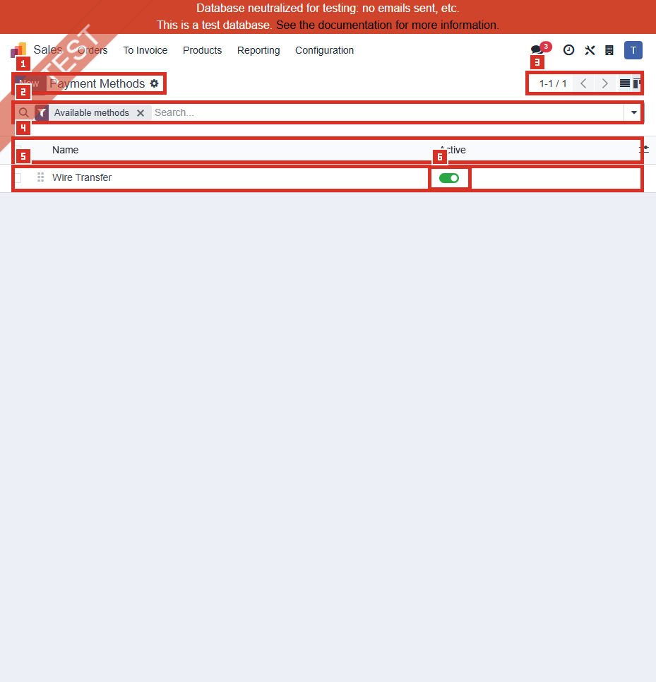
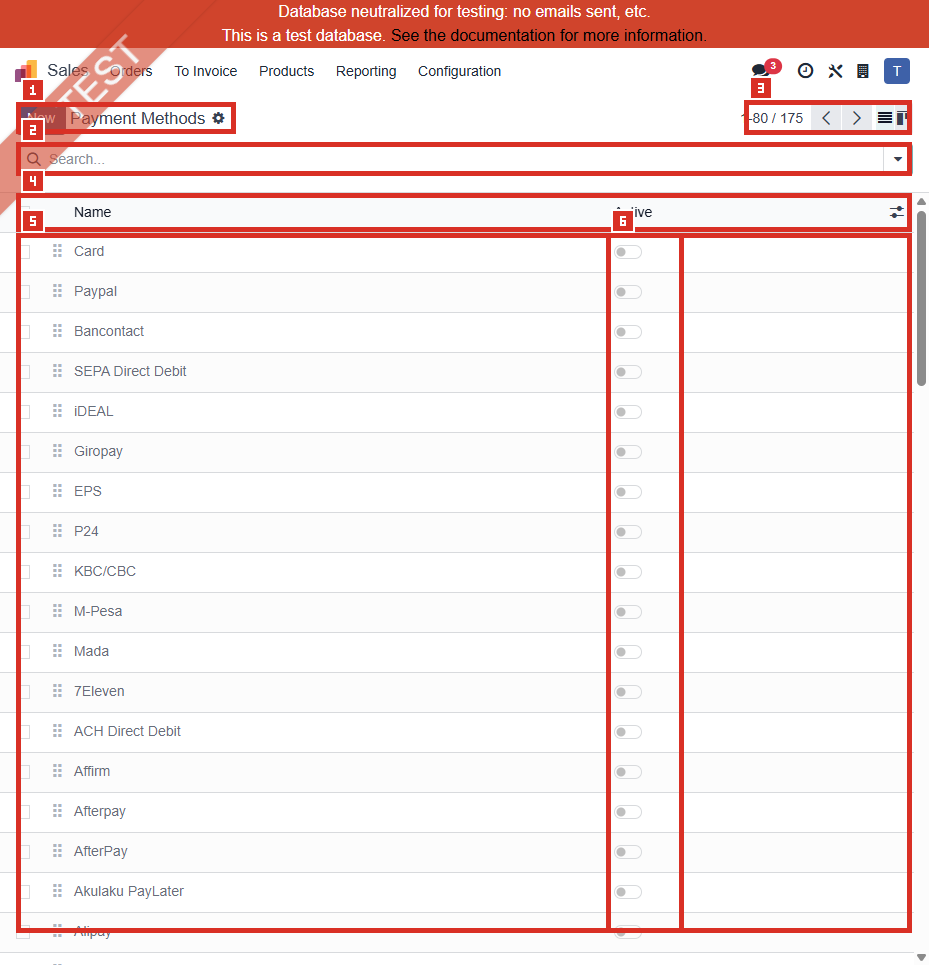
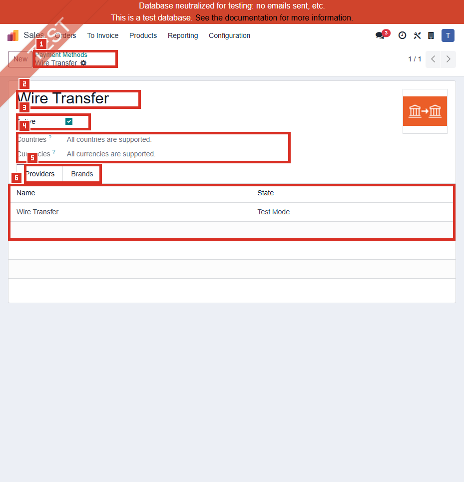
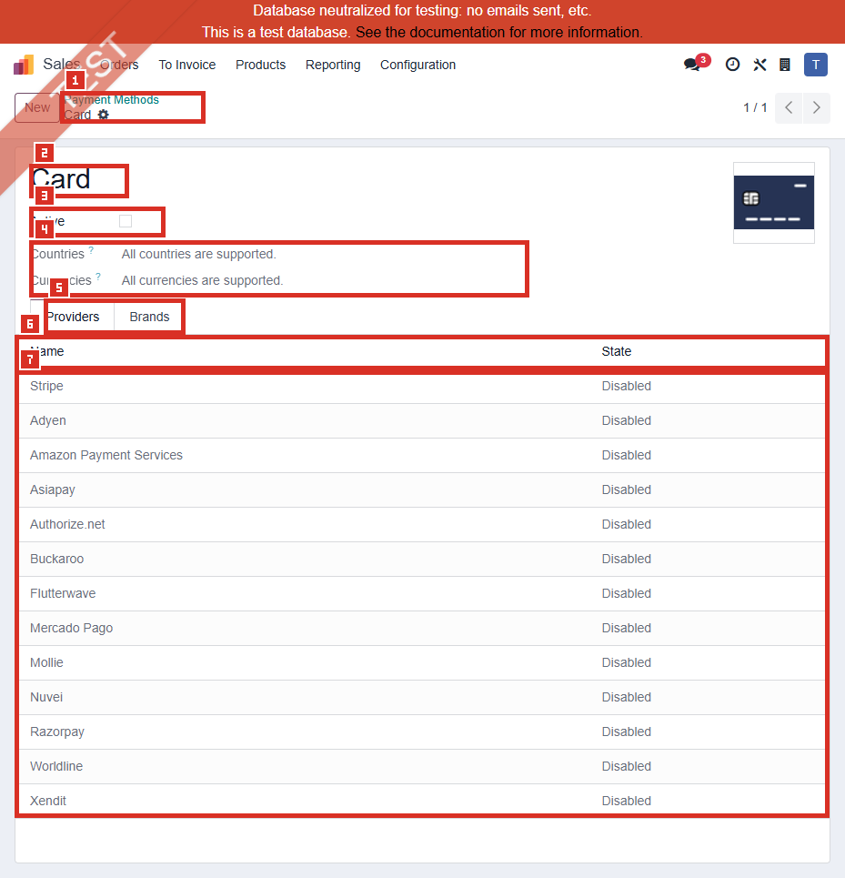

# ACC-021 คู่มือ Accounting Payment Methods

- บริษัท: Linkweld (Thailand) Co., Ltd.
- ระบบ: Odoo 18 Enterprise Staging
- วันที่ตรวจ: 18 กรกฎาคม 2026
- วิธีตรวจ: Evidence-first Read-only with strict token/credential/payment-data privacy
- สถานะบท: `Confirmed` สำหรับ access, default/all-primary lists, safe schema/counts และสอง representative forms; checkout/payment/accounting outcomes เป็น `Not Available`

## Access และขอบเขต

- Accounting > Configuration > Payment Methods เป็นเมนูปกติที่ inventory ยืนยันว่า Visible/Accessible สำหรับผู้ใช้นี้
- Shared action คือ `payment.action_payment_method`, model `payment.method`, route `/odoo/action-277`
- Action เดียวกันถูกใช้ซ้ำจาก Accounting, Sales และ Website; รอบนี้ route แสดงใน Sales application shell แต่ title/breadcrumb ยังคงเป็น Payment Methods
- Action domain คือ Primary Methods เท่านั้น: `is_primary = True`
- Context ใช้ `active_test = False` และเปิด default filter `Available methods`
- ไม่เปิด Developer Mode, Developer > Technical หรือ hidden Configuration tab
- ไม่กด Active toggle, Sequence handle, selection, multi-edit, optional control หรือ field ใด
- เปิด Wire Transfer และ Card เฉพาะ clean View state; ไม่กด Provider row และไม่เปิด Provider form/Credentials
- ไม่ query Token, Transaction, Payment, Journal, Account, Partner หรือ website checkout

หลักฐานโครงสร้าง:

- [ACC-021 Payment Methods extract](../evidence/accounting/ACC-021/ACC-021_payment_methods_extract.json)

## ภาพ 1: Default Available Methods

| หมายเลข | จุดบนหน้าจอ | ผลการตรวจ |
|---|---|---|
| 1 | Page title | Payment Methods |
| 2 | Available methods filter/Search | Default chip แสดงและ Search ว่าง |
| 3 | Pager | `1-1 / 1` |
| 4 | List header | Name และ Active; Sequence handle ไม่มี label |
| 5 | Wire Transfer | Primary Method เดียวที่ Available |
| 6 | Active toggle | On; ไม่ได้กด |

Live request ใช้ domain `is_primary = True AND provider_ids.state != disabled`, order `sequence ASC, id ASC`, `active_test = False`, Company context 1, limit 80

## ภาพ 2: All Primary Methods

| หมายเลข | จุดบนหน้าจอ | ผลการตรวจ |
|---|---|---|
| 1 | Page title | Payment Methods |
| 2 | Search | เอาเฉพาะ Available methods chip ออก; ไม่มี filter อื่น |
| 3 | Pager | `1-80 / 175` |
| 4 | List header | Name และ Active |
| 5 | First page | แสดง 80 จาก 175 Primary Methods |
| 6 | Active toggles | รายการที่เห็นเป็น Off; ไม่ได้กด |

Action ยังคง domain `is_primary = True`, `active_test = False` จึงเห็น Archived Methods ด้วย

## ภาพ 3: Wire Transfer

| หมายเลข | จุดบนหน้าจอ | ผลการตรวจ |
|---|---|---|
| 1 | Breadcrumb | Payment Methods > Wire Transfer |
| 2 | Name | Wire Transfer |
| 3 | Active | On; ไม่ได้กด |
| 4 | Availability | All Countries และ All Currencies supported |
| 5 | Providers/Brands tabs | Providers เป็น tab ปัจจุบัน; Brands ไม่ได้เปิด |
| 6 | Provider row | Wire Transfer, Test Mode; row ไม่ได้กด |

ฟอร์มเปิดใน clean View state และไม่มี dirty field

## ภาพ 4: Card

| หมายเลข | จุดบนหน้าจอ | ผลการตรวจ |
|---|---|---|
| 1 | Breadcrumb | Payment Methods > Card |
| 2 | Name | Card |
| 3 | Active | Off/Archived; ไม่ได้กด |
| 4 | Availability | All Countries และ All Currencies supported |
| 5 | Providers/Brands tabs | Providers เป็น tab ปัจจุบัน; Brands ไม่ได้เปิด |
| 6 | Provider columns | Name และ State |
| 7 | Provider rows | 13 standard Providers ทั้งหมด Disabled; ไม่มี row ถูกเปิด |

Card ถูกเลือกเพราะครอบคลุมสาม category พร้อมกัน: Archived, linked only to Disabled Providers และมี inverse Brand count สูงสุด 36

## จำนวนที่ตรวจพบแบบ Sanitized

| รายการ | จำนวน |
|---|---:|
| payment.method model rows | 221 |
| Primary Methods / Brands | 175 / 46 |
| Primary Active / Archived | 1 / 174 |
| Default Available Primary Methods | 1 |
| Primary with 0 / 1 / multiple Provider links | 30 / 98 / 47 |
| Linked to Enabled / Test / Disabled-only Providers | 0 / 1 / 144 |
| Country restrictions present / missing | 162 / 13 |
| Currency restrictions present / missing | 165 / 10 |
| Tokenization / Express capability | 4 / 1 |
| Refund Unsupported / Full & Partial / Full Only | 99 / 71 / 5 |
| Normalized Name duplicate groups model-wide / Primary | 2 / 1 |
| Duplicate Code groups | 0 |
| Brand rows / Primary Methods with Brands | 46 / 5 |
| Orphan Brands | 0 |
| Maximum Brands | Card = 36 |

## Name duplicate owner review

- Model-wide normalized/trimmed groups: `AfterPay` กับ `Afterpay`; และสอง records ชื่อ `iDEAL`
- Primary-only group: `AfterPay` กับ `Afterpay`
- Duplicate Code groups: 0

ชื่อซ้ำเป็น owner-review finding ไม่ใช่ defect เพราะอาจเป็นคนละ integration/record role และรอบนี้ไม่ได้เปิด checkout หรือ business mapping

## Brand relationship caveat

- `brand_ids` จาก primary `search_read` รอบนี้คืนค่า empty
- แต่มี Brand rows 46 รายการที่ระบุ `primary_payment_method_id` ครบและไม่มี orphan
- จึงนับ Brand จาก inverse relation ของแต่ละ Brand row
- ความต่างของ read representation นี้ไม่ถูกจัดเป็น data defect

## Schema และความหมายเชิงควบคุม

| Field/กลุ่ม | Schema | จุดควบคุม |
|---|---|---|
| Name | Required Char | ชื่อที่ลูกค้าเห็น; ตรวจ duplicate/translation |
| Code | Required Char | Technical mapping identity; ห้ามแก้หลังใช้งาน |
| Sequence | Integer | ควบคุมลำดับ; List handle เป็น write control |
| Primary Method | Many2one | Brand ต้องอ้าง Primary Method |
| Brands | One2many | ตัวเลือก/โลโก้ย่อยของ Primary Method |
| Is Primary | Computed non-stored | Action แสดงเฉพาะ Primary |
| Providers | Many2many | Method ต้องมี compatible Provider |
| Active | Boolean | List toggle เขียนค่าและอาจกระทบ Tokens |
| Country/Currency | Many2many | Filter ร่วมกับ Provider/Partner/payment |
| Tokenization/Express/Refund | Capability fields | บอก support ไม่ใช่ผลทดสอบจริง |
| Company | ไม่มี field | Method เป็น global master; Company control มาจาก Provider/runtime context |

## Critical write behavior

Local Odoo 18 sourceยืนยันว่า:

1. Archive Method, detach Provider หรือปิด Tokenization สามารถ archive linked Tokens ของ Method และ Brands
2. Activate Method อาจถูก block หาก Primary Method ไม่มี Provider ที่อยู่ Enabled/Test
3. Attach Provider แสดง warning ให้ตรวจว่า Provider รองรับ Method จริง
4. Default unknown Payment Method ถูกป้องกันไม่ให้ลบ
5. Compatibility เลือกเฉพาะ Primary Method ที่มี compatible Provider แล้วกรอง Partner Country, Currency, Tokenization และ Express Checkout

ดังนั้น Active toggle, Provider relation และ capability ไม่ใช่ cosmetic settings และห้ามทดลองบน Primary staging

## Standard Odoo 18

Odoo แยก Payment Provider ออกจาก Payment Method:

- Provider คือ integration/channel ที่ประมวลผลหรือรับคำสั่งชำระ
- Payment Method คือวิธีที่ลูกค้าเลือก เช่น Wire Transfer, Card หรือ wallet
- Method ต้องถูก support โดย Provider อย่างน้อยหนึ่งราย
- Country/Currency filter ของ Method ทำงานร่วมกับ filter ของ Provider
- Tokenization, Express Checkout และ Refund support ต้องผ่านทั้ง Provider/Method และ runtime condition

รอบนี้ Default Available filter พบ Wire Transfer เพียงรายการเดียวเพราะ linked Provider อยู่ Test Mode; ไม่มี Method ที่ linked กับ Enabled Provider

## Standard vs Pain Point

| หัวข้อ | Standard Odoo 18 | สภาพ Linkweld | ข้อเสนอ |
|---|---|---|---|
| Available Method | Primary + non-disabled compatible Provider | Wire Transfer 1 | ตัดสินใจ customer-facing payment scope |
| Active master | เปิดเฉพาะ Method ที่ใช้งาน | Active 1, Archived 174 | Freeze Active matrix ก่อน Production |
| Provider links | Method อาจรองรับหลาย Providers | 30 zero, 98 one, 47 multiple | ทำ Provider-to-Method matrix |
| Company | Method ไม่มี Company field | Global master | บังคับ Company ผ่าน Provider/runtime test |
| Country/Currency | Method และ Provider filter ร่วมกัน | Restrictions ส่วนใหญ่มี | ทดสอบ allowed/blocked boundary |
| Capabilities | Method/Provider ต้อง support ร่วมกัน | Flags มีแต่ไม่รัน flow | ห้ามใช้ capability count เป็น readiness |
| Brands | Brand อ้าง Primary | 46 Brands / 5 Primaries | Reconcile inverse relationship/display |
| Token safety | บาง write archive Tokens | ไม่ query Token | ทดสอบ lifecycle บน Clone UAT |

## Pain Point และความเสี่ยง

- Wire Transfer เป็น Active/Available รายการเดียวและ linked Provider อยู่ Test Mode; external checkout visibility ยังไม่ยืนยัน
- ไม่มี Method linked กับ Enabled Provider จึงยังไม่มีหลักฐาน Live online payment
- List มี Active toggle, multi-edit และ Sequence handle ซึ่งทำ write ได้รวดเร็วและมีผลกว้าง
- Archived 174 ไม่ใช่ defect เพราะเป็น catalog ของ standard methods/providers แต่ต้องไม่เปิดโดยไม่อนุมัติ
- Payment Method ไม่มี Company field จึงต้องทดสอบ Company isolation ผ่าน linked Provider และ checkout context
- 30 Primary Methods ไม่มี Provider link และ 144 linked only Disabled; ไม่ควรสรุปว่าใช้งานได้จากชื่อ/Active เพียงอย่างเดียว
- Country/Currency list ว่างอาจหมายถึง All supported; ต้องยืนยันกับ Provider และตลาดจริง
- Duplicate normalized names อาจทำให้ผู้ดูแลเลือกผิด แต่ยังไม่ใช่ defect จนกว่าจะตรวจ Code/Provider/customer display
- Brand inverse dataครบ แต่ primary `brand_ids` read representation ว่าง; ต้องตรวจ UI/checkout โดยไม่แก้ข้อมูล
- Archive/detach/tokenization change สามารถ archive Tokens จึงต้องมี impact list และ rollback

## Solution ที่แนะนำ

1. ทำ Provider-to-Primary Method-to-Brand matrix: Owner, Active, Provider State, Country, Currency, Tokenization, Express, Refund และ customer label
2. หากไม่ใช้ online payment ให้คง catalog Archived และบันทึก `No online payment methods required` พร้อม Business/Accounting approval
3. ตัดสินใจ Wire Transfer: Test-only, Production bank transfer หรือ Disabled; ตรวจ portal/invoice/eCommerce visibility
4. Review normalized duplicate namesด้วย Code/Provider/Brand/customer display แล้ว rename เฉพาะเมื่อมี approved impact analysis
5. จำกัด Active toggle/multi-edit/reorder และ Provider relation ให้ System Admin + Accounting/eCommerce approver
6. Clone database แล้วทดสอบ Country/Currency boundary, Method order, Brand rendering และ runtime compatibility
7. ก่อน archive/detach/disable tokenization ให้ inventory Tokens แบบ restricted และเตรียม restore/re-enrollment plan
8. Reconcile Provider, Method, Transaction, Payment, Bank Journal/Outstanding Account, settlement, refund และ GL แบบ end-to-end

## Acceptance Criteria ก่อน Go-live

- Business/Accounting/eCommerce/IT Security อนุมัติ Active Method/Provider/Brand matrix
- Production ไม่มี Method ที่ชี้ไป Test/Demo Provider เว้นแต่ถูกจำกัดจาก external usersอย่างชัดเจน
- ทุก Active Method มี approved Enabled Provider และ compatible Country/Currency/feature settings
- Method/Brand display ไม่มี ambiguous duplicate สำหรับ customer/operation
- Company selector/runtime ไม่เปิด Method ของ Company อื่น
- Token-impacting write จำกัด role, มี impact preview, approval, backup และ rollback
- Payment Method selection, Provider processing, Transaction/Payment posting และ settlement reconcile
- Active toggle, multi-edit, Sequence, Provider/Brand relation และ Configuration จำกัดสิทธิ์

## รายการ UAT ขั้นต่ำบน Clone UAT เท่านั้น

| UAT ID | กรณีทดสอบ | ผลที่ต้องตรวจ | สถานะ |
|---|---|---|---|
| UAT-ACC-021-01 | Default Available baseline | Wire Transfer visibility ตรง approved Test/Production policy | Pending |
| UAT-ACC-021-02 | Active/Archived filter | Default/all-primary counts และ archived visibility ถูกต้อง | Pending |
| UAT-ACC-021-03 | Provider compatibility | Enabled/Test/Disabled Provider ทำให้ Method available ตาม rule | Pending |
| UAT-ACC-021-04 | Country boundary | Allowed/blocked Partner country และ empty-list semantics ถูกต้อง | Pending |
| UAT-ACC-021-05 | Currency boundary | Allowed/blocked currency ทำงานร่วม Provider filter | Pending |
| UAT-ACC-021-06 | Brand rendering | Card Brands ครบ ไม่ซ้ำ/กำกวม และ map Primary ถูกต้อง | Pending |
| UAT-ACC-021-07 | Duplicate name review | AfterPay/Afterpay และ iDEAL แสดง/mapping ตาม approved decision | Pending |
| UAT-ACC-021-08 | Tokenization capability | Provider/Method support และ save/reuse token ถูกต้อง | Pending |
| UAT-ACC-021-09 | Archive/detach impact | Linked Tokens archive ตามคาดและ restore/re-enroll ได้ | Pending |
| UAT-ACC-021-10 | Express/refund | Eligibility, full/partial refund และ customer outcome ถูกต้อง | Pending |
| UAT-ACC-021-11 | Company/security | Global Method + Company Provider ไม่ปะปน; role ป้องกัน write | Pending |
| UAT-ACC-021-12 | Accounting/regression | Transaction, Payment, Journal/Outstanding, settlement และ GL reconcile | Pending |

## สรุปสถานะ

- Payment Methods เป็น shared normal action ที่เข้าถึงจาก Accounting ได้
- มี 221 model rows: Primary 175 และ Brands 46
- Primary Active 1 คือ Wire Transfer; Archived 174
- Default Available = Wire Transfer 1 รายการ linked Provider Test Mode
- ไม่มี Method linked กับ Enabled Provider
- เปิดเพียง Wire Transfer/Card forms แบบ clean view; ไม่เปิด Provider/Credentials/Brands/Configuration
- ไม่ query Token, Transaction, Payment, Partner, Journal หรือ Account
- ไม่มี external provider host และไม่มี Odoo write
- Checkout, Token, refund, payment, settlement และ accounting reconciliation ยังไม่ยืนยัน

อ้างอิง:

- [Odoo 18 Online payments](https://www.odoo.com/documentation/18.0/applications/finance/payment_providers.html)
- [Odoo 18 Payment Method developer reference](https://www.odoo.com/documentation/18.0/developer/reference/standard_modules/payment/payment_method.html)
