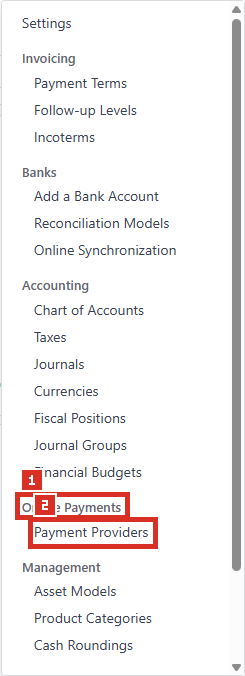
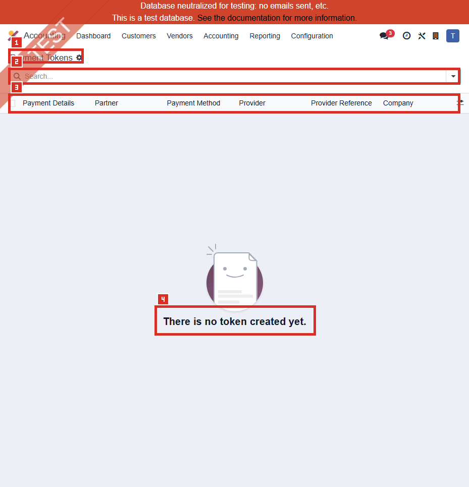

# ACC-022 คู่มือ Accounting Payment Tokens

- บริษัท: Linkweld (Thailand) Co., Ltd.
- ระบบ: Odoo 18 Enterprise Staging
- วันที่ตรวจ: 18 กรกฎาคม 2026
- วิธีตรวจ: Count-first Identity-safe Read-only with strict Token/Payment privacy
- สถานะบท: `Confirmed` สำหรับ zero accessible Tokens, hidden-menu access, empty action และ schema metadata; Token lifecycle/payment outcomes เป็น `Not Available`

## Privacy Gate

ก่อนเปิด Standard action มีการเรียกเฉพาะ `payment.token/search_count` ภายใต้ `allowed_company_ids = [1]`

| Count | ผล |
|---|---:|
| Default Active | 0 |
| Total with `active_test=False` | 0 |
| Active | 0 |
| Archived | 0 |

**ผล Privacy Gate: PASS FOR EMPTY ACTION**

Standard action ถูกเปิดหลังจากยืนยันว่า Active + Archived = 0 เท่านั้น จึงไม่มี Token row/form, Partner, Payment Details, Provider Reference หรือ Token ID ถูกอ่าน

หลักฐานโครงสร้าง:

- [ACC-022 Payment Tokens extract](../evidence/accounting/ACC-022/ACC-022_payment_tokens_extract.json)

## Access และขอบเขต

- Accounting > Configuration ไม่แสดง Payment Tokens สำหรับผู้ใช้นี้
- Local Odoo 18 source จำกัด `account_payment.payment_token_menu` ด้วย `base.group_no_one`
- ไม่เปิด Developer Mode และไม่เปิด Developer > Technical
- หลังผ่าน zero gate จึงโหลด `payment.action_payment_token` แบบ read-only
- Action id 280, route `/odoo/action-280`, model `payment.token`, view `list,form`
- ไม่เปิด form เพราะไม่มี Existing Token และไม่ใช้ข้อมูลอื่นทดแทน
- ไม่เปิด Partner, Provider, Payment Method, Company, Payments, Transactions, checkout, portal, invoice หรือ subscription

## ภาพ 1: Payment Tokens ซ่อนจากเมนูปกติ

| หมายเลข | จุดบนหน้าจอ | ผลการตรวจ |
|---|---|---|
| 1 | Online Payments section | Section แสดงใน Accounting Configuration |
| 2 | Visible item | มี Payment Providers; ไม่มี Payment Tokens |

ภาพนี้ยืนยัน menu visibility ของผู้ใช้นี้เท่านั้น ไม่ใช่ security test ของทุก role

## ภาพ 2: Payment Tokens empty list

| หมายเลข | จุดบนหน้าจอ | ผลการตรวจ |
|---|---|---|
| 1 | Page title | Payment Tokens |
| 2 | Search | ว่าง ไม่มี record |
| 3 | Column labels | Payment Details, Partner, Payment Method, Provider, Provider Reference, Company |
| 4 | Empty help | `There is no token created yet.` |

ไม่มี pager เพราะ total เป็นศูนย์ และไม่มี form ให้สุ่มตัวอย่าง

## จำนวนที่ตรวจพบแบบ Aggregate-only

| รายการ | จำนวน |
|---|---:|
| Accessible Total / Active / Archived | 0 / 0 / 0 |
| Company 1 / Global / Other accessible | 0 / 0 / 0 |
| Provider Enabled / Test / Disabled | 0 / 0 / 0 |
| Payment Method Active / Archived | 0 / 0 |
| Payment Details present / missing | 0 / 0 |
| Provider Reference present / missing | 0 / 0 |

ไม่คำนวณ distinct Partner, Provider, Method, Reference หรือ Transaction relationship เพราะอาจเปิดเผย identity

## Schema metadata และข้อมูลที่ห้ามเปิดเผย

| Field | Schema | Privacy/Control |
|---|---|---|
| Provider | Required Many2one | Company ownership และ integration context |
| Provider Code | Related read-only | Technical identity; ไม่อ่านค่า |
| Company | Related stored read-only | ได้จาก Provider |
| Payment Method | Required read-only Many2one | Method identity; ไม่อ่านค่า |
| Payment Method Code | Related read-only | ไม่อ่านค่า |
| Payment Details | Writable Char | Clear part ของ payment method; Restricted |
| Partner | Required Many2one | Personal/customer identity; Restricted |
| Provider Reference | Required Char | External Token reference; Restricted |
| Payment Transactions | One2many | Transaction relationship; ไม่อ่าน |
| Active | Boolean | Archive/Unarchive control |

## Security และ Critical behavior

Local Odoo 18 sourceยืนยันว่า:

1. Token เป็น Company-owned ผ่าน Provider
2. Internal/Portal/Public users อ่านได้เฉพาะ Token ของ Partner ที่ผูกกับ user และอยู่ใน Company ที่เข้าถึงได้
3. System group มี full CRUD; user ทั่วไปมี read-only model access ภายใต้ record rules
4. Token ต้องมี Provider, Payment Method, Partner และ Provider Reference
5. ห้าม assign Token ให้ Public Partner
6. Archive เรียก provider-specific handler
7. Unarchive ถูก block เมื่อ Payment Method inactive หรือ Provider Disabled
8. Display Name อาจมี clear payment-details suffix หรือวันที่บันทึก

ดังนั้นแม้ form เป็น `create=false/edit=false` การเปิด record ก็ยังเปิดเผยข้อมูลส่วนบุคคลและ payment reference จึงห้ามใช้เป็นหลักฐานทั่วไป

## Standard Odoo 18

Odoo ใช้ Payment Token เป็น reference ไปยัง payment details ที่ Provider เก็บไว้ เพื่อให้ลูกค้า reuse วิธีชำระได้โดยไม่เก็บข้อมูลบัตรเต็มใน Odoo

Token availability ขึ้นกับ Partner, Provider, Payment Method, Company, Active state และ payment context การไม่มี Token ในรอบนี้ไม่ยืนยันว่า tokenization ไม่จำเป็นหรือระบบไม่เคยมี Token ใน access context อื่น

ACC-020 พบ Enabled Provider = 0 และ ACC-021 พบ Active Method เพียง Wire Transfer ที่ linked กับ Test Mode Provider จึงสอดคล้องกับ zero-token baseline แต่ยังไม่ใช่ end-to-end proof

## Standard vs Pain Point

| หัวข้อ | Standard Odoo 18 | สภาพ Linkweld | ข้อเสนอ |
|---|---|---|---|
| Token storage | Odooเก็บ reference/clear suffix; Providerเก็บ sensitive details | Accessible Tokens = 0 | ตัดสินใจว่าจะอนุญาต Tokenization หรือคง zero |
| Access | Own Partner + own Company | ตรวจเฉพาะ user/context นี้ | ทำ role/portal/company UAT แบบ masked |
| Provider/Method | ต้อง active/compatible | ไม่มี Enabled Provider | ห้ามสร้าง Token ก่อน live design |
| Archive | อาจเรียก provider handler | ไม่มี record ให้ทดสอบ | ทำ sandbox lifecycle UAT |
| Unarchive | Block หาก Method inactive/Provider disabled | ไม่ได้รัน | ทดสอบ negative/rollback |
| Privacy | Form/list มี identity/reference | zero gate ป้องกัน exposure | ใช้ aggregate-only monitoring |
| Retention | ต้องกำหนด consent/retention | ไม่มี policy evidence | อนุมัติ Legal/Security policy |

## Pain Point และความเสี่ยง

- Zero accessible Tokens ไม่ใช่ defect และไม่พิสูจน์ว่า access context อื่นเป็นศูนย์
- Menu ซ่อนด้วย developer group แต่ direct action accessible หลัง zero gate; direct access ไม่ควรใช้แทน role design
- Standard list มี Payment Details, Partner และ Provider Reference จึงเป็น Restricted evidence surface
- Token display name อาจเปิดเผย clear suffix หรือวันที่ แม้ไม่แสดง reference เต็ม
- Archive/Unarchive มี provider-specific side effect และอาจทำให้ลูกค้าชำระซ้ำไม่ได้
- Partner rule ทำให้จำนวนที่แต่ละ user เห็นต่างกัน; count นี้ไม่ใช่ company-wide audit ที่สมบูรณ์
- หาก Production เปิด Tokenization ต้องมี consent, retention, deletion, breach response และ Provider offboarding
- Token ต้องไม่ถูกใช้กับ inactive Method/Disabled Provider หรือ Public Partner

## Solution ที่แนะนำ

1. ตัดสินใจ `No Tokenization required` หรือ approved Provider/Method/channel list พร้อม Business, Legal และ IT Security sign-off
2. หากคง zero-token ให้ปิด Tokenization ใน Production matrix และตรวจ portal/eCommerce ว่าไม่มี save-payment option
3. หากใช้ ให้กำหนด consent text, retention, deletion/archive, re-enrollment, provider offboarding, secret rotation และ incident response
4. จำกัด direct action และ Token admin ให้ System Admin ที่ได้รับอนุมัติ; user/portal เห็นเฉพาะของตนตาม rule
5. ใช้ masked aggregate report สำหรับ monitoring; ห้าม export Partner, payment details หรือ provider references
6. Clone UAT ด้วย sandbox/dummy Partner และ masked Token เท่านั้น
7. ทดสอบ Provider/Method state transition, archive handler, unarchive block และ rollback
8. Reconcile Token-to-Transaction behavior โดยไม่เก็บข้อมูลบัตรหรือ secret ใน evidence

## Acceptance Criteria ก่อน Go-live

- Business/Legal/IT Security อนุมัติ Tokenization scope, lawful basis/consent, retention และ deletion
- Production Test/Demo Provider ไม่สร้าง reusable Token ให้ external user
- Token แยก Partner/Company ถูกต้องและ Public Partner ถูก block
- Token list/form/direct action จำกัด role และไม่เปิด reference/identity ในทั่วไป
- Archive/Unarchive/Provider disable/Method archive มี impact preview, approval และ recovery
- Provider offboarding และ secret rotation ไม่ทิ้ง Token ที่ใช้ไม่ได้
- ไม่มี card/account data เต็มใน Odoo log, screenshot, extract หรือ handoff
- Transaction/payment flow ใช้เฉพาะ Active Token ที่ compatible และผ่าน reconciliation

## รายการ UAT ขั้นต่ำบน Clone UAT เท่านั้น

| UAT ID | กรณีทดสอบ | ผลที่ต้องตรวจ | สถานะ |
|---|---|---|---|
| UAT-ACC-022-01 | Zero-token baseline | Portal/checkout ทำงานตาม policy และไม่มี save option ที่ไม่อนุมัติ | Pending |
| UAT-ACC-022-02 | Own-Partner rule | Internal/Portal/Public เห็นเฉพาะ Token ของ Partner ตน | Pending |
| UAT-ACC-022-03 | Company isolation | Token ของ Company อื่นไม่แสดงหรือเลือกใช้ | Pending |
| UAT-ACC-022-04 | Public Partner block | ไม่สามารถ assign Token ให้ Public Partner | Pending |
| UAT-ACC-022-05 | Sandbox token creation | สร้างด้วย approved sandbox flow โดยไม่เปิดเผย detail/reference | Pending |
| UAT-ACC-022-06 | Display masking | UI/portal/log/evidence แสดงเฉพาะ masked detail ตาม policy | Pending |
| UAT-ACC-022-07 | Archive | Handler ทำงาน, Token เลือกใช้ไม่ได้ และ audit trace ครบ | Pending |
| UAT-ACC-022-08 | Unarchive negative | Inactive Method/Disabled Provider ถูก block | Pending |
| UAT-ACC-022-09 | Provider/Method transition | State change archive Token และ recovery ตรง design | Pending |
| UAT-ACC-022-10 | Reuse/validation | Active compatible Token reuse ได้โดยไม่สร้างยอดซ้ำ | Pending |
| UAT-ACC-022-11 | Retention/deletion/offboarding | Policy และ Provider cleanup ทำงานครบ | Pending |
| UAT-ACC-022-12 | Security/accounting regression | ไม่มี identity leak; Transaction/Payment/GL ไม่ผิดซ้ำ | Pending |

## สรุปสถานะ

- Payment Tokens เป็น developer-hidden menu สำหรับผู้ใช้นี้
- Privacy gate ยืนยัน Accessible Active/Archived Tokens = 0 ก่อนเปิด action
- Empty action เปิดได้โดยไม่ใช้ Developer Mode; ไม่มี Existing form
- ไม่อ่าน Partner, Payment Details, Provider Reference, Token ID หรือ Transaction relation
- ไม่มี linked-model query, external-provider request หรือ Odoo write
- Zero Tokens สอดคล้องกับ ACC-020/021 baseline แต่ยังไม่ยืนยัน policy หรือ lifecycle behavior

อ้างอิง:

- [Odoo 18 Online payments](https://www.odoo.com/documentation/18.0/applications/finance/payment_providers.html)
- [Odoo 18 Payment Token developer reference](https://www.odoo.com/documentation/18.0/developer/reference/standard_modules/payment/payment_token.html)
