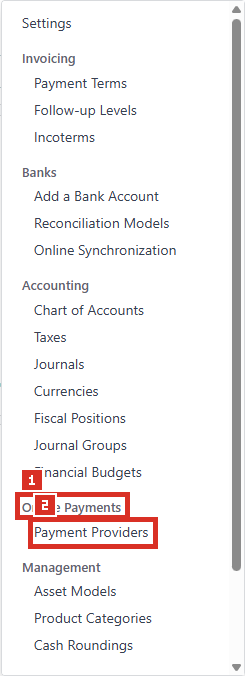
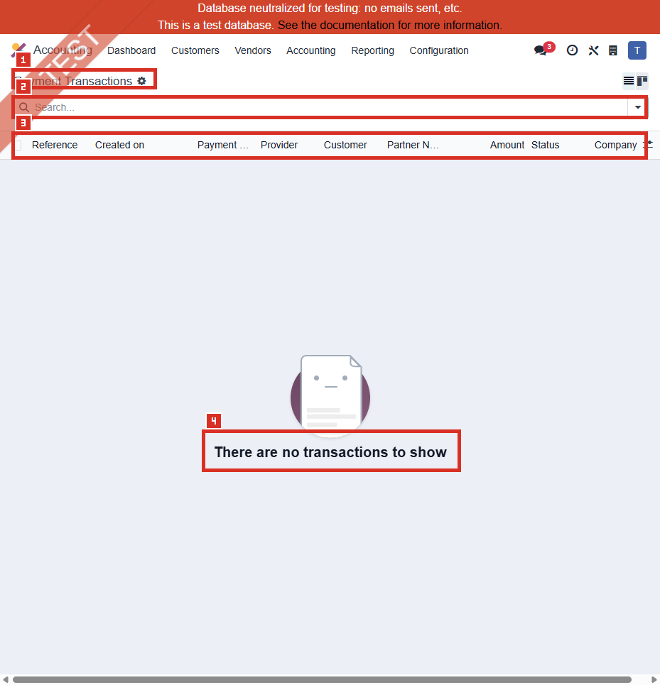

# ACC-023 คู่มือ Accounting Payment Transactions

- บริษัท: Linkweld (Thailand) Co., Ltd.
- ระบบ: Odoo 18 Enterprise Staging
- วันที่ตรวจ: 18 กรกฎาคม 2026
- วิธีตรวจ: Count-first Financial and Identity-safe Read-only
- สถานะบท: `Confirmed` สำหรับ zero accessible Transactions, hidden-menu access, empty action และ schema metadata; Transaction lifecycle และผลทางบัญชีเป็น `Not Available`

## Privacy Gate

ก่อนเปิด Standard action มีการเรียกเฉพาะ `payment.transaction/fields_get` แบบจำกัด field และ `payment.transaction/search_count` ภายใต้ `allowed_company_ids = [1]`

| Count | ผล |
|---|---:|
| Accessible Transactions ก่อนเปิด action | 0 |

**ผล Privacy Gate: PASS FOR EMPTY ACTION**

Standard action ถูกเปิดหลังยืนยัน total = 0 เท่านั้น จึงไม่มี Transaction row, kanban card, form, Reference, Amount, Currency, Partner, Provider Reference หรือ State Message ถูกอ่าน

หลักฐานโครงสร้าง:

- [ACC-023 Payment Transactions extract](../evidence/accounting/ACC-023/ACC-023_payment_transactions_extract.json)

## Access และขอบเขต

- Accounting > Configuration ไม่แสดง Payment Transactions สำหรับผู้ใช้นี้
- Local Odoo 18 source จำกัด `account_payment.payment_transaction_menu` ด้วย `base.group_no_one`
- ไม่เปิด Developer Mode และไม่เปิด Developer > Technical
- หลังผ่าน zero gate จึงโหลด `payment.action_payment_transaction` แบบ read-only
- Action id 278, route `/odoo/action-278`, model `payment.transaction`, view `list,kanban,form`
- ไม่เปิด form เพราะไม่มี Existing Transaction และไม่ใช้ record อื่นทดแทน
- ไม่เปิด Partner, Provider, Payment Method, Currency, Token, Payment, Invoice, Order, Journal, Account หรือ Report

## ภาพ 1: Payment Transactions ซ่อนจากเมนูปกติ

| หมายเลข | จุดบนหน้าจอ | ผลการตรวจ |
|---|---|---|
| 1 | Online Payments section | Section แสดงใน Accounting Configuration |
| 2 | Visible item | มี Payment Providers; ไม่มี Payment Transactions |

ภาพนี้ยืนยัน menu visibility ของผู้ใช้นี้เท่านั้น ไม่ใช่ security test ของทุก role

## ภาพ 2: Payment Transactions empty list

| หมายเลข | จุดบนหน้าจอ | ผลการตรวจ |
|---|---|---|
| 1 | Page title | Payment Transactions |
| 2 | Search | ว่าง ไม่มี record |
| 3 | Column labels | Reference, Created on, Payment Method, Provider, Customer, Partner Name, Amount, Status, Company |
| 4 | Empty help | `There are no transactions to show` |

ไม่มี pager เพราะ total เป็นศูนย์ และไม่มี form ให้สุ่มตัวอย่าง

## จำนวนที่ตรวจพบแบบ Aggregate-only

| รายการ | จำนวน |
|---|---:|
| Accessible Total | 0 |
| Company 1 / Global / Other accessible | 0 / 0 / 0 |
| Draft / Pending / Authorized / Confirmed / Canceled / Error | 0 / 0 / 0 / 0 / 0 / 0 |
| Online redirect / direct / token / validation / offline / refund / blank | 0 / 0 / 0 / 0 / 0 / 0 / 0 |
| Provider Enabled / Test / Disabled | 0 / 0 / 0 |
| Payment Method Active / Archived | 0 / 0 |
| Token present / missing | 0 / 0 |
| Source Transaction present / missing | 0 / 0 |
| Provider Reference present / missing | 0 / 0 |
| State Message present / missing | 0 / 0 |
| Post-processed True / False | 0 / 0 |
| Create Token True / False | 0 / 0 |
| Amount positive / zero / negative | 0 / 0 / 0 |

ไม่มีการอ่านยอด จำนวนเงินรวม หรือคำนวณ distinct Partner, Provider, Method, Currency, Reference และวันที่

## Schema metadata และข้อมูลที่ห้ามเปิดเผย

| กลุ่ม Field | Schema/Control | Privacy |
|---|---|---|
| Provider / Provider Code / Company | Required Provider; Company related ผ่าน Provider | ไม่อ่าน identity |
| Payment Method / Code | Required read-only relationship | ไม่อ่าน identity |
| Reference / Provider Reference | Unique internal reference และ external reference | Restricted |
| Amount / Currency | Required financial values | Restricted |
| Token | Optional saved-payment relationship | ไม่อ่าน |
| State / State Message / Last Change | Lifecycle และ provider response | Restricted |
| Operation / Source / Child / Refund count | Technical transaction lineage | Restricted |
| Partner | Required customer relationship | Restricted |
| Partner traceability fields | Name, email, address, ZIP, city, state, country, phone, language | Highly Restricted |

## Standard Odoo 18

Payment Transaction เป็น technical record ที่ติดตาม lifecycle ระหว่าง Odoo, Payment Provider, Payment Method และเอกสารธุรกิจ โดยมีสถานะ Draft, Pending, Authorized, Confirmed, Canceled และ Error

Odoo รองรับ manual capture และ refund เฉพาะ Provider ที่รองรับ การกด Capture/Void/Refund อาจเรียก Provider ภายนอกและเปลี่ยน financial state จึงไม่ใช่การตรวจแบบ read-only

Odoo แนะนำใช้ Test Mode บนฐานข้อมูลทดสอบหรือฐานข้อมูลสำเนา และ Payment Journal/Outstanding Account ต้องสอดคล้องกับ workflow การรับเงินและ reconciliation

## Standard vs Pain Point

| หัวข้อ | Standard Odoo 18 | สภาพ Linkweld | ข้อเสนอ |
|---|---|---|---|
| Transaction lifecycle | Provider-driven state machine | Accessible Total = 0 | อนุมัติ intended flow ก่อนเปิดใช้ |
| Provider/Method | ต้อง active และ compatible | Enabled Provider = 0 | คง Production block จน UAT ผ่าน |
| Identity/financial privacy | Transaction เก็บ Reference, Amount และ Partner snapshot | zero gate ป้องกัน exposure | จำกัด view/export และใช้ aggregate monitoring |
| Authorization | Authorized ใช้กับ manual capture | ไม่ได้ทดสอบ | ทดสอบ sandbox authorize/capture/void |
| Refund | อาจสร้าง child/refund Transaction | ไม่ได้ทดสอบ | ทดสอบ full/partial/duplicate prevention |
| Accounting | Payment Journal/Outstanding/Reconciliation | ไม่ได้รัน | Reconcile Payment, GL และ bank settlement |
| Token | Archived Token ใช้สร้าง Transaction ไม่ได้ | Tokens = 0 | ทดสอบ policy แบบ masked dummy data |

## Pain Point และความเสี่ยง

- Zero accessible Transactions ไม่ใช่ defect และไม่พิสูจน์ว่า Production หรือ access context อื่นไม่มีประวัติ
- Menu ซ่อนด้วย developer group แต่ direct action accessible หลัง zero gate; direct access ไม่ควรใช้แทน role design
- List/Form มี Reference, Partner, Amount, Provider และ contact snapshot จึงเป็น Restricted evidence surface
- Transaction creation ทำสำเนาข้อมูล Partner เพื่อ traceability ทำให้ retention และ access risk สูงกว่า Partner link เพียงอย่างเดียว
- Authorized state ใช้ได้เมื่อ Provider รองรับ manual capture; configuration mismatch อาจทำให้ flow ค้าง
- Capture, Void และ Refund อาจเรียก Provider และเปลี่ยนยอดหรือสถานะ จึงต้องมี idempotency และ recovery test
- Payment success ไม่เท่ากับ bank settlement หรือ GL reconciliation
- Wire Transfer อยู่ Test Mode และไม่มี Enabled Provider ตาม ACC-020; ห้ามตีความ zero Transactions ว่า checkout พร้อมใช้
- Provider Reference และ State Message อาจมีข้อมูลจากระบบภายนอกและต้องถูก redact จาก screenshot/export/log

## Solution ที่แนะนำ

1. อนุมัติ Provider/Method/channel matrix ว่าใช้ invoice portal, eCommerce, subscription หรือ offline flow ใด
2. คง Enabled Provider = 0 ใน Production จน Business, Finance, IT Security และ Legal อนุมัติ
3. จำกัด Payment Transactions action/export ให้ System Admin และผู้ตรวจที่ได้รับอนุมัติ
4. กำหนด masking, retention, purge, incident response และ audit evidence สำหรับ Partner snapshot/Reference/State Message
5. กำหนด state transition, timeout, webhook retry, duplicate callback และ idempotency policy
6. กำหนด Payment Journal, Outstanding Account, fees, FX, settlement cutoff และ reconciliation owner
7. ใช้ Clone UAT กับ sandbox Provider, dummy Partner และยอดทดสอบเท่านั้น
8. Reconcile Transaction > Payment > Invoice/Order > Journal Entry > Bank Settlement แบบ end-to-end

## Acceptance Criteria ก่อน Go-live

- Provider/Method/Company/Website/channel scope ได้รับอนุมัติและไม่มี Test Provider เปิดให้ลูกค้าจริง
- Transaction Reference unique และ duplicate callback ไม่สร้าง Payment หรือยอดซ้ำ
- Partner/Company isolation ถูกต้องและข้อมูล contact snapshot ไม่เปิดเผยเกิน role
- Pending/Error/timeout/retry มี owner, alert, recovery และ audit trail
- Authorized/Capture/Void ใช้ได้เฉพาะ Provider ที่รองรับและไม่เกิด double capture
- Refund เต็ม/บางส่วน reconcile กับ original Transaction, Payment, Invoice และ GL
- Payment Journal/Outstanding/fee/FX posting reconcile กับ bank settlement
- Token lifecycle compatible และ Archived Token ถูก block
- ไม่มี credential, Provider Reference, State Message หรือข้อมูลส่วนบุคคลใน evidence ทั่วไป
- Production monitoring ใช้ aggregate/masked data และจำกัด Export

## รายการ UAT ขั้นต่ำบน Clone UAT เท่านั้น

| UAT ID | กรณีทดสอบ | ผลที่ต้องตรวจ | สถานะ |
|---|---|---|---|
| UAT-ACC-023-01 | Zero baseline | ไม่มี Transaction ก่อนเริ่ม sandbox test | Pending |
| UAT-ACC-023-02 | Successful payment | State Confirmed, Payment และเอกสารเชื่อมถูกต้อง | Pending |
| UAT-ACC-023-03 | Pending to Confirmed | Webhook/retry ไม่สร้างรายการซ้ำ | Pending |
| UAT-ACC-023-04 | Error/Cancel | ไม่มี Payment/GL ผิดพลาดและ recovery ชัดเจน | Pending |
| UAT-ACC-023-05 | Unique Reference | Duplicate reference/callback ถูก block หรือ idempotent | Pending |
| UAT-ACC-023-06 | Company/role isolation | User ต่าง Company/role ไม่เห็นข้อมูล Restricted | Pending |
| UAT-ACC-023-07 | Partner snapshot privacy | UI/export/log แสดงข้อมูลตาม masking/retention policy | Pending |
| UAT-ACC-023-08 | Authorize/Capture | Provider support, amount และ state transition ถูกต้อง | Pending |
| UAT-ACC-023-09 | Void | Authorized Transaction ถูก void ครั้งเดียวและ audit ครบ | Pending |
| UAT-ACC-023-10 | Full/partial refund | Child Transaction, Payment, Invoice และ GL reconcile | Pending |
| UAT-ACC-023-11 | Token negative | Archived/incompatible Token ถูก block | Pending |
| UAT-ACC-023-12 | Settlement/accounting | Outstanding, fees, FX, bank และ GL reconcile | Pending |
| UAT-ACC-023-13 | Timeout/retry | ไม่มี double charge และมี alert/owner | Pending |
| UAT-ACC-023-14 | Provider disable/offboarding | New flow ถูก block; historical trace ยังปลอดภัย | Pending |

## สรุปสถานะ

- Payment Transactions เป็น developer-hidden menu สำหรับผู้ใช้นี้
- Privacy gate ยืนยัน Accessible Transactions = 0 ก่อนเปิด action
- Empty action เปิดได้โดยไม่ใช้ Developer Mode; ไม่มี Existing row/card/form
- ไม่อ่าน Reference, Amount, Partner, Provider/Method identity, State Message หรือ relationship
- ไม่มี linked-model query, transaction business method, external-provider request หรือ Odoo write
- Zero Transactions สอดคล้องกับ ACC-020 ถึง ACC-022 baseline แต่ยังไม่ยืนยัน lifecycle, settlement หรือ accounting behavior

อ้างอิง:

- [Odoo 18 Online payments](https://www.odoo.com/documentation/18.0/applications/finance/payment_providers.html)
- [Odoo 18 Payment Transaction developer reference](https://www.odoo.com/documentation/18.0/developer/reference/standard_modules/payment/payment_transaction.html)
