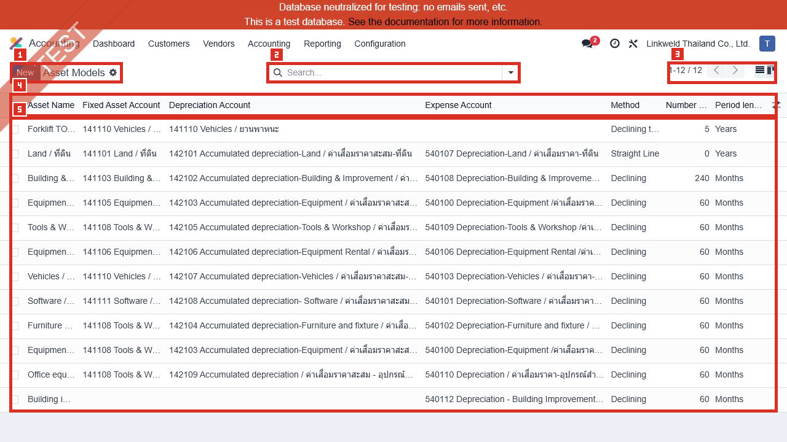
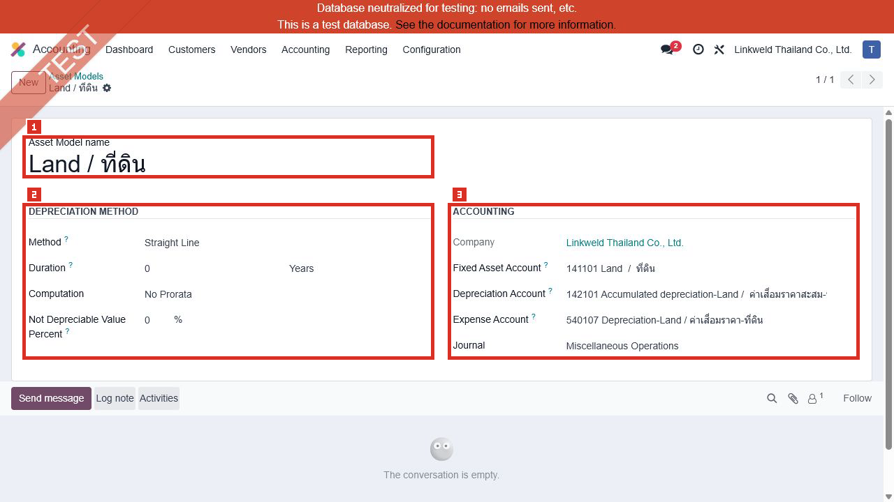
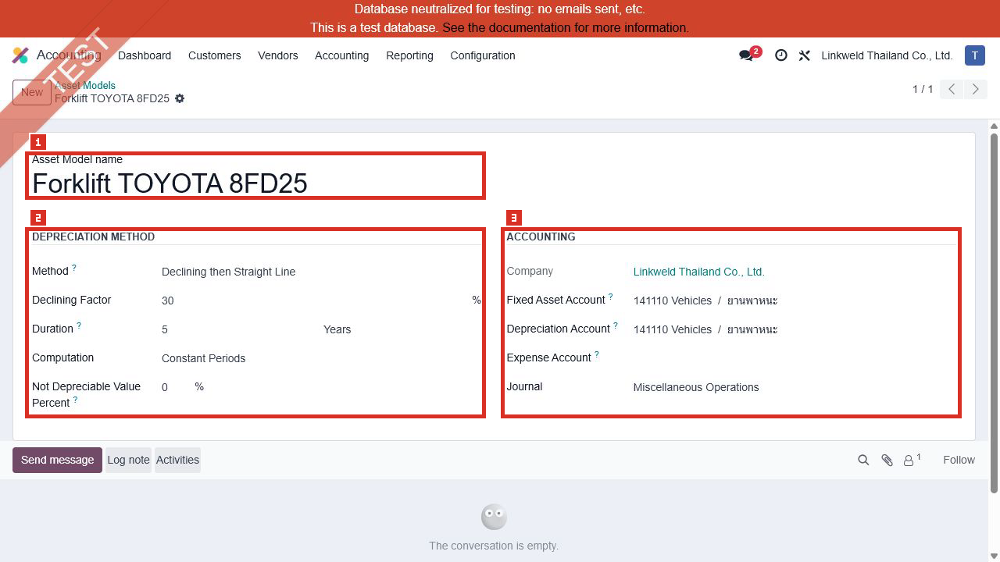
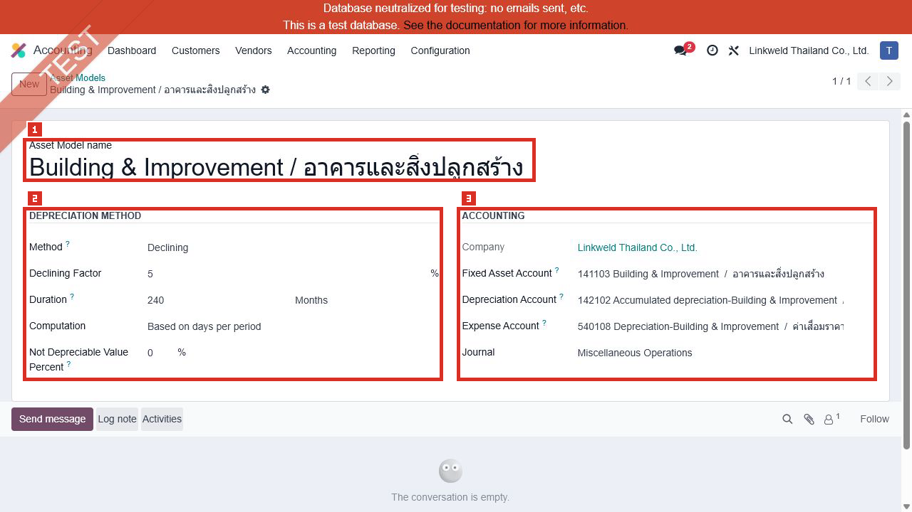

# ACC-024 คู่มือ Accounting Asset Models

- บริษัท: Linkweld (Thailand) Co., Ltd.
- ระบบ: Odoo 18 Enterprise Staging
- วันที่ตรวจ: 18 กรกฎาคม 2026
- วิธีตรวจ: Existing-record-only Read-only with strict no-depreciation/no-posting controls
- สถานะบท: `Confirmed` สำหรับ 12 Asset Models และค่าที่แสดง; depreciation, posting, disposal, tax book และ GL behavior เป็น `Not Available`

## ขอบเขตและความปลอดภัย

- เปิดผ่านเมนูปกติ Accounting > Configuration > Management > Asset Models
- Action id 649, route `/odoo/action-649`, model `account.asset`
- Domain `state = model`, context `default_state = model`, views `list,kanban,form`
- ไม่เปิด Developer Mode หรือ Developer > Technical
- ไม่กด New, Edit, Save, Confirm, Compute Depreciation, Save as Model, Modify Depreciation, Cancel, Archive หรือ Delete
- ไม่เปิด Asset จริง, Depreciation Board, Journal Entry, Account, Journal, Company, Asset Group หรือ Linked Asset
- ไม่มี `validate`, `compute_depreciation_board`, depreciation generation หรือ posting

หลักฐานโครงสร้าง:

- [ACC-024 Asset Models extract](../evidence/accounting/ACC-024/ACC-024_asset_models_extract.json)

## ภาพ 1: รายการ Asset Models

| หมายเลข | จุดบนหน้าจอ | ผลการตรวจ |
|---|---|---|
| 1 | Page title | Asset Models |
| 2 | Search | ว่าง ไม่มี filter chip |
| 3 | Pager | 1-12 / 12 |
| 4 | Columns | Asset Name, Fixed Asset Account, Depreciation Account, Expense Account, Method, Number of Depreciations, Period length |
| 5 | Existing rows | 12 models แสดงในหนึ่งหน้า |

Account labels ถูกใช้เฉพาะหลักฐานภาพที่ผ่าน privacy scan และไม่ถูกคัดลอกลง extract/handoff

## จำนวนและการกระจาย

| รายการ | จำนวน |
|---|---:|
| Total / Active / Archived | 12 / 12 / 0 |
| Company 1 / Global / Other | 12 / 0 / 0 |
| Straight Line | 1 |
| Declining | 10 |
| Declining then Straight Line | 1 |
| Period Months / Years | 10 / 2 |
| Duration 0 / 5 / 60 / 240 | 1 / 1 / 9 / 1 |
| No Prorata / Constant Periods / Based on days | 1 / 2 / 9 |
| Declining Factor 5% / 20% / 30% | 1 / 9 / 2 |
| Fixed Asset Account blank | 1 |
| Depreciation Account blank | 1 |
| Expense Account blank | 1 |
| Journal blank | 0 |
| Models with linked Assets | 0 |

พบชื่อ normalized ซ้ำหนึ่งกลุ่มคือ `Equipment / เครื่องใช้สำนักงาน` จำนวน 2 records แต่ยังไม่จัดเป็น defect จนกว่าจะ trace Product/Account/Asset references และ intended purpose

## ภาพ 2: Land แบบ Straight Line

| หมายเลข | จุดบนหน้าจอ | ผลการตรวจ |
|---|---|---|
| 1 | Model Name | Land / ที่ดิน |
| 2 | Depreciation Method | Straight Line, 0 Years, No Prorata |
| 3 | Accounting | Fixed Asset, Depreciation, Expense Account และ Journal มีค่า |

ที่ดินมักเป็นสินทรัพย์ไม่คิดค่าเสื่อม แต่ `0 Years` ใน model นี้ยังไม่พิสูจน์ policy หรือ runtime behavior ต้องให้ Accounting/CFO ยืนยันว่าควรใช้ Asset Model, Non-depreciable treatment หรือ control อื่น

## ภาพ 3: Forklift แบบ Declining then Straight Line

| หมายเลข | จุดบนหน้าจอ | ผลการตรวจ |
|---|---|---|
| 1 | Model Name | Forklift TOYOTA 8FD25 |
| 2 | Depreciation Method | Declining then Straight Line, factor 30%, 5 Years, Constant Periods |
| 3 | Accounting | Fixed Asset/Depreciation/Journal มีค่า แต่ Expense Account ว่าง |

Expense Account ว่างเป็น `High owner-review finding` เพราะ model ที่นำไปสร้าง Asset อาจไม่มี expense posting destination ที่อนุมัติ อย่างไรก็ตามไม่ได้สร้าง Asset หรือ Compute Depreciation จึงยังไม่สรุป runtime defect

## ภาพ 4: Building & Improvement แบบ Declining

| หมายเลข | จุดบนหน้าจอ | ผลการตรวจ |
|---|---|---|
| 1 | Model Name | Building & Improvement / อาคารและสิ่งปลูกสร้าง |
| 2 | Depreciation Method | Declining, factor 5%, 240 Months, Based on days per period |
| 3 | Accounting | Fixed Asset, Depreciation, Expense Account และ Journal มีค่า |

รูปแบบ 240 เดือนเท่ากับ 20 ปีในเชิงระยะเวลา แต่การใช้ Declining 5% ต้อง reconcile กับนโยบาย useful life, financial reporting, tax depreciation และ salvage/disposal ของ Linkweld

## Standard Odoo 18

Asset Model เป็น `account.asset` ที่มี state `model` ใช้เติมค่ามาตรฐานให้ Asset ใหม่ โดยสัมพันธ์กับ Fixed Asset Account

Odoo 18 รองรับ:

- Straight Line: แบ่ง depreciable value ตามจำนวนงวด
- Declining: คูณยอดคงเหลือด้วย declining factor
- Declining then Straight Line: ใช้ Declining แต่ไม่ต่ำกว่าวิธี Straight Line
- Prorata เพื่อคำนวณงวดแรกตามช่วงเวลาจริง

Odoo สร้าง depreciation entries อัตโนมัติใน draft และ post ตามกำหนด การกด Compute Depreciation/Confirm หรือใช้ Asset ที่ Running จึงเป็นการเปลี่ยนข้อมูลบัญชี ไม่ใช่ read-only evidence

## Standard vs Pain Point

| หัวข้อ | Standard Odoo 18 | สภาพ Linkweld | ข้อเสนอ |
|---|---|---|---|
| Asset Models | Prefill method/accounts/journal | มี 12 active models | ทำ approved model matrix |
| Methods | Straight/Declining/Hybrid | Declining 10/12 | CFO/Auditor ยืนยัน policy |
| Accounts | Asset/Accumulated/Expense + Journal | มี blank อย่างละ 1 ใน 3 account fields | Trace และแก้บน Clone UAT |
| Land | รองรับ model configuration | 0 Years/No Prorata | บันทึก non-depreciable policy |
| Forklift | Hybrid method | Expense Account blank | High owner review |
| Naming | Model name เป็น master data | Equipment ซ้ำ 2 | Trace dependencies ก่อนรวม/ลบ |
| Usage | Model ช่วยสร้าง Asset | linked Assets = 0 | ตรวจ adoption/reference โดยไม่ลบ |
| Posting | Board สร้าง/โพสต์ entries | ไม่ได้ทดสอบ | Clone-UAT reconciliation |

## Pain Point และความเสี่ยง

- Asset Model ที่ account ว่างอาจนำไปสู่การสร้าง Asset หรือ posting configuration ที่ไม่ครบ
- Model name ซ้ำอาจทำให้ user เลือกผิด แต่ห้าม archive/merge จากชื่ออย่างเดียว
- Declining 20% ใช้กับ 9 models และควรมี policy รองรับ ไม่ใช่กำหนดตามความคุ้นเคย
- Land 0 Years อาจเป็น intentional non-depreciable setup หรือ model ที่ไม่เหมาะสม ต้องยืนยัน
- Linked Assets เป็นศูนย์ทุก model ไม่พิสูจน์ว่า model ไม่เคยใช้หรือไม่มี dependency จาก Product/Account automation
- Financial book และ Thai tax depreciation อาจต่างกัน; model เดียวไม่ควรถูกถือเป็น tax schedule โดยอัตโนมัติ
- Compute/Confirm สามารถสร้างหรือ post journal entries จึงห้ามทดสอบบน Primary staging
- การเปลี่ยน account/method/duration อาจกระทบ Asset ใหม่และ existing draft Asset ที่อ้าง model

## Solution ที่แนะนำ

1. สร้าง Asset Class-to-Model matrix: class, useful life, method, factor, prorata, salvage, three accounts, Journal และ owner
2. แยก Financial Book policy ออกจาก Thai Tax depreciation schedule และกำหนด reconciliation owner
3. ตรวจ model ที่ account ว่างทั้งสามประเภท โดย trace existing references ก่อนแก้
4. ยืนยัน Land policy ว่า non-depreciable และกำหนดวิธีบันทึก/impairment/disposal
5. ตรวจ Equipment ชื่อซ้ำจาก external ID, Product Category, Account automation และ existing Asset ก่อน merge/archive
6. จำกัดสิทธิ์แก้ Asset Models ให้ Accounting Manager ที่ได้รับอนุมัติ
7. ทดสอบบน Clone UAT ด้วย dummy vendor bill/asset และ controlled values
8. Reconcile Depreciation Schedule, Journal Entries, Trial Balance, Balance Sheet, P&L และ tax schedule

## Acceptance Criteria ก่อน Go-live

- Asset Model matrix ได้รับอนุมัติจาก Accounting/CFO และ Auditor/Tax owner ตามความจำเป็น
- ทุก model ที่ใช้สร้าง Asset มี Fixed Asset, Accumulated Depreciation, Expense Account และ Journal ที่ถูกต้อง
- Land/non-depreciable asset policy ชัดเจนและไม่สร้างค่าเสื่อมโดยผิดนโยบาย
- Useful life, method, factor และ prorata ตรง class policy
- Model name ไม่กำกวมและ duplicate มี disposition พร้อม dependency evidence
- Product/Account automation เลือก model ถูกต้อง
- Depreciation board dates/amounts/rounding/salvage reconcile
- Posting ใช้ Journal และ accounts ถูกต้อง; Lock Date/approval ทำงาน
- Disposal, sale, write-off, increase/decrease, pause/resume และ correction มี control
- Financial book, tax schedule และ GL reconcile โดยไม่มี manual overwrite ที่ไร้ audit trail

## รายการ UAT ขั้นต่ำบน Clone UAT เท่านั้น

| UAT ID | กรณีทดสอบ | ผลที่ต้องตรวจ | สถานะ |
|---|---|---|---|
| UAT-ACC-024-01 | Model selection | Account/Product automation แสดง model ถูก class | Pending |
| UAT-ACC-024-02 | Straight Line | Board แบ่งยอด/วันที่/rounding ถูกต้อง | Pending |
| UAT-ACC-024-03 | Declining | Factor และยอดคงเหลือถูกต้องถึงงวดสุดท้าย | Pending |
| UAT-ACC-024-04 | Declining then Straight Line | จุดเปลี่ยนและ minimum straight-line ถูกต้อง | Pending |
| UAT-ACC-024-05 | Prorata variants | None/Constant/Days ให้วันที่และยอดตาม policy | Pending |
| UAT-ACC-024-06 | Land | ไม่สร้าง depreciation หาก policy กำหนด non-depreciable | Pending |
| UAT-ACC-024-07 | Missing Expense Account | ถูก block หรือแสดง validation ก่อน posting | Pending |
| UAT-ACC-024-08 | Account mapping | Asset/Accumulated/Expense/Journal posting ถูกต้อง | Pending |
| UAT-ACC-024-09 | Duplicate name | User เลือก model ถูกและ disposition ปลอดภัย | Pending |
| UAT-ACC-024-10 | Vendor Bill to Asset | Source line, value, tax และ acquisition date ถูกต้อง | Pending |
| UAT-ACC-024-11 | Posting/Lock Date | Auto-post, approval และ lock controls ถูกต้อง | Pending |
| UAT-ACC-024-12 | Modify/Pause/Resume | Future board และ audit trail ถูกต้อง | Pending |
| UAT-ACC-024-13 | Dispose/Sell | Gain/loss, removal, invoice และ GL reconcile | Pending |
| UAT-ACC-024-14 | Financial vs Tax book | Schedule/report/GL reconciliation ตรง policy | Pending |

## สรุปสถานะ

- Asset Models เป็นเมนูปกติและมี 12 active Company-1 records
- Declining เป็นวิธีหลัก 10/12 records; 9 records ใช้ 60 Months และ factor 20%
- พบ Fixed Asset Account, Depreciation Account และ Expense Account ว่างอย่างละ 1 model; Journal ครบทุก model
- Forklift มี Expense Account ว่างและเป็น High owner-review finding
- Land 0 Years/No Prorata ต้องยืนยัน non-depreciable policy ไม่ควรแก้จากค่าหน้าจออย่างเดียว
- Equipment มีชื่อ normalized ซ้ำ 2 records; ต้อง trace ก่อน merge/archive
- ไม่สร้าง Asset, board, depreciation move หรือ journal entry และไม่มี Odoo write

อ้างอิง:

- [Odoo 18 Non-current assets and fixed assets](https://www.odoo.com/documentation/18.0/applications/finance/accounting/vendor_bills/assets.html)
