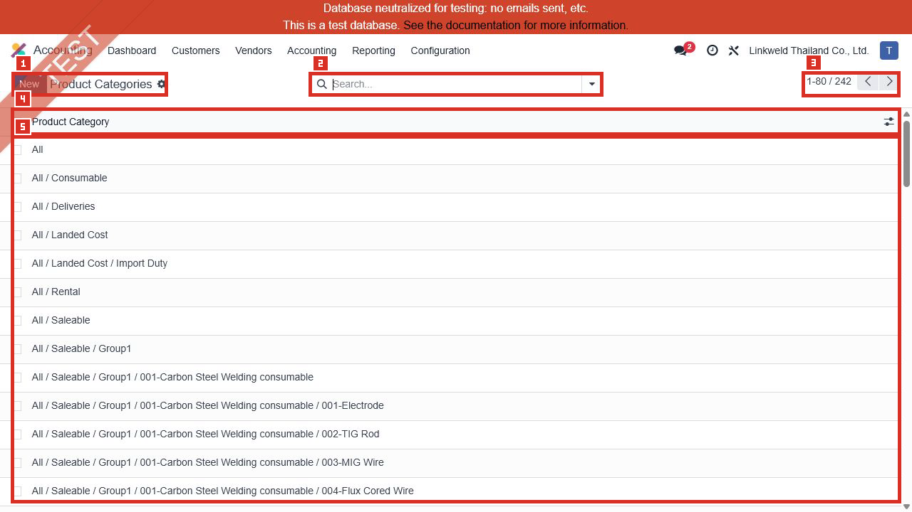
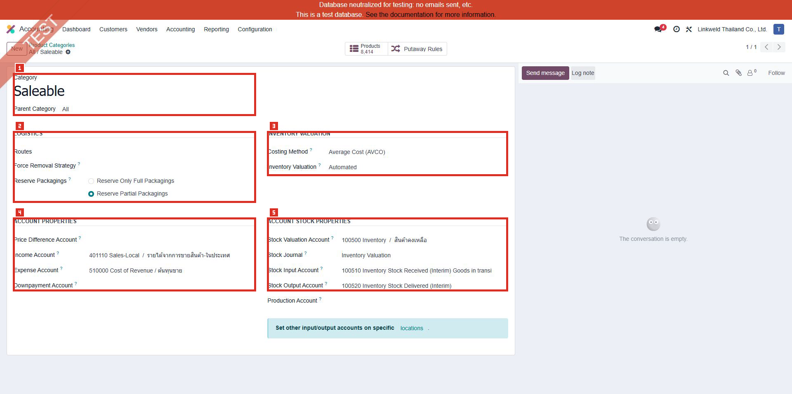
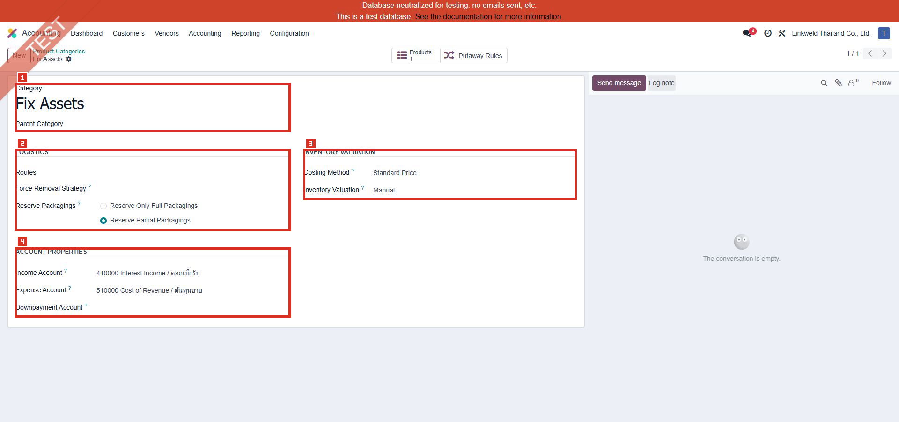
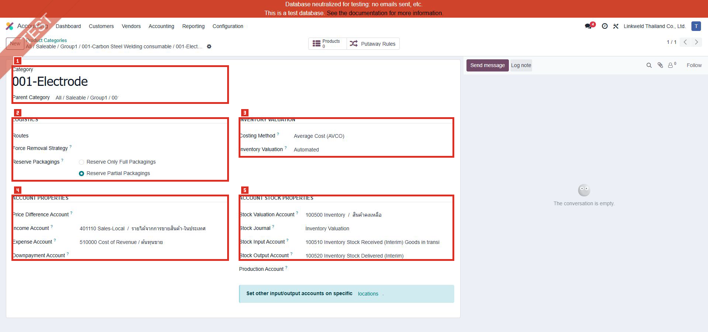

# ACC-025 คู่มือ Accounting Product Categories

- บริษัท: Linkweld (Thailand) Co., Ltd.
- ระบบ: Odoo 18 Enterprise Staging
- วันที่ตรวจ: 18 กรกฎาคม 2026
- วิธีตรวจ: Existing-record-only Read-only with strict inventory valuation/accounting safety
- สถานะบท: `Confirmed` สำหรับ 242 categories และ Company-1 properties; SVL, AVCO/FIFO, WIP, COGS และ GL behavior เป็น `Not Available`

## ขอบเขตและความปลอดภัย

- เปิดผ่านเมนูปกติ Accounting > Configuration > Management > Product Categories
- Action id 147, route `/odoo/action-147`, model `product.category`, views `list,form`
- Action domain เป็น False, context ว่าง, limit 80 และไม่มี live order ระบุ
- ไม่เปิด Developer Mode หรือ Developer > Technical
- ไม่กด New, Edit, Save, Import, Export, Archive, Delete, Products หรือ linked record
- ไม่เปลี่ยน Costing Method, Inventory Valuation, accounts, Stock Journal, Routes หรือ Removal Strategy
- ไม่รัน revaluation, cost recompute, inventory adjustment, landed cost, stock move หรือ posting

หลักฐานโครงสร้าง:

- [ACC-025 Product Categories extract](../evidence/accounting/ACC-025/ACC-025_product_categories_extract.json)

## ภาพ 1: รายการ Product Categories

| หมายเลข | จุดบนหน้าจอ | ผลการตรวจ |
|---|---|---|
| 1 | Page title | Product Categories |
| 2 | Search | ว่าง ไม่มี filter chip |
| 3 | Pager | 1-80 / 242 |
| 4 | Column | Product Category |
| 5 | Existing rows | แสดงหน้าแรกเท่านั้น |

Category names ผ่าน privacy scan และไม่พบ bank account, Tax ID, person/customer/vendor identifier หรือเลข 10 หลักขึ้นไป

## จำนวนและโครงสร้าง

| รายการ | จำนวน |
|---|---:|
| Total Categories | 242 |
| Root / Child | 2 / 240 |
| Depth 0 / 1 / 2 / 3 / 4 | 2 / 7 / 12 / 88 / 133 |
| Maximum Depth | 4 |
| AVCO / Standard / FIFO | 239 / 3 / 0 |
| Automated / Manual | 239 / 3 |
| AVCO + Automated | 239 |
| Standard + Manual | 3 |
| Categories with / without Products | 40 / 202 |
| Duplicate normalized leaf-name groups | 23 |
| Duplicate complete-name groups | 0 |

Product relationship ใช้จำนวน aggregate เท่านั้น ไม่มี Product identity, cost, quantity หรือ stock value ถูกอ่าน

## Account และ Journal presence

| Field | Present | Missing |
|---|---:|---:|
| Income Account | 242 | 0 |
| Expense Account | 242 | 0 |
| Stock Valuation Account | 239 | 3 |
| Stock Input Account | 239 | 3 |
| Stock Output Account | 239 | 3 |
| Stock Journal | 242 | 0 |
| Price Difference Account | 0 | 242 |

สาม categories ที่ไม่มี stock accounts เป็น Manual + Standard ทั้งหมด จึงไม่ใช่ incomplete Automated configuration

Automated 239 categories มี Stock Valuation/Input/Output accounts ครบตาม mandatory constraint และมี Stock Journal ทุก category

Account/Journal identity, code และ balance ไม่ถูกคัดลอกลง extract หรือ handoff

## ภาพ 2: Saleable แบบ AVCO + Automated

| หมายเลข | จุดบนหน้าจอ | ผลการตรวจ |
|---|---|---|
| 1 | Hierarchy | All / Saleable |
| 2 | Costing/Valuation | Average Cost (AVCO) + Automated |
| 3 | Income/Expense | มีค่า |
| 4 | Stock properties | Valuation/Input/Output/Journal มีค่า |
| 5 | Other properties | ไม่มี explicit Route/Removal Strategy; Price Difference ว่าง |

เป็นตัวแทนของ 239 AVCO+Automated categories ไม่ใช่การพิสูจน์ว่าทุก stock move และ journal entry ถูกต้อง

## ภาพ 3: Fix Assets แบบ Manual + Standard

| หมายเลข | จุดบนหน้าจอ | ผลการตรวจ |
|---|---|---|
| 1 | Category | Fix Assets |
| 2 | Costing/Valuation | Standard Price + Manual |
| 3 | Income/Expense | มีค่า |
| 4 | Stock properties | Stock Journal มีค่า; stock accounts ไม่แสดง/ไม่มีเพราะ Manual |

Manual valuation ไม่สร้าง accounting entry อัตโนมัติจาก stock movement จึงต้องมี owner สำหรับ periodic inventory entry และ reconciliation

## ภาพ 4: Electrode hierarchy ระดับ 4

| หมายเลข | จุดบนหน้าจอ | ผลการตรวจ |
|---|---|---|
| 1 | Hierarchy | All / Saleable / Group1 / 001-Carbon Steel Welding consumable / 001-Electrode |
| 2 | Costing/Valuation | Average Cost (AVCO) + Automated |
| 3 | Income/Expense | มีค่า |
| 4 | Stock properties | Valuation/Input/Output/Journal มีค่า |
| 5 | Other properties | ไม่มี explicit Route/Removal Strategy; Price Difference ว่าง |

Hierarchy ระดับ 4 ไม่ใช่ defect แต่ต้องตรวจ governance, naming, parent assignment และ report usability

## Standard Odoo 18

Costing Method เป็น Company-dependent property บน Product Category:

- Standard Price ใช้ cost ที่กำหนดบน Product
- AVCO คำนวณ weighted average cost
- FIFO ให้ stock ที่เข้าก่อนออกก่อนใน valuation

Inventory Valuation:

- Manual: Accounting บันทึก periodic inventory entries เอง
- Automated: Stock Valuation Layer จาก stock movement สามารถสร้าง accounting journal entry แบบ real-time

สำหรับ Automated valuation ต้องมี Stock Valuation, Stock Input และ Stock Output accounts และไม่อนุญาตให้ Valuation Account เท่ากับ Input/Output Account

การเปลี่ยน Costing Method หรือ Inventory Valuation บน category ที่มี products สามารถ empty/replenish stock ผ่าน SVL และสร้าง/post account moves จึงเป็น Critical write action

## Standard vs Pain Point

| หัวข้อ | Standard Odoo 18 | สภาพ Linkweld | ข้อเสนอ |
|---|---|---|---|
| Costing | Standard/AVCO/FIFO | AVCO 239, Standard 3, FIFO 0 | อนุมัติ category costing matrix |
| Valuation | Manual/Automated | Automated 239, Manual 3 | Reconcile real-time posting |
| Mandatory stock accounts | Required for Automated | Automated ครบ 239/239 | ตรวจ account type และ distinctness |
| Price Difference | Product/Category fallback | Category blank 242 | Trace Product fallback + Anglo-Saxon UAT |
| Hierarchy | Parent/child categories | Depth สูงสุด 4 | Governance และ duplicate review |
| Routes/Removal | Category-level optional/default | Explicit 0 ทั้งหมด | Trace Warehouse/Product defaults |
| Product use | Category controls products | 40 categories มี Products | ทดสอบ representative flows |
| Change method | Revalues via SVL/moves | ไม่ได้ทดสอบ | ห้ามแก้บน Primary staging |

## Pain Point และความเสี่ยง

- AVCO+Automated ใช้กับ 98.8% ของ categories ต้องยืนยันว่าเป็น policy จริง ไม่ใช่ค่าที่ copy ซ้ำ
- ไม่มี FIFO category แม้ไม่ใช่ defect แต่ต้องยืนยันว่าไม่มี use case ที่ต้อง trace lot/receipt cost แบบ FIFO
- Price Difference Account ว่างที่ Category level ทั้ง 242 categories ขณะที่ ACC-001 ยืนยัน Anglo-Saxon Accounting เปิดอยู่ ต้องตรวจ Product-level fallback และ vendor bill/receipt variance
- Duplicate leaf names 23 กลุ่มอาจทำให้ user เลือกผิด แต่ complete names ไม่ซ้ำ จึงต้องใช้ full hierarchy ใน UI/report
- 202 categories ไม่มี Product อาจเป็น future/obsolete/structural categories; ห้าม archive จาก count อย่างเดียว
- ไม่มี explicit Routes/Removal Strategies อาจพึ่ง Product/Warehouse defaults ไม่ใช่ defect
- Category change ของ Product ที่ method/valuation ต่างกันสามารถสร้าง SVL และ posted moves
- Automatic valuation ที่ account mapping ผิดจะกระทบ Inventory, Interim, WIP, COGS, P&L และ Balance Sheet
- MRP, subcontracting, landed cost, return, scrap, negative stock และ lot valuation ยังไม่ได้ทดสอบ

## Solution ที่แนะนำ

1. สร้าง Product Category matrix: full path, purpose, owner, product type, costing, valuation, income/expense, valuation/input/output, journal, price difference, route และ removal
2. ยืนยัน AVCO policy แยก Raw Material, WIP, Finished Goods, Consumable, Spare Part และ Fixed Asset
3. Trace Price Difference fallback จาก Product และ Company พร้อม Anglo-Saxon receipt/bill variance
4. ตรวจ account types และห้าม Stock Valuation ใช้ account เดียวกับ Input/Output
5. ใช้ complete category path ใน import/report และจัดการ duplicate leaf names ด้วย governance
6. Trace 202 empty categories จาก external ID, archived Products, BOM/import/integration ก่อน archive
7. จำกัดสิทธิ์ Costing/Valuation/Account changes และใช้ two-person approval
8. ทดสอบ Clone UAT และ reconcile SVL > Journal Entries > Stock Valuation > GL

## Acceptance Criteria ก่อน Go-live

- Category matrix ได้รับอนุมัติจาก Accounting, Costing, Warehouse, Manufacturing และ CFO
- ทุก Automated category มี account mapping และ Journal ที่ถูกต้องตาม company
- AVCO/FIFO/Standard policy ตรง product class และไม่เปลี่ยนโดยไม่มี impact analysis
- Stock Valuation/Input/Output accounts แยกกันและ account types ถูกต้อง
- Price Difference/FX/landed cost/return paths reconcile ภายใต้ Anglo-Saxon
- Product/category hierarchy ไม่มี ambiguity ใน import, operation และ report
- Receipt, delivery, internal transfer, manufacturing, scrap และ return สร้าง SVL/GL ถูกต้อง
- Negative stock และ backdated move มี policy/monitoring
- Manual categories มี periodic-entry owner และ reconciliation
- ไม่มีการเปลี่ยน costing/valuation บน Production โดยไม่มี Clone-UAT migration evidence

## รายการ UAT ขั้นต่ำบน Clone UAT เท่านั้น

| UAT ID | กรณีทดสอบ | ผลที่ต้องตรวจ | สถานะ |
|---|---|---|---|
| UAT-ACC-025-01 | AVCO receipt | Average cost, SVL และ GL ถูกต้อง | Pending |
| UAT-ACC-025-02 | AVCO delivery | COGS/Stock Output/Valuation reconcile | Pending |
| UAT-ACC-025-03 | Multiple purchase prices | Weighted average และ rounding ถูกต้อง | Pending |
| UAT-ACC-025-04 | Return/refund | Reverse SVL/GL และ tax document ถูกต้อง | Pending |
| UAT-ACC-025-05 | Anglo-Saxon variance | Receipt vs Bill price difference account/fallback ถูกต้อง | Pending |
| UAT-ACC-025-06 | Landed Cost | Allocation และ valuation/GL reconcile | Pending |
| UAT-ACC-025-07 | Manufacturing | RM/WIP/FG consumption/production valuation ถูกต้อง | Pending |
| UAT-ACC-025-08 | Scrap | SVL/expense และ approval ถูกต้อง | Pending |
| UAT-ACC-025-09 | Internal transfer | ไม่มี GL ผิดและ ownership/location ถูกต้อง | Pending |
| UAT-ACC-025-10 | Negative/backdated stock | Cost correction และ cutoff ถูกต้อง | Pending |
| UAT-ACC-025-11 | Manual category | Periodic inventory entry และ reconciliation ถูกต้อง | Pending |
| UAT-ACC-025-12 | Category change negative | Production change ถูก block/approved และไม่สร้างผิดซ้ำ | Pending |
| UAT-ACC-025-13 | Duplicate leaf names | Import/user selection ใช้ complete path ถูกต้อง | Pending |
| UAT-ACC-025-14 | Multi-company properties | Costing/valuation/accounts แยก company ถูกต้อง | Pending |

## สรุปสถานะ

- Product Categories เป็นเมนูปกติและมี 242 records
- Company-1 properties เป็น AVCO+Automated 239 และ Standard+Manual 3; FIFO 0
- Automated categories มี mandatory stock accounts ครบ 239/239 และ Stock Journal ครบ
- Price Difference Account ว่างที่ Category level ทั้งหมด; ต้อง trace Product fallback และ Anglo-Saxon UAT
- มี duplicate leaf-name groups 23 แต่ complete-name duplicate เป็นศูนย์
- ไม่มี linked model query, revaluation, SVL, account move, report หรือ Odoo write

อ้างอิง:

- [Odoo 18 Automatic inventory valuation](https://www.odoo.com/documentation/18.0/applications/inventory_and_mrp/inventory/product_management/inventory_valuation/inventory_valuation_config.html)
- [Odoo 18 Using inventory valuation](https://www.odoo.com/documentation/18.0/applications/inventory_and_mrp/inventory/product_management/inventory_valuation/using_inventory_valuation.html)
